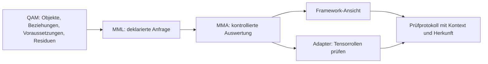

# Framework als konzeptionelle Schnittstelle

Die Schnittstelle stellt das Quantum-Sphaera-Framework als gemeinsamen, expliziten Kontext bereit. Einzelne Werkzeuge hängen daran. Der Tensorprüfer ist der erste Adapter.



## Was die drei Schichten bedeuten

| Schicht | Aufgabe in dieser ersten Schnittstelle |
|---|---|
| **QAM** | Benannte Zustände, Layer, Operatoren, Readouts, Branches, Shells, Witnesses und Tensoren speichern; Rollen, Indexräume, Voraussetzungen und Herkunft explizit zuordnen. |
| **MML** | Eine begrenzte Anfrage formulieren: `EXPORT` für die Framework-Ansicht oder `SCRUB` für das Register bzw. den Tensorrollen-Adapter. |
| **MMA** | Die Anfrage prüfen und `continue`, `guard` oder `reject` zurückgeben. Kontext, Anfrage, Quellen und Ergebnis werden gemeinsam im Protokoll festgehalten. |

Die Bezeichnungen und Grenzen folgen den vorhandenen QAM-Prädikat-, Store- und Tensorblöcken des Companion. Die JSON-Schemata sind eine technische Schnittstellenkonvention; sie ersetzen weder die QAM-Tuple-Tags noch die mathematischen Definitionen.

## Der gemeinsame Kontext

`examples/framework_context.json` enthält ein vollständiges Beispiel im Schema `qsc-framework-interface/2`:

Version 2 verwendet durchgehend SHA-512: 512 Bit bzw. 128 Hex-Zeichen. Protokolle benennen den Algorithmus als `hash_algorithm: "sha512"`. Ältere 64-stellige Elternverweise werden zurückgewiesen; alte Kontextdateien müssen auf das neue Schema umgestellt und Berichte neu berechnet werden. Ein alter Fingerabdruck darf nicht durch Auffüllen künstlich verlängert werden.

- `scope`: lokaler, beschränkter, effektiver oder readout-abhängiger Geltungsbereich mit Beschreibung.
- `qam.objects`: mathematische Objektbeschreibungen einschließlich Payload, Indexrollen, objektbezogenen Voraussetzungen und Quellenangabe.
- `qam.relations`: deklarierte Beziehungen `QClEq`, `QAdmTransport`, `QRead`, `QBranchRef`, `QShellRef` und `QTensorAdm`. Argumente müssen bekannte Objekte des passenden Typs referenzieren.
- `qam.guards`: Voraussetzungen mit `true`, `false` oder `null` und einer dokumentierten Begründung. `active_guards` gelten für den aktuellen Framework-Kontext.
- `qam.residuals`: Witness-Referenzen mit `open` oder `declared_zero`. Eine Null-Deklaration ist kein maschinell geprüfter Nullnachweis.
- `qam.spaces` und `qam.mask_universes`: die gemeinsamen Indexräume und endlichen Readout-Menüs.
- `provenance`: Quellenbeschreibung und optional ein Fingerabdruck eines früheren Kontextes. Ein solcher Verweis wird auf Format geprüft; ein nicht mitgelieferter Elternkontext wird nicht automatisch verifiziert.

**Mathematische Äquivalenz bleibt eine eigene Beziehung.** Gleiche Hashwerte oder Payloads erzeugen kein `QClEq`; unterschiedliche Darstellungen verhindern eine deklarierte Äquivalenz nicht. Die Schnittstelle berechnet keine Äquivalenzklassen und beweist keine Beziehungen.

## Anschluss des Tensorprüfers

Eine Anfrage im Beispiel `framework_tensor_request.json` verwendet:

```json
{
  "id": "audit_framework_tensor_roles",
  "instruction": "SCRUB",
  "guards": [],
  "arguments": {
    "view": "tensor_roles",
    "operations": [
      {
        "id": "state_tensor",
        "type": "tensor_product",
        "left": "X",
        "right": "Y",
        "guards": [],
        "admissibility_relation": "XY_admissible"
      }
    ]
  }
}
```

Hier wird die separat deklarierte Beziehung `QTensorAdm(X,Y)` für genau dieses Paar herangezogen. Ihre Begründung und ihre Voraussetzungen gehen in das Adapterprotokoll ein. Bei `null` bleibt die Zulässigkeit offen; eine Beziehung zu einem anderen Paar wird zurückgewiesen.

Aktive Kontextvoraussetzungen und Anfragevoraussetzungen gelten für alle Operationen. Objektvoraussetzungen werden nur an Operationen weitergegeben, die das jeweilige Objekt verwenden. Eine Voraussetzung einer früheren Einzeloperation wird nicht stillschweigend zur Voraussetzung späterer Operationen.

Allgemeine Objekt- oder Anfragevoraussetzungen ersetzen keine operationsbezogene Tensorzulässigkeit. Tensorprodukte benötigen eine passende `QTensorAdm`-Deklaration oder eigene explizite Zulässigkeitsannahmen. Gemischte Readouts benötigen explizite Kompatibilitätsannahmen. Der Adapter wertet diese Annahmen nicht mathematisch aus.

## Ausführen und ansehen

Python ab Version 3.10 genügt. Im Repository:

```powershell
python -B scripts/qsc_audit/framework_interface.py scripts/qsc_audit/examples/framework_context.json scripts/qsc_audit/examples/framework_export_request.json --output build/audit/framework_view.json
python -B scripts/qsc_audit/framework_interface.py scripts/qsc_audit/examples/framework_context.json scripts/qsc_audit/examples/framework_tensor_request.json --output build/audit/framework_tensor.report.json
python -B scripts/qsc_audit/framework_interface.py scripts/qsc_audit/examples/framework_context.json scripts/qsc_audit/examples/framework_tensor_request.json --verify build/audit/framework_tensor.report.json
python -B -m unittest discover -s scripts/qsc_audit/tests -v
```

Ohne `--output` erscheint das gesamte Ergebnis auf der Standardausgabe. Die erwarteten Berichte liegen unter `build/audit/`.

Programmatische Nutzung:

```python
from scripts.qsc_audit.framework_interface import FrameworkInterface

interface = FrameworkInterface(context)
receipt = interface.execute(request)
```

`interface.context` gibt eine unabhängige Kopie zurück. Anfragen verändern den gespeicherten Kontext nicht. Ein zukünftiger Store-/Transport-Adapter kann dieselbe Grenze nutzen, ist in dieser Version aber noch nicht implementiert.

## Aussage der Ergebnisse

- `continue`: Die unterstützte Anfrage und ihre deklarativen Prüfbedingungen passen. Das ist kein Closure- oder Zulässigkeitsbeweis.
- `guard`: Eine notwendige deklarierte Voraussetzung fehlt, ist offen oder ist als fehlgeschlagen eingetragen.
- `reject`: Die Anfrage, die Referenzen oder die unterstützte Tensorgrammatik passen nicht.

Offene Residuen bleiben auch dann sichtbar, wenn ein Grammatiktest `continue` ergibt. Register-`SCRUB` prüft die Aufzeichnung und deklarierte Guards, nicht die Wahrheit der eingetragenen Beziehungen oder das Verschwinden von Residuen. `EXPORT` zeigt den Kontext, auch bei offenen Guards; sein Status macht die offenen Voraussetzungen sichtbar.

Die Felder `closure_proved` und `mathematical_relations_proved` bleiben immer `false`. Fingerabdrücke verbinden Kontext, Anfrage, Implementierung und Quellen mit dem Ergebnis. Das erneute Berechnen überprüft die Integrität des Protokolls. Es verwandelt ein offenes oder zurückgewiesenes Ergebnis nicht in ein bestandenes.

Die Schnittstelle liest und prüft Daten. Sie verändert weder TeX-Quellen noch gespeicherte mathematische Payloads. Sie führt keine Shell-Kommandos, freien Ausdrücke, LLM-Aufrufe oder numerischen Operatoren aus. Unbekannte Befehle werden zurückgewiesen.

Exitcodes: `0` für `continue` bzw. ein exakt reproduziertes Protokoll; `1` für `guard`, `reject` oder einen abweichenden Bericht; `2` für ungültige Kontextdaten oder Dateifehler.
