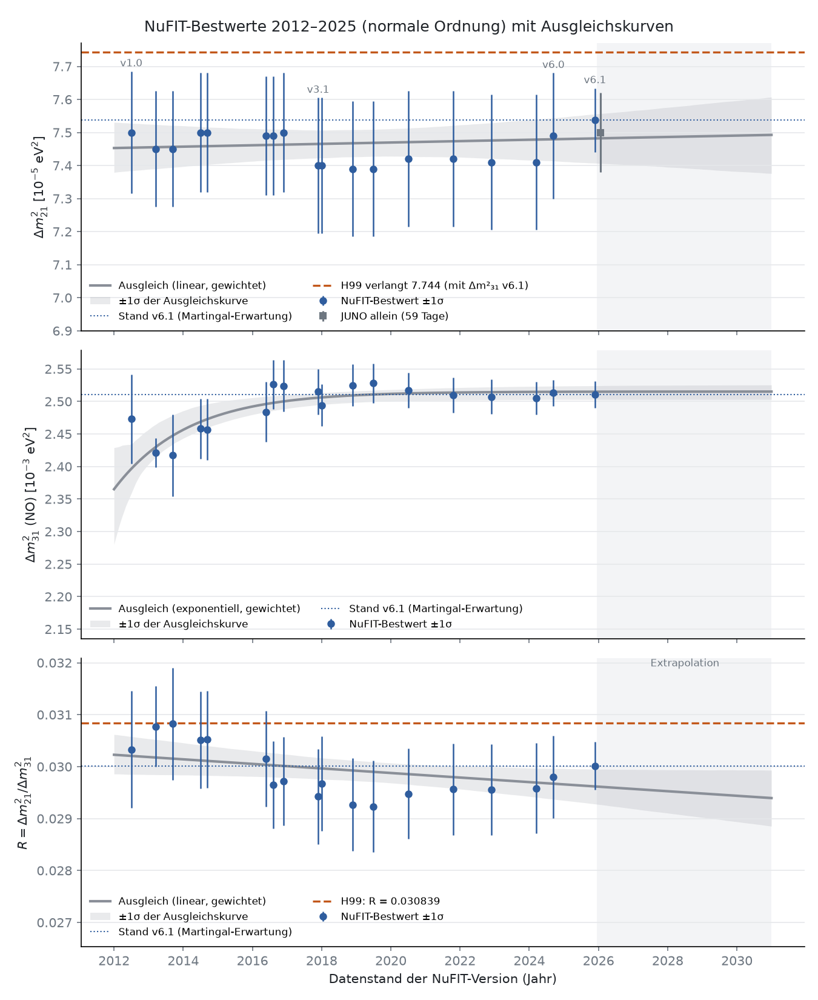

# Forschungsstand

### Rückwirkung über den HC-Winkel: hält κ ≈ 1,2 nicht fest (25.11.2026, Test H136, teilweise nicht blind, k305)

Nach H135 blieb eine Möglichkeit offen: κ könnte am HC-Winkel θ hängen, und die Schleife des HS(3)-Anhangs könnte θ zurückstellen. **Ergebnis: widerlegt.**

**Mit geeichter SU(2) gibt es die Rückwirkung nicht.** Auf der Vorstufe ist dann nur A = A₁ + B invariant; A₁ − B, also cos 2θ, ist es nicht. Ein ruhender Winkel ist Eichung (k299), keine Schleife hängt an ihm.

**Ohne SU(2) (nur U(1) links und rechts) gibt es sie, sie stabilisiert aber nicht.** Koppelt der Anhang verschieden an die beiden Teile, (κ₁A₁ + κ₂B)·C, und sollen die Schleifen allein den Winkel θ₀ = 16,8° halten und zugleich κ_eff = 1,204 liefern, dann gibt es genau eine Lösung: κ₁ = 1,321, κ₂ = −0,078. Sie braucht eine negative Kopplung, θ₀ ist dort ein Minimum der Vakuumtiefe (der Winkel liefe weg), und die Steigung dκ_eff/dθ = −0,77 hat das falsche Vorzeichen gegenüber der Regel κ = 1/cos 2θ (+1,59). Mit HC-Strafe η verschiebt die Schleife den Winkel nur um 0,0098·(κ₂ − κ₁)/η.

**Bilanz zum Wert von κ.** H133: Form festgelegt, Wert frei. k303: keine Regel mit Prinzip, ein Zahlentreffer. H135: kein fester Punkt, Tiefe monoton. H136: keine stabilisierende Rückwirkung. Der Zahlentreffer κ = (γ_L + 1/γ_L)/2 bleibt eine unerklärte Auffälligkeit. Offen ist nur noch eine Kopplung des Anhangs an den Strom der drehenden Lösung; sie bringt eine neue Skala mit und verlässt das skalenfreie Bild. Kein Guard berührt.

Ablage: `notes/research/hilbert_shift_felder_2026_11_24/feldgleichung/Ergebnis_H136_Rueckwirkung_HC_Winkel.md`, Vorab-Notiz `notes/research/predictions/Vorab_Notiz_H136_Rueckwirkung_HC_Winkel.md`, Skripte `k305_test_h136.py`, `k305b_gegenprobe.wl`.
### Test H134: Mit der Frame-Korrektur ist die TM1-Klasse mit JUNO verträglich, aber ohne Vorhersage (25.11.2026, teilweise nicht blind, k263)

Anlass war der Einwand des Autors zu k262, gemessen werde im verschobenen Frame. JUNO selbst benutzt keine Frames; der Einwand trifft die Vorhersageseite, die ohne erklärte Abbildung neben die Messung gestellt war. Frame-Abbildungen, die mit der Gruppe vertauschen (z ↦ iz, z ↦ z̄, der HC-Schatten z ↦ z + μ z̄ mit μ = β_sym²), können eine von der Restsymmetrie festgelegte Spalte nicht verschieben. Wirksam ist nur die Maske D = exp(ε W_l) mit ε = artanh β_sym = 0,6174 aus r57 und H45, die die Plätze unterscheidet und bisher nur auf TM2 angewandt war. Sie wurde unverändert auf die TM1-Klasse aus k262 angewandt, gegen JUNO 2026 (sin²θ₁₂ = 0,3036 ± 0,0064).

- **H134a bestätigt:** Wirkt die Maske auch auf die Neutrinos (Variante B), gibt es 56 Treffer mit θ₁₂ im JUNO-2σ-Bereich und θ₁₃, θ₂₃ in 3σ (32 davon in 1σ). Wirkt sie nur auf die geladenen Leptonen (Variante A), gibt es keinen, und θ₁₂ wird schlechter (≥ 0,346).
- **H134b widerlegt:** θ₂₃ und δ sind unter der Bedingung an θ₁₂ und θ₁₃ nicht scharf (Breiten 0,64 und 0,93).
- **H134c bestätigt:** Die Korrektur kann die Spannung ganz aufheben (Variante B).

„TM1 nach JUNO disfavorisiert“ gilt also nur für die unkorrigierte Spalte. Es bleibt eine Verträglichkeit mit freier Drehung φ und diskreten Wahlen, keine Vorhersage: Auch der Hopf-Wert von ε und die Klasse mit θ₁₃ = 0 treffen. In allen Treffern liegt θ₂₃ im oberen Oktanten (0,536 bis 0,583), während die TM2-Lesart mit derselben Korrektur [0,491; 0,498] gibt (H46). Kontrolle (i) war auf dem festgelegten 2°-Raster leer; ein nachträglicher Lauf mit 0,5° erfüllt sie und gibt dieselben Entscheidungen. OP3 und OP4 bleiben offen, kein Guard ist berührt. [Ergebnis](https://github.com/Moriarty1982/QuantumSphere-Unfold/blob/main/notes/research/predictions/Ergebnis_H134_Frame_Rapiditaet_TM1_JUNO.md)

### Ist κ ≈ 1,2 selbststabilisierend? In den geprüften Lesarten nein (25.11.2026, Test H135, teilweise nicht blind, k304)

Frage des Autors zum Zahlentreffer aus k303: Könnte das System bei diesem Wert selbststabilisierend sein, sodass der Wert unter vielen Möglichkeiten nur oft genug auftreten muss? Geprüft wurden zwei vorab festgelegte Lesarten. **Ergebnis: widerlegt in beiden.**

**Fluss.** Der Ein-Schleifen-Fluss der Skalare ist homogen vom Grad 2, feste Werte ungleich null gibt es nicht. Von κ = 1,2 aus wächst κ zu großen Skalen bis zum Pol bei 1,4·10⁴ GeV, und benachbarte Startwerte laufen auseinander. Es gibt keinen Einzugsbereich.

**Vakuumtiefe.** Wäre κ beweglich, liefe es dorthin, wo das Vakuum am tiefsten ist. Bei fester Skala Λ ist die Tiefe proportional zu F(κ) = B·exp(−2A/B). Ohne Eichfelder und Top ist F für jedes κ gleich e³/(16π²). Mit ihnen steigt F monoton von 0 bei κ = 0,416 gegen diesen Wert (58 % bei κ = 1,2, 90 % bei κ = π). Es gibt kein inneres Maximum, κ liefe zu immer größeren Werten.

**Häufigkeit.** Ein Vakuum entsteht für jedes κ zwischen 0,416 und der Unitaritätsgrenze π, bei gleichverteiltem κ in 87 % der Fälle. Das System startet also fast immer, aber m_h liegt dann irgendwo zwischen 0 und 345 GeV, und nur 2,7 % der Werte geben 120 bis 130 GeV.

Was fehlt, ist eine Rückwirkung. Sie entstünde, wenn der HC die SU(2) bricht und der HS(3)-Anhang an Vorstufe und HS(2)-Anhang verschieden koppelt; dann verschiebt seine Schleife den HC-Winkel θ, und κ = 1/cos 2θ könnte ein fester Punkt dieser Schleife sein. Das ist nicht gerechnet. Kein Guard berührt.

Ablage: `notes/research/hilbert_shift_felder_2026_11_24/feldgleichung/Ergebnis_H135_Kappa_selbststabilisierend.md`, Vorab-Notiz `notes/research/predictions/Vorab_Notiz_H135_Kappa_selbststabilisierend.md`, Skripte `k304_test_h135.py`, `k304b_gegenprobe.wl`.

### Rückwärtssuche nach einer Regel für κ ≈ 1,2: keine Regel, ein Zahlentreffer (25.11.2026, Erkundung, nicht blind, k303)

Nach H133 ist der Wert der Kopplung κ zwischen Vorstufe und HS(3)-Anhang frei, nötig wäre κ* = 1,204. Die Rückwärtssuche hält zuerst die notwendige Bedingung fest: 16κ² = 8π²·m_h²/v² − (3/8)g⁴ − (3/16)(g² + g′²)² + 3y_t⁴. Eine Regel für κ ist im skalenfreien Bild also eine Vorhersage der Higgs-Masse.

**Regeln mit einem Prinzip dahinter treffen nicht.** Die volle Norm gibt κ = 0 (kein Minimum), Sp M⁴ = 0 gibt m_h = 0, die Veltman-Bedingung gibt κ ≈ 0,6 und m_h zwischen 32 und 49 GeV, die gesättigte Unitaritätsgrenze gibt κ = π und 345 GeV, und einen festen Punkt von κ mit Eichfeldern und Top gibt es nicht. Auch die Eichfelder der eigenen su(2) des Anhangs tragen nicht (24 GeV statt 312 GeV).

**Ein Zahlentreffer.** Unter 42 Kandidaten aus den HC-Zahlen liegt genau einer im Fenster: κ = 1/cos 2θ = (γ_L + 1/γ_L)/2 = 1,2004, das sind −0,29 % zum Ziel und m_h = 124,8 GeV. Bei dieser Suche ist etwa ein Zufallstreffer zu erwarten, die Ein-Schleifen-Formel ist nur auf einige Prozent genau, und γ_L ist eingesetzt (OP1). Der Treffer ist deshalb kein Beleg. Als Lesart: 1/cos 2θ ist auf der HC-Richtung das Verhältnis von Linksladung zu Rechtsladung (k292). Eine Herleitung dafür fehlt; erst mit ihr wäre ein blinder Test möglich (H135 frei).

Ablage: `notes/research/hilbert_shift_felder_2026_11_24/feldgleichung/Rueckwaertssuche_kappa_k303.md`, Skripte `k303_rueckwaerts_kappa.py`, `k303b_gegenprobe.wl`.

### Der Anhang von HS(3): Form der Kopplung festgelegt, Wert frei (25.11.2026, Test H133, teilweise nicht blind, k302)

Nach k300 fehlen der Schleifen-Skala schwere Bosonen, und der Anhang ℍ → 𝕆 bringt vier neue reelle Felder mit. H133 fragte, ob der Turm ihre Kopplung an die Vorstufe so festlegt, dass 125 GeV herauskommen. **Ergebnis: nicht bestätigt. Die Form ist festgelegt, der Wert nicht.**

**Form.** Mit ψ = a + b·ℓ, A = N(a), C = N(b) wirkt die Linksmultiplikation mit einer Einheit p von ℍ als p(a + bℓ) = pa + (bp)ℓ, die Rechtsmultiplikation als (a + bℓ)q = aq + (b·q̄)ℓ. Auf dem Anhang b sind beides Rechtsmultiplikationen und vertauschen nicht. Die Linksmultiplikationen bilden auf 𝕆 keine SU(2) mehr (Abschluss Dimension 6), zusammen mit der Rechts-U(1) entsteht su(2) ⊕ u(1) auf a und eine eigene su(2) nur auf b (Dimension 7). Invariant sind nur A und C, im Grad 4 nur A², AC, C². Es gibt also genau einen gemischten Term κ·A·C, und die vier neuen Felder haben dieselbe Masse m² = 2κv². Terme, die in einem gewöhnlichen Modell mit zwei Dubletts die Massen aufspalten, sind durch die Nicht-Assoziativität verboten.

**Wert.** Nötig wären vier Felder bei 382 GeV, also κ ≈ 1,20. Keine Regel des Turms liefert das: Die volle Norm gibt masselose neue Felder, die HC-Strafe gibt κ = −2ημ² mit freiem η, und der Fluss mit einer Schleife (16π²·dκ/dt = 16κ(κ + 3λ_A + 3λ_C)) hat als feste Strahlen nur κ = 0 und die volle Norm. Nachträglich gefunden: Verlangt man die fortgesetzte schwache Wirkung und die Farb-su(3) zugleich, erzeugen beide so(8), und es bleibt nur die volle Norm, also wieder masselose Felder.

**Tragfähigkeit.** Mit κ = 1,20 überschreiten die Kopplungen 4π bei 1,4·10⁴ GeV (günstigster Fall λ_C(v) = 0), sonst schon unter 3 TeV. Das Bild wäre höchstens bis etwa 14 TeV gültig.

Andere Lesarten der Symmetrie geben 6 entartete Felder bei 345 GeV (su(3), ein farbiges Triplett) oder 7 bei 332 GeV (g₂). Grenzen: eine Schleife, Fluss nur mit Skalaren, Massen aus dem Gedächtnis, keine Beschleuniger-Schranken geprüft. Kein Guard berührt.

Ablage: `notes/research/hilbert_shift_felder_2026_11_24/feldgleichung/Ergebnis_H133_Anhang_HS3_Kopplung.md`, Vorab-Notiz `notes/research/predictions/Vorab_Notiz_H133_Anhang_HS3_Kopplung.md`, Skripte `k302_test_h133.py`, `k302b_gegenprobe.wl`.

### Die Schleifen-Skala von 9,8 GeV: es fehlen schwere Bosonen (25.11.2026, Erkundungen, nicht blind, k300, k301)

Frage des Autors nach k299: Sind die 9,8 GeV statt 125 GeV schlimm, und warum klingt die Zahl nach g? Die Formel m_s² = [Σ_Bosonen n·m⁴ − Σ_Fermionen n·m⁴]/(8π²v²) enthält nur gemessene Massen und v, keine Setzung dieses Fadens. Mit W und Z allein kommt 9,78 GeV heraus (Faktor 12,8 in der Masse, 164 im Massenquadrat). Mit dem Top-Quark wird die Summe negativ (m_s² = −2129 GeV²), es gibt dann kein Minimum. Für 125,2 GeV fehlen an Bosonen 8,52·10¹⁰ GeV⁴, das sind zum Beispiel vier reelle Felder bei 382 GeV (eines: 540, acht: 321). Vier reelle Komponenten bringt der nächste Anhang ℍ → 𝕆 mit. Das ist eine Bedingung unter zwei Voraussetzungen (Skala nur aus Schleifen, Feld = elektroschwaches Feld), keine Vorhersage. Massen aus dem Gedächtnis eingesetzt.

Die Ähnlichkeit mit g = 9,81 m/s² ist ein Zufall der Einheiten: Sie besteht nur in GeV und m/s² (dieselbe Masse ist 10,4 Protonmassen, dieselbe Beschleunigung 32,2 ft/s²), g ist GM/R² der Erde und keine Naturkonstante, und ohne Einheiten verglichen liegen die Größen um den Faktor 4,5·10³² auseinander.

Fassung F des HC am ruhenden Knoten aus k291 (k301): Der Knoten verteilt seinen Strom gleichmäßig auf die drei inneren Richtungen (⟨S_i⟩ = S_ges/3). Das T, bei dem er am wenigsten kostet, liegt immer zwischen 5/3 und 3, mit dem Profil bei 2,91. Der HC-Wert T = 1/cos²2θ = 1,441 liegt darunter; dort kostet der Knoten das 9,2-fache des Minimums. In Fassung F würde der HC den Knoten also verformen. Die verformte Lösung ist nicht gerechnet. OP1, OP3, OP4, OP5 bleiben offen.

Ablage: `notes/research/hilbert_shift_felder_2026_11_24/feldgleichung/Skala_9_8_GeV_und_Igel_k300.md`.

### Der HC als Bedingung an den Strom verträgt sich mit SU(2) (25.11.2026, Erkundung, nicht blind, k299)

Anschluss an H132. Unter SU(2) links ist der Winkel zwischen Vorstufe und Anhang Eichung, ein Potential kann nur von der vollen Norm abhängen, und die Fassung η(B − μ²A)² aus k297 ist deshalb nicht möglich. Invariant ist der Strom J = ψ̄·Dψ. Auf der Lösung ψ = e^{iωt}(a + b·j) ist J_i = ω(a² − b²) und |J_⊥| = 2abω, das Verhältnis 2μ/(1 − μ²) = (K − 1/K)/2 ist die Form der Ellipse in eichinvarianter Schreibweise (mit γ_L: 0,664).

Zwei Fassungen. **F (Form der Bewegung):** P = η₂(|J_⊥|² − τ²J_i²)²/N², invariant unter SU(2) links und U(1) rechts. Im Vakuum vierter Ordnung in den Eichfeldern, also keine Massen: Licht bleibt masselos, ρ = 1, Spektrum wie k291. Die Lösung mit b = μa bleibt exakt, Abweichungen kosten Energie nur am drehenden Feld. **S (Stauchung):** Zusatzterm ξ·J_i²/(2N), die entlang der Hopf-Faser gestauchte S³. Licht bleibt masselos, aber m_Z² bekommt den Faktor 1 + ξ und ρ = 1/(1 + ξ). Für jede naheliegende Zuordnung (1 + ξ = γ_L^{±1}, γ_L^{±2}, 1 + μ², 1/cos²2θ) liegt ρ zwischen 0,29 und 3,5 statt bei 1,0004 ± 0,0002 (Messwert aus dem Gedächtnis). Fassung S fällt durch, falls das Feld das elektroschwache ist.

Die Spannung aus H129 und H132 löst sich in Fassung F: Der HC ist dann eine Bedingung an die Bewegung, nicht an das Vakuum. Verloren geht das Bild aus k297 (HC als flache Richtung, Schleife gibt die Skala). Die Skala käme nur aus V(N) und den Eichfeld-Schleifen, das gäbe den bekannten Coleman–Weinberg-Wert von etwa 9,8 GeV statt 125 GeV. Beide Fassungen sind Setzungen. Gegenprobe in Wolfram Language (k299b). OP1, OP3, OP4, OP5 bleiben offen.

Ablage: `notes/research/hilbert_shift_felder_2026_11_24/feldgleichung/HC_SU2_vertraeglich_k299.md`.

### Welche Setzung aus H131 trägt die Spannung? Der Träger der Neutrinos (25.11.2026, Erkundung, nicht blind, k262)

Anschluss an H131. Die 24 Elemente aus k260 mischen den Realteil s_k und die Ladungsrichtung v_k der drei Einträge nicht. Auf s wirkt eine reelle vorzeichenbehaftete Permutation A, auf v wirkt +A (12 gerade Elemente) oder −A (12 ungerade). Auf s allein ist die Gruppe also die volle S₄, linear und reell; antilinear werden die ungeraden Elemente erst auf dem komplexen Triplett z = s + i·v. Gerechnet sind alle 900 Paare von Untergruppen (G_e, G_ν) in zwei Lesarten.

- **Lesart A (wie H131, Neutrinos auf z):** Keine Klasse hat die feste Spalte (2/3, 1/6, 1/6). Feste Spalten sind nur (1/3, 1/3, 1/3), (0, 1/2, 1/2), (1/4, 1/4, 1/2) und (0, 0, 1).
- **Lesart B (Majorana-Neutrinos auf s, reelle Massenform):** ℤ₃ mit einer ungeraden ℤ₂ gibt zwei Klassen zu je 12 Paaren. Die eine hat die TM1-Spalte (2/3, 1/6, 1/6) mit sin²θ₂₃ = 0,5 und |sin δ| = 1 (bei sin²θ₁₃ = 0,022 ist sin²θ₁₂ = 0,3183), die andere die Spalte (0, 1/2, 1/2), also θ₁₃ = 0 (ausgeschlossen). Wolfram exakt: Spalte {2/3, 1/6, 1/6}, und die μτ-Spiegelung gilt für jede reelle Form.

Die Spannung aus H131 sitzt damit nicht in der Gruppe und nicht in „Kopie k auf Platz k“, sondern in der Wahl des Trägers der Neutrinos. Lesart B ist das Muster von H8 (und k256), jetzt aus derselben Gruppe wie H131. Eine Rettung ist das nicht: H8 und TM1 (H4) stehen im Register als „nach JUNO disfavorisiert“; ein eigener Datenvergleich ist nicht gerechnet. Offen bleiben diskret die Wahl der ungeraden ℤ₂ (dieselbe Zweiteilung wie in k280) und das Vorzeichen von sin δ. Der Träger ist eine Setzung wie die übrigen (Plätze als Generationen, ℤ₃, ℤ₂, Majorana). OP3 und OP4 bleiben offen, kein Guard ist berührt. Notiz: `notes/research/hilbert_shift_felder_2026_11_24/setzungen_k262/README.md`.

### H132: Auf der HC-Richtung bleibt kein Eichfeld masselos (25.11.2026, Test, teilweise nicht blind, k298)

Frage nach k297: Bleibt mit den Eichfeldern der Symmetrie des HC-Potentials (U(1) links × U(1) rechts) auf der HC-Richtung ψ₀ = f(cos θ + sin θ·j), tan θ = β_sym², ein masseloses Eichfeld, und hängt das Massenverhältnis nur an β_sym? Vorab-Notiz vor der Rechnung committet, mit einem Überschlag, der das Ergebnis weitgehend festlegte. **Urteil: widerlegt.** Die Determinante der Massenmatrix ist 4g_L²g_R²·A·B, also ungleich null, sobald Vorstufe und Anhang beide da sind. Das Verhältnis hängt allgemein an g_R/g_L; für gleiche Kopplungen ist es exakt m₋/m₊ = μ = β_sym² = 0,3018 (trägt teilweise). Für kleines μ ist m₋² = 4e²μ²f²: Der Anhang gibt dem sonst masselosen Feld eine Masse proportional zu seiner Amplitude.

Mit SU(2) links × U(1) rechts (wie k291) bleibt auf jeder Richtung ein Feld masselos, aber das HC-Potential η(B − μ²A)² ist nicht SU(2)-invariant. Masseloses Licht und das HC-Potential vertragen sich in dieser Übersetzung nicht, dieselbe Spannung wie in H129. Offen ist eine Übersetzung des HC, die mit SU(2) links verträglich ist (die quadratische Strafe war eine Setzung). Gegenprobe in Wolfram Language (k298b). OP1, OP3, OP4, OP5 bleiben offen.

Ablage: `notes/research/hilbert_shift_felder_2026_11_24/feldgleichung/Ergebnis_H132_Eichfelder_HC.md`, Vorab-Notiz `notes/research/predictions/Vorab_Notiz_H132_Eichfelder_HC_Richtung.md`.

### Der HC gibt die Form vor, die Schleife die Größe (25.11.2026, Erkundung, nicht blind, k297)

Anschluss an H129: Bricht der HC die Tauschsymmetrie zwischen Vorstufe und Anhang? Ja. Der Tausch (Rechtsmultiplikation mit j) vertauscht die beiden Kreisanteile a und b und wirkt auf den Beltrami-Koeffizienten des HC als μ → 1/μ. Das ist die Orientierungsumkehr, die r23 als Tachyon-Frame führt. Der HC mit μ = β_sym² < 1 zeichnet die Vorstufe als den größeren Teil aus (91,65 % der Norm, Anhang 8,35 %). Die Tauschsymmetrie ist also die bekannte Wahl zwischen Materie-Frame und Tachyon-Frame; hergeleitet wird diese Wahl nicht.

Schreibt man die HC-Bedingung B = μ²A als Potential, V = η(B − μ²A)² = ημ⁴A² − 2ημ²AB + ηB², dann sind das genau die nach k295 zulässigen skalenfreien Terme, mit κ < 0 und genau auf der Stabilitätsgrenze κ = −2√(λ_Aλ_B). Auf der Richtung B = μ²A ist V = 0 für jede Größe f: Die Form ist fest, die Größe frei (k292, k272). Massen: zwei Phasen und die Größenmode null, die Formmode m_H² = 8ημ²f². Die Schleife legt dann die Größe fest (f² = e·M²/(8ημ²)) und gibt der Größenmode m_s² = (ημ²/π²)·m_H², mit μ = β_sym² also 0,00923·η·m_H². Das ist die Klasse (iv) aus H129, die einzige, in der immer eine Skala entsteht.

Mit dem HC als Bedingung sind zwei Vorzeichen nicht mehr frei: κ < 0 und die erzeugte Skala als feste Amplitude. Frei bleiben η, die Zahl β_sym (OP1) und die Wahl des Frames. Unter dem Fluss ist das Verhältnis nicht fest (16π²·dρ/dt = 64λ_Aρ(ρ − 1) für ρ = μ⁻⁴): Die Schleifen erzeugen β_sym nicht. Die quadratische Strafe ist eine Setzung (einfachste Übersetzung der linearen Projektion). Eine Schleife, ohne Eichfelder. Gegenprobe in Wolfram Language (k297b). OP1, OP3, OP4, OP5 bleiben offen.

Ablage: `notes/research/hilbert_shift_felder_2026_11_24/feldgleichung/HC_Tauschsymmetrie_k297.md`.

### Test H131: S₄ mit der Ladung als verallgemeinerter CP gibt eine einzige Klasse, aber ohne CP-Verletzung (25.11.2026, teilweise nicht blind, k261)

Anschluss an k260. Die 24 Elemente der Würfelgruppe wirken auf das Triplett der drei Plätze als 12 lineare (A₄) und 12 antilineare Abbildungen; die antilinearen sind Platzvertauschungen mit Vorzeichen zusammen mit der Konjugation der Ladung. Angesetzt wie in H39: ℤ₃ für die geladenen Leptonen, ℤ₂ und eine CP-Abbildung X für Majorana-Neutrinos (Vorab-Notiz 875e6d4). **H131a bestätigt:** Alle 48 zulässigen, nicht entarteten Kombinationen fallen in eine Klasse; die übrigen 48 (X der Ordnung 4) erzwingen zwei gleiche Neutrinomassen. **H131b widerlegt:** In dieser Klasse ist J = 0. Die CP aus der Ladung gibt δ = 0 oder 180° und kein maximales θ₂₃. Wolfram exakt: Die Majorana-Matrix ist in der Basis der geladenen Leptonen reell.

Nachträglich gerechnet: TM2 mit sin²θ₁₂ = 0,341 und sin²θ₂₃ = 0,395 oder 0,605 bei sin²θ₁₃ = 0,022. Die Lesart ist damit scharf, steht aber schlecht da: Die Spalte ist nach H39 schon 3,6σ von JUNO entfernt, θ₂₃ liegt weit von 45° (gegen H46, der obere Wert auch gegen H42), und mit H8 (δ = 270°, θ₂₃ maximal) ist sie nicht vereinbar. Getroffen sind die Setzungen dieser Lesart (Kopie k auf Platz k, ℤ₃ und ℤ₂ wie H39, Majorana), nicht H128 und H130. Ein Vergleich mit aktuellen globalen Fits für θ₂₃ und δ ist nicht gerechnet. OP3 und OP4 bleiben offen, kein Guard ist berührt. Notizen: `notes/research/predictions/Ergebnis_H131_S4_Ladung_CP_Mischung.md`, Skripte in `notes/research/hilbert_shift_felder_2026_11_24/mischung_h131/`.

### H129: Schleifen können die Skala erzeugen, legen aber den Anhang nicht fest (25.11.2026, Test, teilweise nicht blind, k296)

Frage nach k295: Erzeugt der skalenfreie Ansatz V = λ_A·A² + κ·A·B + λ_B·B² (μ² = 0) bei einer Schleife von selbst eine Skala im Anhang? Vorab-Notiz mit Kriterien vor der Rechnung committet; die Tauschsymmetrie Vorstufe ↔ Anhang und ein Überschlag waren dort offengelegt. **Urteil: nicht bestätigt.** Die Skala entsteht auf 67,8 % des Gitters (2668 von 3936 Punkten, „trägt teilweise“), im Anhang aber nur bei 29,5 % davon, genau so oft wie in der Vorstufe (widerlegt).

Die β-Funktionen sind 16π²·dλ_A/dt = 4(κ² + 20λ_A²), 16π²·dκ/dt = 16κ(κ + 2λ_A + 2λ_B), dλ_B entsprechend. Für κ < 0 entsteht immer eine Skala mit beiden Anteilen (der Fall a, b ≠ 0 aus k292). Für großes κ > 0 wird die kleinere der Kopplungen λ_A, λ_B zuerst null, und dieser Teil bekommt die feste Amplitude. Für 0 < κ ≲ 2√(λ_Aλ_B) fließt alles zum Potential der vollen Norm λ(A + B)², ohne Skala. Der Zusatzterm K₂ zeichnet bei einer Schleife die drei imaginären Richtungen aus (z = 24·c₂·J gegen 0), nicht den Anhang; K₁ behandelt alle vier gleich.

Was bleibt: Wo eine Skala entsteht, entsteht sie als feste Amplitude (wie μ² < 0), nie als gewöhnliche Masse. Dieses eine Vorzeichen folgt aus der Rechnung, solange man skalenfrei rechnet. Welcher Teil kondensiert, bleibt eine freie Zahl. Ohne die Kopplung κ gibt es keine Schleifen-Skala, mit κ > 0 wird die Vorstufe massiv (m² = κ⟨B⟩); „Licht bleibt masselos“ aus k295 und „Skala von selbst“ schließen sich in diesem Modell aus. Eine Schleife, ohne Eichfelder, nur ℂ → ℍ. Gegenprobe in Wolfram Language (k296b) stimmt genau. OP1, OP3, OP4, OP5 bleiben offen.

Ablage: `notes/research/hilbert_shift_felder_2026_11_24/feldgleichung/Ergebnis_H129_Schleifen_Skala.md`, Vorab-Notiz `notes/research/predictions/Vorab_Notiz_H129_Schleifen_erzeugen_Skala_im_Anhang.md`.

### Die erste Skala steht im Anhang von HS(2) (25.11.2026, Erkundung, nicht blind, k295)

Anschluss an k294: Tritt das Amplituden-Potential erst bei HS(2) ein? In der vollen Norm geht das nicht. λ(N − f²)² ist auf der Vorstufe nicht null und enthält dort den Massenterm −2λf²·N(ψ₁). Verlangt man die Rekursion (der Anhang verschwindet ohne χ) und die Vorgabe „keine Masse auf HS(1)“ zusammen, bleiben bis zur vierten Ordnung genau drei Terme: B, A·B und B² mit A = N(ψ₁), B = N(χ) (17 Monome, 3 invariant unter Links- und Rechtsdrehung um i, 5 nur unter der Linksdrehung). Im Potential V = λ_A·A² + κ·A·B + λ_B·B² + μ²·B ist μ² die einzige Größe mit Massendimension. Die Skala f tritt also zum ersten Mal im Anhang von HS(2) auf (Lesart A aus k291).

Für μ² > 0 ist der Anhang ein gewöhnliches massives Feld. Für μ² < 0 bekommt er eine feste Amplitude: bei κ ≥ 0 liegt sie ganz im Anhang (B = −μ²/(2λ_B), Radialmode m² = −4μ², Vorstufe m² = −κμ²/λ_B), bei κ < 0 und κ² < 4λ_Aλ_B sind beide Anteile ungleich null mit A/B = −κ/(2λ_A). Für κ = 0 bleibt das Feld von HS(1) masselos, obwohl der Anhang eine feste Amplitude hat. Die Lösung im Anhang aus k292 ist am Minimum exakt, ihre Amplituden sind dann festgelegt (in k272 waren sie frei). Ohne Kondensat wachsen die langen Wellen des Anhangs (q² < −2(μ² + κA)), passend zur Schwelle aus k294.

Das Vorzeichen von μ² ist in dieser Schreibweise das offene Vorzeichen des σ-Terms aus k282 (Lesart). Die Rekursion lässt beide zu. λ_A, λ_B, κ, μ² sind freie Parameter, gerechnet ist klassisch und ohne Eichfelder. Offen: ob Schleifen der Zusatzterme μ² mit bestimmtem Vorzeichen erzeugen. Gegenprobe in Wolfram Language (k295b). OP1, OP3, OP4, OP5 bleiben offen.

Ablage: `notes/research/hilbert_shift_felder_2026_11_24/feldgleichung/Potential_im_Anhang_k295.md`.

### Feste oder schwankende Norm: eine scharfe Schwelle in der Wellenzahl (25.11.2026, Erkundung, nicht blind, k294)

Anschluss an k293. Mit einem Potential λ(N − f²)² und dem gegenläufigen Anteil unter dem Winkel θ zwischen ℂ und Anhang, ψ = a·e^{ip₁} + b·(cos θ + j·sin θ)·e^{−ip₂}, ist die gemittelte Energie in erster Ordnung linear in sin²θ: E/a²b² = 2λ + ½c₁Q + sin²θ·[(½c₁ + 2c₂)·Q − 2λ] mit Q = k²k′²·(4 − (1 + cos α)²). Das Minimum liegt deshalb immer an einem Ende. Für Q < 4λ/(c₁ + 4c₂) liegt der Anteil ganz im Anhang (feste Norm), darüber ganz in ℂ (schwankende Norm). Lange Wellen sehen also die feste Norm, kurze nicht; die beiden Lesarten A und B aus k291 sind zwei Bereiche derselben Gleichung. In den Größen aus k291 liegt die Schwelle bei (k_c·r₀)⁴ = (m_r·r₀)²/(8(1 + 4c₂/c₁)) mit der Radialmode m_r² = 8λf² und der Knotengröße r₀. Die Lösung im Anhang ist mit Potential exakt, die in ℂ nur in erster Ordnung gerechnet. Die Schwelle hängt an drei freien Koeffizienten, das Potential ist gesetzt, und woher f kommt, bleibt offen. sympy und Wolfram unabhängig. Ablage: `notes/research/hilbert_shift_felder_2026_11_24/feldgleichung/Schwelle_feste_Norm_k294.md`.

### Der gegenläufige Anteil wandert nicht von selbst in den Anhang (25.11.2026, Erkundung, nicht blind, k293)

Anschluss an k292: Muss der gegenläufige Kreisanteil bei HS(2) in die neue Richtung j wandern, sodass die Norm fest wird? Verglichen wurden zwei Lösungen der freien Gleichung mit verschiedenen Laufrichtungen, ψ = a·e^{ip₁} + b·e^{−ip₂} (Anteil in ℂ) und ψ = a·e^{ip₁} + (b·j)·e^{−ip₂} (Anteil im Anhang). Die freie Energie ist gleich. Die gemittelte Energie des Flächenterms K₁ ist im Anhang doppelt so groß (a²b²k²k′²·W gegen die Hälfte, mit W = 4 − (1 + cos α)²), und der Kommutatorterm K₂ trägt nur dort bei (2·a²b²k²k′²·W). Der Unterschied ist (½c₁ + 2c₂)·a²b²k²k′²·W und verschwindet für parallele Wellen. Mit positiven Koeffizienten kostet das Wandern also Energie, und das positive c₁, das die Ruhemasse bei HS(2) braucht (k291), spricht dagegen.

Der Übergang zur festen Norm folgt damit nicht aus den Zusatztermen. Der einzige Baustein des Ansatzes, der ihn bevorzugt, ist ein Potential, das Schwankungen der Norm bestraft: Die Lösung in ℂ hat die Streuung 2a²b², die im Anhang keine. Welche Lösung gewinnt, hängt an freien Koeffizienten. Das Ergebnis ließ sich beim Festlegen des Kriteriums ablesen, deshalb Erkundung; H129 bleibt frei. Gerechnet in erster Ordnung auf ebenen Wellen, sympy und Wolfram unabhängig. Ablage: `notes/research/hilbert_shift_felder_2026_11_24/feldgleichung/Anhang_Energie_k293.md`.

### Drei Oktonion-Kopien auf drei Plätzen: S₄, mit der Ladung A₄ (25.11.2026, Erkundung, nicht blind, k259, k260)

Anschluss an H130. **Vollständigkeit (k259):** Die Abschlussbedingung für farbstabile Unteralgebren der Sedenionen ist ein Polynomsystem; Wolfram (Reduce über ℝ) gibt als vollständige Lösungsmenge genau die drei Oktonion-Kopien O_0, O_120, O_240 und die zwei nicht alternativen Algebren B_±. H130 hängt damit nicht mehr an Zufallsstarts. **Kopien auf Plätzen (k260):** Legt man die Kopie k auf den Platz k von H₃(𝕊), dann bleibt von (Würfeldrehungen) × S₃ eine Gruppe mit 24 Elementen und den Ordnungen von S₄; stetig bleibt nur g₂. Jede Platzvertauschung braucht die passende Vertauschung der Kopien. Mit der Ladung je Platz in der Richtung der jeweiligen Kopie vertauschen 12 Elemente, das ist A₄; die anderen 12 erhalten die Ladung bis auf Vorzeichen und den Tausch von Links- und Rechtsmultiplikation. Die Massenform K bleibt 60 zu 54.

Einordnung: Eine endliche Familiengruppe entsteht hier schon ohne die Ladung, aus den drei Kopien, die HS(4) mitbringt. Die Zuordnung „Kopie k auf Platz k“ ist aber eine Setzung, und der zugehörige Teilraum ist keine Unteralgebra (Abschlussdefekt 0,31). Eine Mischungsmatrix ist nicht gerechnet. OP3 und OP4 bleiben offen, kein Guard ist berührt. Notiz: `notes/research/hilbert_shift_felder_2026_11_24/drei_kopien_k259/README.md`.

### Test H130: Die Ladungsrichtung liegt senkrecht zur Verdopplungseinheit, 9/10 ist festgelegt (25.11.2026, teilweise nicht blind, k258)

Anschluss an H128. Offen war, was den Winkel zwischen Ladungsrichtung u und Verdopplungseinheit e₈ festlegt, von dem das Massenverhältnis r = 1 − (1 − u₈²)/10 abhängt. Vorab festgelegte Forderung (3137c5f): Eine Generation soll in 𝕊 so gebaut werden können wie bei HS(3), also mit einem oktonionischen Träger, auf dem die Farbe su(3)_c als 1 ⊕ 1 ⊕ 3 ⊕ 3̄ wirkt. Die Suche (600 Zufallsstarts, alle konvergent) findet genau drei Klassen abgeschlossener farbstabiler Unteralgebren: die Kopie O_0 mit u = e₇, die Kopien O_120 und O_240 mit u = −½e₇ ± (√3/2)e₁₅, und zwei Algebren B_± mit u = e₈. Wolfram exakt: Die drei Kopien sind alternativ und normmultiplikativ, B_± sind es nicht. **H130a und H130b bestätigt:** Oktonionische Träger gibt es nur bei u₈ = 0.

Lesart: Zusammen mit H128 ist die Brechung SU(3) → SO(3) erzwungen, sobald eine Generation verlangt wird, und das Verhältnis von Spin 1 zu Spin 2 in der Form K ist 9/10 ohne Wahl von u. Die Ladung, die die Farbe auswählt, und die Brechung der Familiensymmetrie hängen an derselben Bedingung u ≠ ±e₈. Gesetzt bleiben die Forderung selbst, die Form K und ihr Vorzeichen im Potential (offen bis zur Feldgleichung). Die Vollständigkeit der Suche beruht auf Zufallsstarts, nicht auf einem Beweis. OP3 und OP4 bleiben offen, kein Guard ist berührt. Notizen: `notes/research/predictions/Ergebnis_H130_Ladungsrichtung_Verdopplungseinheit.md`, Skripte in `notes/research/hilbert_shift_felder_2026_11_24/ladungsrichtung_h130/`.

### Der HC legt die Form der HS(1)-Ellipse fest, nicht die Amplitude (25.11.2026, Erkundung, nicht blind, k292)

Frage des Autors: Gilt eher Lesart A (Amplitude f entsteht bei HS(2)) oder B (f liegt schon bei HS(1) fest, etwa durch den HC)? Der HC ist im Bestand eine quasikonforme Projektion mit Beltrami-Koeffizient μ = β_sym² und Dilatation γ_L. Die HS(1)-Ellipse a·e^{iωt} + b·e^{−iωt} ist die Abbildung z → a·z + b·z̄ mit μ = b/a und K = (a + b)/(a − b). Der HC legt also b/a = 0,3018 und das Achsenverhältnis 1,8644 fest und lässt die Größe frei; als lineare Abbildung kann er keine Amplitude auszeichnen. Die Norm ist bei HS(1) nicht fest, N = a² + b² + 2ab·cos 2ωt, und ein auf der Ellipse festgehaltenes Feld verträgt sich mit der Regel ψ̈ = −ω²ψ nur für ab = 0. Das spricht für A: Das Licht von HS(1) bleibt masselos.

Ein Teil von B bleibt richtig. Bei HS(2) kann der gegenläufige Anteil in die neue Richtung wandern: ψ = a·e^{iωt} + (b·j)·e^{−iωt} = e^{iωt}(a + b·j) hat die feste Norm a² + b², erfüllt ψ̇ = ωiψ und hat als Schatten in ℂ die alte Ellipse. Die Ladung der Rechtsdrehung ist ω(a² − b²), die von HS(1). Die Skala f² = a² + b² ist also bei HS(1) als Zeitmittel schon da und wird im nächsten Schritt zur festen Norm, an der die Ruhemasse und die Eichfeldmassen aus k291 hängen. Das ist eine genaue Fassung der „Protomasse“. Geprüft mit sympy und unabhängig mit Wolfram. Nicht gezeigt ist, dass der gegenläufige Anteil in den Anhang wandern muss; β_sym bleibt eingesetzt (OP1 offen). Ablage: `notes/research/hilbert_shift_felder_2026_11_24/feldgleichung/HC_feste_Norm_k292.md`.

### Keine Masse auf HS(0) und HS(1): wo sie im Ansatz zuerst entsteht (25.11.2026, Erkundung, nicht blind, k291)

Hinweis des Autors: Auf HS(0) und HS(1) gibt es keine Masse im strengeren Sinn, HS(1) könnte aber eine Protomasse tragen, je nachdem, ob der Urknall bei HS(1) oder HS(2) liegt. Der Ansatz k290 kommt dort ohne Massenterm aus, wenn ω als Wellenfrequenz gelesen wird (ω = |k|, die Ellipse aus k253 löst □ψ = 0). Für ein Feld fester Norm f verschwindet der Flächenterm K₁ auf dem Kreis S¹ identisch, auf S³ ist 4·K₁ genau der Skyrme-Term. Nach der Derrick-Skalierung gibt es in drei Raumdimensionen ohne einen solchen Term keine ruhende lokalisierte Lösung. Eine Ruhemasse als Energie einer gebundenen Lösung entsteht deshalb erst bei HS(2): Der Igel auf S³ hat M ≈ 103,2·f·√c₁ (Verhältnis zur Schranke 1,2325 in Python und 1,2298 in Wolfram, Literatur 1,2315). Knoten mit Windungszahl gibt es nur für S³ (π₃ ist null für S⁰, S¹, S⁷).

HS(1) hat zwei Arten von Protomasse, beide ungebunden: die invariante Masse gekreuzter Lichtwellen (E² − P² = 4A²B²k⁴) und, bei fester Norm und geeichter U(1), die Masse m_A = e·f des Eichfelds. Im nächsten Schritt, HS(2) mit fester Norm, SU(2) links und U(1) rechts geeicht, sind die Massenquadrate g²f²/4 (zweimal), (g² + g′²)f²/4 und 0. Erst dort gibt es masseloses Licht neben massiven Eichfeldern. Die zwei Lesarten unterscheiden sich darin, ob f schon bei HS(1) festliegt (Protomasse, dann liegen zwischen HS(1) und HS(2) nur reine Zahlen) oder erst bei HS(2) entsteht. Das ist eine Lesart und keine Herleitung: Die elektroschwache Struktur ist mit der Wahl der geeichten Gruppen hineingesteckt, f ist gesetzt, und ob der HC als Normalisierer die feste Norm liefert, ist nicht geprüft. Ablage: `notes/research/hilbert_shift_felder_2026_11_24/feldgleichung/Masse_zuerst_k291.md`.

### Allgemeine Feldgleichung für den Turm, rekursiv geschrieben (25.11.2026, Erkundung, nicht blind, k290)

Auftrag des Autors: für jede Hilbert-Shift-Stufe eine allgemeine Feldgleichung hinschreiben, die später Stück für Stück rekonstruiert wird, möglichst so, dass jede Stufe nur etwas anhängt. Der Ansatz: Feld ψ_n(x) in der Cayley–Dickson-Algebra A_n, Verdopplung ψ_{n+1} = ψ_n + χ_n·ℓ_n mit ℓ_n² = g_n, und L_{n+1}[ψ + χℓ] = L_n[ψ] + Δ_n[ψ, χ]. Der Anhang Δ_n enthält eine Kopie des freien Teils der Vorstufe mit dem Faktor −g_n (weil N(ψ + χℓ) = N(ψ) − g_n·N(χ)), ist gerade in χ (weil χ → −χ ein Automorphismus ist) und verschwindet bei χ = 0. Die Vorstufe bleibt also als Lösung erhalten. Dazu kommt je Stufe genau ein Term neuer Art, der auf allen Vorstufen identisch verschwindet: die Fläche K₁ = N(X_μ)N(X_ν) − ⟨X_μ, X_ν⟩² bei HS(1), der Kommutator N([X_μ, X_ν]) bei HS(2), der Assoziator N([X_μ, X_ν, X_ρ]) bei HS(3) und der Normdefekt N(X_μX_ν) − N(X_μ)N(X_ν) bei HS(4), jeweils mit X_μ = D_μψ.

Geprüft (sympy mit symbolischen Vorzeichen g, Wolfram unabhängig): Die freie Lagrangedichte hat die volle Symmetrie so(2ⁿ) und sieht die Algebra nicht. Mit dem Term der jeweiligen Stufe hat sie die Dimensionen 0, 1, 3, 14, 14 für n = 0 … 4 (mit Abhängigkeit von Re ψ: 0, 0, 3, 14, 14), mit einer festen Einheit 0, 0, 1, 8. Das ist die Tabelle aus k253 (U(1), SU(2), G₂, Stabilisator SU(3)), jetzt als Symmetrie einer Lagrangedichte. Die Regel ψ̇ = ωuψ aus k253 ist die Euler–Lagrange-Gleichung des Terms erster Ordnung ½⟨ψ̇, uψ⟩ − (ω/2)N(ψ) und gilt exakt bis n = 3, bei n = 4 für allgemeines u nicht mehr. Jedes Vorzeichenmuster mit einem g = +1 gibt dem Anhang negative Bewegungsenergie (k272 in der Sprache der Lagrangedichte).

Zu den offenen Vorzeichen: Das eine g des Bestands zerfällt in der Gleichung zweiter Ordnung in zwei unabhängige Vorzeichen, das der Algebra (g_n) und das von μ² (Schwingung oder Wachstum bei ψ = 0). Der σ-Term aus k282 ist in der Rekursion der Unterschied zwischen der Masse der Vorstufe und der des Anhangs, sein freies Vorzeichen sagt also, ob der Anhang schwerer oder leichter ist. Die Rekursion legt es nicht fest. Kandidaten dafür sind Eichinvarianz (sie erzwingt gleiche Massen, wenn die geeichte Gruppe Vorstufe und Anhang mischt), die Forderung, dass nur die Algebra der höchsten Stufe zählt, und Schleifenkorrekturen. Das ist nicht gerechnet. Alle Koeffizienten, die Bauart der Zusatzterme (aus D_μψ oder aus den Strömen ψ̄D_μψ), die Eichgruppe je Stufe und die Wahl der Einheit u bleiben freie Parameter. Lösungen mit Ortsabhängigkeit, Stabilität und die Produktstufen bis ℂ⊗ℍ⊗𝕆 sind nicht gerechnet. Ablage: `notes/research/hilbert_shift_felder_2026_11_24/feldgleichung/`.
### Test H128: Der Hilbert-Shift HS(4) lässt G₂ × SU(3) übrig; die Ladungsrichtung macht daraus SO(3) (25.11.2026, teilweise nicht blind, k283)

Anlass ist die Vermutung des Autors, der Hilbert-Shift schaffe mehr Dimensionen und sei zugleich ein Kollaps der inneren Struktur, aus dem sich die Symmetriegruppen ergeben. Geprüft wurde das an der Albert-Algebra über den Sedenionen, H₃(𝕊), mit Vorab-Notiz (2b53bbd). Dimension und Symmetrie im Turm (dim H₃(A_n) / dim Der): ℝ 6/3, ℂ 9/8, ℍ 15/21, 𝕆 27/52, **𝕊 51/22**, A₅ 99/22. **H128a (dim Der = 17, also g₂ ⊕ so(3)) ist widerlegt:** Es überleben 22 Dimensionen, g₂ ⊕ su(3). Die su(3) ist die volle Symmetrie von H₃(ℂ) über der Verdopplungseinheit e₈, dem G₂-neutralen Teil von H₃(𝕊), und sie vertauscht mit ganz G₂. **H128b ist für die Ladungsrichtung e₇ bestätigt:** Die algebraweite Form K(W) = Σ_b ‖[L_b, L_W]‖² gibt für Spin 2 und Spin 1 die Werte 60 und 54, also μ₁²/μ₂² = 9/10 (Wolfram exakt). Für u = e₈ ist das Verhältnis 1 (widerlegt). Allgemein gilt r(u) = 1 − (1 − u₈²)/10.

Lesart: Der Schritt 𝕆 → 𝕊 senkt die Symmetrie von F₄ auf G₂ × SU(3). Die Brechung SU(3) → SO(3) ist der Winkel zwischen der Ladungsrichtung e₇ und der Verdopplungseinheit e₈; der Stabilisator der Ladungsebene wirkt auf dem Feld nur noch als so(3). Damit entsteht der Massenunterschied zwischen Spin 1 und Spin 2, den k281 verlangt, ohne Setzung von Hand, mit festem Verhältnis. Bei HS(5) wiederholt sich das Muster mit e₁₆ (dim Der = 22, Verhältnis 29/36; Erkundung). SO(3) → A₄ kommt nicht aus dem Turm, denn reelle Drehungen sind auf jeder Stufe Automorphismen; dafür bleibt die Ladung (12 von 24 Würfeldrehungen, auch in H₃(𝕊)). **Offen:** Der Turm legt das Verhältnis fest, nicht das Vorzeichen, mit dem K im Potential steht. Positiv gäbe „Spin 1 leicht“ (ℤ₃), negativ „Spin 1 schwer“ (ℤ₂ mit flacher Richtung). Das Vorzeichen wird nicht gesetzt und geht als offene Eingabe an die Feldgleichung. K ist eine gesetzte, kanonische Form; dass die Plätze Generationen sind und warum die Ladung e₇ und nicht e₈ ist, ist nicht gezeigt. OP3 und OP4 bleiben offen, kein Guard ist berührt. Notizen: `notes/research/predictions/Ergebnis_H128_Kollaps_Hilbert_Shift_Familiensymmetrie.md`, Skripte in `notes/research/hilbert_shift_felder_2026_11_24/kollaps_h128/`.

### Was die SU(3)-Entartung aufhebt: Konjugation und Einheit des Verdopplungsschritts (25.11.2026, Erkundung, nicht blind, k282)

Anschluss an k281, mit einer Bilanz der Setzungen für k275 bis k281 (`rueckwaerts/bilanz/`). Die beiden einfachsten Terme, die die Entartung aufheben, sind die zwei Strukturabbildungen des Schritts ℝ → ℂ: Tr(W∘σW) mit der Konjugation σ (e₇ → −e₇) und Tr((CW)∘(CW)) mit der Einheit C. Exakt gilt Tr((CW)²) = Tr W² − |d|² und für c = 0 Tr(W∘σW) = Tr W² − 4|v|². In su(3) erhält Tr W² alles, zusammen mit dem σ-Term nur so(3), zusammen mit dem C-Term nichts Kontinuierliches; die Ladungsmischung c ≠ 0 lässt von den 24 Würfeldrehungen 12 (A₄). Das ist die Kette aus r60, jetzt für das Potential. Der σ-Term koppelt das Feld an sein Konjugiertes (Majorana-Typ).

Die Vorzeichen der beiden Terme bleiben frei und entscheiden über das Vakuum (40 Starts je Punkt): Spin 1 leicht gibt ℤ₃, negativer Diagonalterm gibt V₄, Spin 1 schwer allein gibt ℤ₂ mit der flachen Richtung aus k279. Ein isoliertes ℤ₂-Vakuum trat in keinem der acht Vorzeichenfälle auf. Offen: ob der Turm die Vorzeichen festlegt. Ablage: `notes/research/hilbert_shift_felder_2026_11_24/rueckwaerts/k282/`.

### Beide Felder als ein Element: keine Ausrichtung (25.11.2026, Erkundung, nicht blind, k281)

Frage aus k280: Legt die Algebra das Vorzeichen der Kopplung fest? Das naheliegende Prinzip ist, beide Felder als Teile eines Elements W = Z_v(a) + Z_S(b) zu lesen. Dann füllen sie für ab ≠ −1 den ganzen spurfreien Teil von H₃(ℂ) (3 + 5 = 8 Dimensionen), und jedes Potential V = f(Tr W², N(W)) ist SU(3)-invariant. Das Vakuum ist die ganze Bahn W = (3ψψ⁺ − 1)/√6, ein ℂP². Numerisch erreichen 60 von 60 Starts je (a, b) dieselbe Höhe 1/√54 an verschiedenen Punkten, ohne Restgruppe in A₄ und ohne feste Mischungsspalte. Die Zwei-Feld-Vakua aus k280 liegen für beide Vorzeichen auf der Bahn und sind nicht ausgezeichnet. Das ℤ₃-Vakuum aus k278 ist im vollen Raum ein Sattel, außer bei a = ±1/√3.

Folgerung: Die Ausrichtungen aus k278 bis k280 (ℤ₃, ℤ₂, 45°, TM1-Spalte) entstehen dadurch, dass die Felder von Hand auf Teilräume eingeschränkt wurden. Das ist eine Setzung. Gebraucht wird ein Term, der Spin 1 und Spin 2 trennt (SO(3)- oder A₄-invariant, nicht SU(3)-invariant), etwa getrennte Massen. Das Ergebnis stand vor der Rechnung fest, deshalb Erkundung; H128 bleibt frei. Ablage: `notes/research/hilbert_shift_felder_2026_11_24/rueckwaerts/k281/`.

### Kopplung der beiden Felder: Winkel 45°, ℤ₂ geht in erster Ordnung verloren (25.11.2026, Erkundung, nicht blind, k280)

Anschluss an k278 und k279. Die niedrigsten gemischten Invarianten des Spin-1-Felds Z_v und des Spin-2-Felds Z_S sind exakt (Wolfram) I₁₁ = Tr(Z_v∘Z_S) = 2(b − a)·Σvₖsₖ sowie I₂₁ = Tr(Z_v²Z_S) und I₁₂ = Tr(Z_vZ_S²). Im ℤ₃-Vakuum v ∝ (1,1,1) und auf der flachen Richtung u = (cos θ, sin θ, 0) sind alle drei ∝ sin 2θ. Die Kopplung hebt die flache Richtung aus k279 also eindeutig auf: **θ = π/4**, Achse u = (1, ±1, 0)/√2, ein 2×2-Block mit gleicher Diagonale (maximale Mischung zweier Plätze). Der V₄-Punkt wird nicht gewählt. Das volle Minimum von V₁ + V₂ + ε·I₁₁ bestätigt 45,00° in 40 von 40 Starts für jedes ε ≠ 0. Dieselbe Kopplung bricht aber die ℤ₂ in erster Ordnung (kleine Nebendiagonalen ∝ ε), und eine gemeinsame Restgruppe gibt es nicht. Das ist das Ausrichtungsproblem der Literatur.

Lesart als Mischung (Setzung: Massenmatrix des zweiten Sektors gleich dem reellen Teil von Z_S, erster Sektor ℤ₃-diagonal): Festgelegt ist nur die Spalte der Achse u, nämlich (2/3, 1/6, 1/6) oder (0, 1/2, 1/2), die erste oder dritte Spalte der tribimaximalen Matrix. Die erste ist die TM1-Spalte (wie k256/H8), die zweite hat θ₁₃ = 0. Welche auftritt, hängt an einem hier freien Vorzeichen; die anderen Eigenwerte sind entartet, und die Spalte verschiebt sich in erster Ordnung in ε. Das ist deshalb keine Vorhersage. Ablage: `notes/research/hilbert_shift_felder_2026_11_24/rueckwaerts/k280/`.

### Zweites Feld im Spin-2-Teil: ℤ₂ nur als entartetes Vakuum (25.11.2026, Erkundung, nicht blind, k279)

Anschluss an k278. Ein einzelnes Feld im Spin-2-Teil (reell symmetrisch, spurfrei, Diagonale a, Nebendiagonale s), gemischt mit seiner Ladungsdrehung Z_b = S + b·C·S, hat exakt (Wolfram) Tr Z² = |a|² + 2(1 + b²)|s|² und N(Z) = a₁a₂a₃ + 2(1 − 3b²)·s₁s₂s₃ − (1 + b²)·Σaₖsₖ². Mit t = √(1 + b²)·s und γ = cos 3φ (tan φ = b) ist N = ½[(1 + γ)·det(D + T) + (1 − γ)·det(D − T)]. Daraus folgt die Vakuum-Menge ohne Rechnung, deshalb Erkundung und kein blinder Test (H128 bleibt frei): Für |γ| < 1 sind die Maxima von N die drei Großkreise uₖ = 0 der Achse u auf der Bahn (3uuᵀ − 1)/√6. Auf ihnen ist die Restgruppe fast überall **ℤ₂** (Vorzeichenwechsel zweier Plätze), an den Punkten u = eₖ die Kleinsche **V₄**. Numerisch erreichen 60 von 60 Zufallsstarts je b dieselbe Höhe 1/√54, mit ℤ₂ in 299 von 300 Läufen (b = 0,25 bis 4). Bei b = 0 und b = ±√3 ist N SO(3)-invariant, und es gibt keine Ausrichtung.

Folgerung: ℤ₂ kommt mit einem zweiten Feld vor, ist aber nicht festgelegt. Der Winkel auf dem Kreis ist eine exakt flache Richtung jedes Ein-Feld-Potentials und entscheidet zwischen ℤ₂ und V₄ (V₄ führt nach H39 auf trimaximale Mischung, widerlegt). Aufheben kann sie nur eine Kopplung an das erste Feld oder ein Term außerhalb des Ein-Feld-Prinzips. Weiter gesetzt: das Feld im Spin-2-Teil, die Plätze als Generationen, die Mischung b, alle Skalen. Ablage: `notes/research/hilbert_shift_felder_2026_11_24/rueckwaerts/k279/`.

### Ein-Feld-Prinzip für das Flavon-Potential (24.11.2026, Erkundung, nicht blind, k278)

Anschluss an r60.5. Ist der Flavon **ein einziges Element** der Albert-Algebra, Z_a = X(v) + a·C·X(v) mit beliebigem a, dann gilt exakt (Wolfram): Tr Z² = 2(1 + a²)|v|², N(Z) = 2(3a − a³)·v₁v₂v₃ und Tr Z⁴ = (Tr Z²)²/2. Ein Σv⁴-Term tritt nie auf. Jedes Potential eines Felds hängt also nur von |v|² und xyz ab, und die Ausrichtung ist zwingend (1,1,1) mit Restgruppe ℤ₃ (gedämpfte Dynamik wie k274: 80 von 80 Läufen). Fehlt der kubische Term (κ = 0, oder a ∈ {0, ±√3}, wo N(Z_a) ≡ 0 ist), bleibt das Vakuum unausgerichtet. **Folgerung:** ℤ₂ (Neutrino-Lesart) verlangt ein zweites, unabhängiges Feld. Geladene Leptonen und Neutrinos können nicht dasselbe Vakuum lesen. Das entspricht dem Zwei-Flavon-Aufbau der Literatur, folgt hier aber aus dem Prinzip. Offen: wo das zweite Feld sitzt (Kandidat: Spin-2-Teil) und ob r42 die Mischung a festlegt. Ein blinder Test (H128) wird damit denkbar. OP3/OP4 offen. Ablage: `notes/research/hilbert_shift_felder_2026_11_24/rueckwaerts/k278/`.

### Runde r60: Trialität, Familien-SO(3) und ihre Brechung zu A₄ (24.11.2026)

Auf Entscheidung des Autors („erstmal r60, dann weiter rechnen“) bündelt Runde v4.10.0-r60 die Erkundungen k275 und k277 und den Test H127 im Companion. Die Artikel ziehen später nach. Die Runde rechnet nichts neu. **r60.1:** In der Albert-Algebra ist der Kommutant von G₂ in f₄ eine Familien-SO(3), die auf den drei Plätzen als Vektor wirkt. Die Ladung bricht sie genau zu A₄, und zwar nur im farbneutralen Teil. A₄ ist damit hergeleitet statt gesetzt. **r60.2 (H127):** Die Brechung ist reiner Spin 3 (bestätigt). Stufe B ist nach Wortlaut widerlegt (Mangel der Vorab-Notiz). **r60.3:** Bei exakter A₄ bleiben die Quarks entartet, V_CKM = 𝟙 (No-go für jede SO(3)-verträgliche Kopplung). **r60.4:** Der xyz-Term ist die kubische Albert-Norm des ladungsgedrehten Flavons, N(CX) = −2v₁v₂v₃. **r60.5:** Ein Potential nur aus CX erzwingt die Ausrichtung ℤ₃. Mit gemischten Termen entscheidet ein freier Koeffizient zwischen ℤ₃ und ℤ₂, deshalb gibt es keinen blinden Test (H128 frei). **r60.6:** Die offene Wahl ist von der Slot-Symmetrie zu den Koeffizienten eines Potentials gewandert. Guards unverändert, OP1–OP5 offen. Notizen: `notes/research/v4_10_0_r60/`.

### Quark-No-go und xyz als kubische Albert-Norm (24.11.2026, Erkundung, nicht blind, k277)

Anschluss an H127. **No-go:** Auf den Quark-Tripletts sind A₄-invariante und SO(3)-invariante Operatoren dasselbe (dim 36; Spin 1 ⊗ Spin 1 hat nur l = 0, 1, 2, und A₄ hat dort außer l = 0 kein Invariantes). Jede SO(3)-verträgliche Konstruktion aus der Ladungsbrechung bleibt für die Quarks deshalb SO(3)-invariant, in jeder Ordnung. Solange A₄ exakt gilt, folgen entartete Massen und V_CKM = 𝟙 (H39d hergeleitet). **Der kubische A₄-Term ist algebraisch:** Für einen Flavon v in den e₇-Anteilen ist die kubische Norm nach der Ladungsdrehung N(C·X(v)) = −2 v₁v₂v₃ (Wolfram exakt). Den xyz-Term, den A₄-Modelle von Hand ansetzen, liefert also die Albert-Algebra. **Ausrichtung:** Ein Potential nur aus C·X erzwingt (1,1,1) mit Restgruppe ℤ₃ (Lesart der Dirac-Sektoren). Gemischte Terme bringen Σvᵢ⁴ mit freiem Koeffizienten, und dann entscheidet das bekannte Phasendiagramm zwischen ℤ₃ und ℤ₂. Kein blinder Test möglich, H128 bleibt frei. Offen: ein Prinzip für die Koeffizienten. OP3 offen. Ablage: `notes/research/hilbert_shift_felder_2026_11_24/rueckwaerts/k277/`.

### Test H127: Die Ladungsbrechung ist reiner Spin 3 (24.11.2026, blind, k276)

Anschluss an k275. Vorab-Notiz vor der Rechnung (ba473c5). **Stufe A bestätigt:** Die Ladungsstruktur L_e₇ je Platz, eingeschränkt auf den farbneutralen Teil H₃(ℂ) (dieselbe Art Objekt wie eine Massenmatrix MM†), liegt unter der Familien-SO(3) **ganz im Spin-3-Teil** (w₃ = 1 exakt, Wolfram; End(1 ⊕ 3 ⊕ 5) hätte auch l = 0 … 4). Sie ist A₄-invariant und wechselt unter den ungeraden Elementen das Vorzeichen. Die Brechung SO(3) → A₄ ist damit ein einziger Spin-3-Tensor vom Typ xyz (t_ijk = |ε_ijk|), genau das Objekt, das A₄-Flavon-Modelle von Hand ansetzen. **Stufe B nach Wortlaut widerlegt, inhaltlich offen:** Die vorab gewählte Kopplung K = Σ_Y L_Y · L_Y ist auf antisymmetrischen Operatoren (3/2) mal der Projektor auf f₄ (Schur, Rang 52), und L_e₇ steht senkrecht auf f₄. K gibt die Brechung deshalb nicht an die Quarks weiter, und die Leckordnung bleibt offen. Das ist ein Mangel der Vorab-Notiz, kein Befund über die Quarks. Eine Massenmatrix entsteht erst mit einem Vektor (M ∝ t·v), und das bleibt Setzung. OP3 offen. Ablage: `notes/research/hilbert_shift_felder_2026_11_24/rueckwaerts/h127/`, Notizen unter `notes/research/predictions/`.

### Trialität und drei Generationen: Albert-Algebra (24.11.2026, Erkundung, nicht blind, k275)

Anschluss an k273 (Lücke Spin ½ gegen Spin 1). In der Albert-Algebra H₃(𝕆) (Träger der Trialität, drei Plätze; dim Der = 52 = f₄) ist der Kommutant von G₂ eine **so(3), die auf den drei Plätzen als Vektor wirkt** (ε eingebaut über den antisymmetrischen Teil); der Kommutant der Farbe ist su(3)′ ⊃ so(3). Farbtripletts: alle Spin 1 (su(3)′-Fundamentale), und die so(3) vertauscht dort **exakt** mit der Ladungsstruktur (L_e₇, R_e₇ je Platz). Farbsinguletts: 1 ⊕ 3 ⊕ 5; in span(1, e₇) mischt L_e₇ die Eins (Spin 2/0) mit e₇ (Spin 1) und bricht die so(3) (Python und Wolfram gleich). **Rest mit Ladung: genau A₄** (12 der 24 Oktaeder-Elemente, die geraden; Ikosaeder bricht) – die Slot-Symmetrie, die r33/r55 bisher gesetzt hatten. Lesart: Quarks tragen die Familien-SO(3) exakt, Leptonen nur A₄ (vgl. kleine CKM, große PMNS, H125); nicht gerechnet. Nicht gezeigt: dass die Plätze Generationen sind, die Einbettung in den Turm, Massen. OP3/OP4 offen, kein Guard berührt. [Notiz](https://github.com/Moriarty1982/QuantumSphere-Unfold/blob/main/notes/research/hilbert_shift_felder_2026_11_24/rueckwaerts/trialitaet/README.md)

### Veröffentlichung v5.4.0 (24.11.2026)

Companion v5.4.0 ist veröffentlicht, DOI [10.5281/zenodo.24500009](https://doi.org/10.5281/zenodo.24500009), neue Version von v5.3.0 (Concept-DOI 10.5281/zenodo.19210728). Das Paket enthält die Runden v4.10.0-r31 bis r59. Das Physik-Paper steht damit auf r59: durchgerechneter OP5-Fall, Ergänzungen im Grenzen-Teil aus r52–r58 und ein Absatz zur Händigkeitsserie (H125: Vorzeichen der leptonischen CP-Phase unter einer Setzung, prüfbar bis etwa 2035; Cayley-Dickson-Turm legt keine Zahl fest). Zwei überbreite Formelzeilen in r38 und r46 wurden nur umbrochen. Kein OP und kein Guard ist geschlossen. Der deutsche Preprint steht auf Fassung 0.3.0 (DOI 10.5281/zenodo.24497991).

### Runde r59: Die Drehsinn-Reihe und der Hilbert-Shift-Turm (24.11.2026, Sammelrunde)

Auf Entscheidung des Autors („Erst Sammelrunde r59, dann Preprint“) bündelt Runde v4.10.0-r59 die Erkundungen k245–k274 und die Tests H125 und H126 im Companion, damit der deutsche Preprint 0.3.0 sie nach der Regel „Hauptpaper bleibt Quelle“ zitieren kann. Die Runde rechnet nichts neu und übernimmt den damals festgehaltenen Status: **Teil A, Drehsinn** (r59.1–r59.6): Hopf-Wert 1/√3 aus dem Nullpunkt j + ½ (Daten verfehlt), Restdrehung −π des größten Formzyklus (γ_M eingesetzt), τ_T = −τ_M, a − b mit der Parität von τ, Λ ↔ Drehrate nur Umbenennung; der absolute Drehsinn ist die Wahl von i, eine Konvention. H125 Stufe A bestätigt (nicht blind), Stufe B offen (sin δ_PMNS < 0 unter S1, Frist 2035). **Teil B, Turm** (r59.7–r59.14): Erzeugungsregel HS(0)–HS(3), ab HS(4) keine stetige Symmetrie mehr, diskrete S₃ und Bott-Periode, K = ⅔ genau bei exp(uπ/4), Mischung nur in bekannten Mustern, H126 nicht prüfbar, N_c = 3 im Turm-Modell erzwungen, CP-Phase erst ab N = 3, Duffing-Term ohne Strukturänderung. **r59.15 (Bilanz):** Nichts leitet β, Massen, Mischungswinkel oder Λ her. Alles außer H125/H126 nicht blind. OP1–OP5, Q1a offen; kein Guard berührt. [Runde](https://github.com/Moriarty1982/QuantumSphere-Unfold/blob/main/notes/research/v4_10_0_r59/README.md)

### Nichtlineares Ursprungsfeld (24.11.2026, Erkundung, nicht blind, k274)

Anschluss an k272. Mit ψ̈ = −ω²ψ − λ|ψ|²ψ entsteht eine **Skala** (Duffing: T ≈ 2π(1 − 3λA²/8), Wolfram exakt über K(m)), die **Struktur** bleibt: Der Term ist G₂-äquivariant, Kreisbahnen exp(uΩt)ψ₀ mit Ω² = ω² + λ|ψ₀|² sind bis HS(3) exakt (Residuum ≤ 5·10⁻¹³) und brechen ab HS(4). Bei HS(1) präzedieren alle echten Ellipsen (Bertrand), geschlossen bleiben nur Linie (HS(0)) und Kreis (eine Generation); der Präzessionssinn folgt dem Umlaufsinn, einen Drehsinn wählt λ nicht. Für λ < 0 wechselt die Rückstellung bei |ψ| = ω/√|λ| das Vorzeichen: Oberhalb liegt das Feld im gespaltenen Fall von k272 (Lesart: dynamische M/T-Grenze, nicht gerechnet). OP1/OP3/OP5 offen, kein Guard berührt. [Notiz](https://github.com/Moriarty1982/QuantumSphere-Unfold/blob/main/notes/research/hilbert_shift_felder_2026_11_24/rueckwaerts/nichtlinear/README.md)

### Drei Generationen rückwärts (24.11.2026, Erkundung, nicht blind, k273)

Eine CP-Phase gibt es erst ab N = 3 (N = 2: J ≡ 0, Wolfram exakt); bei N = 3 ist jede Quartett-Invariante J·εε, und J ist ein Bargmann-Viereck aus Flavour- und Massenprojektoren: drei Generationen sind die kleinste Zahl mit Flavour-Holonomie. Ein Kreuzprodukt hat der Turm nur auf Im ℍ und Im 𝕆, ein dreidimensionales ε nur auf Im ℍ. Lesart: Die Generationsebene ist eine weitere HS(2)-Stufe, die **als Vektor** (Automorphismen SO(3)) wirkt; ℍ = 1 ⊕ 3, die Eins ist Singulett. Der Turm liefert über der Farbe die Verdopplungseinheiten e₈, e₁₆, e₃₂: Sie vertauschen mit Farbe und Ladung (Universalität), wirken aber als Spin ½, also als Dublett (zwei Generationen, wie ℂ⊗𝕊). Das ist der bekannte Rollentausch (Spin ½ gegen Spin 1) von der Rückwärtsseite. Offen: eine Turmstufe mit adjungierter HS(2)-Wirkung (Kandidat Trialität, nicht gerechnet). OP3/OP4 offen, kein Guard berührt. [Notiz](https://github.com/Moriarty1982/QuantumSphere-Unfold/blob/main/notes/research/hilbert_shift_felder_2026_11_24/rueckwaerts/generationen/README.md)

### Feldkonfigurationen des HS-Turms rückwärts (24.11.2026, Erkundung, nicht blind, k270–k272)

Anschluss an k253–k256. Von oben gelesen ist fast jede Wahl im Turm erzwungen oder Konvention. **Drei Farben:** Der Turm bietet je Stufe N_c = 0, 1, 3, 3, 4 Leitern (Radon–Hurwitz, eine Einheit fest). Im Turm-Modell (Ladung k/N_c, gerade Sektoren links, wie r43) sind nur N_c = 2 und 3 anomaliefrei mit reinen Singulett- und Fundamentaldarstellungen; der Turm erreicht davon nur N_c = 3, zuerst bei 𝕆 (sympy und Wolfram; Gegenprobe Q_u = ½ + 1/(2N_c) = (N_c − 1)/N_c ⇒ N_c = 3). **HS(2) allein ist anomal** (Tr Y³ = 3/4, ein Dublett, Witten): Der Turm muss bis zur Farbe. SU(3) bleibt genau bei **einer** festen Oktonion-Einheit; J = iL_u ist die Fock-Parität. **Drehsinn:** Auf ℂ ein echtes Bit, ab ℍ durch innere Drehung wegdrehbar (Konvention); als Bit bleibt links/rechts, das r43 per Anomalie wählt, bis auf den Frame-Spiegel. Der Projektor ½(1 + iL_u) ist auf der HS(1)-Ebene die Projektion auf einen Kreisanteil; HS(0) (a = b) gewichtet beide gleich. **Ursprungsfeld variiert** (ψ̈ = gω²ψ, alle 27 Vorzeichenmuster der drei Shifts): Nur (−,−,−) gibt kompakte G₂/SU(3) ohne Nullteiler; jedes +1 gibt gespaltene Oktonionen (Lecks ab der betroffenen Stufe, sl(3,ℝ) bzw. su(2,1) statt SU(3)), jedes 0 eine entartete Algebra. Amplitude, Frequenz und Phase wirken oben nicht. Gesetzt bleiben der r43-Rahmen und M gegen T; Massen, Koide-δ und Generationenzahl offen. OP1/OP3/OP5 offen, kein Guard berührt. [Notiz](https://github.com/Moriarty1982/QuantumSphere-Unfold/blob/main/notes/research/hilbert_shift_felder_2026_11_24/rueckwaerts/README.md)

### H126: PMNS aus der Kopplung zweier Oktonion-Richtungen (24.11.2026, Test, nicht prüfbar, k257)

Vorab-Notiz 0a1bd3aa (vor der Rechnung). Elektron- und Neutrino-Richtung mit Winkel χ, Neutrino-Zustand in Koide-Form, Massenmatrix M_jk = ⟨g_j, Ψ_ν(Ψ_ν g_k)⟩ mit e₈ als i. **Strukturprüfung (Wolfram exakt):** MM† hat für alle χ, δ_ν die Eigenwerte {0, 2cos²χ, 2cos²χ}, ist also überall entartet, und die Nicht-Assoziativität trägt exakt null bei (M − M_assoz ≡ 0). Nach dem festgelegten Kriterium ist H126 **nicht prüfbar**; der Datenvergleich zählt nicht. Grund: Die Paarung liest nur 1 und e₈; mit e₈ als i ist jedes V_w zweidimensional komplex (wie r13), der Assoziator fällt aus den gelesenen Komponenten heraus. Ein neuer Versuch bräuchte eine andere Paarung (neue Nummer, neue Vorab-Notiz). OP3/OP4 offen, kein Guard berührt. [Ergebnis](https://github.com/Moriarty1982/QuantumSphere-Unfold/blob/main/notes/research/predictions/Ergebnis_H126_Kopplung_zweier_Richtungen.md)

### Mischungsmatrix aus der Kopiengeometrie? (24.11.2026, Erkundung, nicht blind, k256)

Anschluss an k255. Mit der S₃ der Kopien als Restsymmetrie stehen alle Mischungsmuster vor der Rechnung fest: beide Sektoren ℤ₃ → keine Mischung; Neutrinos ℤ₃ → trimaximal (wie H39a, widerlegt); Neutrinos mit Kopienspiegelung → θ₁₃ = 0 (ausgeschlossen). **Wörterbuch** (Flavour = Kopienbasis): TM2-Spalte (1,1,1)/√3 = reelle Eins, TM1-Spalte (2,−1,−1)/√6 = imaginäre Kopienachse; genau Konjugation ∘ Kopienspiegelung hält die TM1-Spalte (Majorana-artig) und gibt mit CP-Lesart H8 zurück. Nichts jenseits bekannter Muster (H4, H8, H39). Ein blinder Test braucht eine neue Zutat; vorgesehen ist H126 (nicht-assoziative Kopplung zweier Oktonion-Richtungen mit Winkel χ, Vorab-Notiz zur Freigabe). OP3/OP4 offen, kein Guard berührt. [Notiz](https://github.com/Moriarty1982/QuantumSphere-Unfold/blob/main/notes/research/hilbert_shift_felder_2026_11_24/mischung/README.md)

### r13 neu gelesen: S₃-Zyklus als Generationsschritt? (24.11.2026, Erkundung, nicht blind, k255)

Anschluss an k254. Das r13-Ergebnis („Zyklus unter der Ladung nur Phase“) ist **nicht allgemein zwingend**. Die 120°-Drehung ψ hält die r13-Ladungsachse e₈ fest und vertauscht mit L_{e₈}; deshalb gibt sie dort nur Phasen. In der Basis der drei Oktonionen-Kopien ist derselbe Operator eine Vertauschung: Auf V_w = span{1, w⊗f₁, w⊗f₂} trägt S₃ die Permutationsdarstellung 1 ⊕ 2, die Zustände g_k = 1/√3 + √(2/3)·w⊗f_k sind orthonormal, liegen je in einer Kopie **unter dem magischen Winkel** zur Eins (der in r13 fehlende Bezug ist nativ) und werden von ψ zyklisch vertauscht; in der Eigenbasis ist ψ = diag(1, ω, ω̄), die r13-Phase. **Koide (Wolfram exakt):** Für Ψ = α + β·w⊗n(δ) ist K = (α² + β²)/(3α²), also K = ⅔ genau für β = α, d. h. Ψ = exp(uπ/4) (Achteldrehung, ρ² = ½ wie r12, Phase π/4 wie H123); dann Brannen-Form 1 + √2 cos(δ − 2πk/3). δ bleibt frei (nur 120°-Schritte sind Symmetrie). Die Spiegelungen von S₃ kehren L_{e₈} um (S₃ = ℤ₃ ⋊ ℤ₂, vgl. H125). **Grenze:** Die Kopienladungen vertauschen nicht, ihr Mittel ist ½·𝟙; in ℂ⊗𝕊 passen drei Generationen nicht. Die Sedenionen liefern Generations-Etikett und Mischgeometrie (straffer Rahmen, Hauptwinkel 60°, nicht-assoziative Kopplung in die dritte Kopie; Nullteiler liegen zwischen den Kopien), den Teilcheninhalt nur mit drei orthogonalen Trägern (Weg B oder höhere Kopienregister). OP3/OP4 offen, kein Guard berührt. [Notiz](https://github.com/Moriarty1982/QuantumSphere-Unfold/blob/main/notes/research/hilbert_shift_felder_2026_11_24/r13/README.md)

### Warum bringt HS(4) nichts Neues? (24.11.2026, Erkundung, nicht blind, k254)

Anschluss an k253. „Nichts Neues“ gilt nur für die stetige Symmetrie (Der bleibt g₂). Bei HS(4) (Sedenionen) brechen Alternativität, Moufang-Identität und Normmultiplikativität (Hurwitz: nur 1, 2, 4, 8); Flexibilität und Potenzassoziativität bleiben bis n = 6. Die Nullteiler sind die Lecks des Atlas: Kern von L_a vierdimensional, G₂-Bahn 11-dimensional (Moreno). **Neu ist eine diskrete Symmetrie:** Wolfram findet exakt 6 G₂-verträgliche Automorphismen (S₃, Standarddarstellung auf den zwei Kopien der 7, Vorzeichen auf e₈); jede Spiegelung hält eine Oktonionen-Unteralgebra fest, die drei Kopien schneiden sich nur in ℝ und werden von S₃ vertauscht (Triole, Kandidat für Generationen; nach r13 wirkt der Zyklus unter Q_* aber als Phase, offen). **Kreisachsen:** Die größte Menge verträglicher (antikommutierender) Achsen ist 1, 3, 7, 8, 9 für n = 1 … 5, genau Radon–Hurwitz ρ(2ⁿ) − 1; fortgesetzt 0, 1, 3, 7 | 8, 9, 11, 15 | 16, …, also Bott-Periode: HS(n + 4) hat 8 Achsen mehr als HS(n). Der Turm hört nicht auf, er wird periodisch mit Periode 4; HS(6) hat 11 = 1 + 3 + 7 Achsen (Dixon) an der Stelle von HS(2). Algebra aus der Literatur, nur nachgerechnet; OP1, OP3, OP5 offen, kein Guard berührt. [Notiz](https://github.com/Moriarty1982/QuantumSphere-Unfold/blob/main/notes/research/hilbert_shift_felder_2026_11_24/hs4/README.md)
### H125: Relatives CP-Vorzeichen zwischen Leptonen und Quarks (24.11.2026, Stufe A bestätigt, Stufe B offen, k252)

Nach k250 ist ein absoluter Drehsinn eine Konvention (Wahl von i). H125 fragt nach einem relativen. Vorab-Notiz 76f7a6c, Freigabe „mach weiter“. **Stufe A (nicht blind):** Die neutrale Familien-su(2) der Sedenionen (r14.4, unter CT-003) erfüllt auf dem Leptonblock H_n die Relation [R_e7, R_e8] = −2R_e15 und auf dem farbigen Block +2R_e15; Ursache ist die Nichtassoziativität der Rechtsmultiplikation. Relativ zum Lorentz-Spin (Linkswirkung von H, B = 1/4 + i/4) ist das Lepton-Dublett das komplex konjugierte: Bargmann-Invariante der Oktant-Projektoren 1/4 − i/4 gegen 1/4 + i/4 bei den Quarks, in allen 24 + 24 Zuordnungen mit vollem Rang (numpy auf der Infrastruktur von search.py; Wolfram exakt: B = 1/4 + is/4 für [J_x, J_y] = isJ_z). Das relative Vorzeichen bleibt unter i ↦ −i erhalten, weil beide Sektoren zugleich konjugiert werden; es ist der erste Befund der Drehsinn-Reihe, der ein Vorzeichen nicht setzt. **Stufe B (blind gegen künftige Daten):** Unter der Setzung S1 (CP entsteht in beiden Sektoren gleich aus der Familienstruktur) gilt sign J_PMNS = −sign J_CKM, also sin δ_PMNS < 0; entschieden bei ≥ 3σ, Frist 2035. NuFIT neigt heute schon dazu, entscheidet aber nichts; Grundwahrscheinlichkeit ½. OP3, OP4 offen; kein Guard berührt. [Ergebnis](https://github.com/Moriarty1982/QuantumSphere-Unfold/blob/main/notes/research/predictions/Ergebnis_H125_Relatives_CP_Vorzeichen.md)

### Eine Erzeugungsregel für den Hilbert-Shift-Turm (24.11.2026, Erkundung, nicht blind, k253)

Frage des Autors: Gibt es eine Feldkonfiguration (oder Familie) für den ersten Hilbert-Shift, eine für den zweiten und von dort aus für alle folgenden, und werden die späteren einfacher, weil sie in bekannte Physik münden? **Regel:** Der Feldwert ψ lebt in der Cayley–Dickson-Algebra A_n (Dimension 2ⁿ = Trägergröße des Atlas), jeder Shift fügt eine neue imaginäre Einheit hinzu, und die Grundbahn ist ψ(t) = exp(uωt)ψ₀ mit einer Einheits-Imaginären u. **HS(0):** reelle Schwingung auf einer Linie; in HS(1) eingebettet ist das ψ = a e^{iωt} + b e^{−iωt} mit a = b, also zwei gleich starke Gegen-Kreisanteile (Kelvin-Paar), Fläche 0. Die Zeitumkehr vertauscht a und b, HS(0) ist genau die zeitumkehrinvariante Teilfamilie. **HS(1):** alle Ellipsen mit a ≠ b; Fläche π(a² − b²) = U(1)-Ladung (Wolfram exakt); die zwei Kreisanteile sind die sym/antisym-Trennung des HC, die Halbachsen a ± b die Periapsis-Aufspaltung; ein ungerader Stoß erzeugt sie, der Drehsinn u = ±i bleibt gesetzt. **HS(2):** H = ℂ², Zustände auf der Hopf-Sphäre, Berry-Phase γ = −Ω/2: die erste Holonomie (HS(1) hat keine), SU(2), Chiralität aus Links- gegen Rechtsmultiplikation. **HS(3):** Der(𝕆) = g₂, Stabilisator einer Einheit su(3). **Ab HS(4) nichts Neues:** dim Der(A_n) = 0, 0, 3, 14, 14, 14 (n = 0 … 5, Python; Wolfram bis n = 4 gleich), Stabilisator 0, 1, 8, 8, 8; die Kreisbahn schließt nur bis 𝕆 für jedes u (max|L_u² + 1| ≈ 10⁻¹⁶, bei den Sedenionen 0,85), dazu Nullteiler: der Lecktest des Atlas als Rechnung (Hurwitz). Danach baut der Turm aus Produkten; HS(6) = ℂ⊗ℍ⊗𝕆 = HS(1)⊗HS(2)⊗HS(3) (Dixon), mit U(1), SU(2), SU(3) je einmal auf einer Divisionsstufe. **Grenzen:** Die Algebra ist Standard, neu ist die Zuordnung zum Turm (Lesart). Drehsinn, Achse und Richtung bleiben gesetzt; die Gruppen sind Symmetrien des Feldwerts, keine Eichfelder; Hyperladung und Kopplungen nicht hergeleitet; „einfacher“ gilt algebraisch, nicht dynamisch gezeigt. OP1, OP3, OP5 offen; kein Guard berührt. [Notiz](https://github.com/Moriarty1982/QuantumSphere-Unfold/blob/main/notes/research/hilbert_shift_felder_2026_11_24/README.md)

### Drehsinn aus dem Lichtgewicht? (24.11.2026, Erkundung, nicht blind, k250)

Frage aus dem Gedankenexperiment: Wenn der HC das Lichtgewicht a = b leicht stört, wirkt a − b dann wie ein Drehmoment und wählt den Drehsinn? **Nein.** a und b sind Diagonalgewichte (⟨σ_z⟩); unter der Orientierungsumkehr (ω ↦ ω², z ↦ z̄) bleiben sie unverändert, ein Umlaufsinn kippt. Unter dem Tausch M ↔ T (R = σ_y wie T = σ_z, r81.6(b)) wechselt a − b das Vorzeichen: Es hat die Parität von τ, nicht von ε, und zusammen mit einer orientierten Größe ergibt sich wieder τε aus H123. **Referenzwahl r14.2 mit a ≠ b (Wolfram, symbolisch):** Der Grundzustand (x, 1, 1) von −(aQ + bR) ist für alle a, b > 0 reell und positiv; die Bargmann-Invariante (x² + 2ω)³ hat für jedes reelle x dasselbe Phasenvorzeichen (Im = √3), das nur ω festlegt; K = ⅔ gilt nur bei a = b. Am Photonpunkt ρ = I/2 kann keine unitäre (HC-)Dynamik a = b stören. Auf dem Drei-Mulden-Ring ist eine statische Störung periodisch und gibt kein Netto-Drehmoment (Lesart). **Bilanz:** Über k245–k250 ist der Drehsinn überall gesetzt; die offene Wahl ist bei ε angekommen, also bei der Wahl von i, die über ℂ eine Konvention ist. Prüfbar bleibt ein *relativer* Drehsinn (Kandidat r14.4: entgegengesetzte Orientierung auf Leptonen und Quarks) und der Betrag bei Matter-Gewichten (bewusst nicht eingesetzt). H125 bleibt frei. OP1, OP3 offen; kein Guard berührt. [Notiz](https://github.com/Moriarty1982/QuantumSphere-Unfold/blob/main/notes/research/drehsinn_lichtgewicht_2026_11_24/README.md)

### Λ und die Drehrate der Scheibe (24.11.2026, Erkundung, nicht blind, k251)

Frage des Autors: Hängt die kosmologische Konstante an der Winkelgeschwindigkeit der Drehung aus dem Gedankenexperiment „Zeit als Restdrehung“, eventuell in Kombination mit Umlaufsinn, Eigenfrequenz ω₀ und Länge ℓ des Sektorstrings? Dimensional passt Λc² ∝ Ω²; verlangt wäre Ω ≈ 0,8 H₀, eine Umdrehung pro Hubble-Zeit. **Ausgeschlossen:** räumliche Wirbelung (Gödel exakt Λ = −ω², falsches Vorzeichen; im expandierenden Raum verdünnt sich 2ω² wie a⁻⁴; CMB-Schranke (ω/H)₀ < 4,7·10⁻¹¹ lässt höchstens 10⁻²¹ von Λ zu) und Drehenergie eines inneren Feldes (w = −1 nur ohne Drehung; Kreisbahn ist Staub, Ladung verdünnt sich mit a⁻³). **Möglich, aber konventionell:** Im euklidischen de Sitter ist die Zeit ein Drehwinkel mit Periode 2π/Ω und Λ = 3Ω² (Gibbons–Hawking; im Repo als r06, KMS bei 2π/κ); positives Λ gehört zu geschlossener Drehung, AdS hat keine erzwungene Periode. Für die Kombination des Autors gilt im mitrotierenden System r̈ = (Ω² − ω₀²)r, im de-Sitter-Patch r̈ = (Λ/3)r: **Λ/3 ↔ Ω² − ω₀²**, positiv genau wenn die Drehung die Eigenfrequenz überholt. Das ist ein Formvergleich, keine Herleitung, mit demselben Frame-Risiko wie T9. Der Umlaufsinn geht nur als s² = 1 ein (Λ ist skalar), höchstens als Produkt zweier Orientierungen wie τε. Mit ω₀ = πc/ℓ: Λ = 3π²(r² − 1)/ℓ², r = Ω/ω₀; die Skala wandert zu ℓ (≈ 3,8 Hubble-Radien für r ~ 1, sonst r² − 1 ≈ 10⁻¹²³ bei Planck-Länge). **Urteil:** Verknüpfung nur konventionell, ohne unabhängige Festlegung von Ω oder ℓ eine Umbenennung von Λ, wie die Epoche in r56.4. Wolfram exakt; OP5 offen, r56 unverändert, H125 frei, kein Guard berührt. [Notiz](https://github.com/Moriarty1982/QuantumSphere-Unfold/blob/main/notes/research/lambda_drehrate_2026_11_24/README.md)

### Restdrehung als Holonomie der Drei-Sektor-Scheibe (24.11.2026, Erkundung, nicht blind, k246)

Anschluss an das Gedankenexperiment „Zeit als Restdrehung“ (Zeit = aufsummierte Drehung nach einem Formzyklus, wie bei der fallenden Katze). Gefragt war, ob ΔΦ = γ_M·A (I1-Brücke, A = ½) die Holonomie eines konkreten Formzyklus von drei Bögen auf dem Kreis ist. Der mechanische Zusammenhang folgt aus Drehimpuls null. **Kreismodell vom 12.11. (fester Radius, formunabhängige Massen):** Krümmung exakt null, kein Zyklus hinterlässt eine Drehung. **Radiale und tangentiale Welle mit Phasenversatz:** Restdrehung je Zyklus exakt −4πab/(a² + 2); die Kopplung ist genau bei der Koide-Amplitude a = √2 (K = ⅔) maximal, eine Umschreibung des bekannten 45°-Winkels. **Massen an den Bögen (m ∝ ℓ^p):** Der größte Formzyklus, bei dem jeder Bogen einmal leer wird, dreht die Scheibe um genau −π, für jedes geprüfte p > 0. Liest man γ_M als Kopplung des Zusammenhangs (Ashtekar–Barbero, γK), folgt ΔΦ = γ_M · ½. γ_M selbst entsteht aus der Geometrie nicht (die Krümmung enthält nur π und √2) und bleibt eingesetzt; die offene Wahl wandert von „eine Lichtquerung“ zu „größter Formzyklus“. Drehsinn gesetzt. Wolfram exakt, numerische Kontrolle; ein falsches sympy-Integral (−1,26 statt −π) wurde dabei gefunden. OP3 offen, kein Guard berührt, CT-001/CT-002 unverändert. [Notiz](https://github.com/Moriarty1982/QuantumSphere-Unfold/blob/main/notes/research/holonomie_restdrehung_2026_11_24/README.md)

### Licht als Vermittler, Zeit aus Stringbewegung (Erkundung, 24.11.2026)

Der Autor hat eine seiner frühesten Ideen wieder aufgenommen: das Licht als Vermittler zwischen den Sektoren. Im Hauptkorpus steht sie als Federmodell (das Photon als masseloser Knoten zwischen Materie bei z⁻ = +β und Tachyon bei −β) und als Photonpunkt P, an dem Materie und Tachyon ihren Unterschied verlieren (r19). Spätere Runden haben sie zerlegt: z⁻ = 0 ist meist R (r21/r22), keine endliche Kaskade erreicht P (r23), die Dualität verbindet M und T direkt. **Gedankenexperiment (Lesart):** Zeit ist die Restdrehung (Holonomie), die nach einem Schwingungszyklus bleibt; Zyklen ohne umlaufene Fläche erzeugen keine Zeit. HS(0) ist zeitlos und stabil (ein Kanal, keine Fläche), HS(1) bringt den HC und die erste Ebene, HS(2) die erste Holonomie als Urknall. Im Julia-Bild (c = −1 + iγ) liegt der Zyklus bei γ = 0 auf der Achse (Fläche 0); bei γ ≠ 0 fängt ein anziehender 3-Zyklus jede Welle von außen ein, und die Fläche hat das Vorzeichen von γ (k249). Strömungsbild: Kirchhoff-Ellipse, inverse Kaskade, Burgers-Einstrom und Superradianz-Abgabe als Energiebilanz. **Rechnungen:** Ein Lichtsignal legt die Zeitrichtung τ in M fest, und unter der Tachyon-Abbildung mit holomorpher Adjungierter liest T den Gegensinn (k247, Wolfram exakt). Im Drei-Mulden-Modell ist die Schwelle zur Rotation ⅔ der Pendelfrequenz (nur Geometrie), ohne Zahl des Companion (k248). P erfüllt das Vermittler-Profil r30.7 nicht (A4, A5). **Der Drehsinn ist an keiner Stelle hergeleitet**; herleitbar wären nur Schwelle und Betrag, mit bestimmtem Außenfeld. Nicht blind, keine H-Nummer (H125 frei), keine Runde; OP1, OP3, OP5, Q1a offen, kein Guard berührt. [Notiz](https://github.com/Moriarty1982/QuantumSphere-Unfold/blob/main/notes/research/licht_vermittler_zeit_2026_11_24/README.md)

### H123 / Runde r58: Zeitlich geordnete Oktant-Auslese auf einer Punktierung (Q1a) (23.11.2026)

Faden „Auslesegesetz Q1a als H123 testen“, Freigabe des Autors „Committen und rechnen“. Vorab-Notiz 1a4662ef, Wolfram exakt, Qiskit-Zyklustest als
unabhängige Kontrolle; teilweise nicht blind. Gefragt ist, was eine Auslese in drei zeitlich geordneten Fenstern R → T → J_B (Bargmann-Invariante des
Oktant-Tripels) auf einer Punktierung vom Spin j leistet. **H123a bestätigt (nicht blind):** B = 2^(−3j) e^(iτεjπ/2) für alle j ≤ 20; die Zeitumkehr des
Protokolls (Reihenfolge umkehren und antiunitäres Θ_j) lässt B fest, wie r31.2 für Spin ½. **H123b widerlegt (erwartet):** Die Auslese gibt beiden
Orientierungen |j, ±j⟩ denselben Betrag, trennt sie aber nur für j ∉ 2ℕ; für j = 2, 4, … ist B(+j) = B(−j). **H123c bestätigt:** Ein einzelnes
Fenster (Eigenwert von R_j) trennt nur die halbzahligen j. **H123d trägt nicht:** Die daraus folgende Zählregel (Gewicht 1 auf geraden j) gibt
γ_M′ = 0,23412, γ_L′ = 1,8379, β′ = 0,5434, m_W′ = 80,099 GeV (−20σ); Leptonfenster und m_W verfehlt, Ω_M = 0,295 im Fenster. Lesart: Das
Oktantvorzeichen und das Gewicht 2 der Zählung sind in dieser Form nicht derselbe Datensatz; eine Dreiecksauslese, die U2 liefert, braucht einen
Raumwinkel Ω mit jΩ ∉ πℤ für alle j. Nachträglich: Das gebogene Dreieck der Restbiegung (≈ ⅔) erfüllt das, ist aber aus γ_M gebaut. Auslöser 3 von
I1 getroffen (als Ausweg genannt, nicht verfolgt). Q1a, OP1, OP3 offen; kein Guard berührt. [Ergebnis](../llm/Ergebnis_H123_Zeitliche_Oktantauslese.md), [Runde](../notes/research/v4_10_0_r58/README.md)

### H124 / Runde r57: Die Kaskade mit Attraktor Ω_M = β² (23.11.2026)

Auftrag des Autors: „jetzt weg b“ (Attraktor-Weg nach r56; Idee I7 aufgenommen). W1/W2 bleiben eingefroren; gerechnet wird an der einzigen Dynamik des Bestands für das Verhältnis, der Kaskade r31 mit Brücke 3 aus r05.5. **r57.1 (Rückwärtssuche, Wolfram exakt):** dΩ_M/dN = (1 − Ω_M)(εβ² − 3Ω_M) hat die abstoßende Materie-Ära Ω_M = 1 und den Attraktor εβ²/3. Er ist genau für ε = 3 gleich β², also Γ = 3H, ein Kaskadenschritt je Volumen-e-Faltung; am Attraktor w_eff = −0,698, Kopplung δ = 0,906. ε = 3 folgt aus der Attraktorforderung, nicht aus der Struktur. **r57.2 (H124, Vorab-Notiz 7b2b665, nicht blind):** An DESI DR2 BAO mit freiem Ω_M heute ist das Modell nicht ausgeschlossen (χ² = 18,42, p = 0,072, Schwelle 24,72), liegt aber Δχ² = 7,87 hinter ΛCDM und verlangt Ω_M heute ≈ 0,50. **Folge:** β² liegt in der Zukunft; das „warum heute“ bleibt unerklärt, die Epoche bleibt Eingabe wie in r56, der Wert von Λ ebenso. CMB, Supernovae und Wachstum sind nicht geprüft. OP5 und H96 offen. [Ergebnis](../notes/research/predictions/Ergebnis_H124_Kaskaden_Attraktor_DESI_DR2.md).

### Runde r56: Λ als Eingabe, Negativ-Schluss des OP5-Rests (23.11.2026)

Autorentscheidung: „Negativ-Schluss (A)“ statt Attraktor-Weg. Erkundung, nicht blind (Ergebnis stand analytisch vorher fest), keine H-Nummer; Wolfram exakt (k242). Die Runde bündelt r03, r05, r06 und r69/r70 zu einer Aussage über eine benannte Klasse 𝒦: Frame-Abbildungen und Auslesungen, W1/W2 unter G1 und G2, der semiklassische Weg (r06), das OP5-Vergleichsmodell mit affinem Zweig und die Markov-Kaskade mit Brücken Γ = εH. **r56.2:** Die Konstante fällt aus jeder Bewegungsgleichung in 𝒦. Die Verschiebung V → V + c ändert die Feldgleichung nicht (Differenz 0, exakt) und fügt (ρ, p) = (ac, −ac) mit w = −1 hinzu; mit spurfreier Gleichung und Erhaltung gilt d/dt(H² − κρ/3) = 0, die Konstante ist Integrationskonstante. **r56.3:** 𝒦 hat keine eigene Skala; alle festgelegten Zahlen sind dimensionslos und von Ordnung eins, gebraucht würde Λℓ_P² = 2,85·10⁻¹²². **r56.4:** Die Auslesung Ω_M = β² gilt für jedes Λ > 0 zu genau einer Epoche, x*³ = κρ_M0(1 − β²)/(3β²Λ), und gibt nur Λ = 3(1 − β²)H*² = 2,094·H*². Sie tauscht Λ gegen die Epoche. **r56.5:** In 𝒦 ist der Absolutwert von Λ eine Eingabe, gleichwertig die Epoche „heute“; das „warum heute“ ist dieselbe Eingabe, keine zweite. Das ist ein No-go für den Bestand, nicht für jede Erweiterung: Eine Konstruktion mit eigener Länge oder einer dimensionslosen Zahl nahe 10⁻¹²² entginge ihm. OP5 bleibt offen, H96 offen; der Attraktor-Weg ist als Idee I7 mit Auslösern zurückgestellt. [Notiz](../notes/research/v4_10_0_r56/README.md).

### Hopf-Lücke als Nullpunkt der Fläche (Erkundung, 23.11.2026)

Frage des Autors: Was passiert, wenn man in der Zählung statt ½ die Heisenberg-Unschärfe einsetzt? Die Fläche einer Punktierung ist heute √(j(j+1)) = √(j² + j); der Zusatz j ist bereits die Querunschärfe ΔJ_x² + ΔJ_y². Setzt man in beiden Frames das halbklassische Spektrum j + ½ ein (Nullpunkt ħ/2 wie beim Oszillator), wird die Zählgleichung geschlossen lösbar: M mit e^{−πγ} = ½, also γ_M = ln 2/π, T mit γ_T = ln 2/(2π). Damit ist γ_L **exakt 2** und β_sym **exakt 1/√3**, der Hopf-Wert aus `rem:bsym-hopf-gap`. Ohne Nullpunkt (Spektrum j) gibt es log₂ 3 = 1,585. Lesart (ungeprüft): Die Hopf-Konstruktion ist der halbklassische Grenzfall, und die Hopf-Lücke 1/√3 → 0,549 ist die Quantenkorrektur der kleinsten Punktierung (Spin ½, 13 % der Fläche). Als Faktor fällt die Unschärfe heraus, nur als Nullpunkt wirkt sie. Nicht blind (Hopf-Wert bekannt), keine H-Nummer, Skript k245 (Wolfram exakt, Python-Kontrolle). Mit j + ½ werden die Daten verfehlt (β² = ⅓, m_W); OP1 bleibt offen, kein Guard berührt. [Notiz](https://github.com/Moriarty1982/QuantumSphere-Unfold/blob/main/notes/research/hopf_gap_2026_11_23/README.md)

### Deutscher Preprint 0.2.0 veröffentlicht (23.11.2026)

Auf Freigabe des Autors ist der deutsche Preprint in Fassung 0.2.0 auf Zenodo erschienen: DOI
[10.5281/zenodo.24481107](https://doi.org/10.5281/zenodo.24481107), 55 Seiten, Stand der Runden bis v4.10.0-r55. Er übernimmt die
Befunde aus r53–r55 (Zählregel als Dimensionsformel, Auslese-Extremum H122, Querschnittskarte) in verkürzter Form; maßgeblich bleibt der
Companion. Kein offenes Problem ist geschlossen, keine Guard aufgehoben.

### Runde r55: Wie die offenen Probleme zusammenhängen; deutscher Physik-Artikel nachgezogen (23.11.2026)

Auftrag des Autors: „Alles mit Runde r55“ (Übernahme der heutigen Befunde in den deutschen Physik-Artikel, Zenodo-Concept-DOI 10.5281/zenodo.24405552). Die Erkundung zum Zusammenhang der offenen Fragen (PR #263) wird als Runde in den Companion übernommen und mit r53 und r54 nachgezogen; keine Rechnung, keine H-Nummer. **r55.1:** eine Zahl β_sym, fünf einzeln gesetzte Übersetzungen; OP1 hängt allein an den Zählregeln. **r55.2:** Querschnitt Q1 (Auslese) zerfällt in Q1a Orientierung (Oktantvorzeichen, Zählung; offen) und Q1b Rahmen und Achse (r54: bei OP1 vom Feld gewählt, bei OP5 äußere Setzung). **r55.3:** Querschnitt Q2 (Dynamik) ohne Skala und Vermittler; I1 einziger Kandidat für OP1, OP3, OP5. **r55.4:** eigene Reste je Problem. **r55.5:** Zuordnung der offenen Punkte von Artikel und Physik-Paper. **r55.6:** größter Hebel nach r54 ist Q1a. **Deutscher Artikel (`paper/preprint-de/`):** Abschnitt 5.6 beginnt mit der Querschnittssicht (r55), ergänzt beim nativen Operator die Orientierung der Zählung (r53) und ersetzt beim Quellgesetz „verteilt Achse und Ruhesystem anders“ durch das Ergebnis von r54; Literatureinträge zur OpenAI-Familie 148 und zu r55; Datum 23.11. Die Zenodo-Fassung 0.1.0 (24 Seiten) bleibt unverändert. Physik-Paper (One number) um einen Satz zu den Querschnitten ergänzt. [Runde](../notes/research/v4_10_0_r55/README.md). **Überarbeitung des deutschen Artikels nach einer Durchsicht (Autor: „Alles abarbeiten“):** Rechnungen nachgerechnet, kein Fehler. Die OP5-Fallstudie im Haupttext ist auf den Stand r33–r54 gebracht (c_h = 1 aus W2, Kegelgrenze und No-go r47/r49, Vakuumschranke r50/r51, Auslese r46/r54; Beispielwert g_m² = 3/100 nur in einem Material denkbar; Gleichsetzung Ruhedichte = Yukawa-Masse als Modellannahme); 5.4 führt γ_M, γ_T, die Zählregeln, OP1 und die Beobachterlesart ein; Anhang B ordnet die Vermittlersuche r33–r54 in zwei Tabellen; Prüfangaben auf ihren tatsächlichen Umfang beschränkt; Runden nach v5.3.0 als eigener Literatureintrag, alle Links auf Commit 852dc9b5 gepinnt; Primärquellen Koide, PDG, Dixon, Furey ergänzt; Begriffe eingeführt (W2, QAM, Frames R, Tachyon-Abbildung gegen Zeitumkehr), Einschränkungen präzisiert (Generationsindex nur für lineare farbäquivariante Auslesen, n = 3 gesetzt). Entwurf 51 Seiten, ohne Überläufe.

### H122 / Runde r54: Bestimmt die Auslese ihren Rahmen selbst? (Q1b) (23.11.2026)

Auftrag des Autors: „Q1 Auslesegesetz“, dann Wahl „Q1b Rahmen und Achse“. Vorab ein Befund der Rückwärtssuche: Q1 zerfällt in Q1a (Orientierung: OP3 nach H118, Zählung von OP1 nach r53) und Q1b (Rahmen und Achse: OP1 Lesart B und OP5 Ausleseseite, beide blind für die Zeitorientierung, r48). Hypothese H122, Vorab-Notiz d861db0e, Wolfram exakt; H122a und die modeweisen Teile nicht blind. **H122a bestätigt:** Bei OP1 gilt Q_F(u) − Q_F(R) = 2(E₀² + B₀²) sin²θ sinh²η ≥ 0; der Rahmen E ∥ B ist das eindeutige Minimum der Auslese über alle Beobachter, entartet genau entlang der Achse. **H122b widerlegt:** Bei OP5 ist das Ruhesystem der Präparation ein Sattel der Gezeitenauslese unter Detektorboosts, modeweise, im Azimutmittel und im isotropen Mittel (entlang 2b²(5b² − 2)/(45(1 − b²)²), quer 2b²(4 − b²)/(45(1 − b²)²)). **H122c widerlegt:** Die Achse ist bei OP5 keine Entartungsrichtung. **Trägt nicht:** Bei OP1 wählt das Feld Rahmen und Achse aus, bei OP5 sind sie eine äußere Setzung des Detektors; das schärft r48.2. Nachträglich: Eine Präparation nur quer zur Achse (k_z = 0) hat die OP1-Struktur (a²b² sin²t/3, null genau entlang der Achse); das wäre eine neue Setzung. Physik-Paper (Abschnitt zur OP5-Fallstudie) und Preprint Anhang B nachgezogen. Q1, OP1, OP5 offen. [Ergebnis](../llm/Ergebnis_H122_Auslese_Extremum.md), [Runde](../notes/research/v4_10_0_r54/README.md).

### Runde r53: Zählregeln als Dimensionsformel und Frame-Austausch für C5 (OP1, C5) (23.11.2026)

Auftrag des Autors: „Runde r53 anlegen“. Die Runde übernimmt die Volltextprüfung der OpenAI-Familien 148 und 149 (Eintrag unten) in den Companion; Erkundung, nicht blind, keine H-Nummer. **r53.1:** In natürlichen Einheiten r_j = e^{−2π√(j(j+1))} ist jede Zählgleichung eine Moran-Gleichung mit Dimension γ < 1; mit Gibbs-Gewichten gilt H(p)/χ = γ exakt, und für endliche Abschneidungen ohne exakte Überlappung ist dim_H μ = γ nach 148 (in T-Einheiten, D > 1, nicht anwendbar). **r53.2:** Das Gewicht 2 von M braucht zwei verschiedene Abbildungen für |j, ±j⟩; zusammengelegt oder nur einer zugelassen folgt γ₁ = 0,161586, für T die Dimension 0. **r53.3:** Zwei Kontraktionen vertauschen genau bei gleichem Fixpunkt; eine Zählung ohne Reihenfolge der Punktierungen kollabiert den Attraktor. **r53.4 (Lesart):** Das Gewicht 2 verlangt eine Auslese, die die beiden Orientierungen unterscheidet, ohne eine auszuwählen (H118, Q1); U2 und die T-Regel sind nicht hergeleitet. **r53.5:** Ein Frame-Austausch als schwach reversibles Massenwirkungsnetz hält C5_M über einer positiven Schranke (149); C5_M → 0 nur einseitig wie die Kragenrekursion. **r53.6 (klassisch):** Keine endliche Null in Massenwirkungsnetzen; eine endliche Null braucht eine nicht-Lipschitz-Dynamik oder einen Vorzeichenwechsel. **r53.7:** Für Form (iii) von C5 bleiben diese beiden Klassen; der Vorzeichenwechsel ist für den Score gescheitert (r21.12). Physik-Paper (Grenzen, Abschnitt „One number“) und Preprint 5.6 nachgezogen. Kein Guard berührt; OP1 und C5 offen. [Runde](../notes/research/v4_10_0_r53/README.md).

### Volltextprüfung der OpenAI-Familien 148 und 149 an OP1 und C5 (Erkundung, 23.11.2026)

Auftrag des Autors: „148 und 149 prüfen“. Volltexte (Einleitung und Hauptsätze) und Lean-Umfang gelesen, gerechnet mit Wolfram; Erkundung, nicht blind, keine H-Nummer. **OP1 (148):** In natürlichen Einheiten r_j = e^{−2π√(j(j+1))} ist jede Zählgleichung eine Moran-Gleichung mit Dimension γ < 1, auf die der Satz dim_H μ = min{1, h_RW/χ} auch bei exakten Überlappungen anwendbar ist (in T-Einheiten, D = γ/γ_T > 1, greift er nicht). Kontrolle: γ_M = 0,237533, γ_T = 0,127384, γ_P = 0,274067; mit Gibbs-Gewichten gilt H(p)/χ = γ exakt. Fallen |j, +j⟩ und |j, −j⟩ zusammen oder wird nur einer zugelassen, folgt γ₁ = 0,1616 (für T Dimension 0): Das Gewicht 2 verlangt eine Auslese, die beide Orientierungen unterscheidet, ohne eine auszuwählen (Lesart, Bezug H118 und Q1). Gespiegelte Kopien mit eigenem Zentrum zählen voll; Reihenfolge-Unabhängigkeit aller Punktierungen kollabiert den Attraktor. **C5 (149):** Hat der Austausch zwischen den Frames als Massenwirkungsnetz einen Rückweg, bleibt C5_M über einer positiven Schranke (M ⇌ T: Grenzwert k₂/(k₁ + k₂); auch nichtlinear und mit drei Frames); C5_M → 0 verlangt einen einseitigen Übergang wie die Kragenrekursion. Klassisch erreicht kein Massenwirkungsnetz null in endlicher Zeit; für einen Zeugen der Form (iii) bleiben eine nicht-Lipschitz-Dynamik am Nullpunkt oder ein Nulldurchgang (für den Score gescheitert, r21.12). OP1 und C5 offen, kein Guard berührt. [Notiz](../notes/research/openai_148_149_fulltext_2026_11_23/README.md).

### Sichtung des OpenAI-Mathematikpakets (Literatur, 23.11.2026)

Auftrag des Autors: alle 721 Manuskripte (373 Familien, github.com/openai/math, Stand 30.10.) auf Brauchbarkeit für die offenen Probleme prüfen. Fünf Lesesichtungen der Abstracts gegen ein Suchprofil, Gegenkontrolle per Stichwortsuche; keine Volltexte, nichts davon begutachtet. **Direkt verwendbar (A):** nur Quasi-RH (Familie 003: keine Nullstellen von ζ und Dirichlet-L-Funktionen bei Re s > 7/8 bzw. 11/12, keine Siegel-Nullstellen), und nur für das RH-Paper des Autors: Mit Nullstellen ½ + iE gilt |Im E| < 3/8; das ist eine Schranke des kontravarianten Anteils und ein dritter Prüfstein für das Programm (eine bekannte nullstellenfreie Region reproduzieren). Quasi-RH benutzt Euler-Produkt und eine Familie sextischer Twists, nicht die Spiegelung s ↦ 1 − s̄; das bestätigt die Prüfung des RH-Papers vom 19.10. (B8). **Methoden (B):** 148 (Hausdorff-Dimension selbstähnlicher Maße auch bei exakten Überlappungen; Prüffrage für die Moran-Lesart von OP1: sind |j, ±j⟩ zwei Abbildungen oder eine?), 149 (Permanenz schwach reversibler Massenwirkungssysteme; No-go für eine Zeugenklasse von C5), 104 (Mean-Payoff-Spiele; exakte Entscheidung von C6/T2 bei endlicher Auslesungsklasse), 334 (formal in allen Ordnungen, trotzdem keine lokale Lösung; Warnung für Jet-Befunde am OP5-Keim), 376 (Unentscheidbarkeit in Navier–Stokes; No-go-Vorlage für C6/T2). Für OP2, OP4, Q1 und Q2 kein Treffer. Der bekannte Vorzeichenfehler (drei zurückgezogene Arbeiten zu Weil-Klassen und K3) betrifft keinen Treffer. Kein OP, Guard oder Vorhersage berührt. [Notiz](../notes/research/openai_math_screening_2026_11_23/README.md).

### Zusammenhang der offenen Fragen: Wurzel, zwei Querschnittslücken, eigene Reste (Erkundung, 23.11.2026)

Auftrag des Autors: „prüfe erstmal wie alle offenen fragen im paper zusammenhängen“, „Ja, festhalten“. Keine Rechnung, keine H-Nummer. Die Wurzelkarte vom 18.11. gilt unverändert: Jede Zahl von OP2 bis OP5 ist eine Funktion von β_sym aus OP1, die fünf Übersetzungen (Versatz, Restbiegung, |U_e2|² und ε, Ω_M, cot θ_W) sind einzeln gesetzt. Seit r31 (Holst) und r52 (J_B) hängt OP1 allein an den Zählregeln; eine Lösung von OP1 liefert die Zahl, keine Übersetzung. **Zwei Querschnittslücken** liegen quer zu den OP-Nummern. (Q1) **Auslese:** Rahmen u, Achse n und Zeitorientierung fehlen in OP1 (Lesart B, φ = sech 2η), OP3 (Vorzeichen des Oktantschritts, H118) und OP5 (gerichtete Kopplung, r40, r45, r46). Das ist in r45.4 bereits benannt und hier nur in die Wurzelkarte eingetragen; nach r48 sind die Ausleseformen verwandt, nicht gleich, ein einziges Auslesegesetz ist also nicht gezeigt. (Q2) **Dynamik:** W1/W2 eingefroren, keine Skala, kein Vermittler erfüllt A1–A5; I1 (String M–T) ist der einzige Kandidat, der OP1, OP3 und OP5 zugleich berührt. Lose: Die Stringrelaxationsfrage des Physik-Papers und die Summe der M- und T-Lesart geben beide w = −⅓, nicht w = −1. **Eigene Reste:** Existenz von D₋ (OP2), Generationen und Koide (OP3), ℤ₂, δ_CP, CKM und Eichzuordnung (OP4), Absolutwert von Λ (OP5), C5, C6/T2. Die offenen Punkte von Preprint 5.6 und Physik-Paper sind diesen Schichten zugeordnet. Folge für OP5: Ein Negativ-Schluss (Λ als Eingabe) betrifft nur den OP5-Rest; ein Attraktor-Weg für Ω_M → β² liegt in Q2 und braucht zusätzlich die Übersetzung. Alle OPs, C5 und C6/T2 offen. [Notiz](../notes/research/op_cross_map_2026_11_23/README.md).

### Runde r52: Die Frame-Abbildung J_B am Flächenoperator (H121, OP1) (23.11.2026)

Auftrag des Autors: „weiter mit OP1“, „J_B am Flächenoperator“. Vorab ein Überblick über den OP1-Stand: Die eine Zahl γ_L = γ_M/γ_T = cosh 2η_sym = 1,8647 hängt an der Zuordnung der Zählregeln (DL zu M, ABCK zu T), rund 25 Mechanismen sind ohne Treffer geprüft, und als letzter struktureller Kandidat für ein frame-abhängiges Flächenquant war die nicht-unitäre Frame-Abbildung J_B ungeprüft. Hypothese H121, Vorab-Notiz c35174df, Skript k241 (Python). **H121a bestätigt (nicht blind):** J_B ist ein Automorphismus der Lorentz-Algebra; er hält L_x und K_x fest und tauscht quer zur Achse Drehungen und Boosts (L_y ↦ iK_z, L_z ↦ −iK_y, K_y ↦ −iL_z, K_z ↦ iL_y). **H121b bestätigt (nicht blind):** Eine Konjugation, unitär oder nicht, lässt jedes Spektrum fest (Prüfung 8,9·10⁻¹⁶); Nicht-Unitarität allein ändert also kein Flächenspektrum. **H121c widerlegt:** Liest T die Fläche über die transformierte Simplizitätsbedingung ab, wird aus K = γL die Beziehung K′ = diag(γ, −1/γ, −1/γ)L′; bei γ_M ergibt das −4,21 quer und 0,2375 längs, weder γ_T = 0,1274 noch γ_L. **Lesart:** Unitärer Boost (Rovelli–Speziale), Holst-Dualität (r31) und J_B tragen alle kein frame-abhängiges Flächenquant; OP1 hängt allein an den Zählregeln selbst (U2 für M, j = ½ für T). Physik-Paper (Grenzen), Preprint 5.6, Offene Probleme und Vorhersagen-Seite nachgezogen. OP1 offen. Notizen: `llm/Vorab_Notiz_H121_JB_Flaechenoperator.md`, `llm/Ergebnis_H121_JB_Flaechenoperator.md`, `notes/research/v4_10_0_r52/`.

### Runde r51: Ein Medium unter der Frame-Abbildung J_B, Lesart (b) (23.11.2026, Erkundung)

Auftrag des Autors: „Lesart (b) prüfen“. Methode vorab (20c34729), nicht blind; Python/sympy (Wolfram nicht erreichbar). J_B ist der komplexe Boost mit Rapidität iπ/2 entlang der M–T-Achse, durch den T das Bild von M ist; getrennt davon das Tachyonbild einer Wirkung (iπ, H79), nur als Kontrolle. **Algebra:** J_B erhält die Metrik und hält genau die lichtartigen Richtungen entlang der Achse (Phasen ∓i) und die Querebene fest; Strukturen des Photon-Frames „überleben“ J_B also. **Folge:** Ein Medium aus diesen Richtungen ist quadratisch in ihnen und bekommt (∓i)² = −1. Das Gegenstrom-Medium, in M gesund (Kegelgrenze 0,803), ist in T überlichtschnell (Geschwindigkeitsquadrate 2,5 bis 4, Grenze 4,66). Unter J_B invariant sind nur Ausbreitungstensoren, die entlang der Achse lichtschnell bleiben (1,1995 in beiden Frames). Kontrolle iπ: Das Medium bleibt unverändert und in beiden Frames gesund. **Trägt nicht.** Die Idee ist wörtlich erfüllt, aber mit falschem Vorzeichen: Aus Verengung in M wird Weitung in T. Lesart: Weite Kegel passen zum Tachyon-Frame; die Dynamik in T regelt nach H79 aber das Tachyonbild der Wirkung, und J_B gehört zur Auslese. Die Vakuumschranke aus H120 gilt in M unabhängig davon. Damit sind beide Lesarten der Idee geprüft. Physik-Paper 6.9, Preprint B.1 und 5.6 nachgezogen. OP5 offen. Notizen: `notes/research/op5_jb_medium_2026_11_23/`, `notes/research/v4_10_0_r51/`.

### Runde r50: Ein Medium aus lichtartigen Strahlen (H120) und eine Vakuumschranke (23.11.2026)

Anlass, Autor: „was ist wenn das medium nur für den photon frame funktionieren würde und in den anderen frames müsste es sich verbiegen?“, „mit (a) anfangen“ (Lesart a: gewöhnliche Boosts). Präzisiert: Ein Boost ändert nur die Beschreibung; messbar wird die Verbiegung über die Invarianten u·l zwischen Beobachter und den lichtartigen Vektoren des Mediums. Hypothese H120, Vorab-Notiz d3810e58, Skript k240 (Python). Alle drei Felder laufen auf einer gemeinsamen effektiven Metrik G = η + κΣw_s l_s l_s. **H120a bestätigt (nicht blind):** Ein einzelner lichtartiger Strahl lässt seine Richtung lichtschnell; die Kegelgrenze bricht für jedes κ (1,1995). **H120b teilweise:** Zwei Gegenströme halten die Grenze in allen Richtungen (35 von 49 Parametersätzen, z. B. 0,803). Ein Beobachter, der sich entlang der Stromachse bewegt, sieht die Gewichte a e^{−2η}, b e^{2η}; zum Photon-Frame hin dominiert ein Strom, und das Medium wird zu einem Strahl (Grenze 1,05 ab η = 1, gegen 1,1995). Es ist also ein Medium nur nahe seinem Gleichgewichtssystem, nicht im Photon-Frame; T9 wird nicht gestützt. **H120c bestätigt:** Für jede universelle Verlangsamung ε verlangt die Grenze exakt ε ≥ √(7g_m²/6). Mit einer Laborgrenze ε ≤ 10⁻¹³ folgt g_m² ≲ 8,6·10⁻²⁷: Das Vergleichsmodell (g_m² = 3/100) ist im Vakuum um rund 25 Größenordnungen ausgeschlossen; ein beobachtbarer gerichteter Kontrast braucht ein Material (die Grenze 10⁻¹³ betrifft Fermionen und ist für den Higgssektor übernommen). Physik-Paper 6.9, Preprint B.1 und 5.6, Vorhersagen-Seite nachgezogen. OP5 offen. Notizen: `llm/Vorab_Notiz_H120_Nullmedium.md`, `llm/Ergebnis_H120_Nullmedium.md`, `notes/research/v4_10_0_r50/`.

### Runde r49: Das Feldruhesystem R als Bezugssystem der Verlangsamung; No-go für den lichtschnellen Higgsradius (23.11.2026, Erkundung)

Auftrag des Autors: „weiter“ nach r48. Methode vorab (a306f879), nicht blind (Symmetrieüberlegung vorab). Wolfram exakt, nachträglich sympy. **Symmetrie:** Ein Feld mit E ∥ B ist unter Boosts entlang seiner Achse invariant; R ist damit nur bis auf solche Boosts bestimmt. Invariant sind genau die Tensoren diag(s₁, s₂, s₂, −s₁), darunter der Energie-Impuls-Tensor des Feldes. Jede daraus gebaute Ausbreitung ist entlang der Achse lichtschnell; quer kann sie verlangsamen (G = η + λT: (1 − λρ)/(1 + λρ), ½ bei λρ = ⅓). **Kegelgrenze:** Mit dieser richtungsabhängigen Verlangsamung hält die Grenze quer zur Achse (0,675), bricht aber nahe der Achse (1,040), weil dort der massive Kanal koppelt und lichtschnell bleibt. **Trägt teilweise:** Entlang der Achse bräuchte es einen Ruhevektor eines Mediums, den das Feld nicht hat. **Nachträglich, No-go:** Mit c_h² = 1, wie W2 es erzwingt (r33), ist die obere Bedingung der Kegelgrenze identisch −⅔g_m²(1 + r_m − α) − j_0²/(1 − r_0) − j_m²/(1 − r_m) < 0. Die gerichtete Kopplung ist mit dem Higgsradius von W2 für keine Wahl der Vermittlergeschwindigkeiten kausal verträglich, auf keiner Seite der Weggabelung. Verlangsamt werden müssten drei Ausbreitungen, Higgsradius und beide Vermittler; alle drei brauchen ein Medium mit eigenem Ruhevektor. Physik-Paper 6.9, Preprint B.1 und 5.6 nachgezogen. OP1, OP5 offen. Notizen: `notes/research/op5_rest_frame_R_2026_11_23/`, `notes/research/v4_10_0_r49/`.

### Runde r48: Auslese von OP1 (Lesart B) und des OP5-Vergleichsmodells verglichen (23.11.2026, Erkundung)

Auftrag des Autors: „mach das“ (Konsistenzprüfung nach r47). Kriterien vorab (498f0578), teilweise nicht blind, Wolfram exakt. **Rechnung:** Für ein Feld mit E ∥ B misst ein Beobachter quer zur Achse |E′|² + |B′|² = (E₀² + B₀²) cosh 2η, also φ = sech 2η; entlang der Achse bleibt φ = 1. Der OP5-Zähler aus r46.3 ist mit β = tanh η ein Polynom in cosh 2η und cosh 4η. Alles ist gerade in η. **Vergleich:** Gemeinsam ist der Kern, nämlich der elektrische Teil einer Feldstärke relativ zur Vierergeschwindigkeit des Beobachters (F bei OP1, Riemann-Tensor bei OP5); weil er quadratisch in u ist, fällt die Zeitorientierung in beiden heraus. Verschieden ist die Zuordnung: Bei OP1 gehören Ruhesystem R und Achse (E ∥ B) dem Feld und nur die Rapidität dem Beobachter, die Auslese ist ein dimensionsloses Verhältnis; beim Vergleichsmodell gehört die Achse dem Detektor, die Geschwindigkeit bezieht sich auf die Präparation, die Auslese ist absolut. **Verwandt, nicht gleich.** Damit beide gleich wären, müsste die Messachse die E ∥ B-Achse des Feldruhesystems sein und der Detektor sich auf R beziehen; R wäre dann Kandidat für das Bezugssystem auf der Feldseite, das r47 für die Verlangsamung verlangt (benannt, nicht geprüft). Kein Widerspruch zwischen beiden. Physik-Paper 6.9, Preprint B.1 und 5.6 nachgezogen. OP1, OP5 offen. Notizen: `notes/research/op1_op5_readout_compare_2026_11_23/`, `notes/research/v4_10_0_r48/`.

### Runde r47: Kegelgrenze bei lichtschnellen Vermittlern, Korrektur zu r46, Ende von Weg 2 (23.11.2026, Erkundung)

Anlass: Auftrag des Autors „versuchen wir 2.“ (Bigravitation von M und T als bewusst neue Zutat). Bei der Vorwissen-Prüfung fiel die Bedingung aus der Notiz zur metrischen Kegelgrenze auf: Läuft ein Vermittler lichtschnell (r_i = 1), muss seine Hauptkopplung an den Higgsradius verschwinden, sonst ist ein Hauptminor von K − V negativ. Nicht blind, keine H-Nummer. Wolfram: Das größte Geschwindigkeitsquadrat ist im Vergleichsmodell 0,675, bei r_0 = r_m = 1 aber 1,064, mit c_h² = 1 (W2) 1,199 und mit je einem lichtschnellen Kanal 1,031 bzw. 1,041. **Korrektur zu r46:** Die Aussage, r_m = 1 sei zulässig, war falsch; sie stützte sich nur auf die Stabilitätsbedingungen aus r38. Die verlangsamte Ausbreitung wird für die Kausalität gebraucht und bleibt gesetzt; Zweig B trägt damit nur **teilweise**. Ein Lorentz-kovariantes Feld ist in jedem Rahmen lichtschnell; ein engerer Kegel braucht ein ausgezeichnetes Bezugssystem auf der Feldseite. Die Weggabelung löst sich also nicht einseitig auf: Die Auslese trägt Rahmen, Achse und Orientierung der Kopplung, die Feldseite die Verlangsamung. **Folgen:** Schon ein gewöhnliches, lichtschnelles Graviton verletzt mit dieser Kopplung die Grenze. Weg 2 scheitert bei proportionalen Hintergründen an derselben Bedingung; helfen könnte nur ein engerer zweiter Kegel, H78 gibt T aber einen weiteren. Physik-Paper 6.9, Preprint B.1 und 5.6 korrigiert. OP5 offen. Notizen: `notes/research/op5_cone_check_2026_11_23/`, `notes/research/v4_10_0_r47/`.

### Runde r46: Zweig B, Rahmen, Achse und Orientierung als Daten der Auslese (23.11.2026, Erkundung)

Auftrag des Autors: „Zweig B: Auslese“. Methode vorab (bb7274a1) mit dem strengen Raster aus r45 (Setzungen müssen sinken, Vorhersage über N_m hinaus); teilweise nicht blind. Wolfram exakt. **Ergebnis:** Die gerichtete Kopplung ist exakt die kovariante Auslese −hΠ^{μν}u^αu^βR_{μανβ} eines Detektors mit Ruhesystem u und Messachse n (Π = Projektor quer zu n); im Ruhesystem gibt sie genau die bifokale Quelle und den Zähler N_m. Sie zerfällt identisch in −R_uu − E_nn; N_m kommt aus der ganzen Quer-Auslese, nicht aus einem Teil. Die Zeitorientierung fällt heraus (u steht quadratisch, der Zähler ist gerade in ω). Der führende statische Kontrast ⅔g_m²a²/m² hängt nicht von r_m ab; mit r_m = 1, also einem gewöhnlichen Lorentz-kovarianten Feld, sind die Stabilitätsbedingungen aus r38 erfüllt. **Vorhersage:** Der Kontrast hängt von der Bewegung des Detektors relativ zur Präparation ab, entlang der Achse ⅔a(a − β²k_z²), quer ⅔a²(1 + β²cos²φ); im Zweig H hinge er an der Bewegung eines Mediums. Für Laborgeschwindigkeiten ist β² sehr klein. **Trägt nach dem strengen Raster:** Gesetzt bleiben nur ein massiver Spin-2-Vermittler (Masse m) und seine Kopplung g_m an den Higgsradius über die Auslese; Rahmen, Achse, r_m und Orientierung entfallen als Setzungen, die Fragen aus r39–r44 stellen sich nicht. Offene Feldfrage, jetzt ohne Rahmen: Gibt es im QSC-Modell einen massiven Spin-2-Freiheitsgrad mit linearer Kopplung an den Higgsradius? W1 und W2 haben ihn nicht. Physik-Paper 6.9, Preprint B.1 und 5.6 nachgezogen. OP5 offen. Notizen: `notes/research/op5_readout_branch_2026_11_23/`, `notes/research/v4_10_0_r46/`.

### Runde r45: Bilanz der Vermittlerkette und die Weggabelung dahinter (23.11.2026, Audit)

Auftrag des Autors: das Muster der wiederkehrenden „drei bis vier Ecken“ untersuchen und „eine bis zwei Ebenen höher“ neu bewerten. Audit ohne Kriterium, eine Kontrollrechnung (Wolfram, nicht blind). **Herkunft:** N_m entstand am 20.11. in den Notizen zur bifokalen Antwort als Fierz–Pauli-Kontraktion einer von Hand gebauten gerichteten Quelle aus der Kopplung −hP^{ij}R⁽¹⁾_{0i0j} („ausdrücklich gesetzt“); r_m = ½ und g_m² = 3/100 sind Vergleichseingaben. **Kontrolle:** Die Quelle ist erhalten, und der gewöhnliche kovariante Fierz–Pauli-Zähler S·S − (trS)²/3 ist genau N_m; die Zeit-Quer-Komponenten koppeln und tragen −2ax bei, ohne sie wäre der Zähler ⅔(a+x)². **Folgerung:** Die Richtung steckt im ursprünglichen Bau in der Kopplung (Rahmen u, Achse n), nicht im Vermittler. Erst die Zerlegung von r38/r39 erzeugte die Frage, warum H_0i nicht koppeln; die Kette r39–r44 beantwortet eine Frage dieser Zerlegung (Korrektur der Lesarten, append-only). **Bilanz:** Über r33–r44 bleibt die Zahl der freien Wahlen bei eins und wandert; gesetzt bleiben gerichtete Kopplung, verlangsamte Ausbreitung r_m und Werte, alles Daten eines ausgezeichneten Bezugssystems. **Weggabelung:** Die vier Ecken (Hintergrund r36, String r37/I1, Zeitorientierung H118/r40, Keim-Gegenstrom r41) liefern alle u, n und eine Orientierung. Zweig (H), Feldseite, wurde in r35–r44 stillschweigend gewählt; Zweig (B), Ausleseseite, entspricht dem ursprünglichen Bau, der widerspruchsfreien Lesart B von OP1 und H118 („Zeitorientierung der Auslese“). Entscheidung des Autors. Neue Verfahrensregel in AGENTS.md (Bilanz nach zwei „trägt teilweise“). Physik-Paper 6.9, Preprint B.1 und 5.6 nachgezogen. OP5 offen. Notizen: `notes/research/op5_mediator_audit_2026_11_23/`, `notes/research/v4_10_0_r45/`.

### Runde r44: Fortsetzbarkeit der Bild-Jets zum zweiten Jet (23.11.2026, Erkundung)

Auftrag des Autors: „weiter“ nach r43. Methode vorab (2f835585), blind im Ergebnis, mit Prüfung der Suchrichtung nach drei Varianten mit derselben offenen Voraussetzung. Ein erster Jet ist nur zulässig, wenn er sich zu einem zweiten Jet fortsetzen lässt; das System dafür hat 128 Gleichungen, 240 Unbekannte und Rang 113, also 15 Verträglichkeitsbedingungen. Python/mpmath, 40 Stellen. Geprüft: der gespeicherte Jet, das Zeitumkehr- und das Spiegel-Jet aus r43 und zwei zufällige Glieder der Familie. Alle fünf lassen sich fortsetzen (volle Reste 2·10⁻²³ bis 4·10⁻²¹ bei rechten Seiten der Größe 27–38; Rang überall 113). **Keine Einschränkung:** Auch der zweite Jet trennt Zeitumkehr und Spiegelung nicht. Werte, erster und zweiter Jet sind damit ausgeschöpft; höhere Jets hängen an der offenen Omega-Bedingung des Keimprogramms. Die zurückgestellte Idee I1 (String M–T) ist der andere Weg und dem Autor vorgelegt. Physik-Paper 6.9, Preprint B.1 und 5.6 nachgezogen. OP5 offen. Notizen: `notes/research/op5_counterflow_second_jet_2026_11_23/`, `notes/research/v4_10_0_r44/`.

### Runde r43: Bilder des Gegenstroms in der Familie der ersten Jets (22./23.11.2026, Erkundung)

Auftrag des Autors: „weiter“ nach r42. Methode vorab (1a23dd7a), teilweise nicht blind (Abzählung 31 + 40 < 96). Python/mpmath auf dem vorhandenen Bau der vervollständigten Bedingungen R = (F, G, dg). Der vervollständigte Jet weicht vom Jet aus r42 nur um 1,7·10⁻¹⁴ ab; r42 gilt auch dort. Die Jacobi-Matrix von R hat Rang 31 von 32 bei 96 Ableitungen: Die ersten Jets bilden eine 65-dimensionale Familie. Gedämpftes Newton-Verfahren für R = 0 zusammen mit je einer Bildbedingung: Das Zeitumkehrbild ist verträglich (|R| = 1,7·10⁻⁴⁰ nach 9 Schritten), das Spiegelbild ebenso (3·10⁻⁴⁰ nach 8 Schritten); die innere Umkehr (|R| = 0,15 nach 12 Schritten) und beide Bilder zugleich wurden nicht erreicht. **Unterbestimmt:** Der erste Jet entscheidet nicht zwischen Zeitumkehr und Spiegelung. Korrektur der Lesart aus r42: „keines passt“ beschreibt die gespeicherte Lösung, nicht den Keim. Lauf 1 (zu wenige Schritte) und Lauf 2 (Skriptfehler) sind mit abgelegt. Physik-Paper 6.9, Preprint B.1 und 5.6 nachgezogen. OP5 offen. Notizen: `notes/research/op5_counterflow_jet_family_2026_11_22/`, `notes/research/v4_10_0_r43/`.

### Runde r42: Zeitumkehr oder Spiegelung am ersten Jet des Keims (22.11.2026, Erkundung)

Auftrag des Autors: „weiter“ nach r41. Methode vorab (8006e893), teilweise nicht blind (Handskizze erwartete eine innere Umkehr der Ströme). Python/mpmath auf dem ersten Jet des 70-stelligen Keims. Geprüft: Ist Block 2 auch in den ersten Ableitungen das Bild von Block 0 unter Zeitumkehr T, Spiegelung x ↦ −x (R) oder innerer Umkehr ohne Koordinatenwechsel (I)? Relative Abweichungen der Ableitungen: T 1,28, R 1,87, I 0,72 (gegen Block 1: 1,07, 0,93, 1,07); Raster 10⁻². **Unentschieden, keines passt.** Auch die Blöcke 0 und 1 derselben Laufrichtung unterscheiden sich in den Ableitungen um das 4,9-Fache der Skala; die Handskizze (I) trifft nicht zu. Die Bildbeziehung aus r41 gilt also nur für die Werte am Keimpunkt, nicht als lokale Feldbeziehung. Nachträglich: Die Geschwindigkeitsableitungen folgen nicht der Hubble-Form v = ±x/t (∂_x v = 0,72, 3,21, −0,25 statt ±1); „Hubble-artig“ in k168 war eine Lesart aus den Werten. Grenze: Der Jet erfüllt F = 0 und g = 0, die vervollständigten G-, dg-Bedingungen sind nicht gelöst. Physik-Paper 6.9, Preprint B.1 und 5.6 nachgezogen. OP5 offen. Notizen: `notes/research/op5_counterflow_jet_2026_11_22/`, `notes/research/v4_10_0_r42/`.

### Runde r41: Gleiche Gewichte beider Zeitorientierungen aus dem Gegenstrom des Keims (22.11.2026, Erkundung)

Auftrag des Autors: „weiter“ nach r40. Methode vorab (10e483e1) als Rückwärtssuche, nicht blind (Dichten aus k168 auf zwei Stellen bekannt). Ziel: p = ½ aus r40.4. Ausgeschlossen vorab: der Paar-Konnektor aus r34 (Tachyon-Abbildung hebt nicht auf) und ein String M–T mit ganz umgekehrter Orientierung (p = 0). Gerechnet: der Gegenstrom des OP5-Keims, Python/mpmath auf dem 70-stelligen Keim und Wolfram exakt. Block 2 (läuft mit −x/t, Spin −e_y) ist bis auf 7,9·10⁻⁴ das lokale Zeitumkehrbild von Block 0 (+x/t, Spin +e_y). Die Dichten beider Laufrichtungen sind 5,969 + 0,426 gegen 6,384, also p = 0,5004 (φ²) bzw. 0,5003 (J⁰) und |w| < 10⁻³; der Zähler weicht relativ höchstens um |w| von N_m ab. Mittel mit Zeitumkehr gibt genau 3N_m, Mittel mit Spiegelung x ↦ −x nur für k entlang des Gegenstroms. **Trägt teilweise:** Die Fierz-Größen unterscheiden Zeitumkehr und Spiegelung nicht; die Zeitumkehr ist gewählt, weil nur sie N_m gibt. Die Auslese der Austauschenden in den Blockströmen ist eine Lesart, und es ist nur ein Keimpunkt. Nachträglich: Die Nettogeschwindigkeit der drei Blöcke ist 9·10⁻⁵; der Keim ruht im System seines Gesamtstroms, so dass der Rahmen, den der Vermittler braucht, auch die Gleichgewichtung liefern könnte (Lesart). Physik-Paper 6.9, Preprint B.1 und 5.6 nachgezogen. OP5 offen. Notizen: `notes/research/op5_counterflow_orientation_2026_11_22/`, `notes/research/v4_10_0_r41/`.

### Runde r40: Warum die Zeit-Quer-Komponenten nicht koppeln (22.11.2026, Erkundung)

Auftrag des Autors: „H_0i-Entkopplung begründen“. Methode vorab (0e57242a), teilweise nicht blind, Wolfram exakt. Vier Kandidaten für die Entkopplung w = 0 aus r39. (K1) Ein massives Fierz–Pauli-Feld auf dem Unterraum (t, x, y) sieht die erhaltene Quelle J_ab nicht: Der Austausch ist bei c = 1 identisch null, sonst am Pol null, nie ∝ N_m. (K2) H_0i als Hilfsfelder über E_ij = ∂_tH_ij − ∂_iH_0j − ∂_jH_0i mit Steifigkeit μ: Die Abweichung vom Ziel ist −2a_⊥x d_m/(μ(x − x_μ)) mit einem zweiten Pol bei x_μ = (m² + r_m q)(1 − 2a_⊥/μ); nur μ → ∞, also erzwungenes H_0i = 0, gibt N_m. (K3) Unter Zeitumkehr ω ↦ −ω sind J_00 und J_ij gerade, J_0i ungerade; eine zeitumkehrinvariante Kopplung verbietet H_0iJ_0i genau, wenn H_0i gerade ist, H also nicht wie ein Raumzeittensor transformiert. (K4) Gewichtet der Austausch gleiche relative Zeitorientierung seiner Enden mit p und umgekehrte mit 1 − p, ist der Zähler exakt N(c, w = 2p − 1); N_m bei c = 1 genau für p = ½. Die Tachyon-Abbildung statt der Zeitumkehr gibt keine Aufhebung. **Trägt teilweise:** Die Lesart aus r39 (Fierz–Pauli-artige Hilfsfelder ohne Pol) ist widerlegt. Die Entkopplung heißt: Der Austausch ist gerade unter der relativen Zeitumkehr seiner Enden, derselben, die nach H118 die Orientierung des Oktanten umkehrt und die kein Kandidat festlegt. Gleiche Gewichte sind benannt, nicht hergeleitet. Zurückgestellte Idee I1 berührt: Zwei Enden mit unabhängiger Zeitorientierung passen zu einem String zwischen M und T. Physik-Paper 6.9, Preprint B.1 und 5.6 nachgezogen. OP5 offen. Notizen: `notes/research/op5_mediator_h0i_decoupling_2026_11_22/`, `notes/research/v4_10_0_r40/`.

### Runde r39: Der Skalar als Komponente eines einzigen Tensorfelds (22.11.2026, Erkundung)

Auftrag des Autors: „skalar als zeit-zeit-komponente herleiten“. Methode vorab (538b11d6), nicht blind, Wolfram exakt. Ein symmetrisches Tensorfeld H_ab auf dem Unterraum (t, x, y) senkrecht zur Achse, mit einer Masse und einer Geschwindigkeit, koppelt an J_ab = ∂_a∂_bη − cη_ab□_∥η; die Zeit-Quer-Komponenten H_0i koppeln mit Gewicht w. Der Austausch ist genau dann λN_m, wenn w = (3c+1)(c−1)/2. Erhalten ist J_ab genau für c = 1, die Fassung der Verbesserung S^{μν} = p^μp^ν − η^{μν}d aus r32.0 auf diesem Unterraum; dann verlangt der Abgleich w = 0 und gibt g′² = g_m²/3. Damit folgen Gewicht und Entartung des Skalars aus r38 aus einem Feld mit einer Masse. Stabilität wie r38 (geisterfrei für g_m² < 3, statisch g_m² ≤ 3r_m). **Trägt teilweise:** Die Entkopplung von H_0i ist gewählt (in einer Fierz–Pauli-artigen Dynamik wären sie Hilfsfelder; Lesart). Die Zeit-Zeit-Komponente koppelt an Δ_⊥η statt an ∂_t²η, und die Zerlegung weicht von r38 und vom Stringvertex aus r37 ab (gleiche Summe, keine Drehung im Feldraum). Physik-Paper 6.9, Preprint B.1 und 5.6 nachgezogen. OP5 offen. Notizen: `notes/research/op5_mediator_single_tensor_2026_11_22/`, `notes/research/v4_10_0_r39/`.

### Runde r38: Feldgleichungen für den Vermittler, erster Ansatz (22.11.2026, Erkundung)

Auftrag des Autors: „wäre eine feldgleichung bzw. ein erster ansatz davon nicht erstmal sinnvoll?“, „ja, anlegen und rechnen“. Methode vorab (6bad83cb), nicht blind, Wolfram exakt, Stabilität zusätzlich auf einem Raster. Ansatz: ein Tensorfeld X_ij quer zur Achse und ein Skalar S, gekoppelt an den Higgs-Radialmodus über g X_ij(∂_i∂_j − κδ_ij∂_t²)η und g_s S∂_t²η. Feldgleichungen: (∂_t² − r_mΔ + m²)X_ij = g(∂_i∂_j − κδ_ij∂_t²)η, (∂_t² − r_sΔ + m_s²)S = g_s∂_t²η, 2(∂_t² − Δ + m_H²)η = 𝒥_h + g(∂_i∂_jX_ij − κ∂_t²X_ii) + g_s∂_t²S. Der Austausch reproduziert den Vermittlerterm −g_m²N_m/d_m des Vergleichsmodells exakt, eindeutig für g² = ⅔g_m², κ = ½, g_s² = ⅓g_m², wenn Tensor und Skalar gleiche Masse und Geschwindigkeit haben. κ = ½ ist genau der Wert des gespannten Strings aus r37. Geisterfrei für g_m² < 3; die statische Energie ist genau dann positiv, wenn g_m² ≤ 3r_m (Raster bei r_m = ½: 7/5 stabil, 8/5 instabil). Damit hat r_m eine Rolle: Ein Medium mit r_m → 0 trüge diesen Vermittler nicht stabil. **Trägt teilweise:** Der Skalar (Gewicht ½ relativ zum Tensor) und seine Entartung mit dem Tensor sind gesetzt. Physik-Paper 6.9, Preprint B.1 und 5.6 nachgezogen. OP5 offen. Notizen: `notes/research/op5_mediator_field_equation_2026_11_22/`, `notes/research/v4_10_0_r38/`.

### Runde r37: Gespannter String als Vermittler (22.11.2026, Erkundung, I1)

Auftrag des Autors: „weg c“. Methode vorab (7ecb9fce), nicht blind, Wolfram exakt im Fock-Raum. Annahmen: ein Nambu–Goto-String ist zwischen M- und T-System gespannt (feste Enden, Länge L entlang der Achse), seine Spannung hängt vom Higgsradius ab, T₀(1 + τη/v), und η ist längs der Achse langwellig. Der String liefert damit Rahmen (Ruhesystem der Enden), Achse (Spannrichtung) und Polarisationsstruktur (Querschwingungen) selbst. Die Zwei-Quanten-Zustände der Grundmode geben einen Pol bei 2ω₁ mit Residuum ∝ 2a_⊥² − 2a_⊥x + x²: Die gerichteten Anteile stimmen im Verhältnis exakt mit N_m = ⅔(x² − a_⊥x + a_⊥²) überein, der ungerichtete Anteil x² ist halb so groß. Dazu kommt ein Pol bei ω₁ mit Zähler a_⊥; das Massenverhältnis 1 : 2 ist eine Vorhersage dieses Bildes. **Trägt teilweise.** Die Spannungsabhängigkeit vom Higgsradius ist gesetzt. Physik-Paper 6.9, Preprint B.1 und 5.6 nachgezogen. OP5 offen. Notizen: `notes/research/op5_string_mediator_2026_11_22/`, `notes/research/v4_10_0_r37/`.

### Runde r36: Vakuumhintergrund als Träger des Vermittlers (22.11.2026, Erkundung)

Auftrag des Autors: „weg b“. Methode vorab (9f91c274), nicht blind, Wolfram exakt. Ein neues Feld X koppelt linear an |Φ|², also an den Higgs-Radialmodus. Im Lorentz-invarianten Vakuum gibt der Skalar X|Φ|² nur einen ungerichteten Pol; Vektor (Proca) und Tensor (Fierz–Pauli) mit Ableitungskopplung geben gar keinen Pol, nur Kontaktterme. Ein gerichteter Pol braucht also in jedem Fall einen Hintergrund. Mit Rahmen u und Achse n erreicht ein Spin-2-Feld quer zur Achse den Zähler N_m = ⅔(x² − a_⊥x + a_⊥²) des Vergleichsmodells exakt, mit positiver Polarisationssumme (zweiparametrige Familie; die negative Mischung kommt aus einer Kopplung von Zeit-Zeit-Komponente und Querspur). Das ist die Potenz a_⊥², die dem Materialweg fehlte. Gesetzt bleiben Rahmen, Achse und Polarisationsstruktur; als Hintergrund nennt der Bestand Strömung und Spinvektor des OP5-Keims sowie das raumartige Tachyonbild eines ruhenden Materiezustands, beides Lesarten: **trägt teilweise.** Physik-Paper 6.9, Preprint B.1 und 5.6 nachgezogen. OP5 offen. Notizen: `notes/research/op5_background_mediator_2026_11_22/`, `notes/research/v4_10_0_r36/`.

### Runde r35: Optische Mode der Präparation als Vermittler (22.11.2026, Erkundung)

Auftrag des Autors: „Weg A: Material“. Methode vorab (a86479e0), nicht blind, Wolfram exakt. Eine Rückwärtssuche zeigt zuerst, warum kein Vakuumfeld tragen kann: r_m ≠ 1 und die Paarung von Materie und Tachyonbild bei gemeinsamer Rapidität zeichnen ein Bezugssystem aus (ein Boost um ξ ändert q² des Paar-Konnektors um 4m² cosh(2η+ξ) sinh ξ). Im Materialweg ist der Vergleichsskalar der Higgs-Radialmodus, gekoppelt an die Massendichte zweier Komponenten. Eine isotrope Probe gibt nur q-abhängige Terme. Eine einachsige Probe (Paarfeder längs starr) gibt einen gerichteten Term mit der optischen Lücke als Masse und dem Gewicht a_⊥·μ(Y₁/ρ₁ − Y₂/ρ₂)²; er koppelt nur, wenn die Komponenten verschieden große Higgs-Anteile ihrer Ruhemasse haben. Das führende Glied des Kontrasts braucht r_m nicht. Der Zähler ist aber a_⊥ statt ⅔a_⊥² wie im Vergleichsmodell: **trägt teilweise.** Physik-Paper 6.9, Preprint B.1 und 5.6 nachgezogen. OP5 offen. Notizen: `notes/research/op5_material_mediator_2026_11_22/`, `notes/research/v4_10_0_r35/`.

### Runde r34: Vermittler-Suche für den OP5-Fall (22.11.2026, Erkundung)

Auftrag des Autors: „Vermittler-Suche starten“. Methode vorab (a3443d99), nicht blind, Wolfram exakt. Acht Kandidaten des Bestands wurden gegen fünf Anforderungen geprüft (massiv, unterluminal, linear an den Higgsradius gekoppelt, gerichtet, mit Feldgleichung). Kein Vakuumfeld erfüllt alle fünf. Der gegenläufige Paar-Konnektor aus einem Materiezustand und seinem Tachyonbild ist massiv (q² = 2m² sinh 2η), unterluminal (|v| = e^{−2η} = 0,29) und gerichtet, hat aber weder Wirkung noch eine belegte Kopplung an den Higgsradius; der gegenläufige Übergangs-Konnektor ist tachyonisch, die mitlaufenden sind lichtartig. Die optische Mode des zweikomponentigen Materials hat die Lücke ω₀² = k(ρ₁+ρ₂)/(ρ₁ρ₂) und koppelt genau bei Y₁/ρ₁ ≠ Y₂/ρ₂ an die Higgsquelle; sie erfüllt alle Anforderungen, macht den gerichteten Kontrast aber zu einer Eigenschaft der Präparation. Physik-Paper 6.9, Preprint B.1 und 5.6 nachgezogen. OP5 offen. Notizen: `notes/research/op5_mediator_search_2026_11_22/`, `notes/research/v4_10_0_r34/`.

### Runde r33: Annahme (40) gegen W2 geprüft (22.11.2026, Erkundung)

Auftrag des Autors: „lass uns annahme 40 untersuchen“. Methode vorab (a9b61787), nicht blind, Wolfram exakt. Im Higgs-Sektor von W2 gilt für den Radialmodus 2(∂_t² − Δ)η + 4μ²η = 𝒥_h; die Gleichsetzung δJ_OP5 = δ𝒥_h ist also exakt, wenn das OP5-Vergleichsfeld η ist. Das erzwingt c_h = 1 (gesetzt waren 1/2) und im minimalen W2 g₀ = 0 (keine lineare Metrik-Mischung) sowie g_m = 0 (Kopplung an massive Vektoren quadratisch). Der gerichtete Kontrast hängt damit an einer anderen Annahme: einem unterluminalen, linear an den Higgsradius gekoppelten massiven Vermittler, den W2 nicht enthält. Der kompakte gewöhnliche Teil bleibt unberührt. Physik-Paper 6.9, Preprint B.1 und 5.6 nachgezogen. OP5 offen. Notizen: `notes/research/op5_assumption40_w2_2026_11_22/`, `notes/research/v4_10_0_r33/`.

### Deutscher Preprint: H113 im Eichteil und Abschnitt „Was offen bleibt“ (22.11.2026)

Anlass: Die Triage-Rezension von AI Physics Review zum Preprint v0.1.0 nennt drei Entwicklungspunkte (native Operatoren, Herleitung der Eichzuordnung, unabhängiges geometrisches Quellgesetz). Der Preprint hat jetzt (a) in 2.4 den Befund H113: Eine farbäquivariante lineare Auslese verschwindet, ein Generationsindex kann nicht in der Farbe sitzen, nur in einer farbneutralen Multiplizität; (b) einen Abschnitt 5.6 „Was nach dieser Fassung offen bleibt“, der die drei Punkte mit ihrem Stand bündelt. Quelle von H113 ist Companion-Runde r30.8; keine neue Runde nötig. Preprint 45 Seiten. Kein Punkt ist geschlossen.

### Runde r32: Durchgerechneter OP5-Fall, Companion als Quelle (22.11.2026)

Auf Wunsch des Autors ist der Companion die maßgebliche Fassung: Die Runde v4.10.0-r32 führt den OP5-Fall mit Beweisen (r32.0 gesetzte Eingaben, r32.1 Higgsquelle, r32.2 elastische Präparation, r32.3 kompakter Außenbeitrag, r32.4 gerichteter Kontrast, r32.5 Bündelfaktor und planare Kontrolle, r32.6 zweite Ordnung, r32.7 Status). Physik-Paper 6.9 und Preprint-Anhang B verweisen jetzt auf diese Runde. Neue Daueranweisung „Hauptpaper bleibt Quelle“: Nachweise aus der Artikelarbeit kommen im selben Arbeitsgang als Runde in den Companion. OP5 offen.

### Physik-Paper: OP5-Fallstudie aus dem Preprint übernommen (22.11.2026)

Die im deutschen Preprint hergeleitete OP5-Fallstudie (Anhang B) steht jetzt knapp auf Englisch im Entwicklungsteil Geometrie des Physik-Papers („A worked case: one matter modulation and two geometric responses“), dazu ein Satz im Haupttext. Inhalt: Higgsquelle δ𝒥_h aus der Kompression, elastische Zwei-Komponenten-Präparation mit kompaktem gewöhnlichem Außenbeitrag (retardierte Lösung γ̄ = −16πG T_*), gerichteter Kontrast 16𝒜P/(m²R⁴) auf derselben Achse, Bündelfaktor 1 − 36κ⟨ξ⟩, planare Kontrolle, Bilanz zweiter Ordnung als offene Aufgabe. Die Gleichsetzung der Quellen ist ausdrücklich als Annahme ohne Wirkung benannt. Wirkt erst mit der nächsten Version. OP5 offen.

### Deutscher Preprint: Anhang B mit Herleitungen zu Abschnitt 4.4 (22.11.2026)

Auf Anregung eines anderen Sprachmodells, vom Autor beauftragt: Die Gleichungen (39)–(51) der OP5-Fallstudie im Preprint sind in einem neuen Anhang B Schritt für Schritt hergeleitet (Quelle der elastischen Verschiebung, Profilwahl, kompakter Außenbeitrag, Achsenprofil mit Faktor 230400, Gezeitenkontrast 16𝒜P/(m²R⁴), Bündelfaktor 1 − 36κ⟨ξ⟩, planare Kontrolle, Energiebilanz, Piola-Tensor zweiter Ordnung) und exakt mit Wolfram geprüft (`paper/preprint-de/audit/anhang-b/`). Offengelegt sind die beiden Annahmen: die gewählten Koeffizienten des Antriebsoperators (39) und die Gleichsetzung (40) der Higgsquelle mit dem OP5-Antrieb. Ohne (40) bleiben Mechanik, Erhaltung und kompakter gewöhnlicher Außenbeitrag gültig; der gerichtete Kontrast skaliert mit der Normierung und braucht eine gemeinsame Wirkung. OP5 bleibt offen. Preprint jetzt 43 Seiten.

### Runde r31: Orientierung des Oktanten; Holst-Term und Frame-Abbildungen (22.11.2026)

Die Arbeiten nach v5.3.0 stehen jetzt als Runde v4.10.0-r31 im Companion (r31.1–r31.6): H118 (Oktantphase τ·ε·π/4, Vorzeichen = Zeitorientierung der Auslese, im Bestand nicht festgelegt), OP3 ruht (Autor; keine zeitliche Reihenfolge aus Feldabbildungen), W1 + Holst (nur Dualität der Krümmung ändert γ; A² + B² erhalten, γ_L bei gleichem G ausgeschlossen), Horizontnormale und Helizitätsachse nur über (S1) gleich, Datenstand 22.11. (kein offener Test entschieden). Keine neue Rechnung. Notiz: `notes/research/v4_10_0_r31/`.

### Dynamik: W1 mit Holst-Term und die Frame-Abbildungen (22.11.2026, Erkundung)

Auftrag des Autors: „Ja, Holst-Erkundung“ (Dynamik-Linie W1/W2 dafür geöffnet). Verfahren vorab festgelegt (1e9a5e2a), nicht blind, Wolfram exakt. In W1 + Holst, L = A⟨⋆Σ,R⟩ + B⟨Σ,R⟩ mit B/A = 1/γ, lassen Boosts, Drehungen und der komplexe Boost η + iπ/2 die Wirkung unverändert. Nur eine Dualitätsdrehung der Krümmung ändert γ: arctan γ′ = arctan γ + θ (auf R allein) bzw. + 2θ (auf Σ und R), das Flächenquant κγ um cos(arctan γ)/cos(arctan γ + θ). J_B als Drehung um π/2 gibt γ ↦ −1/γ oder lässt γ fest. Keiner der Winkel π/4, π/2, iπ/2, η, 2η bildet γ_M auf γ_T ab; nötig wäre θ* = −0,1065, im Bestand nicht ausgezeichnet. OP1 offen; W1/W2 sonst weiter eingefroren. Notiz: `notes/research/w1_holst_frame_maps_2026_11_22/`.

**Nachtrag (nachträglich, analytisch):** Jede Dualitätsdrehung, auch komplex, verzerrt oder mehrfach, erhält A² + B² (Einstein- und Holst-Koeffizient). Für reelle Ergebnisse ist das Verhältnis der Flächenquanten dann ±√((1 + γ_T²)/(1 + γ_M²)) = ±0,981, unabhängig vom Weg; der in r10.3 verlangte Faktor 0,536 bei gleichem G ist für jede Folge von Dualitätsdrehungen ausgeschlossen. Die Nähe 1,855 ≈ γ_L bei π/4 gehört zu γ′ = 1,62, nicht zu γ_T.

### OP3: Orientierung des Oktanten ist eine Zeitorientierung (H118, 22.11.2026)

Vorab festgelegt (Commit 371f14d7), teilweise nicht blind, Wolfram exakt. **H118a bestätigt:** Die Phase der acht Oktant-Tripel aus Polen von R, T, J_B ist τ·ε·π/4 (τ Umlaufrichtung, ε Produkt der Polvorzeichen); R, T, J_B erhalten ε, die Umkehrwalze Θ kehrt es um. **H118b widerlegt:** Von neun vorab gelisteten Kandidaten legt keiner die Bahn nativ fest (gerade: Frame-Abbildungen, Kompensator, Beträge/Ränge/Zertifikate; Schalter: Θ; zirkulär: Zeitrichtung des Dreierzyklus r16.9 über die Leptongewichte; ohne Festlegung oder Abbildung: Polwahl, Hilbert-Shift, Phasenregister, Residuum Im ζ_sh). Zusatz: Die Zeitumkehr der Feldamplituden wirkt auf χ als komplexe Konjugation und kehrt die Orientierung um, die Parität wirkt wie σ_x und erhält sie. Das Vorzeichen des Oktantschritts ist also eine Zeitorientierung der Auslese. OP3 offen. Dateien: `llm/Vorab_Notiz_H118_*`, `llm/Ergebnis_H118_*`, `llm/h118_octant_orientation.*`.

### Deutscher Preprint im Repository nachgezogen (22.11.2026)

Der deutsche Preprint „Quantum Sphaera: Auf dem Weg zu einem gemeinsamen Rahmen für Materie, Eichstruktur und Raumzeitgeometrie“ (v0.1.0, [10.5281/zenodo.24405552](https://doi.org/10.5281/zenodo.24405552)) liegt jetzt als Quelle unter `paper/preprint-de/`. Neu gegenüber 0.1.0: Abschnitt 3.3.3 zum Vorzeichen des Oktantschritts (Beträge und Endpunkte legen nur π/4 fest; der Kompensator vernichtet die geschlossenen ungeraden Zustände; Auswahl des Rückwegs offen, H115–H117) und Abschnitt 5.4 zur einen Zahl β = 0,5494 mit fünf getrennten Gleichsetzungen, der Zufallsabschätzung und Rovelli–Speziale. Neue Daueranweisung: Vor jeder Übergabe werden Physik-Paper, Wiki und Preprint auf den Forschungsstand gebracht. Eine neue Zenodo-Version des Preprints nur mit Freigabe.

### Runde r30: Eine Zahl und ihre Übersetzungen; Orientierung des Oktantschritts (22.11.2026)

Vorbereitung für v5.3.0 (Auftrag des Autors: „Zenodo-Veröffentlichung vorbereiten“, Zielversion v5.3.0, Physik-Paper ergänzen). Die Arbeiten vom 17. bis 22.11. stehen jetzt als Runde v4.10.0-r30 im Companion. Keine neue Rechnung, keine neue Nummer.
- **Teil I, OP1 (Erkundungen):** Ein unitär wirkender Boost ändert das Flächenspektrum nicht (Rovelli–Speziale); ein frame-abhängiges Flächenquant braucht eine nicht-unitäre Frame-Abbildung oder eine Mittelwert-Lesart (r30.1). Ein Boost mit η_M entlang der Normalen bevorzugt die Extremzustände, wählt sie aber nicht aus (r30.2). Die T-Regel (nur j = ½) hat keinen datenfreien Grund; die Dimensionsleiter ist für T im Kreis, J_B² = −1 und 47 Einheiten liefern keinen (r30.3, r30.4). Die drei Treffer von γ_L sind mit Zufall verträglich, sobald man die Wahl des Paars aus 36 mitzählt (r30.5). Die Zahlen von OP2–OP5 gehen auf eine Zahl zurück, die fünf Übersetzungen sind einzeln gesetzt (r30.6); kein Vermittler-Kandidat erfüllt das Profil A1–A5 (r30.7).
- **Teil II, OP3 (H113–H117, nicht blind):** Keine farbäquivariante lineare Auslese des Generationsrasters (r30.8); der Photonpunkt legt die Bargmann-Phase nicht fest, unter Bures-Identifikation det G(r) = (√(1+r) − 1)/2 (r30.9); der direkte Kompensator hat auf geschlossenen ungeraden Zuständen Rang null, eine reelle Halbierung braucht eine zusätzliche Phasenwahl (r30.10); Beträge und Endpunkte legen das Vorzeichen des Oktantschritts nicht fest (r30.11); im Zwei-Fenster-Modell 3× +π/4, 3× −π/4, 9 gesperrt, 1 mehrdeutig (r30.12).
- **OP5 und Rechenprüfungen:** geschlossene Form des ungeraden Dirac-Schalenplateaus, Ausschluss gleicher Sondensignale für streng konvexe bifokale Formen, Hintergrundmodell aus gepaartem Vakuum und Staub ohne Herleitung der H96-Quote; Bandmaschine MMA/SystemVerilog in 209 Fällen gleich (r30.13).
- **Physik-Paper:** zwei neue Unterabschnitte („Orientation of the octant step“ im Massenteil, „One number and several translations“ im Ausblick) und je ein Satz im Haupttext; neue Literatur Rovelli–Speziale 2003.

OP1–OP5, C5, C6/T2 offen. Notiz: `notes/research/v4_10_0_r30/`.

### Spinorband: Wegwahl im zweiten Umlauf (22.11.2026)

Zwei Umläufe tragen als endliches Vergleichsmodell. Der erste hält Kandidaten in einem vorläufigen Zustand fest, der zweite kann bei unterschiedlicher Zulässigkeit entgegengesetzte Oktantphasen wählen. Beide zulässigen Richtungen lassen den Ausgang mehrdeutig. Wolfram, MMA und beide HDL-Steuerungen bestätigen den Vergleich. Eine native vorzeichenempfindliche HC-/Routing-Regel ist offen.

### Spinorband: Phasenfolge und Rückkehrregel (22.11.2026)

Der Companion führt bereits eine Vernam-artige Heuristik zur Rekonstruktion lokaler Persistenzregeln. Im idealen Oktantvergleich liefern entgegengesetzte Rückwege bei gleichen Überlappungsbeträgen signierte Schritte ±45°. Gleich häufige Gesamtphasen können auch durch konstante Einzelschritte entstehen. Die native Wahl des gerichteten Rückwegs und ihre Phasenauslese bleiben offen.

### OP3: Kompensator und Oktant-Nullrichtung (22.11.2026)

Auf den geschlossenen J-ungeraden Generationszuständen hat der direkte Kompensator Rang null. Eine reelle Spiegelung einer Hälfte der komplexen Oktant-Nullgeraden erzeugt im Vergleich die Kette 6→5→4. Die Gram-Matrix lässt die reelle Phasenrichtung frei. Eine ambient antiunitäre Projektion kann Rang fünf auf einer anders eingebetteten, nicht invarianten Teilstruktur erreichen.

### OP3: Photon-Eigenpunkt und flacher Oktant (22.11.2026)

Der Photonpunkt hat zum reinen Rand den Bures-Abstand π/4. Das Dublett am Photonpunkt erzwingt dennoch keine Bargmann-Phase des Generationsraums. Werden beide Größen identifiziert und die paarweisen Überlappungen festgehalten, fällt der komplexe Gram-Rang am Photonpunkt von drei auf zwei, reell direkt von sechs auf vier. Eine Fünferzwischenstufe und Stabilität brauchen zusätzliche Struktur.

### OP3: Farbauslese des Generationsrasters (22.11.2026)

Die wörtliche Diagonale mit Spalten e₄,e₅,e₆ trägt bei farbneutralen Generationszeilen den Farbtyp des Tripletts und hat unter farbäquivarianten linearen Auslesen in ein Singulett Rang null. Die farbneutrale Restspalte hat drei Richtungen. Im H26-Vergleich ergänzt der schwache Quaternionfaktor in jeder Zeile das Paar aus Neutrino und geladenem Lepton. Die Massenfrage bleibt offen.

### OP5: A-Port-Kreuzkontrast und Aktorprüfung (21.11.2026)

Pro Frequenz fallen separable multiplikative Fehler im A-Vierfachkontrast exakt heraus. Ein unabhängig kalibrierter Vierzustands-Phasenrest kann die Einzelgrenzen weiter verschärfen. Für die gewöhnlichen Aktoren gibt es eine Sechs-Richtungen-Messung mit Fehlergrenze und einen Stellwegtest für den gemeinsamen Gegenhub. Reale Referenz- und Materialdaten fehlen. [Kreuzkontrast und Aktorprüfung](https://github.com/Moriarty1982/QuantumSphere-Unfold/blob/main/notes/research/op5_bifocal_response_2026_11_18/OP5_A_Kreuzkontrast_Aktorpruefung.md)

### OP5: Ausführbare A-Port-Prüfung (21.11.2026)

Das gewöhnliche A-Prüfschema verarbeitet zwei Bandenden mit Lastvariation, Kontrollpunkt und eigenem Direktstandard. Synthetische Fehlerfälle unterscheiden gekrümmte Lastantwort und affinen Interzeptfehler. Das gewöhnliche Ansteuerungsfenster ist dimensionslos formuliert und enthält einen bedingten Aktor-Rangtest. [Auswertung und Grenzen](https://github.com/Moriarty1982/QuantumSphere-Unfold/blob/main/notes/research/op5_bifocal_response_2026_11_18/OP5_A_Port_Auswertung.md)

### OP5: Optischer Vorversuch und Ansteuerungsfenster (21.11.2026)

Ein rein optischer A-Kontrollversuch kann die gewöhnliche Echo- und Referenzkette mit unabhängigem Direktstandard prüfen. Die kohärente Quelle entfernt Gemeinsames, lässt aber gemischte Delay-Terme. Das gewöhnliche Kontrollpotential hat eine messbedingte Untergrenze und mechanisch bedingte obere Grenzen. [Kontrollversuch und Ansteuerung](https://github.com/Moriarty1982/QuantumSphere-Unfold/blob/main/notes/research/op5_bifocal_response_2026_11_18/OP5_J_Optischer_Kontrollversuch_Ansteuerungsfenster.md)

### OP5: Endpunktphase und Materialhub (21.11.2026)

Die Resonanz-A-Null lässt Phase und Verlust offen. Bei 99 Prozent Konversion bleibt im Modell eine J-Reflexionsamplitude von einem Prozent, die in der Lastnormierung zu berücksichtigen ist. Drei bekannte Lasten bestimmen bei fester Quelle deren Rückreflexion. Für das gewöhnliche Momentprofil sind notwendige Grenzen für Hub, Dehnung, Dichte und Stützkraft abgeleitet. [Endpunktphase und Materialhub](https://github.com/Moriarty1982/QuantumSphere-Unfold/blob/main/notes/research/op5_bifocal_response_2026_11_18/OP5_J_Endpunktphase_Laststandard_Materialhub.md)

### OP5: Bandendpunkte und glatte Momentkerne (21.11.2026)

Zwei getrennt abgestimmte Kalibrierfrequenzen reichen für den bisherigen Endpunktbeitrag, verlangen im verlustbehafteten Vergleich aber besonders enge Stabilität. Zwei kohärente Wellenstandards kalibrieren den Pilotabgriff bei endlicher Richtwirkung. Endlich breite glatte Kerne erfüllen die selektiven Momentbedingungen exakt. [Endpunkte und Momentkerne](https://github.com/Moriarty1982/QuantumSphere-Unfold/blob/main/notes/research/op5_bifocal_response_2026_11_18/OP5_J_Bandendpunkte_Pilot_Momentkerne.md)

### OP5: Resonatorband und Momentprofil (21.11.2026)

Der synchron resonante Zweimodenvergleich benötigt für das bisherige 100-MHz-Band eine weit größere effektive Kopplung als das räumliche Vergleichsmodell. Ein lokaler Pilotabgriff kürzt den Empfängergewinn. Das gewöhnliche Momentprofil ist direkt konstruierbar, und die b₄-Achsenselektivität schränkt das Variationsinfimum im betrachteten Übergang auf rund 95 915 bis 96 014 ein, gegenüber 362 für die fünf Polynom-Momente allein. [Resonator und Momentprofil](https://github.com/Moriarty1982/QuantumSphere-Unfold/blob/main/notes/research/op5_bifocal_response_2026_11_18/OP5_J_Resonator_Pilot_Momentprofil.md)

### OP5: Phasenanpassung, Pilot und Gradientenbudget (21.11.2026)

Phasenangepasste Konversion benötigt im idealisierten Modell einen Metermaßstab und engere Index- und Verlustgrenzen als die kurze Schicht. Ein separat kalibrierter Pilot bestimmt den komplexen Direktgain-Transfer. Die Kompensation erzwingt beim gewöhnlichen Gradienten eine nichtverschwindende Mindestvariation. [Konversion und Gradientenbudget](https://github.com/Moriarty1982/QuantumSphere-Unfold/blob/main/notes/research/op5_bifocal_response_2026_11_18/OP5_J_Phasenanpassung_Pilot_Gradient.md)

### OP5: Konverterlast, Leerkörper und Ringfehler (21.11.2026)

Ein separat kalibrierter reziproker Modenkonverter könnte einen A-Spiegel als J-Last abbilden. Der Leerkörperkalibriertransfer braucht einen unabhängigen Direktwert. Lokale Bernstein-Grenzen senken den radialen Formfehler, reichen für den steilen Übergangsring aber nicht für ein brauchbares relatives b₄-Budget. [Konverter und lokale Ringgrenzen](https://github.com/Moriarty1982/QuantumSphere-Unfold/blob/main/notes/research/op5_bifocal_response_2026_11_18/OP5_J_Konverter_Leerkoerper_Ringfehler.md)

### OP5: Laststandard, Direktpfadmonitor und Annulus (21.11.2026)

Zwei passive additive H/HCl-Kontakte können keine reine J-Last bilden. Ein separat kalibrierter Direktmonitor begrenzt den sichtbaren Rücklauf. Ein exakt kompensierter Übergangsring zeigt, warum eine globale Dichteänderungsgrenze allein keine brauchbare relative b₄-Genauigkeit liefert. [Last und Kontrollprofil](https://github.com/Moriarty1982/QuantumSphere-Unfold/blob/main/notes/research/op5_bifocal_response_2026_11_18/OP5_J_Laststandard_Monitor_Annulus.md)

### OP5: J-Terminierung, Echokontrolle und Radialraster (21.11.2026)

Eine bekannte komplexe J-Last liefert das kohärente Produkt aus Hin- und Rückübertragung. Bei reziproken Ports bleibt das Wurzelvorzeichen. Kalibrierte Dämpfung eines unmarkierten Rücklaufs erlaubt Extrapolation mit quadratischem Rest. Abgestufte Flächenringe senken die Formfehlergrenze für eine Lipschitz-Säulendichte. [Terminierung und Ringraster](https://github.com/Moriarty1982/QuantumSphere-Unfold/blob/main/notes/research/op5_bifocal_response_2026_11_18/OP5_J_Terminierung_Echo_Radialraster.md)

### OP5: Leistungsbilanz, Fourier-Echos und Ringmessung (21.11.2026)

Eine A-Leistungsbilanz kann eine J-Amplitude bei separat begrenzten Verlusten und anderen Ausgängen eingrenzen. Ein 3×3-Phasengitter liefert gerade markierte Echokanäle. Die gewöhnliche Achsensäule ist mit exakten logarithmischen Ringgewichten und einem Fehlerbudget für Messlücken berechenbar. [Leistung, Fourier und Säule](https://github.com/Moriarty1982/QuantumSphere-Unfold/blob/main/notes/research/op5_bifocal_response_2026_11_18/OP5_J_Leistungsbilanz_Fourier_Ringmessung.md)

### OP5: Optische Null, gekoppelte Echos und Achsensäule (21.11.2026)

Ein kohärenter H/HCl-A-Nullabgleich kann im Modell eine J-Richtung erzeugen. Die absolute J-Amplitude bleibt offen. Zwei unabhängig geschaltete Echophasen entfernen auch gemischte Zweierpfade im linearen Modell. Eine gewöhnliche Säulendichtemessung mit Außenreferenz kann das Achsenpotential des Kontrollprofils und damit den gewöhnlichen b₄-Beitrag bestimmen. [Nullport und Säulendichte](https://github.com/Moriarty1982/QuantumSphere-Unfold/blob/main/notes/research/op5_bifocal_response_2026_11_18/OP5_J_Optischer_Nullport_Echo_Achsensaeule.md)

### OP5: Kreuzstandard, Echophasen und Weyl-Kontrolle (21.11.2026)

Ein kalibrierter Standard mit nichtverschwindendem A/J-Kreuzeintrag fixiert die relative Portskala. Komplexes Phasenmitteln unterdrückt einen gezielt phasenmarkierten skalaren Echo-Rundlauf. Ein s⁴-Kern prüft den gewöhnlichen Weyl-Anteil bei verschwindender massiver Gezeitenantwort und macht den entarteten gewöhnlichen Koeffizienten im Achsenpotential separat zugänglich. [Standards und Kontrolle](https://github.com/Moriarty1982/QuantumSphere-Unfold/blob/main/notes/research/op5_bifocal_response_2026_11_18/OP5_J_Standards_Echophasen_Weylkontrolle.md)

### OP5: Portprojektion, Referenzphase und Spotbreite (21.11.2026)

Eine separat kalibrierte J-Einspeisung und A-Empfangsprojektion bestimmen die Kreuzreflexion gezielt. Der 4-m-Vergleich hat nun ein Budget für acht Rohwerte und einen gemischten Referenzphasenterm. Identisch breite runde Spots erhalten die Radialtrennung im Profilkern bei bekannter gewöhnlicher Profilform. [Port- und Spotrechnung](https://github.com/Moriarty1982/QuantumSphere-Unfold/blob/main/notes/research/op5_bifocal_response_2026_11_18/OP5_J_Port_Referenz_Spot.md)

### OP5: Anschlussabgleich und Polarisationswege (21.11.2026)

Die Kaskadenrechnung begrenzt die Kreuzreflexion der äußeren Anschlussebene. Ein Längenkreuzquotient entfernt auch chromatische Referenzterme, sofern sie den Längenwechsel überstehen. Ein seitlich versetzter Strahl hebt im Profilkern die Weyl-Polarisation hervor. Unterschiedliche Radialformen trennen im kompensierten Vergleich gewöhnliche und massive Weyl-Beiträge. [Anschluss und Polarisationswege](https://github.com/Moriarty1982/QuantumSphere-Unfold/blob/main/notes/research/op5_bifocal_response_2026_11_18/OP5_J_Anschluss_Pilot_Polarisation.md)

### OP5: Feste Terminierung und Referenzebenen (21.11.2026)

Im homogenen Marker reicht die kleine Kreuzreflexion für die A-Zweilastmessung mit fester passiver J-Last. Für 4 m bleibt die Änderung des relativen A/J-Referenzwegs im Beispiel auf Pikometerniveau zu begrenzen. Zwei orthogonale Polarisationen prüfen die Ricci-/Weyl-Struktur des Elektronenvergleichs. [Terminierung und Geometrie](https://github.com/Moriarty1982/QuantumSphere-Unfold/blob/main/notes/research/op5_bifocal_response_2026_11_18/OP5_J_Terminierung_Referenzebenen.md)

### OP5: Passive Lasten, Dispersion und Schwellen (21.11.2026)

Im homogenen Modell erreichen getrennte passive A/J-Lasten das zuvor angesetzte Lastdreieck nicht. Eine passive Modenumwandlung kann es theoretisch erreichen. Bei unverändertem Fehlerbudget trennen rund vier Meter freie Strecke die illustrative massive Dispersion vom konstanten Versatz bei 100 MHz. Eine einzelne Dirac-Schwelle liefert eine nichtproportionale Kinetikmatrix, die Summe braucht einen eigenen Abgleich. [Last- und Schwellenrechnung](https://github.com/Moriarty1982/QuantumSphere-Unfold/blob/main/notes/research/op5_bifocal_response_2026_11_18/OP5_J_Passive_Last_Dispersion.md)

### OP5: Zweikanal-Lastvariation und J/A-Laufphase (21.11.2026)

Bei zwei Rücklaufmoden bestimmen drei affin unabhängige Laststellungen den A-Durchgang. Eine feste J-Reflexion kann bei bloßer A-Variation einen Offset hinterlassen. Im J-Beispiel ist die Längenphase auflösbar, die Änderung über 100 MHz bleibt unter der Fehlergrenze. Der minimale klassische Zwei-Ableitungssektor hat bei gemeinsamer Metrik einen gemeinsamen transversalen Hauptteil. [Last- und Phasenrechnung](https://github.com/Moriarty1982/QuantumSphere-Unfold/blob/main/notes/research/op5_bifocal_response_2026_11_18/OP5_J_Lastvariation_Laufphase.md)

### OP5: Durchgang und parallele Prüfkriterien (21.11.2026)

Zwei Laststellungen mit kohärenter Portmessung bestimmen den A-Einwegdurchgang trotz einfallender Gegenwelle. Drei abgeglichene Längen liefern einen Konsistenztest für eine isolierte J-Mode. Der verallgemeinerte Eigenwertabstand der elektrischen und magnetischen Kinetik bestimmt, ob eine masselose lokale Laufphasenaufspaltung möglich ist. [Durchgang und Prüfkriterien](https://github.com/Moriarty1982/QuantumSphere-Unfold/blob/main/notes/research/op5_bifocal_response_2026_11_18/OP5_J_Durchgang_Parallelpruefung.md)

### OP5: Rücklauf und Einwegfehler (21.11.2026)

Der Vier-Zustands-Rücklauf misst das Produkt der Einwegfaktoren. Der Einwegfehler kann auf 5·10⁻⁷ im Loggewinn begrenzt werden, wenn Echo-Rest und unabhängig belegte gemischte Richtungsasymmetrie zusammen höchstens 10⁻⁶ betragen. A-Durchgang, J-Ausbreitung und native Differenzkopplung haben damit getrennte Prüfgrößen. [Einwegrechnung](https://github.com/Moriarty1982/QuantumSphere-Unfold/blob/main/notes/research/op5_bifocal_response_2026_11_18/OP5_J_Einweg_Ruecklauf.md)

### OP5: Gekreuzte Schaltkontrolle (21.11.2026)

Der Vier-Zustands-Quotient kürzt getrennte Körper- und Schaltfaktoren. Eine zustandsgemischte Anschlussänderung bleibt mit der Markertransmission multipliziert und braucht einen unabhängigen Kontrolltransfer. Vier oder acht zeitlich gestaffelte Messungen können affine beziehungsweise quadratische Drift des differentiellen Loggewinns kürzen. [Schaltkontrolle](https://github.com/Moriarty1982/QuantumSphere-Unfold/blob/main/notes/research/op5_bifocal_response_2026_11_18/OP5_J_Gekreuzte_Schaltkontrolle.md)

### OP5: Kohärente A-Nullreferenz (21.11.2026)

Zwei flankierende Nullmessungen kürzen affine Drift der logarithmischen Verstärkung und Phase, wenn der Phasenzweig verfolgt wird. Eine schaltabhängige Änderung des komplexen Gewinns braucht eine unabhängige Kontrolle. Für den vollen Zweikanalmarker genügt im Beispiel ein symmetrischer J-Amplitudenanteil von höchstens 2,890·10⁻⁴ je Einkanalanschluss. Die Rechnung budgetiert Zeitdrift und Projektion an beiden Bandenden. [Nullreferenz](https://github.com/Moriarty1982/QuantumSphere-Unfold/blob/main/notes/research/op5_bifocal_response_2026_11_18/OP5_J_Einkanal_Nullreferenz.md)

### OP5: Diagonalfehler des skalaren Markers (21.11.2026)

Das 100-MHz-Schichtmodell begrenzt die Abweichung der A-Diagonale von der skalaren Transmission auf 1,612·10⁻⁶. Im J-Kanal kürzen sich Teile der ersten und zweiten Korrektur. Die Abweichung vom freien J-Referenzwert bleibt unter 1,638·10⁻⁶. Bei Verwendung beider skalarer Diagonalwerte bleiben nach Rücklauf und Modellfehler 4,596·10⁻⁶ für die komplexe Referenzmessung und weitere Beiträge. [Diagonalrechnung](https://github.com/Moriarty1982/QuantumSphere-Unfold/blob/main/notes/research/op5_bifocal_response_2026_11_18/OP5_J_Diagonalreferenz.md)

### OP5: Komplexe Vorwärtsreferenz (21.11.2026)

Nach Abzug des Rücklaufs bleiben im 100-MHz-Modell rund 6,234·10⁻⁶ für komplexe Kalibrierfehler und weitere Markierungsreste. Die Schichttoleranz allein deckt eine Zentralmessung nicht ab. Ein glatter linearer Indexverlauf kann die skalare Transmission am Bandrand um 7,856·10⁻³ verschieben. Für den Kalibrieranteil der Laufzeitdifferenz genügen direkte Messungen der tatsächlichen Diagonalen an beiden Bandenden, wenn die Feldbasis und das Fehlerbudget eingehalten werden. [Referenzrechnung](https://github.com/Moriarty1982/QuantumSphere-Unfold/blob/main/notes/research/op5_bifocal_response_2026_11_18/OP5_J_Komplexe_Referenz.md)

### OP5: Rücklauftoleranzen mit massivem J-Modellkanal (21.11.2026)

Eine auf das Bandzentrum abgestimmte massive J-Dispersion erhält die drei zentralen Auslöschungen. Im 100-MHz-Schichtbeispiel mit gemeinsamen Grenzen von 2,5·10⁻⁷ für relativen Dickenfehler, reelle Indexabweichung und imaginären Index bleibt der einfache Rücklauf unter 3,513·10⁻⁶. Die skalare Reflexion dominiert. Verlust und Phasendrift der Transmission benötigen eine eigene Kalibrierung. [Toleranzrechnung](https://github.com/Moriarty1982/QuantumSphere-Unfold/blob/main/notes/research/op5_bifocal_response_2026_11_18/OP5_J_Ruecklauf_Toleranzen.md)

### OP5: Phasenaufgelöste Rückstreugrenze (21.11.2026)

Bei endlichem A-Hub liest die erste Rückumwandlung die Wellenzahlsumme sowie einen durch die interne Gegenwelle unterdrückten Differenzanteil. Beide verschwinden im Zentrum des idealisierten Vergleichsbands. Mit der Phasenabschätzung der zweiten Iteration sinkt die analytische 100-MHz-Obergrenze der Reflexionsnorm auf rund 1,84·10⁻⁶ und liegt für diesen Rücklaufbeitrag unter dem bisherigen Quotientenbudget. Reale Dispersion, Schichtfehler und Anschlussantwort bleiben zu prüfen. [Reflexionsrechnung](https://github.com/Moriarty1982/QuantumSphere-Unfold/blob/main/notes/research/op5_bifocal_response_2026_11_18/OP5_J_Rueckstreuung_Band.md)

### OP5: Endlicher Markerhub und Rückstreugrenze (21.11.2026)

Eine exakt behandelte A-Schicht trägt den endlichen Phasenhub. Für eine schwache J-Beimischung begrenzt eine konvergente Reihe die Abweichung der Vorwärts- und Rückstreumatrix. Der diagonale Markerkontrast ändert sich erst quadratisch in der Beimischung, während Umwandlung linear sein kann. Das analytische 100-MHz-Beispiel erlaubt einen Kontrast nahe zwei und erfordert weiterhin eine eigene Rücklaufkontrolle. Die Anschlussgrenze und die physische Kalibrierung bleiben offen. [Markerhub und Schranken](https://github.com/Moriarty1982/QuantumSphere-Unfold/blob/main/notes/research/op5_bifocal_response_2026_11_18/OP5_J_Endlicher_Markerhub.md)

### OP5: Zweikanalstreuung am Feldmarker (21.11.2026)

Bei unterschiedlichen A/J-Wellenzahlen gewichtet Vorwärtsstreuung die Modenumwandlung mit der Wellenzahldifferenz, Rückstreuung mit der Summe. Ein gemischter lokaler Rang-eins-Marker kann in Born-Ordnung eine Vorwärtskorrektur vom Rang zwei ergeben. Die Modenzuordnung verlangt nur einen kalibrierten Diagonalkontrast der Vorwärtsmatrix im betrachteten diagonalen Streckenmodell. Eine exakte Schichtmatrix ergänzt die schwache Rechnung für endliche Phasen. Die geometrische Mindestantwort der Zweikanalanschlüsse und freie J-Ausbreitung bleiben offen. [Streurechnung](https://github.com/Moriarty1982/QuantumSphere-Unfold/blob/main/notes/research/op5_bifocal_response_2026_11_18/OP5_J_Zweikanal_Marker.md)

### OP5: Passiver Markierungshub und Anschlussband (21.11.2026)

Im verdünnten HCl-Einlinienmodell kostet ein Pi-Hub bei höchstens einem Prozent Amplitudenverlust rund 313 Halbbreiten Verstimmung. Die Anschlussantwort sinkt dabei. Die Bandrechnung gibt eine notwendige Überlappung und eine gemeinsame Säulenbedingung an. Für das bisherige schwach gekoppelte HCl/H-Beispiel unterschreitet schon die geometrische Anschlussschranke das Ziel. Ein separater off-resonanter H-Marker umgeht den HCl-Phasen-Verlust-Konflikt des Markers. Die reale Vorwärtsantwort und die Zweikanalanschlüsse bleiben zu prüfen. [Schicht- und Bandrechnung](https://github.com/Moriarty1982/QuantumSphere-Unfold/blob/main/notes/research/op5_bifocal_response_2026_11_18/OP5_J_Passiver_Vorwaertshub.md)

### OP5: Rang-eins-Feldreferenz und zeitgleiche Null (21.11.2026)

Eine kalibrierte Rang-eins-Vorwärtsantwort genügt zur vorzeichenfesten Modenzuordnung, sofern ihre beiden Diagonalgewichte verschieden sind und ihr komplexer Hub bekannt ist. Die illustrativen HCl/H-Richtungen haben günstige Gewichtstrennung. Das bestimmt weder einen erreichbaren Vorwärtshub noch die Anschlussverstärkung. Bei tatsächlich gemeinsam benutzten Anschlüssen kürzt eine zeitgleiche Nullmessung ihre gemeinsame Drift exakt. Das kombinierte Fehlerbudget führt Profil- und Markierungsquotient zusammen. [Herleitung](https://github.com/Moriarty1982/QuantumSphere-Unfold/blob/main/notes/research/op5_bifocal_response_2026_11_18/OP5_J_Feldreferenz.md)

### OP5: Vorzeichenfeste Modenzuordnung (21.11.2026)

Eine im Feldraum kalibrierte Markierung der beiden Moden erlaubt die Spurauslese ihrer komplexen Übertragungen auch bei gleichen Eigenphasen. Die Fehlerschranke hängt von Profil- und Markierungsfehlern ab. Profilgebundene Anschlussdrift muss weiterhin begrenzt werden. Referenzierte Einzelphasen der zwei Läufe bestimmen die mittleren Kopplungen auch bei ungleichen Modengewichten. Ohne gemeinsame Zeitreferenz liefern vier differentielle Läufe bei unabhängig variierten, bekannten Strahlgewichten vollen Rang. Die physische J-selektive Markierung und die reale Anschlusskalibrierung bleiben offen. [Herleitung](https://github.com/Moriarty1982/QuantumSphere-Unfold/blob/main/notes/research/op5_bifocal_response_2026_11_18/OP5_J_Modenzuordnung.md)

### OP5: Zweilauf-Kalibrierung mit endlicher Strahlbreite (21.11.2026)

Wird das Querintegral des Kalibrierprofils durch einen getrennten Ring außerhalb des Strahlkerns ausgeglichen, bleibt der OP5-Gezeitenkontrast für alle Strahlen im Kern null, und die gewöhnliche Gezeitenkrümmung ist dort konstant. Ungleiche erste Modenmomente können weiterhin einen gewöhnlichen Laufzeitrest erzeugen. Die Zweilauf-Auswertung enthält Schranken für Modengewichte, Kalibrierfaktor und Anschlussfehler sowie eine Bedingung für eindeutig zugeordnete Eigenphasen. Bei unveränderten Beispielvorgaben von 100 MHz und 0,25 ps fordert die Aufteilung des reinen Matrixbudgets auf beide Läufe rund 0,0319 kleinste Singulärzahl pro Ende. Messwerte für reale Modengewichte, Anschlüsse und native Kopplung fehlen. [Zweilauf-Rechnung](https://github.com/Moriarty1982/QuantumSphere-Unfold/blob/main/notes/research/op5_bifocal_response_2026_11_18/OP5_J_Zweilauf_Kalibrierung.md)

### OP5: Gewöhnliches Binnenfeld und Kalibrierprofil (21.11.2026)

Das statische A/B-Signalprofil hat auf der Mittelachse keine gewöhnliche Laufzeit- oder Phasenänderung. Sein gewöhnlicher Gezeitenkontrast ist dennoch proportional zum OP5-Gezeitenkontrast. In der bisherigen strikt stabilen Vermittlerfamilie kann der proportionale Koeffizient nicht auf null gesetzt werden, ohne die transversale Stabilitätsreserve zu verlieren. In der idealen Zweimodenauslese mit gleicher Bahn fällt die gemeinsame minimale Phase aus dem Eigenwertverhältnis heraus. Ein eigenes Kalibrierprofil liefert gewöhnliche Achsenkrümmung bei verschwindendem modelliertem OP5-Gezeitenkontrast und verschwindender gewöhnlicher Achsenlaufzeit. Es erlaubt eine getrennte Schätzung des angenommenen gewöhnlichen Krümmungsgewichts bei stabilen Anschlüssen und Modengewichten. [Binnenfeld und Kalibrierprofil](https://github.com/Moriarty1982/QuantumSphere-Unfold/blob/main/notes/research/op5_bifocal_response_2026_11_18/OP5_J_Binnenfeld_Messweg.md)

### OP5: Energieabschätzung in der Schaltphase (21.11.2026)

Die Druck- und Uhrkorrektur erlaubt für kleine Auslenkung und feste glatte Schaltbahn eine gleichmäßig positive symmetrische Reduktion im bewegten Innenbereich. Eine Energieabschätzung begrenzt das Wachstum freier Störungen über die endliche Schaltzeit ohne zusätzlichen Ableitungsverlust, solange kein Energiefluss vom Rand eintritt. Aus der retardierten Lösung folgt eine Schranke für ein zeitlich gefenstertes gewöhnliches Gezeitensignal am Außenmesspunkt. Sie enthält Gewichte proportional zu $d^{-1}$, $d^{-2}$ und $d^{-3}$ für Abstand $d$ und hängt vom Messband und den Materialkoeffizienten ab. Die Grenze ist für den idealisierten Außensensor formuliert. Randdynamik, Zahlen für eine reale Auslese, Binnenfeld und native Kopplung bleiben offen. [Energie- und Messabschätzung](https://github.com/Moriarty1982/QuantumSphere-Unfold/blob/main/notes/research/op5_bifocal_response_2026_11_18/OP5_J_Schaltphase_Fehlergrenze.md)

### OP5: Störungen des Speichers und der Eigenzeituhr (21.11.2026)

Das druckfreie Speichermodell hat im homogenen Eingangsplateau einen longitudinalen Jordanblock. Geschwindigkeitsfehler erzeugen Dichtefehler proportional zu Wellenzahl und Zeit. Eine kompakte stationäre Dichtestörung bei gleicher Gesamtmasse und gleichem Dipol kann bereits eine gewöhnliche Außenquadrupolkrümmung erzeugen. Druck- und Uhrterme, deren erste Variation auf der Sollbahn verschwindet, erhalten die bisherige Außenkompensation der Sollbahn. Sie geben im homogenen Ruhepunkt reguläre akustische und gekoppelte elastische Uhrmoden. Die Stabilität über die Schaltphase und das gewöhnliche Außenfeld ihrer Störungen bleiben offen. [Störungsrechnung und symbolische Kontrolle](https://github.com/Moriarty1982/QuantumSphere-Unfold/blob/main/notes/research/op5_bifocal_response_2026_11_18/OP5_J_Stabilitaet_Arbeitsspeicher.md)

### OP5: Lokale kovariante Kopplung für den Arbeitsspeicher (21.11.2026)

In der vorbereiteten Schaltung beginnt die Änderung der Ruheenergie im Speicher quadratisch, die Mitnahmekraft aber linear. Eine gemeinsame Kontinuumswirkung liefert die Kraft über eine aus Materiallabels und Eigenzeit gebildete 1-Form. Ihr Kopplungsterm ist metrikunabhängig. Elastischer Tensor und Speicher-Tensor ergeben wieder die bilanzierte gewöhnliche Quelle. Die Uhr mit idealem Eigenzeitzwang hat auf der Sollbahn Multiplikator null. Die Uhr- und Matrixgleichung folgen bis zur zweiten Auslenkungsordnung aus der Trägergleichung und der Variationsidentität zur Diffeomorphismeninvarianz. Die retardierte gewöhnliche Außenkompensation bleibt in linearer Gravitation erhalten. Stabilität, reale Schaltkomponenten und native Kopplung sind offen. [Wirkung und Rechenkontrolle](https://github.com/Moriarty1982/QuantumSphere-Unfold/blob/main/notes/research/op5_bifocal_response_2026_11_18/OP5_J_Kovariante_Speicherkopplung.md)

### OP5: Druckfreier Arbeitsspeicher und Kraftreaktion (21.11.2026)

Ein mitgeführter druckfreier Teilchenstrom mit veränderlicher Ruheenergie je Teilchen liefert im Kontinuumsmodell den verlangten Gegenfluss. Sein kompakter Relativweg ist proportional zu $\dot s^2$ und geht an den Enden auf null. Die Teilchenzahl bleibt erhalten. Der relative Speicherstress beginnt oberhalb der zweiten Ordnung, die Reaktionskraft auf die Matrix ist lokal bilanziert. Passiver Drag mit beschränktem Faktor liefert die nötige Mitnahme im druckfreien Modell nicht. Ein bekannter zusätzlicher quadratischer Speicherstress lässt sich bei gleicher Energie- und Flussbilanz durch Nachstellen der aktiven Materialmetrik kompensieren. Die gewöhnliche linearisierte Außenkompensation bleibt unter diesen Annahmen bestehen. Die Realisierung der Kraft- und Energieübertragung und die native Kopplung bleiben offen. [Herleitung und Kontrolle](https://github.com/Moriarty1982/QuantumSphere-Unfold/blob/main/notes/research/op5_bifocal_response_2026_11_18/OP5_J_Druckfreier_Arbeitsspeicher.md)

### OP5: Quadratisch nachgeführte Umschaltung (21.11.2026)

Bei zwei aktiven elastischen Kontinua kann der Schaltverlauf der zweiten Verschiebung dem Quadrat des ersten folgen. Dann heben sich die quadratischen Beiträge zu Dichte, Impulsstrom und räumlichem Impulsfluss punktweise auf. Eine kompakte symmetrische Spannung realisiert die Bahn über die veränderliche Materialmetrik. Ein mitbewegter Speicher führt den elastischen Leistungsfluss zurück und erreicht seine anfängliche Energie pro Massenelement. Unter dem effektiven Gesetz eines Speicherflusses ohne zusätzlichen räumlichen Stress bis zur betrachteten Ordnung bleibt die retardierte linearisierte Außenkrümmung während der gesamten Schaltung null. Der abweichende Schaltverlauf hat eine berechenbare erhaltene Restquelle. Ansteuerung, Speicherstress einer realen Apparatur und native Kopplung bleiben offen. [Herleitung und symbolische Kontrolle](https://github.com/Moriarty1982/QuantumSphere-Unfold/blob/main/notes/research/op5_bifocal_response_2026_11_18/OP5_J_Umschaltung_Ruhelagen.md)

### OP5: Spannungsfreie Ruhelagen und statisches Außenfeld (21.11.2026)

Zwei idealisierte elastische Komponenten haben je zwei kompatible Ruhelagen mit gleicher gespeicherter Energie und verschwindendem Cauchy-Stress. Eine kompakte Verschiebung zweiter Ordnung in der zweiten Komponente gleicht den quadratischen Massentransport punktweise aus. Die lineare Dichteänderung ist ein Laplace-Profil und behält ihre lokale Higgsquelle im W2-Vergleich. In linearer Gravitation ist das gewöhnliche statische A/B-Außenfeld der mechanischen Quelle bis einschließlich zweiter Ordnung in der Auslenkung null. Die Modellenergie liefert die Schaltbarriere und einen Leistungsport. Physische Ansteuerung, Schalttransienten, gewöhnliches Binnenfeld der Sonde und native Kopplung bleiben für die Auslese zu prüfen. [Herleitung und symbolische Kontrolle](https://github.com/Moriarty1982/QuantumSphere-Unfold/blob/main/notes/research/op5_bifocal_response_2026_11_18/OP5_J_Spannungsfreie_Ruhelagen.md)

### OP5: Dynamische Halterung und Materialbilanz zweiter Ordnung (20.11.2026)

Zwei idealisierte elastische Komponenten erhalten beim Schalten den linearen mechanischen Tensor. Ein gezielt geformtes Profil hält den direkten gewöhnlichen linearen Gravitationsbeitrag auch während des Übergangs kompakt und erhält den axialen Plateaukontrast. In quadratischer Ordnung gleicht ein ortsfestes Reservoir die Gesamtarbeit aus. Die bekannte direkte Energiedichte kann trotzdem einen Quadrupol haben. Ein aktiv verformter Kompensator mit erhaltenem Tensor gleicht diesen berechneten Dichteanteil auf dem Plateau aus. [Dynamische Gegenbewegung](https://github.com/Moriarty1982/QuantumSphere-Unfold/blob/main/notes/research/op5_bifocal_response_2026_11_18/OP5_J_Dynamische_Gegenbewegung.md) · [Reservoir](https://github.com/Moriarty1982/QuantumSphere-Unfold/blob/main/notes/research/op5_bifocal_response_2026_11_18/OP5_J_Reservoir_Quadrupolabgleich.md)

Für zwei proportionale Saint-Venant–Kirchhoff-Kontinua mit ausschließlich interner Paarfeder addieren sich die quadratischen Piola-Beiträge. Ein positives Spurmittel schließt bei nichttrivialer kompakter longitudinaler Erstverschiebung eine kompakte zweite Summenverschiebung aus. Der gewöhnliche Gesamtstress einschließlich Verbindung und Ansteuerung, die native Higgs–OP5-Kopplung und H96 bleiben offen. [Hyperelastische Halterung](https://github.com/Moriarty1982/QuantumSphere-Unfold/blob/main/notes/research/op5_bifocal_response_2026_11_18/OP5_J_Hyperelastische_Halterung.md)

### OP5: Gewöhnliches Außenfeld und statische Halterung (20.11.2026)

Ein quer ausgeglichenes kompaktes Laplace-Profil erhält den axialen Krümmungskontrast. Unter der direkten W2-Restmassenannahme liegt das statische Newton-Potential vollständig im Profilträger. Zwei überlagerte linearelastische Kontinua mit verstellter innerer Feder können die stationäre Umverteilung tragen. Ihre linearen Spannungen heben sich auf und die verbleibende direkte Masse hat weiterhin ein kompaktes Potential. Punktweise Massekompensation würde in der Restmassen-Näherung auch die Higgsquelle löschen. Zeitabhängige Impulsbilanz, Energieversorgung, native Higgs–OP5-Kopplung und H96 bleiben offen. [Quadrupolkompensation](https://github.com/Moriarty1982/QuantumSphere-Unfold/blob/main/notes/research/op5_bifocal_response_2026_11_18/OP5_J_Quadrupol_Kompensation.md) · [Halterung](https://github.com/Moriarty1982/QuantumSphere-Unfold/blob/main/notes/research/op5_bifocal_response_2026_11_18/OP5_J_Halterung_Spannungsbilanz.md)

### OP5: Molekülanschlüsse, Nullprofil und materielle Quelle (20.11.2026)

Die elektrische R(0)-Linie von H³⁵Cl bei 0,360329 eV erlaubt im Dipolmodell auch einen hypothetischen J-Übergang. Zusammen mit separat angesteuertem atomarem Wasserstoff ergibt sich formal Rang zwei. Bei schwacher J-Kopplung nähern sich die Anschlussrichtungen an. Die kleinste Singulärzahl begrenzt dann die auslesbare zweite Komponente. Additive Messfehler und profilsynchrone Phasenänderungen an den Anschlüssen gehen getrennt in das A/B-Fehlerbudget ein. Eine bekannte Nullstellung im selben Zweig lässt feste Anschlussfaktoren herausfallen. [HCl-Übergang](https://github.com/Moriarty1982/QuantumSphere-Unfold/blob/main/notes/research/op5_bifocal_response_2026_11_18/OP5_J_HCl_Vektoranschluss.md) · [Fehlerbudget](https://github.com/Moriarty1982/QuantumSphere-Unfold/blob/main/notes/research/op5_bifocal_response_2026_11_18/OP5_J_AB_Fehlerbudget.md) · [Nullpfad](https://github.com/Moriarty1982/QuantumSphere-Unfold/blob/main/notes/research/op5_bifocal_response_2026_11_18/OP5_J_Nullpfad_Abgleich.md)

Im linearen, extern angetriebenen Tensorvergleich schaltet ein quer ausgeglichenes Profil den axialen Krümmungskontrast, während der direkte modellierte Hintergrund an den Enden in beiden Stellungen verschwindet. Ein absolut einseitiger statischer Antrieb kann den integrierten Skalarhintergrund nicht kompakt halten. Eine ausgeglichene Differenz zweier Quellen kann gemeinsame Ausläufer erhalten. W2 liefert über die Yukawa-Kopplung eine lineare Higgsantwort auf Kompression. In der Restmassen-Näherung trägt diese Dichteänderung beim bisher verwendeten Profil einen gewöhnlichen gravitativen Quadrupol. Die Identifikation des Higgsradius mit dem OP5-Profilfeld, die Bilanz der Halterungen und die Apparaturkalibrierung bleiben offen. H96 hat keinen neuen Datenvergleich. [Nullprofil](https://github.com/Moriarty1982/QuantumSphere-Unfold/blob/main/notes/research/op5_bifocal_response_2026_11_18/OP5_J_Gleicher_Messweg_Nullprofil.md) · [Antrieb](https://github.com/Moriarty1982/QuantumSphere-Unfold/blob/main/notes/research/op5_bifocal_response_2026_11_18/OP5_J_Signierter_Profilantrieb.md) · [W2-Dichte und Quadrupol](https://github.com/Moriarty1982/QuantumSphere-Unfold/blob/main/notes/research/op5_bifocal_response_2026_11_18/OP5_J_W2_Dichteantrieb.md)

### OP5: Formantwort der bifokalen Kristall-Schnittstelle (18.11.2026)

Erkundung mit vorab festgelegter Geometrie. Eine Änderung des Brennpunktabstands erzeugt ein gegenpunktgerades Residuum, das eine starre Translation nicht aufheben kann. Bei festem Sollwert der Abstandssumme kompensiert die Änderung der kleinen Ellipsenhalbachse den Defekt exakt. Die physikalische Quellenabbildung fehlt. Eine zusätzliche Umfangssteifigkeit mit fester Ruhelänge hinterlässt einen linearen Restdefekt und quadratische Energie. Eine Ruhelänge, die der Reparaturellipse mitgeführt wird, vermeidet beides im Modell. Ob eine solche Kopplung physikalisch vorliegt, bleibt offen. [Formantwort](../notes/research/op5_bifocal_response_2026_11_18/README.md), [Energieprüfung](../notes/research/op5_bifocal_response_2026_11_18/Steifigkeit.md).

### OP5: Gepaarter Vakuumanteil und ungepaarter Staub (18.11.2026)

Analytische Erkundung mit vorab committeten Kriterien. In einem gemeinsamen Ruhesystem liefert der Ansatz für positive Beiträge A ≥ B mit p = −2B den Staubanteil (A−B)/(A+B). Bei A=B bleibt Vakuum, bei B=0 Staub. Bei getrennter Erhaltung entwickelt sich der Anteil wie im flachen Staub-plus-Vakuum-Modell. Eine konstante innere Quote erfordert Energietransfer. k183 verfehlt den Vakuumgrenzfall. k193 liefert nahe dem Kondensat Staub plus Vakuum, lässt ihr Verhältnis aber als Anfangsdaten frei. Die Kristall-Auslesung begründet dabei keine gravitative Quellenabbildung. H96 und OP5 bleiben offen. [Notiz](../notes/research/op5_pairing_readout_2026_11_18/README.md).

**Kristall–Julia-Nachtrag:** Der M–T-Vergleich unter der bedingten Chart-Abbildung w ↦ iw ergibt nach Rücktransport exakt dieselbe Orbitmaske. Eine unverändert übernommene T-Formel erzeugt dagegen Koordinatenartefakte. Ungleiche Antwortgewichte reproduzieren den globalen Quotienten nur als Eingabe. Die gravitative Quellenabbildung und die P-Randkarte bleiben offen. [Nachtrag](../notes/research/op5_pairing_readout_2026_11_18/Julia_Frames.md).

**Kopplungsnachtrag:** Ein adiabatisch minimierter Ordnungsparameter liefert Vakuum plus in erster Ordnung drucklosen Überschuss. Ohne direkte Gegenwirkung führt die Kopplung zu negativer adiabatischer Schallgeschwindigkeit im Quadrat. Ein vollständiges Quadrat in der Energie ergibt im effektiven Modell exakt drucklosen Überschuss; dessen erhaltene Menge bleibt frei. Eine native Zellenwirkung und H96 bleiben offen. [Notiz](../notes/research/op5_pairing_readout_2026_11_18/Kopplung.md).

**Kristallverbund:** Eine eigenständige M–T-Schnittstellenkoordinate kann bei festem Überschuss den Geometrierest vollständig ausgleichen, wenn ihr keine zusätzliche Rückstellenergie entgegensteht. Eine feste P-Verankerung kann positiven Zusatzdruck erzeugen; eine frei mitgehende P-Koordinate vermeidet ihn im Modell. Die native Kopplung und die H96-Anfangsbedingung fehlen. [Notiz](../notes/research/op5_pairing_readout_2026_11_18/Verbund.md).

**P-Randprobe:** Zwei Fortsetzungen im selben Maxwell-Nullsektor können trotz gleicher Anfangstangente konstante bzw. quadratisch steigende Energiedichte haben. Die freie Dualitätsbahn liefert einen energieflachen Kandidaten. Die Nullbedingung bestimmt weder die native Randabbildung noch die Energie der gemeinsamen Kopplung. [Notiz](../notes/research/op5_pairing_readout_2026_11_18/P_Rand.md).

**Dualität am P-Rand:** Eine gemeinsame Vierteldrehung erlaubt Kopplungen mit positiver Energiekrümmung. Selbst eine stetige gemeinsame Symmetrie kann relative Verschiebungen verankern. Außerdem kann eine exakte Symmetrie des Defektnormquadrats einen bestehenden Defekt nicht durch gemeinsame Rotation abbauen. Gesucht ist eine tatsächlich reparierende relative Bewegung ohne Zusatzdruck. [Notiz](../notes/research/op5_pairing_readout_2026_11_18/Dualitaet.md).

**OP2-Sondenprobe:** Ein direkter Zweimoden-Mischterm erhält die Besetzungsdifferenz im Allgemeinen nicht. Zwei unterschiedliche diagonale Phasengeschwindigkeiten erzeugen dagegen bei festem Überschuss einen veränderlichen gemischten Geometriekanal. Der Kanal oszilliert; stationäre Reparatur, M/T-Zuordnung und effektiver Druck bleiben offen. [Notiz](../notes/research/op5_pairing_readout_2026_11_18/OP2_Sonden.md).

**Dritter Sondenkanal:** Im kanonischen Modell schließt die Erhaltung von N für alle Zustände ein Bindungspotential für die dazu konjugierte Phase aus. Ein dritter Kanal kann stattdessen die Summe Q erhalten. Das Modell besitzt eine stabile stationäre relative Phase und lineare Überschussenergie am Minimum. Nahe Zustände oszillieren; native Kopplung, Einregelung und heutige Überschussmenge fehlen. [Notiz](../notes/research/op5_pairing_readout_2026_11_18/OP2_Lock.md).

**Prüfung am Sondenblock:** Die beiden aktiven linearen Kopplungen zum dritten Kanal zwingen in der hermiteschen Dreimodenreduktion alle erhaltenen diagonalen Ladungsgewichte zur Gleichheit. Ein stationärer Zustand kann einen von null verschiedenen Geometrie-Kreuzterm tragen. Das vorherige konservative Bindungsmodell oszilliert bei Auslenkung. [Notiz](../notes/research/op5_pairing_readout_2026_11_18/OP2_Block.md).

**Feistel-artiger Zellschritt:** Die getrennten Teilflüsse des Dreikanalmodells ergeben eine reversible Zellregel mit exakt erhaltenem Gesamtüberschuss Q. Der reparierte Fixpunkt ist linear stabil für 0<τ²K/I<4. Die Regel erzeugt keine Einregelung; ihre Koeffizienten und das geometrische Phasenziel sind bislang Eingaben des effektiven Modells. [Notiz](../notes/research/op5_pairing_readout_2026_11_18/Feistel.md).

**Zellfixpunkt aus Residuen:** Der reversible Schritt kann direkt aus dem Gradienten der quadrierten Zellresiduen gebildet werden. Ein invertierbarer lokaler Residuen-Jacobi liefert einen eindeutigen Fixpunkt mit Nullresiduum. Bei zusätzlicher Verankerungsenergie kann ein stationärer Restdefekt bleiben. Die historischen Zellbedingungen liefern die benötigten nativen Antwortfunktionen noch nicht. [Notiz](../notes/research/op5_pairing_readout_2026_11_18/Zellfixpunkt.md).

**Kreisgrenzfall:** Bei zusammenfallenden Foki beginnt die minimierte feste Rückstellenergie in vierter Ordnung des signierten Fokusabstands. Bei getrennten Foki bleibt der quadratische Term. Die Quellenabbildung sowie zusätzliche direkte Energieterme sind ungeklärt. [Symmetrieprobe](../notes/research/op5_bifocal_response_2026_11_18/Symmetrie.md).

**Dipolauslesung:** Der erste Kosinuskoeffizient der Brennpunktdifferenz liest den signierten Fokusabstand auf der Reparaturellipse exakt aus. Der Winkelmittelwert bleibt null. Der quartische Energieleitterm bleibt auch in dieser Auslesekoordinate quartisch. Eine native orientierte Achse und eine erhaltene physikalische Ladung folgen daraus noch nicht. [Notiz](../notes/research/op5_bifocal_response_2026_11_18/Dipol.md).

### Profil des Vermittlers (18.11.2026)

Auftrag des Autors: „Ja, Vermittler-Profil“. Erkundung ohne Rechnung. Eine Übersetzungsschicht müsste (A1) η als Ergebnis liefern, (A2) M und T über einen eigenen Zustand koppeln, (A3) stabil sein, was bei direkter Kopplung nach H74 verstimmte Spektren in M und T verlangt, (A4) alle fünf Übersetzungen der Wurzelkarte erzeugen und (A5) für einen Teilchentest eine Skala mitbringen. **Befund:** Kein Kandidat erfüllt das. Die String-Brücke I1 ist der einzige mit zwei Übersetzungen zugleich (Zählung von T über CT-004, Restbiegung γ_M/2 über CT-002); das Kondensat I4 bringt als einziger eine Skala, aber keine Zahl; der Konnektor k185 trägt η nur als Eingabe. Neu: Die Stabilitätsbedingung A3 passt zu γ_L ≠ 1, erklärt den Wert aber nicht. Nächster möglicher Schritt: I1 auf eine dritte Übersetzung prüfen (|U_e2|² oder Ω_M), vorab festgelegt. Alle OPs offen. [Notiz](../notes/research/op_mediator_profile_2026_11_18/README.md).

### Wurzelkarte der offenen Probleme (18.11.2026)

Frage des Autors: Sind die OPs wirklich offen, oder hängen sie an einer fehlenden Übersetzungsschicht? Erkundung ohne Rechnung. **Befund:** Für die Zahlen stimmt die Vermutung. Jede Zahl, die OP2 bis OP5 heute liefern, ist eine Funktion der OP1-Zahl β_sym. Für die Übersetzungen stimmt sie noch nicht: Versatz (OP2), Restbiegung (OP3), Mischungselement und ε (OP4), Dichteanteil (OP5) und Kopplungsverhältnis (H15) sind fünf einzeln gesetzte Gleichsetzungen, vier nachträglich. Das erklärt, warum die Treffer mit Zufall verträglich sind. Jedes OP hat außerdem einen eigenen Rest, der nicht an der Zahl hängt. Eine Übersetzungsschicht müsste nach Rovelli–Speziale einen eigenen Zustand zwischen den Sektoren haben. Alle OPs offen. [Notiz](../notes/research/op_root_map_2026_11_18/README.md).

### OP1: Kann ein Boost das Flächenquant ändern? (18.11.2026)

Auftrag des Autors: „Weiter an OP1“. Erkundung, Literatur gelesen (Rovelli–Speziale, gr-qc/0205108). Nach r10 ist die Zuordnung DL → M, ABCK → T gleichwertig mit einem frame-abhängigen Flächenquant (γ_M/γ_T = γ_L). Rovelli und Speziale zeigen: Ein geboosteter Beobachter misst einen anderen, nicht vertauschenden Flächenoperator mit **demselben** Spektrum, sofern der Boost unitär wirkt; nur der Mittelwert kontrahiert. Unter Lesart (B) sind M und M̄ durch einen echten Boost verbunden und sehen also dasselbe γ; die Dualitätsdrehung lässt die Geometrie ohnehin fest (r10). **Folge:** Ein frame-abhängiges Flächenquant ist mit unitären Boosts unverträglich. Die Zuordnung braucht eine nicht-unitäre Frame-Abbildung (einzige Kandidatin: J_B mit imaginärer Rapidität iπ/2) oder eine Umdeutung von γ_T als Mittelwert (zirkulär). OP1 offen. [Notiz](../notes/research/op1_area_quantum_boost_2026_11_18/README.md).

### OP1: Die Regel des Frames T (18.11.2026)

Auftrag des Autors: „T-Regel angehen“. Erkundung, nicht blind. Von fünf Gründen dafür, dass T nur j = ½ zählt, ist keiner datenfrei und tragfähig: Tachyon-Boden (trägt nicht, r10), Irreduzibilität (braucht (A)), eine Querung = ein Strang (CT-002), Fundamentaldarstellung offener Strings (CT-004), Dimensionsleiter. **Neu:** Die Dimensionsleiter der Moran-Lesart hängt an der Einheit. Sie gibt T, M, P auf Linie, Fläche und Raum genau für Einheiten γ₀ ∈ [1; 1,0757) · γ_T; die untere Grenze ist das T-Quant selbst. Mit der Einheit über M (D_M = 2) oder P steht eine andere Regel auf der Linie. Für T ist die Leiter damit im Kreis. Kandidaten für einen datenfreien Grund (ungeprüft): J_B wählt die Dubletts mit J_B² = −1; eine unabhängige Einheit im schmalen Fenster. **Nachtrag (18.11.):** Der J_B-Kandidat entfällt. Unter (A) wählt J_B² = −1 wie R² die Kramers-Regel (alle halbzahligen j; das stand schon im Nachtrag vom 15.11. und hätte den Kandidaten ausgeschlossen). Ohne (A), als Dualitätsdrehung auf Helizitätszuständen, gilt J_B² = −1 für jedes j oder nur für j = 1, 3, 5, …. Keine natürliche Wirkung wählt allein j = ½. **Nachtrag 2 (18.11.):** Auch der zweite Kandidat entfällt. Eine vorab festgelegte Liste von 47 natürlichen Einheiten (ohne γ_T; Commit c64caff) hat keinen Eintrag im Fenster [γ_T; γ_P/2), bei 0,94 erwarteten Zufallstreffern. Die Dimensionsleiter bleibt für T im Kreis; die T-Regel hat keinen datenfreien Grund. OP1 offen. [Notiz](../notes/research/op1_t_rule_2026_11_18/README.md).

### OP1: U2 unter Lesart (B), Boost an einer Punktierung (18.11.2026)

Auftrag des Autors: „U2 unter (B) prüfen“. Erkundung, nicht blind; Verfahren vorab festgelegt (Commit 4ee7618). Frage: Löst ein Beobachter, der mit der Rapidität des Frames M (η = artanh β_sym = 0,6175) entlang der Horizontnormalen geboostet ist, an einer Punktierung nur die Extremzustände |k, ±k⟩ auf? Rechnung in der SL(2,ℂ)-Hauptreihe (EPRL-artig, γ = γ_M). **Ergebnis: graduell.** Die Extremzustände bleiben am besten erhalten (P = 0,74–0,82 gegen höchstens 0,59–0,73 für |m| < k, k = ½ … 3), werden aber nicht ausgewählt; die vorab gesetzten Schranken für „scharf“ werden in beide Richtungen verfehlt. Nachträglich: Die Trennung wächst mit der Rapidität und wäre erst in der masselosen Grenze (S1′) scharf; transversale Boosts zeichnen nichts aus. U2 folgt aus (B) allein nicht. OP1 offen. [Notiz](../notes/research/op1_u2_boost_2026_11_18/README.md).

### OP1: Welche Prämisse teilen die Begründungen der Zuordnung? (18.11.2026)

Auftrag des Autors: „Gemeinsame Prämisse“. Erkundung, keine Rechnung. Sechs nachträgliche Wege begründen die Zuordnung DL → M, ABCK → T (Prinzip P, Irreduzibilität, masselose Querung, Moran-Lesart, eine Querung = ein Strang, I1). Geordnet nach dem, was jede Begründung leisten muss: Spektrum √(j(j+1)) (allen gemeinsam, Literatur), Gewicht 2 für M, alle Spins für M, nur j = ½ für T. **Befund:** Es gibt keine einzelne gemeinsame Prämisse. Für das Gewicht 2 wählen drei Wege dieselbe Zustandsmenge |j, ±j⟩ (Unschärfe, Invarianz, Helizität); der gemeinsame Kern ist U2 („M liest nur Extremzustände“). „Alle Spins“ ist nur als Maximalität gesetzt. Für j = ½ in T gibt es fünf verschiedene, teils unverträgliche Gründe; zwei sind schon belastet (P2 trägt nicht, r10; (A) fällt unter (S1′)). Ein gemeinsames Prinzip für M und T liefert nur die Moran-Lesart, mit gesetzter Zuordnung Frame ↔ Dimension. **Folge:** Bester Angriffspunkt ist U2 (unter Lesart (B): löst ein Beobachter mit Rapidität η an einer Punktierung nur Extremzustände auf?), schwächste Stelle die T-Regel. OP1 offen. [Notiz](../notes/research/op1_common_premise_2026_11_18/README.md).

### Zufallsabschätzung der Treffer von γ_L (18.11.2026)

Auftrag des Autors: „Ja, Zufallsabschätzung“. Erkundung, nicht blind; Verfahren vor der Rechnung festgelegt (Commit 8557ed7). **Teil A** (belegte Auswahl je Treffer): Ω_M = β² p = 0,73 (26 Lesarten), |U_e2|² = β² 0,12, cot θ_W = γ_L 0,17, Φ_e = π/4 − γ_M/2 0,29; erwartet 1,31 Zufallstreffer, beobachtet 4, P(4 von 4) = 0,004 als Untergrenze (nicht gezählte Suchen, Auswahl nach dem Sehen). **Teil B** (fester Katalog aus 16 Messgrößen, 8 Formen, 2σ): DL/ABCK trifft 3 (sin²θ₁₂, cot θ_W, Ω_m); ein zufälliges γ_L trifft 3 mit P ≈ 0,018–0,023, über die 36 Zählregel-Paare also 0,64–0,81 erwartete Paare dieser Güte. Beobachtet ist genau eines. Ergebnis: **mit Zufall verträglich**, sobald die Paarwahl mitgezählt wird; nur bei datenfrei feststehendem Paar etwa 2 %. Nachträglich: Die beiden Ziele um 0,30 hängen zu 73 % zusammen. Folge: Das Gewicht von „eine Zahl“ hängt an einer datenfreien Begründung der Zuordnung (OP1) und an vorab festgelegten Vorhersagen (H9, H15, H96, H102, H112). OP1 offen. [Notiz](../notes/research/chance_estimate_2026_11_18/README.md).

### H112: Überbestimmung von β² aus Mischung und Kosmologie (17.11.2026)

Auftrag des Autors: „H112 Überbestimmung“. Vorab festgelegt, noch keine Prüfdaten. Der Companion liest β_sym² zweimal ab: als |U_e2|² = sin²θ₁₂ cos²θ₁₃ (H9) und als Ω_M (H96). H112 verlangt nur, dass beide Messungen dieselbe Zahl zeigen (|z| ≥ 3 widerlegt), gleich welche; der Wert 0,30185 aus der Zählregel (OP1) geht nicht ein. Fallen H9 oder H96, H112 aber nicht, ist die Zählregel belastet, nicht die Gleichsetzung; fällt H112, fällt mindestens eine der beiden Lesarten. Prüfdaten wie H9 und H96, Frist 31.12.2029. Offen gesagt: schwacher Test (gemeinsames σ ≈ 0,007–0,009); TM1 und β_sym² trennt er nicht, die Hopf-Variante 1/3 schon. Heute (kein Test) in allen vier Paarungen verträglich. OP1 und OP4 offen. [Vorab-Notiz](../notes/research/predictions/Vorab_Notiz_H112_Ueberbestimmung_beta.md), Skript `k234_test_h112.py`.

### OP4: Bestandsaufnahme der Mischungs-Linie (17.11.2026)

Auftrag des Autors: „OP4 aufgreifen“. Keine Rechnung. Datenstand: NuFIT v6.1 (Daten November 2025) ist die neueste Version, JUNO zuletzt am 29.09.2026; die offenen Vorhersagen H9, H42, H46, H100 warten. Tabelle aller Mischungstests nach hergeleitet, angepasst, offen. Neu: H9 und H45/H46 hängen an β_sym bzw. η, also an der Zahl von OP1; die kommenden Neutrinodaten prüfen sie indirekt mit. OP4 offen. [Notiz](../notes/research/op4_status_audit_2026_11_17/README.md).

### Runde r29: Die Zählregel von M als eine Zahl (17.11.2026)

Die Arbeiten aus PR #167–#173 stehen jetzt als Runde v4.10.0-r29 im Companion (r29.1–r29.7, mit drei ausdrücklichen Rücknahmen). Keine neue Rechnung. Kern: Die Zählgleichung ist eine Moran-Gleichung, γ_L ist die Hausdorff-Dimension des M-Fraktals und zugleich Frequenzverhältnis, cosh 2η und 1/b_M; die Registerbreite ist eine Beobachtergröße; OP1 ist die Frage nach β_sym. OP1–OP5 offen. [Runde](../notes/research/v4_10_0_r29/README.md).

### OP1: Beide Lesarten der Registerbreite getestet (17.11.2026)

Auftrag des Autors: „teste beides“. Erkundung, nicht blind. Gegen die Bestandsaussagen gehalten: Die Beobachterlesart (B), φ = sech 2η, gibt alle Definitionen des Registers wieder (R mit E ∥ B bei φ = 1, P als Nullfeld bei 0, M und T bei 0,5363, getrennt durch das Vorzeichen von Re s). Die Helizitätslesart (H) widerspricht der Definition von R (dasselbe reelle Feld läge bei 0, in der Lage von P). **Folge:** Die Frequenzkette der Notizen zu Flusslinien, Auslesefrequenz und Spannung zu P gilt nur unter (H) und ist dort als bedingt vermerkt; Moran-Lesart und Dimensionsleiter sind unberührt. Unter (B) ist OP1 die Frage, warum der Beobachter M sich mit β_sym = 0,5494 relativ zum Ruheframe des Feldes bewegt; neun vorab festgelegte Horizontgeschwindigkeiten treffen nicht (nächste 1/√3, 5,1 %). OP1 offen. [Notiz](../notes/research/op1_two_readings_2026_11_17/README.md).

### OP1: Rückwärtssuche und eine offene Voraussetzung (17.11.2026)

Stand nach PR #167–#172 als Rückwärtssuche: sechs notwendige Bedingungen (Flächenauslesung, reine Stränge mit unbekanntem Port, Breite ≠ 0, Frequenz γ_L · ln 2 · T_H ohne Schwarzschild-Ruhequelle, kein Boost aus T, Gleichgewichtshorizont liest wie P) und die ausgeschlossenen Wege. **Offene Voraussetzung:** Die Registerbreite b von Konvention F lässt zwei Lesarten zu, beide mit Wert 1/γ_L: (H) Helizitätsbreite entlang der Port-Achse, Eigenschaft des Feldzustands, verlangt eine Frequenz; (B) Beobachterlesart r = |s|/(2u), Eigenschaft des Beobachters (Rapidität η vom flussfreien Profil), keine Frequenz nötig, dafür die alte Frage nach β_sym. Welche gemeint ist, legt der Autor fest. OP1 offen. [Notiz](../notes/research/op1_backward_search_2026_11_17/README.md).

### OP1: Eine Zahl in sechs Gestalten (17.11.2026)

Auftrag des Autors („weiter“). Zusammenstellung, nicht blind. γ_L = 1,864699765 ist zugleich das Verhältnis der Zählparameter γ_M/γ_T (Definition), die Hausdorff-Dimension des M-Fraktals (Satz), das Verhältnis der Bohr-Frequenzen ω_M/ω_T (Identität), cosh 2η mit β_sym = tanh η (Definition), der Kehrwert der Registerbreite 1/b_M (Konvention F) und der Lorentz-Faktor zweier flussentgegengesetzter Beobachter (r11.5(b), Lesart).

**Frequenz von M (Lesart):** Das Bit-Quant von T (ln 2 · T_H), gesehen von einem Beobachter mit Rapidität 2η, hat die Energie γ_L · ln 2 · T_H = ω_M. Die Frequenz von M ist danach keine Ruhefrequenz des Horizonts, sondern die geboostete Bit-Frequenz von T; deshalb fand die Suche unter Schwarzschild-Ruhefrequenzen nichts. **Nachtrag (Paar geprüft):** Das Paar ist (M, M̄), nicht (M, T). Ein Boost erhält s = (E + iB)²; der T-Frame (J_B-Bild) verlangt s ↦ −s̄ (Materie → Tachyon) und liegt um iπ/2 verschoben. Das Beispiel aus r11.5(b) sah nur wie T aus, weil die T-Abbildung auf Feldern mit E·B = 0 eine Drehung um π ist. γ_L ist der Lorentz-Faktor von M und M̄ und das Energiedichteverhältnis M/R. Die Boost-Lesart der Frequenz von M ist zurückgenommen; die Frage nach der Frequenz ist wieder offen. OP1 offen. [Notiz](../notes/research/op1_one_number_2026_11_17/README.md).

### OP1: Die Zählgleichung als Moran-Gleichung (17.11.2026)

Frage des Autors: Gibt es eine geometrische Struktur, die das Problem von selbst löst? Erkundung, nicht blind.

- **Exakt:** In Einheiten des T-Quants ist die Zählgleichung Σ g(j) r_j^D = 1 mit r_j = 2^{−a(j)/a(½)}, die Moran-Gleichung eines selbstähnlichen Fraktals. Die Frame-Faktoren sind Hausdorff-Dimensionen: T 1 (Strecke), M 1,8647 = γ_L, P 2,1515; die Breite von M ist b_M = 1/D_M. Mit linearem Spektrum ist M das Sierpinski-Dreieck (log₂ 3).
- **Fläche:** Das M-Fraktal liegt überlappungsfrei in der Ebene (explizite Anordnung). Die volle SU(2)-Zählung (P) kann auf keiner Fläche liegen (Σ r² = 1,199 > 1). Im Regelraum von H98 schließt die Ebenenbedingung genau diese eine Regel aus; M hat unter den übrigen die größte Dimension.
- **Prinzip (Lesart, nachträglich):** 2 ist die größte ganze Kopienzahl je SU(2)-Skala, die auf eine Fläche passt (3 gibt D = 2,27). „Der Horizont trägt das reichste selbstähnliche Gebilde mit ganzer Kopienzahl, das auf die Fläche passt“ legt die Regel von M, γ_L und b_M ohne freien Parameter fest.

Grenzen: nicht blind, Prinzip nachträglich gewählt, Literatur (Moran, Mauldin–Urbański, Moon–Moser) aus Vorwissen. OP1 offen. **Nachtrag Dimensionsleiter:** Im Regelraum von H98 ist die reichste Regel, die in ℝ^d passt, für d = 1 die von T (zwei Hälften füllen die Strecke), für d = 2 die von M, für d = 3 die von P. Die Frames sind die reichsten Auslesungen auf Linie, Fläche und Raum; T ⊆ M ⊆ P wird zu 1 ⊂ 2 ⊂ 3. Nur im Regelraum S; nicht blind. Ein blinder Test folgt aus der Moran-Lesart allein nicht. **Spannung zu P aufgelöst:** Mit Register b = 0 (statisches Feld, Lage von P) passt keine Registerzählung auf eine Fläche (Σ N r² = 1,199); auf eine Fläche passt sie erst ab b > b_c ≈ 0,25–0,35, und eine solche Breite gibt es nur mit Frequenz. Kette: Flächenauslesung ⇒ b > b_c ⇒ Frequenz ⇒ nicht statisch. Der statische Horizont liest wie P (Raumstufe), M ist die Flächenstufe mit zeitharmonischer Auslesung; die Regel von M entspricht reinen Strängen mit unbekanntem Port, nicht dem M-Register. [Notiz](../notes/research/op1_moran_geometry_2026_11_17/README.md).

### Sichtung verworfener Ideen und Vergleich mit anderen TOE-Versuchen (17.11.2026)

Aufträge des Autors. Erkundung, nicht blind.

**Verworfene Ideen:** 35 widerlegte Tests, zurückgezogene Bedingungen und I1–I4 gegen zehn später berichtigte Grundannahmen gehalten. Echter Kandidat ist nur **H6, Kriterium C**: TM1 folgt, wenn die Gruppe aus Triole und Spiegelung die vierelementige Vorzeichen-Symmetrie enthält; damals fehlte ein modellinterner Grund, seit 16.11. hat der Bestand die Kleinsche Gruppe der Frame-Abbildungen (mit dem Dreierzyklus A₄, mit Spiegelung S₄, Ordnung 24). Ob beide dieselbe Gruppe sind, ist offen und prüfbar. Nachgerechnet und weiter widerlegt: H13 (mit β_sym z = −4,9), H73 (Tachyon-Frame |w + 1| = 0,104). H61–H63 sind offen statt verneint (Testannahme), P2 verdient eine Neufassung als Frequenzbedingung. [Notiz](../notes/research/review_discarded_ideas_2026_11_17/README.md). **Nachtrag:** Der Kandidat H6 trägt nicht. Die Vorzeichen-Symmetrie ist die Kleinsche Gruppe im Torus von Stab(e₇) = SU(3); sie hält span(1, e₇) fest (dort wirken die Frame-Abbildungen) und vertauscht mit der Familien-su(2). Es bleibt eine Parallele (A₄/S₄ auf zwei verschiedenen Räumen), keine Gleichsetzung; Kriterium C bleibt ohne Grund. Keine H-Nummer (analytisch vorher entschieden). [Notiz](../notes/research/op4_h6_criterion_c_2026_11_17/README.md).

**Andere TOE-Versuche:** Kaluza–Klein, Supergravitation, GUTs, Strings, LQG, selbstduale Variablen, Twistoren, E8, Divisionsalgebren, Connes, Koide-Herleitungen hängen an vier Stellen: Chiralität/drei Generationen, Zustandsauswahl, freier Gravitationsparameter, Realität gegen Selbstdualität. Lesart: Drei davon sind dieselbe Geometrie, die Kugel der komplexen Strukturen (reell am Äquator, selbstdual an den Polen). Der Companion nennt die Breite ausdrücklich: Frame M bei b = 1/γ_L. OP1 ist in dieser Sprache die Frage, warum die Auslesung dort liegt. Kein Beweis, kein OP geschlossen. [Notiz](../notes/research/toe_comparison_2026_11_17/README.md).

### OP1: Mit welcher Frequenz liest M aus? (17.11.2026)

Auftrag des Autors („weiter“). Erkundung, nicht blind. Literatur: Dreyer (Quasinormal-Frequenz ln 3/(8πM), Flächenquant 4 ln 3), Corichi, Polychronakos (äquidistantes Spektrum), Frodden–Geiller–Noui–Perez (γ = ±i gibt S = A/4; im Bild von r17.4 die Pole, also die Ports).

- **Befund:** Die Gewicht-2-Regel von M mit linearem Flächenspektrum gibt γ = ln 3/π, und ihr kleinster Schritt (Δj = ½) hat genau die Fläche 4 ln 3, Dreyers Quasinormal-Quant. Die Bohr-Frequenz dieses Schritts ist die Quasinormal-Frequenz; Bekenstein–Hawking gilt zugleich, ohne SO(3) und ohne j_min = 1. In den gelesenen Arbeiten steht diese Kombination nicht.
- **Mit dem Spektrum √(j(j+1)) des Bestands** passt keine Regel (M 5,17; P 5,97). T trifft in beiden Spektren 4 ln 2 (Bekensteins Bit).
- **Preis:** Linear wird γ_L = log₂ 3 = 1,585 und Ω_M = 0,226 statt 0,302; die Datenpaarung von H98 fällt. Gabel: Quasinormal-Frequenz ⇒ lineares Spektrum ⇒ H98 fällt; √(j(j+1)) ⇒ M ohne Quasinormal-Frequenz.

**Nachtrag (Gabel spektrumfrei):** T hat in jedem Spektrum das kleinste Quant 4 ln 2; das Verhältnis der Auslesefrequenzen ist ω_M/ω_T = γ_L. „M liest mit der Quasinormal-Frequenz“ ist daher gleichwertig mit γ_L = log₂ 3, für jedes Spektrum, solange T nach ABK zählt. Umgekehrt legt die Datenpaarung (γ_L = 1,8647) die Auslesefrequenz von M auf 1,2925 · T_H fest, ohne bekannte Quelle. **Quellensuche:** 16 vorab festgelegte Frequenzen (Quasinormalmoden asymptotisch und Grundtöne, Bekenstein-Bit, Photonring, Planck-Maxima, Maggiore, 2η) – 0 Treffer; nächster 2η = 1,2351 (4,4 %). Eine Quelle für 1,2925 wäre gleichwertig mit einer Herleitung von γ_L. OP1 offen. [Notiz](../notes/research/op1_readout_frequency_2026_11_17/README.md).

### OP1: Querungen oder Flusslinien? (17.11.2026)

Auftrag des Autors („weiter“). Erkundung, nicht blind. Literatur: Am isolierten Horizont gilt T(l, l) = 0, also φ₀ = 0; es quert keine Strahlung (Eder–Sahlmann, arXiv:1801.00747). Maxwell-Punktierungen sind dort Flusslinien mit elektrischer und magnetischer Ladung, keine Querungen. Eine Lesart der U(1)-Zählung als Zählung masseloser Helizitäten wurde nicht gefunden.

- Flusslinien sind reelle Felder und liegen auf der χ-Kugel auf dem Äquator, also in der Lage von P (Helizität 0, r16.3(c)); die Dualität dreht dort nur den Ladungswinkel. Die Ports (Pole) und die Breite von M erreichen nur komplexe, zeitharmonische Felder.
- Folge: (S1′) als masselose Querung passt nicht zum isolierten Horizont, an dem DL und ABK zählen. Lesart (nicht hergeleitet): Ein Horizont im Gleichgewicht trägt Punktierungen in der Lage von P und zählt 2j + 1 (0,274), wie die SU(2)-Behandlung; die Gewicht-2-Zählung von M bliebe einem nicht isolierten Horizont vorbehalten. Für H102 ist das eine Warnung, kein Befund.

Grenze: LQG-Stränge sind gravitative Flusslinien; die χ-Lage ist nur für das Maxwell-Feld erklärt. **Nachtrag (Entscheidung des Autors: Erkundung statt Test):** Auch reelle Weyl-Felder (Typ D, beliebiges Ψ₂) liegen bei P; eine Breite ungleich null, also M und die Ports, gibt es nur mit relativen Phasen, das heißt bei Frequenz ω > 0. Die Gewicht-2-Zählung von M gehört damit, wenn überhaupt, zu einer zeitharmonischen Auslesung, nicht zum statischen Horizont; gesucht ist die Frequenz, mit der M ausliest. Kein blinder Test möglich, H112 frei. OP1 offen. [Notiz](../notes/research/op1_flux_lines_2026_11_17/README.md).

### Runde r28: Stand von Restbiegung und Zählregel (17.11.2026)

Die Tests und Erkundungen vom 16. und 17.11. (H106–H111, OP3-Diagnose, H102-Grunddaten, U1, (S1), Korrekturterm, Topologie, HC je Frame, Register-Entropie) stehen jetzt als Runde v4.10.0-r28 im Companion (r28.1–r28.7), als Vorbereitung für v5.2.0. Keine neue Rechnung. Kern: Die Phase ist im Träger starr; der bewachte Kern entgeht dem über die Verbindung, seine Größe kommt nur aus der Zählregel von M; H102 prüft Kernlesart, U(1)-Zählung und Flächenspektrum gemeinsam. OP1 und OP3 offen. [Runde](../notes/research/v4_10_0_r28/README.md).

### OP1: Zählung aus der Register-Entropie (17.11.2026)

Auftrag des Autors. Erkundung, nicht blind. Modell: Eine Punktierung mit Spin j ist ein Bündel aus 2j Strängen, jeder im Registerzustand seines Frames (Konvention F).

- **P:** Der Photonpunkt ist maximal gemischt; das Bündel verteilt sich gleichmäßig auf alle 2j + 1 Zustände, also γ_P = 0,274067. Die dritte Zählart folgt damit aus dem Register von P.
- **R:** reiner Zustand, ein Zustand je Spin.
- **M:** Das Register von M gibt eine vom Spin abhängige Zahl (gegen 2,40 bzw. 1,865), nicht die konstante 2 der Regel. Die Regel von M entspricht stattdessen reinen Strängen mit unbekanntem Port (ein Bit je Punktierung), also der Zählung reiner R-Zustände mit unbekanntem Vorzeichen.

Ergebnis: Die Entropie erklärt die Enden des reellen Asts (R und P), nicht M. OP1 offen. [Notiz](../notes/research/op1_entropy_count_2026_11_17/README.md).

### OP1: Verwischte HC-Auslesung und Gegen-HC (16.11.2026)

Zwei Ideen des Autors: Der Materie-Frame liest mehr aus, verwischt aber heimlich; und zum HC gehört beim Wechsel oder Vergleich ein Gegen-HC, der ihn beim Messen rückgängig macht. Erkundung, analytisch.

- **Verwischen:** Die HC-Maske (m = ±j längs einer Achse), über alle Achsen gemittelt, ist voll drehinvariant und nimmt jeden Zustand des Spins j mit Wahrscheinlichkeit 2/(2j+1) an. Ihr Zählgewicht bleibt 2 je Spin, also γ = 0,2375 ohne Eichfixierung. Preis: gezählt wird die Spur einer unscharfen Auslesung, keine Zustandszahl (die SU(2)-Literatur zählt Zustände und kommt auf 0,274).
- **Unschärfe:** Der HC wählt genau die unschärfeminimalen Zustände (r63.2). Ein Gegen-HC als Komplement (Partner-Port) holt den Rest dazu und gibt 0,274; ein Gegen-HC als Verwischen der Achse behält 0,2375.
- **Herkunft des Verwischens:** nicht aus dem Vergleich M ↔ T (gemeinsame Port-Achse nach Konvention F); möglich aus der Horizontgeometrie, weil die Normale über den Horizont jede Richtung genau einmal annimmt (ABK, Feld vom Grad 1). Nicht geprüft.

OP1 offen. [Notiz](../notes/research/op1_hc_blur_2026_11_16/README.md).

**HC je Frame und dritte Zählart (Nachtrag):** Bisher trägt P keine Zählung (seit r63); die dritte Zählart (alle 2j + 1, SU(2), γ = 0,274) ist ungenutzt. Vorschlag: ein eigener HC je Frame. T: nur j = ½ (0,1274); M: Extremzustände längs der Port-Achse (0,2375); P: keine Auswahl, weil am Photonpunkt beide Ports gleich sind (F2), also alle 2j + 1 Zustände (0,2741). Die Masken sind geschachtelt (T ⊆ M ⊆ P); verwischt unterscheiden sie sich nur durch eine Annahme je Spin (1, 2/(2j+1), nur j = ½). Spannung: In Konvention F liegt P zwischen M und T, in der Zählung außen. Setzung, kein Datenvergleich.

**Lage von P (Nachtrag, 17.11.):** Die Spannung ist ein Effekt der Koordinate x. In Rapiditäten (x = tanh²η) liegt M bei η, T beim Tachyon-Boden η + iπ/2 (1/x), und beide Äste enden für η → ∞ bei P. P ist also der gemeinsame Endpunkt im Unendlichen, nicht die Mitte; von R aus liegt P außen, wie in der Zählung. Auf dem reellen Ast R → M → P wächst die Zählung mit der Register-Entropie (0 / 0,78 / 1 bit). T hat dieselbe Entropie wie M und bildet einen eigenen, imaginär verschobenen Ast. Restspannung: Ein Grenzwert von Masken mit Rang 2 erreicht nie 2j + 1; der HC von P muss ein eigener sein (aus F2), kein Grenzwert.

### OP3: Das Kern-Bild topologisch (16.11.2026)

Auftrag des Autors: topologische Analyse. Erkundung, analytisch.

- **Grenze:** Topologie legt ganze Zahlen und Symmetrieanteile fest (Chern-Zahl 1, Oktant = 2π/8), keine stetigen Werte. Die Zielphase 2/3 ist kein rationaler Teil von 2π; ΔΦ = γ_M/2 muss also von außen kommen (OP1).
- **Genau ein Kern** ist topologisch die einzige starre Biegung (n Kerne geben n − 1 freie Holonomien).
- **Neu:** Als Symmetrie der Verbindung verlangt die Umkehrwalze Θ = iσ_y K eine antipodensymmetrische Flussdichte, F(−n) = F(n). Dann ist ein flussfreier Kern bei der Zyklusachse nur mit einem zweiten bei der Gegenachse verträglich; Fall A (Fluss sammelt sich am Gegenpol) widerspricht der Symmetrie. Das Kernpaar ist im Quotienten ℝP² wieder eine einzige Punktierung. Seine Phase ist nicht ausgewertet (nur mit Vorab-Notiz).
- **Neu:** Nach Borsuk–Ulam gibt es über der Antipodenabbildung keine Struktur mit Θ² = −1 auf dem trivialen Bündel. Eine fermionische Umkehrwalze erzwingt Fluss, also eine nichtverschwindende Phase; ihren Wert legt sie nicht fest.

[Notiz](../notes/research/op3_topology_core_2026_11_16/README.md).

**Mehrere Umkehrwalzen (Nachtrag, Frage des Autors, Abgleich mit den Kryptologie-Teilen):** Der Bestand hat schon mehrere: C = PT (Rundweg, zentral), J_B (Reflektor) und ihre Rotor-Konjugate R_α⁻¹J_B R_α (Enigma-Muster aus r02.5; bei α = π/4 genau T). Auf der Generationskugel ist C die Identität, J_B und die Konjugate sind Halbdrehungen um Achsen der Äquatorebene. Genau eine Walzenstellung, α = π/8, tauscht Kern und Gegenpol (und den Oktanten mit dem gegenüberliegenden). Auch sie verlangt als Symmetrie ein Kernpaar. Fixpunktfrei auf χ ist keine Umkehrwalze des Bestands; die Antipodenabbildung Θ wäre eine zusätzliche. Alle Walzenstellungen zugleich können keine Symmetrie sein; wie bei der Enigma wirkt jeweils eine, und sie wechselt (Lesart).

**Wechselnde Walze (Nachtrag):** Im Kick-Raster des Bestands (Triole ∪ J_B(Triole), sechs Kicks je Schlag, r14) haben die wirksamen Umkehrwalzen drei Achsen (90°, 150°, 30°), und zwei aufeinanderfolgende ergeben die Drehung um 120° um die Helizitätsachse, also den Drittelzyklus von r16.9: Zwei Reflexionen setzen einen Generationsschritt zusammen. Die Walze, die Kern und Gegenpol tauscht (α = π/8), liegt dagegen im Viertelraster (r14.1(b), Faktor ½), das die Zyklusachse nur über Oktantenmitten führt (Grundschritt 90°). Kern-Bild und Generationszyklus gehören damit zu zwei verschiedenen Walzenrastern (Lesart).

**Zwei Raster verglichen (Nachtrag):** Das Viertelraster erzeugt eine Diedergruppe der Ordnung 8, liegt ganz in der Symmetrie des Oktanten und enthält alle Frame-Abbildungen (die Kleinsche Vierergruppe der HS(8)-Kopien). Das Triolenraster erzeugt eine der Ordnung 6, liegt nicht in der Oktantensymmetrie und enthält von den Frame-Abbildungen nur J_B. Gemeinsam sind nur 1 und J_B. Die Dreierachse des Generationszyklus (Helizitätsachse) und die Achse des Frame-Oktanten (1, 1, 1) stehen genau im magischen Winkel 54,74°. Es gibt also zwei Oktanten, beide mit Phase π/4; eine Biegung entstünde erst aus einer Verbindung beider Bilder. Eine solche Konstruktion wird nur mit Vorab-Notiz gerechnet.

**H111 (16.11.):** Die Verbindung beider Oktanten über eine Kreuz-Gram (Generationen aus dem Zeitzyklus, Auslesung über die Frame-Eigenzustände) ist widerlegt: 4 Versuche, kein Treffer. Nachträglich erkannt: Beide Familien liegen in ℂ², die Kreuz-Gram hat Rang 2, ein √m ist immer null; die Konstruktion bleibt auf dem Rand. Eine biegende Verbindung muss aus ℂ² hinausführen (Spin 1, S). [Ergebnis](../notes/research/predictions/Ergebnis_H111_Zeitoktant_durch_Frames.md).

### OP3: Methoden-Notiz zu einem zeitabhängigen Korrekturterm (16.11.2026)

Idee des Autors: einen von der Zeit abhängigen Korrekturterm einfügen, der die Werte in die richtige Richtung biegt, und rückwärts untersuchen, wie er sich in jedem Schritt ändern müsste. Vor jeder Rechnung festgelegt: System (Basis s₊, w, s̄₋; freie Entwicklung nach r16.8; eine Periode), zwei Startzustände (Spin-1-Dreieck, flacher Oktant), Ziel K = 2/3 und φ = 0,666674 mit Spielraum, feste Generatoren (Dipol, Quadrupol; getrennt dissipativ), Auswahlprinzip kleinster Eingriff, Robustheitsvarianten, vier Formmerkmale (Richtung, Charakter, Zeitverlauf, Integral) und eine Liste erwarteter Artefakte. Vorab festgehalten: K und φ hängen nur von den Populationen ab. Ein Befund zählt erst, wenn er stabil ist und ein Übertragungstest mit eigener H-Nummer (Neutrinos, Laufen bis M_Z) ihn bestätigt. Erkundung, nicht blind. [Methoden-Notiz](../notes/research/op3_correction_term_2026_11_16/Methoden_Notiz.md).

**Erste Rechnung (16.11.):** Alle 16 Läufe erreichen das Ziel. Kein Befund nach den vorab festgelegten Kriterien: Die Richtung (Dipol gegen Quadrupol) und die dissipative Mischung (91 % J₊, 9 % J₋²) sind über die Varianten nicht stabil, der Zeitverlauf zeigt nur die benannten Artefakte (Resonanz, Geodätenform), und keine Pulsfläche trifft eine Konstante (S2: 0,123 gegen γ_M/2 = 0,1188). Der minimale Eingriff folgt der Tangente des Koide-Kreises. Die Läufe mit τ = 3π sind nicht konvergiert; eine Wiederholung steht aus. [Ergebnis](../notes/research/op3_correction_term_2026_11_16/README.md).

**Nachlauf (16.11.):** Mit Startfeld nahe null konvergiert auch τ = 3π. Weiterhin kein Befund. Die über fast alle Varianten gleiche dissipative Mischung (91 % J₊, 9 % J₋²) ist analytisch durch die Tangente des Koide-Kreises festgelegt. Ergebnis: In der Darstellung auf S hängen K und φ nur an den Populationen, und kein natives Element verschiebt sie; jeder Korrekturterm ist dort fremd und sein minimaler Verlauf reine Geometrie. Vorschlag: denselben Ansatz mit einer zeitabhängigen Verbindung (Fluss, wie beim bewachten Kern) statt eines Hamiltonterms.

**Methoden-Notiz 2 (16.11.):** Derselbe Ansatz mit zeitabhängiger Verbindung: Auf der Generationskugel bleiben die drei Auslesezustände fest (K = 2/3 exakt), und nur der Berry-Fluss durch das Oktantendreieck wird umverteilt (Gesamtfluss 2π fest, Kontinuitätsgleichung). Gesucht ist der sparsamste Fluss-Strom, der 0,1187 aus dem Dreieck bringt; verglichen mit der Kern-Konfiguration von H102 (flussfreie Kappe, Fluss am Gegenpol) und mit gleichmäßiger Verteilung. Vorab genannte Erwartung: Lokaler Transport schiebt Fluss am Rand hinaus und bildet keinen Kern; bestätigt sich das, ist es ein Ausschluss für eine lokale Herkunft des Kerns. [Methoden-Notiz 2](../notes/research/op3_correction_term_2026_11_16/Methoden_Notiz_Verbindung.md).

**Ergebnis (16.11.):** Der sparsamste lokale Fluss leert einen flussfreien Saum entlang der drei Kanten des Dreiecks (Breite gegen gut 3°), keinen Kern in der Mitte. Die Kern-Konfiguration von H102 kostet mindestens das 270-fache, mit Fluss am Gegenpol etwa doppelt so viel wie bei gleichmäßiger Verteilung. Ausschluss: Ein lokaler, sparsamer Fluss erzeugt den Kern nicht. Erzwingen würde ihn ein undurchlässiger Rand des Dreiecks mit Abfluss nur über eine Punktierung (Lesart „removed“), nicht gerechnet. [Ergebnis](../notes/research/op3_correction_term_2026_11_16/README.md).

**Undurchlässiger Rand (16.11.):** Ein Grund im Bestand ist nicht gefunden. Die Kanten sind Spiegelkreise, aber der Berry-Fluss ist pseudoskalar (die Bargmann-Phase wechselt unter Konjugation das Vorzeichen), also erzwingt die Spiegelung keinen verschwindenden Normalstrom. Setzt man den Rand undurchlässig mit einer Punktierung, wird der Abfluss eine flussfreie Scheibe vom Raumwinkel 2ΔΦ mit freier Lage (19,5° um die Mitte), also genau die Struktur von H102. Die Größe ist dabei die Zielbedingung, kein Ergebnis; offen bleiben „genau ein Kern“ und ΔΦ = γ_M/2 (OP1).

### OP1: Einheitliche Flussauslesung in R – Vorprüfung statt Test (16.11.2026)

Geplant war ein Test: eine Auslesung im Bezugsframe R (dein ursprünglicher „Photon-Frame“), M bei Rapidität η, T bei −η + iπ/2. Die Vorprüfung zeigt, dass der Ausgang feststeht: Sind die Frame-Abbildungen invertierbar und sektorerhaltend, hat der Effekt in jedem Spin denselben Rang wie die Maske; M und T zählen dann gleich (Form von r10.4(c), nachgerechnet bis j = 5). Keine H-Nummer. Offen bleiben zwei Auswege: verschiedene Objekte (Flusslinien gegen Querungen, r24.4) oder sektormischende Boosts wie in Spinschaum-Modellen (K = γL), den Ort, den r10.3 nennt; Literatur dazu nicht geprüft. [Notiz](../notes/research/op1_r_readout_precheck_2026_11_16/README.md).

**Nachtrag Literatur (EPRL arXiv:0711.0146, Bianchi arXiv:1204.5122):** Lorentz-Boosts mischen in γ-einfachen Darstellungen die SU(2)-Spins (K = γL gilt nur schwach), Ausweg 2 ist also formal offen. Bianchis Quanten-Rindler-Horizont (Facetten |j, +j⟩ längs der Normalen) gibt aber Unruh-Temperatur unabhängig von j und γ und S = A/4 für jedes γ: Der Boost-Teil liefert keinen frame-abhängigen Flächenquant, und γ wird durch die Entropie nicht festgelegt. γ_M = 0,2375 ist eine Eigenschaft der mikrokanonischen Flächen-Ensemble-Zählung. Dazu eine neue Grunddaten-Abhängigkeit von H102: Mit dem Flächenspektrum j bzw. j + ½ statt √(j(j+1)) gäbe die Beziehung 0,6105 bzw. 0,6751.

### OP1: Setzung (S1) geprüft – masselose Querungen statt „derselben SU(2)“ (16.11.2026)

Auftrag des Autors: (S1) prüfen. Erkundung, nicht blind.

- **(S1)/(A) als Gleichheit der Gruppen ist nicht haltbar.** Die räumliche Drehgruppe, deren Casimir die Fläche einer Punktierung gibt, lässt s₊ und
  s₋ fest (nachgerechnet); χ ist ihr Singulett. Die Frame-Abbildungen wirken in einer inneren SU(2) des Dubletts.
- **Natürliche Verriegelung (S1′): Stränge sind masselose Quanten, die den Horizont entlang der Normalen queren.** Dann ist die Helizität die
  Spinkomponente längs der Normalen (U1, Pol von χ, Port), und die kleine Gruppe masseloser Teilchen lässt je Spin nur ±j zu (U2). Das ergibt die
  DL-Zählung ohne weitere Wahl; massive Punktierungen gäben 2j + 1 (Ghosh–Mitra).
- **Preis:** Unter (S1′) lassen R, T und J_B die Spinkomponente längs der Normalen fest (T und J_B kehren Helizität und Ausbreitungsrichtung zugleich
  um). Annahme (A) fällt damit, und mit ihr die r17.3-Begründung der T-Regel; diese ruht dann allein auf r24.4 (Querungen). Masselose Stränge sind
  außerdem Nullfelder ohne Punkt auf der χ-Kugel (r16.3(a)).

OP1 steht damit an der Frage, ob die Punktierungs-Stränge masselos sind und normal queren. Literatur dazu nicht geprüft.

**Nachtrag Literatur (16.11.):** In ABK ist die U(1)-Achse die Horizontnormale (internes Feld r vom Grad 1; m = Spin längs r). Nach Mitra (arXiv:0705.3741) folgt j = |m| (U2) aus der Entropie, sobald nur die Horizontzustände gezählt werden; die Zählregel des Frames M verkürzt sich damit auf U1 („M zählt nur Horizontzustände“). Ghosh–Noui–Perez (arXiv:1309.4563): Die Statistik der Punktierungen lässt sich aus der Entropie nicht entscheiden, wie r24.1 für (S2). Eine Lesart der U(1)-Zählung als Zählung masseloser Helizitäten wurde in den gesichteten Arbeiten nicht gefunden. OP1 offen; H98, H102
unverändert. [Notiz](../notes/research/op1_s1_check_2026_11_16/README.md).

### OP1: Bedingung U1 geprüft – die native Achse ist die Helizitätsachse (16.11.2026)

Auftrag des Autors: U1 prüfen. Erkundung, nicht blind. **Berichtigung vorweg:** Dass γ_M der U(1)-Wert ist und die Literatur SU(2) (0,274)
bevorzugt, steht schon in v4.9.0-r68.3/r68.4; die vorige Notiz hatte das nicht als Vorwissen geführt.

- **Was U1 genau verlangt** (QAM-Notiz zu den Zählmasken): eine ausgezeichnete Achse u an jeder Punktierung. Dann ist die M-Maske
  1{J² − J_u² − |J_u| = 0} mit Rang 2 je Spin, und ihre Spur gibt die DL-Gleichung (0,237533); ohne Achse kommt Ghosh–Mitra (0,274) heraus.
- **Der Bestand hat diese Achse nativ.** Die Dualitätsdrehung z ↦ e^{ia}z dreht χ um die Helizitätsachse (nachgerechnet); die Tachyon-Abbildung R
  ist ihr Element bei a = π/2. Die Pole sind die Ports (Eigenzustände von iL_e7, r16.2(b)), und Konvention F definiert den Frame M über den
  Kompensator-Port. U1 lautet also: M liest die Helizitätsladung eines Strangbündels.
- **Offen bleibt (S1):** dass der Spin einer Horizont-Punktierung das χ-Qubit eines Strangs ist, und damit die Frage, ob die Horizontnormale (die
  in der Literatur die U(1) festlegt) die Helizitätsachse ist. Dualität ist außerdem nur für das freie Feld eine Symmetrie.

Kette jetzt: Phase ← Kern γ_M ← DL-Zählung M ← U1 (Helizitätsachse, nativ) + U2 (Extremdublett, Lesart) ← (S1). OP1 offen; H102 unverändert.
[Notiz](../notes/research/op1_u1_check_2026_11_16/README.md).

### OP1/OP3: Grunddaten von H102 und die Zählregel des Frames M (16.11.2026)

Auftrag des Autors: prüfen, ob H102 von falschen Grunddaten ausgeht, und die Zählregel angehen. Erkundung, nicht blind.

- **Messdaten in Ordnung.** H102 rechnet mit PDG 2024 (m_τ = 1776,93 ± 0,09 MeV); die Listings 2026 geben denselben Wert. Spannung +2,3σ;
  Belle II 2023 allein (1777,09 ± 0,14) läge bei +0,3σ. Entschieden wird wie festgelegt mit der ersten PDG-Ausgabe nach dem 13.11.2026.
- **Kritisch ist γ_M.** Die Zählregel des Frames M ist genau die U(1)-Zählung von Domagala–Lewandowski/Meissner (nur m = ±j, γ = 0,237533). Die
  neuere Literatur (Übersicht Barbero–Pranzetti 2022) bevorzugt für Horizonte die SU(2)-Zählung (Engle–Noui–Perez) bzw. Ghosh–Mitra mit γ = 0,274;
  die U(1)-Randbedingungen gelten dort als leichte Überzählung. Mit 0,274 gäbe die H102-Beziehung φ = 0,648 und m_τ ≈ 1868 MeV, und der
  Frame-Faktor γ_L wäre 2,1515 statt 1,8647. H102, γ_L sowie H15, H46 und H96 stehen also auf der U(1)-Zählung.
- **Die Zählregel zerlegt.** DL für M folgt aus zwei Bedingungen: U1, der Materie-Frame liest an einer Punktierung nur eine U(1)-Ladung (Vermutung:
  J = L_e7 wählt sie aus); U2, jede Ladung mit kleinster Fläche, j = |m| (Lesart: Extremdublett der Port-Auslesung, r24.2). Das Gewicht 2 ist dann
  die Zahl der Extremzustände, kein Statistik-Ansatz. Offen ist U1; das ist die bisher genaueste Fassung von OP1.

[Notiz](../notes/research/op1_counting_rule_data_2026_11_16/README.md). OP1 und OP3 offen; H102 unverändert.

### OP3: Auswahlgesetz – Berichtigung zur Diagnose, Rückführung auf OP1 (16.11.2026)

Auftrag des Autors: das Auswahlgesetz für den Feldzustand angehen. Die Vorwissen-Suche fand den bewachten Kern (r14.5–r14.7) und die offene
Vorhersage H102, die die Diagnose übersehen hatte. **Berichtigt:** Die Phase 2/3 hat eine geometrische Lesart, $\varphi=\pi/4-\gamma_M/2$
(Oktant minus eine flussfreie Kappe vom Raumwinkel $\gamma_M$, Abweichung $3{,}3\cdot10^{-5}$). Der Kern ändert nicht die Zustände, sondern die
Verbindung auf der Generationskugel; der verdrängte Fluss sitzt am Gegenpol (Umkehrwalze). So entgeht er der Starrheit mit genau einer Zahl.

Die Kette lautet: Phase ← Kern ($\Omega$) ← Flächenquant des Beobachter-Frames M ← Zählregel des Frames M ← OP1. Das Auswahlgesetz läuft damit
auf eine Frage hinaus: warum der Materie-Frame alle Spins mit Gewicht 2 zählt. H102 ($m_\tau=1777{,}134$ MeV, heute $+2{,}3\sigma$) bleibt
eingefroren und wird mit der nächsten PDG-Ausgabe entschieden. OP1 und OP3 offen.
[Nachtrag zur Diagnose](../notes/research/op3_chain_diagnosis_2026_11_16/README.md).

### OP3: Diagnose – woran die Biegung scheitert (16.11.2026)

Auftrag des Autors: die Logikkette zurückgehen und bei OP5 nachsehen. Erkundung, nicht blind.

- **Ziel und Gram-Lesart stimmen.** Jede positive Dreiergruppe hat die Brannen-Form; $K$ legt nur $|c|$ fest, $\delta$ ist eine zweite,
  unabhängige Zahl. Aus den Polmassen: $|G_{01}|^2=0{,}499991$, Bargmann-Phase 0,666689.
- **Zwei Zahlen, eine Geometrie.** In jeder reinen, generationssymmetrischen Konstruktion legt die Überlappung den Kegel und der Kegel die Phase
  fest. Kohärente Zustände mit Überlappung² ½ geben für Spin ½, 1, 3/2, 2 die Phasen 0,785, 0,679, 0,650, 0,637; 2/3 liegt zwischen Spin 1 und 3/2.
- **Der Zielzustand ist nicht kohärent.** In der Lesart von r16.9 verlangen $K=\varphi=2/3$ ein Kohärenzmaß 1,068 statt 1, also Rang zwei der
  Invariantenmatrix $S$ (r16.8), deren Größe für jedes Feld frei ist. Die fehlende Zahl ist eine Eigenschaft des Feldzustands, nicht des Trägers.
- **Gleiche Lücke wie OP5:** Auch dort lässt die Algebra eine Familie frei und wählt den Wert nicht aus (Zustandsauswahl); ein berechneter Umlauf
  (Quelle–Rückweg) fehlt. Folgerung: Weitere Träger-Varianten helfen OP3 nicht; Fortschritt hängt an der Dynamik.

Davor am selben Tag (Erkundungen, Ideen des Autors): Frame-Lesung der Hälften und der Generationen (H109 widerlegt); die vier Kopien von HS(8)
als Kleinsche Vierergruppe der Frame-Abbildungen mit Kopie 00 als Betrachter; Querdephasierung um die Zyklusachse mit $\kappa^2=0{,}880706$ als
Bedingung (H110 widerlegt, kein natives $\kappa$); C⊗H⊗O⊗S ist HS(10) mit Nullteilern. OP3 offen.

[Diagnose](../notes/research/op3_chain_diagnosis_2026_11_16/README.md) · [Betrachter](../notes/research/op3_frame_algebras_observer_2026_11_16/README.md) ·
[Sedenionen](../notes/research/op3_dixon_times_sedenions_2026_11_16/README.md) · [natives κ](../notes/research/op3_native_kappa_2026_11_16/README.md) ·
[H109](../notes/research/predictions/Ergebnis_H109_Generationsabhaengige_Frames.md) · [H110](../notes/research/predictions/Ergebnis_H110_Betrachter_HS7_Haelfte.md).

### OP3: Renormierung schließt den Rest nicht (16.11.2026)

Erkundung, nicht blind (die Richtung folgte schon aus H1, v4.8.0-r12); der zweite Weg des Autors nach H106–H108. Die Bargmann-Phase der Runden ist
dreimal die Koide-Phase δ von H1 (Polmassen 0,666674, Spin-1-Dreieck 0,679042).

| Massen | 3δ | gegen Polmassen |
|---|---|---|
| Polmassen | 0,666674 | 0 |
| laufend bei M_Z (H1) | 0,663370 | −0,0033 |
| Ein-Schleifen-QED bei m_τ / M_Z / 10⁹ MeV | 0,663406 / 0,663360 / 0,663247 | −0,0033 bis −0,0034 |
| Spin-1-Dreieck (Ziel) | 0,679042 | +0,0124 |

Die Renormierung verschiebt die Phase um einen fast festen Sprung **nach unten**, weg vom Spin-1-Dreieck, und um nur ein Viertel des Rests. Sie
schließt ihn nicht. Damit sind vier Wege geprüft (Singulett, verschachtelte Normierung, Verschränkung, Renormierung); der Rest 0,012376 bleibt
offen.

[Erkundung](../notes/research/op3_renormalisation_2026_11_16/README.md).

### OP3: Test H108, verschränkte Generationszustände (16.11.2026)

Auftrag des Autors nach H107: verschränkte Zustände prüfen. Vorab festgelegt (H108, 01a0f86): Jeder Spin-1-Zustand der zwei Kopien-Qubits ist
durch zwei Punkte auf der Kugel bestimmt (Majorana-Darstellung); gleiche Punkte geben den kohärenten, verschiedene einen verschränkten Zustand.
Generation k bekam den Punkt n_k und als zweiten einen natürlichen Punkt der Konstruktion (Nachbar n_{k+1}, Pole ±z, Gegenpunkt −n_k, Gegenpunkt
des Nachbarn).

**Widerlegt:** 10 Versuche, kein Treffer. Ein gemeinsamer Punkt am Pol der Zyklusachse macht das Dreieck wieder flach (Phase π/4, eine masselose
Generation), Gegenpunkte geben reelle Zustände (Phase 0), der Nachbarpunkt überdreht (0,176). Das unverschränkte kohärente Dreieck (0,679) bleibt
am nächsten an der Lepton-Phase.

**Einordnung:** Mit H106, H107 und H108 sind drei parameterfreie Familien aus der Kopienstruktur von HS(8) widerlegt. Nach der Regel zur Suchrichtung
ist der nächste Schritt der zweite Weg des Autors, die Renormierung (Polmassen gegen laufende Massen).

[Vorab-Notiz](../notes/research/predictions/Vorab_Notiz_H108_Verschraenkte_Generationen.md) · [Ergebnis](../notes/research/predictions/Ergebnis_H108_Verschraenkte_Generationen.md).

### OP3: Test H107, verschachtelte Normierung in HS(8) (16.11.2026)

Idee des Autors: HS(8) als ein HS(7) und zwei HS(6) verschachteln; ein HS(6) als Normierung, das HS(7) als Normierung der beiden HS(6), wobei
die Basiswahl entscheiden könnte. Vorab festgelegt (H107, 30a4a50; vor der Rechnung auf die volle Grammatik von HS(8) erweitert, 44cda89):
Das Singulettgewicht ist das Gewicht eines Knotens des Generationszustands, unnormiert oder in seiner HS(7)-Hälfte normiert; Basis ist die
Zyklusachse. Für die Aufzählung der Beziehungen gibt es jetzt die Hilfskonstruktion `tools/hs_partition.py` (Idee des Autors).

**Widerlegt:** 20 Versuche, kein Treffer auf 0,0002 rad. Am nächsten kommt das Gewicht eines mittleren HS(6) (−0,0015 statt −0,0124), außerhalb
der Toleranz und nicht gedeutet.

**Struktureller Befund:** Für die kohärenten Generationszustände $\lvert n\rangle\lvert n\rangle$ ist jedes HS(6), in seiner HS(7)-Hälfte
normiert, genau das Gewicht eines einzelnen Kopien-Qubits ($\sin^2(\psi/2)$ oder $\cos^2(\psi/2)$). Die Verschachtelung trägt bei
Produktzuständen also nichts über HS(7) hinaus. Damit sie Information trägt, müssten die Generationszustände über die Kopien verschränkt sein.
Offen bleiben dieser Weg und die Renormierung (Polmassen gegen laufende Massen).

[Vorab-Notiz](../notes/research/predictions/Vorab_Notiz_H107_Verschachtelte_Normierung.md) · [Ergebnis](../notes/research/predictions/Ergebnis_H107_Verschachtelte_Normierung.md).

### OP3: Test H106, das Singulett schließt den Rest nicht (16.11.2026)

Vorab festgelegt (H106, abf54a0): Kann das Singulett der vier Dixon-Kopien aus r25 den Rest der Biegung erklären, also die 0,012376 rad
zwischen dem Spin-1-Dreieck (Phase 0,679042) und der Lepton-Phase 2/3? Geprüft wurden zwei Mechanismen ohne freien Parameter, jeweils mit
Überlappung ½:
- **M1:** jede Generation mit Singulettgewicht ¼ (Dimensionsanteil des Singuletts). Ergebnis: Phase 0,640, um das Doppelte des Rests zu weit.
- **M2:** jede Generation als Paar benachbarter Richtungen $\lvert n_k\rangle\lvert n_{k+1}\rangle$ (die „Normalen“ der Paare). Ergebnis:
  dieselbe Phase wie das Dreieck; die Paare sind nur eine andere Schreibweise.

**Widerlegt.** Nachträglich und nicht gedeutet: Ein Singulettgewicht von 0,0979 träfe die Lepton-Phase genau; es ist ans Ziel angepasst.
Ein Test dazu bräuchte einen Mechanismus, der das Gewicht vorher festlegt.

[Vorab-Notiz](../notes/research/predictions/Vorab_Notiz_H106_Singulett_Restbiegung.md) · [Ergebnis](../notes/research/predictions/Ergebnis_H106_Singulett_Restbiegung.md).

### Berichtigung: Die Bildprüfung von HS(6) steht im Atlas (16.11.2026, Runde r27)

Auf den Auftrag, die Bildprüfung von HS(6) zu machen, zeigte das Lesen des Atlas: Sie ist schon da, in der Schicht r59 direkt nach r58.
Runde r26 hatte sie fälschlich als offen geführt; r27 berichtigt das.

**Was r59 zeigt:** Das erreichbare Bild der Codierungsabbildung über die Fangklassen ordnet sich so:

| Klasse | Bedeutung | Status |
|---|---|---|
| A₁ | Kragen-Inneres | Dixon-zulässig |
| A₂, A₃ | Selektor-Wechsel S₁₂, S₂₃ | geroutet |
| A₄ | nicht benachbarter Wechsel S₁₃ | blockiert |
| A₅ | HC/MM-Buchführungsfläche | absorbiert, schuldfrei |
| A₆ | Überlappungskante | geroutet oder zulässig |

Unter den Null-Register-Annahmen (Leck von HS(4), Schuld von HS(5), verborgenes Leck, HC/MM-Schuld) und der Vollständigkeit der Fangabbildung
bleibt **keine offene Klasse**. Die Schichten danach prüfen das Routenmenü: OP5 ist im erklärten Rahmen lokal geschlossen und nur an der Grenze
zur vollen Active-Core-Integration offen. r59 rät außerdem ausdrücklich, keinen neuen algebraischen Träger hinzuzufügen; HS(7) und HS(8) aus
r25 und r26 liegen also außerhalb des Zwecks des Atlas-Turms (wie r26.3 schon sagte). Keine Rechnung, kein neues Ergebnis.

**Warum der Atlas abgeraten hat, und was davon heute gilt (r27.2, auf Frage des Autors).** Der Atlas (v4.7) nennt drei Gründe:

| Grund im Atlas | was seitdem passiert ist | gilt heute |
|---|---|---|
| (a) Die Dixon-Codierung macht die OP5-Prüfung endlich; ein neuer Träger öffnete die Routensuche wieder. | Die alte OP5-Frage wurde ausgesetzt und neu gestellt: Die Λ-Auslöschungspflicht ist keine etablierte Folge des Kerns, das Quelle–Rückweg-Paket ein bedingtes Schema ohne native Route (r05, r11.2). Der lokale OP5-Abschluss enthält keine Frame-Größe und bleibt in seinem Rahmen (v4.9.0-r23(f)). | für die Codierung von OP5-Routen ja, für andere Nutzungen des Trägers nicht |
| (b) Vorsicht: Ab HS(4) kann eine naive Erweiterung „sedenionenartig“ werden; der Atlas setzt deshalb Projektor und Leckregister statt freier Sedenionen. | Die Regel aus r26 verdoppelt den Träger in Kopien, wie HS(5), und keine Algebra; die Kopien bleiben $\mathbb C\otimes\mathbb H\otimes\mathbb O$. | trifft Kopien nicht; träfe eine Sedenionen-Lesart von 128 Kanälen (Weg A aus r13) |
| (c) Rahmen: Dixon nur als Routen-Code, ohne Teilchenanspruch. | Seit v4.8 nutzt das Projekt $\mathbb C\otimes\mathbb H\otimes\mathbb O$ ausdrücklich als Träger einer Generation (CT-003, r13, r16.1, r19, r25). | eine Rahmenaussage für die Atlas-Schicht, kein Satz gegen die zweite Rolle; beide Rollen getrennt halten (Routen-Masken sind keine Generationszustände) |

Ergebnis: Der Rat war eine Rahmenentscheidung für das OP5-Programm von v4.7 und eine Vorsicht vor Algebra-Verdopplung. Keines von beiden verbietet HS(7) und HS(8) als Kopienträger für Generationen. Für die Codierung von OP5-Routen bleibt der Rat sinnvoll.

[Runde](../notes/research/v4_10_0_r27/README.md).

### Zulässigkeit von HS(7) und HS(8): eine Verdopplungsregel (16.11.2026, Runde r26)

Erkundung, nicht blind; offener Punkt aus r25. Der Atlas (v470/32, Schicht r58) definiert die Stufenzahl $C_n = 2^n$ für jedes $n$, deutet aber
nur HS(0) bis HS(6). Er setzt zwei Regeln, das Leck-Tor von HS(4) (der Meta-Septum-Projektor muss mit dem inneren Operator vertauschen) und
die Schuldfreiheit von HS(5) (Verdopplung vorne/hinten mit gleichem Projektor auf beiden Seiten). Außerdem empfiehlt er, vor einer neuen
Stufe die Bildprüfung von HS(6) zu machen, und nutzt den Dixon-Träger als Routen-Code für OP5, ausdrücklich ohne Teilchenaussage.

**Gesetzte Regel (r26.1, Autorentscheidung):** Über HS(6) entsteht jede Stufe durch Verdopplung nach dem Muster von HS(5):
$\mathrm{HS}(n+1) = \mathrm{HS}(n)\oplus\mathrm{HS}(n)$ mit demselben Projektor in beiden Kopien. Also HS(7) = 2 × HS(6), HS(8) = 4 × HS(6).

**Ergebnisse (r26.2):**
- Jede Operation, die nur zwischen den Kopien wirkt, ist leck- und schuldfrei; das gilt für alles aus r25 (Kopien-Qubit, Triplett und
  Singulett; das Spatprodukt ist eine Auslese und berührt die Register nicht).
- Schuld entsteht nur durch Bewegung innerhalb einer Dixon-Kopie aus dem Sektor heraus, nie durch das Mischen von Kopien. Das HS(4)-Tor muss
  in jeder Kopie gelten.
- Die Stufen bleiben verschachtelt; die Halbierung aus r25 ist verträglich.

**Grenzen (r26.3):** Die Regel ist gesetzt, die Bildprüfung von HS(6) ist nicht gemacht. **Berichtigt in r27:** Die Bildprüfung von HS(6) ist im Atlas bereits gemacht (Schicht r59): Im erreichbaren Bild der Fangklassen A₁–A₆ bleibt keine offene Klasse, unter den Null-Register-Annahmen und der Vollständigkeit der Fangabbildung. Die Zulässigkeit zeigt nur, dass die Generations-
Lesart aus r25 den Atlas-Regeln nicht widerspricht; sie stützt sie nicht, denn im Atlas hat der Turm eine andere Aufgabe.

[Erkundung](../notes/research/op3_hs78_admissibility_2026_11_16/README.md) · [Runde](../notes/research/v4_10_0_r26/README.md).

### OP3: Zwei und vier Dixon-Kopien; die vierte als Normale der drei Generationen (16.11.2026, Runde r25)

Erkundung, nicht blind; Idee des Autors. Frage: Reichen die 64 Dimensionen der Dixon-Algebra $\mathbb C\otimes\mathbb H\otimes\mathbb O$? Im
Atlas hat der Tensor-Shift HS(n) $2^n$ Kanäle; HS(6) ist der Dixon-Träger mit 64 Bit. Weiterschieben gibt HS(7) mit zwei und HS(8) mit vier
Dixon-Algebren. Die Vermutung des Autors: Die vierte speichert die Normalen der drei anderen zueinander.

- **Kopien und Ladung (r25.1):** Auf $n$ Kopien hat der Kommutant von Eich- und Lorentzgruppe die Dimension $6n^2$, mit Kopienanteil
  $M_n(\mathbb C)$. Die Eichgruppe wirkt auf dem Kopienindex nicht; jeder Zustand dort hat bestimmte Ladung.
- **HS(7), zwei Kopien (r25.2):** ein Qubit. Seine drei unverzerrten Zustände geben K = 2/3, aber den **flachen** Oktanten ($\det G = 0$,
  eine masselose Generation). Das passt zu den zwei Generationen von Weg A in r13.
- **HS(8), vier Kopien (r25.3):** zwei Qubits, also Triplett (Spin 1) plus Singulett ($\varepsilon_{ab}$). Das Spin-1-Dreieck liegt im
  Triplett und ist **gebogen** (Phase 0,679, drei positive Massen). Die einzige mit SU(2) verträgliche Abbildung von drei Triplett-Vektoren auf
  das Singulett ist ihr Spatprodukt $\det V = v_1\cdot(v_2\times v_3)$; die Kreuzprodukte sind die Normalen. Nachgerechnet:
  $|\det V|^2 = \det G$.

| Fall | Phase | $`\det G = \lvert\det V\rvert^2`$ |
|---|---|---|
| flacher Oktant (HS(7)) | $`\pi/4`$ | 0 |
| Spin-1-Dreieck (HS(8)) | 0,679 | 0,0503 |
| Leptonen | 2/3 | 0,0557 |

  Die vierte Algebra ist genau dann besetzt, wenn alle drei Generationen massiv sind; sie speichert die Biegung, die offene Größe von OP3.
  Ladungsneutral, also der seit r13.6 gesuchte neutrale Levi-Civita-Träger.
- **Halbierung (r25.4, Vermutung des Autors bestätigt):** HS(8) = 2 × HS(7) = 4 × HS(6); die vier Kästen sind die vier Dixon-Algebren.
  Triplett und Singulett liegen quer dazu: Die Generationen sind über die Kästen verteilt.
- **Nachträglich (r25.5):** Die Kästen tragen die Massenhierarchie: Gewichte 0,7927 / 0,1952 / 0,0120 je Generation, die Wurzel-Gewichte des
  Spin-1-Dreiecks; gegen die Leptonen τ auf 0,05 %, μ auf 0,9 %, e auf 11 % (die bekannte Restbiegung).
- **Offen:** HS(7) und HS(8) sind im Atlas nicht definiert; die Auswahl der drei Zustände (Überlappung ½) bleibt gesetzt; den Rest 0,0124 zur
  Lepton-Phase erklärt das Singulett nicht. Kein Test.

[Erkundung](../notes/research/op3_dixon_copies_2026_11_16/README.md) · [Runde](../notes/research/v4_10_0_r25/README.md).

### OP1: Test H105 unter Setzung V1 (16.11.2026)

Eine Suche nach einem blinden Test für die Querungs-Lesart (r24.4) ergab: Sie hat eine messbare Folge nur, wenn **jede** Querung des
Horizonts ein T-Quant ist (Fassung V1), auch eine einfallende Gravitationswelle. Dann ändert jede Querung die Fläche um
$4\ln 2\,\ell_P^2$; das ist das Bekenstein–Mukhanov-Spektrum mit $\alpha = 4\ln 2$, und ein Loch kann den Grundton des Ringdowns
nicht absorbieren, wenn er zwischen zwei Linien liegt: Echos. In der Fassung V2 (nur Hawking-Partner) gibt es nur Linien in der nicht
messbaren Hawking-Emission.

Der Autor hat V1 gesetzt. **Vorab-Notiz H105** (b77ba9e), vor jeder Auswertung festgelegt: Es zählen nur Analysen, die nach dem
16.11.2026 erscheinen und Flächenquantisierung ausdrücklich prüfen; Frist 31.12.2028; Ausgänge bestätigt, widerlegt, widersprüchlich,
nicht entscheidbar. Offen gesagt: V1 ist eine Wahl, die den Test erst ermöglicht; $\alpha = 4\ln 2$ ist nicht projektspezifisch; ob
solche Echos beobachtbar sind, ist umstritten (arXiv:2201.03245). Beispiel aus `k227_test_h105.py`: Endmasse 60 Sonnenmassen, Spin 0,7:
Linienabstand 12,4 Hz, Grundton 288 Hz, Lage 5,51 Linien, also fast genau mittig.

[Testsuche](../notes/research/op1_crossing_test_search_2026_11_16/README.md) · [Vorab-Notiz](../notes/research/predictions/Vorab_Notiz_H105_Flaechenschritte_Echos.md).

### OP1: Statistik je Frame rückwärts geprüft; T zählt Querungen (16.11.2026, Runde r24)

Erkundung, nicht blind; OP1 bleibt offen. Die Zählregel „M alle Spins mit Gewicht 2, T nur j = ½“ (H98) war seit r17.5 als Statistik
von Penrose-Strängen gelesen: bosonische Stränge geben alle j, fermionische nur j = ½. Offen war die Setzung (S2): Warum liest T
fermionisch und M bosonisch?

**Rückwärtssuche zu (S2) (r24.1).** Ein Grund müsste auf dem Austausch von Strängen wirken, von der Tachyon-Abbildung vertauscht werden
und nicht auf die Kramers-Regel führen. Im Bestand gibt es keinen:

| Kandidat | warum er ausscheidet |
|---|---|
| Frame-Abbildungen je Strang | wirken strangweise und vertauschen mit dem Strangtausch |
| R² = −1 | führt auf Kramers (r17.6) |
| Port-Parität J des Hauptkorpus („C bosonisch, A fermionisch“) | J_B tauscht nur die beiden Helizitätsanteile eines Feldes ($F_+\mapsto iF_-$), kein Strangtausch |
| Kompensator strangweise | erzeugt ausgerichtete, symmetrische Bündel, nie antisymmetrische |

Alles, was die Tachyon-Abbildung vertauscht, wirkt strangweise. (S2) ist aus der Frame- und Portstruktur **nicht begründbar**. Nebenbei
gibt der strangweise Kompensator eine Lesart für (S3): Liest M jeden Strang durch einen Port, entstehen genau die ausgerichteten Bündel
$|j,\pm j\rangle$, das Extremdublett mit Gewicht 2 (r24.2).

**I1 verfolgt (Autorentscheidung; Auslöser I1-3 getroffen).** Zählt T Endpunkte einzelner Strings, folgt j = ½ aus der Einzahl, ohne
Statistik. Die bisherige Setzung dafür, „T = String-Sektor“ (Guard 1 von CT-004), hat aber keine Stütze:
- **T11 widerspricht ihr (r24.3):** T11 ordnet Strings dem Port C, LQG dem Port A zu. Mit den Scheiben-Ports der C5-Lesart liest M den
  Port C und T den Port A, also M Strings, T LQG. Mit den algebraischen Ports trennt T11 die Frames gar nicht.
- **Der Name γ_string ist nur ein Name:** Der Wert ist die LQG-Zählung (ABCK) mit nur j = ½.

**Ersatz: T zählt Querungen (r24.4, Lesart).** Der Bestand gibt dem Tachyon eine eigene Rolle zwischen zwei getrennten Bereichen: Der
Kern eines Schwarzen Lochs erreicht das Außen nur durch Tunnelung als Tachyon (`thm:core`), γ_string ist die Zählung des einfallenden
Tachyons (r64(e)), und ein Tachyon läuft auf einen einzigen Boden zu (r63.3). Mit I1 gelesen ist die Brücke zwischen den Systemen das,
was den Horizont quert. Eine T-Punktierung ist eine Querung, eine Querung trägt einen Strang, also j = ½ mit Gewicht 2.

| Setzung | vorher | nach r24 |
|---|---|---|
| Guard 1 von CT-004 | T = String-Sektor, ohne Stütze | T zählt Querungen; Stütze `thm:core`, r64(e), r63.3 |
| (S2) Statistik je Frame | nötig, nicht begründbar | nicht nötig |
| (S1) Strang = Quant von χ | nötig | weiter nötig |
| (S3) ausgerichtete Bündel in M | nötig | weiter nötig, mit Lesart r24.2 |
| Flächenspektrum | fest (H104) | unverändert |

**Grenzen:** Lesart, kein Test. `thm:core` ist eine Erzählung des Hauptkorpus ohne Statusvermerk; warum M keine Querungen sieht, ist nur
als „M bleibt außen“ gelesen. Ein Test bräuchte eine weitere Folge der Querungs-Lesart, etwa die Zahl der T-Punktierungen eines
Horizonts im Verhältnis zu seiner Hawking-Rate. Das Register CT-004 ist nicht geändert.

[Rückwärtssuche](../notes/research/op1_statistics_backward_2026_11_16/README.md) · [I1, Querungen](../notes/research/op1_i1_crossing_2026_11_16/README.md) · [Runde](../notes/research/v4_10_0_r24/README.md).

### Wohin führt die Kaskade? (16.11.2026, Runde r23)

Erkundung, nicht blind. Offene Frage aus r22.4: Führt die Kaskade des Hauptkorpus, die „alles zurück zu $z^-=0$“ projiziert, zum
Bezugsframe R (reiner Zustand, $\phi = 1$) oder zum Photonpunkt P (lichtartige Klasse, $\phi = 0$)?

**Antwort: Der Hauptkorpus führt zwei Kaskaden unter einem Namen**, und ihre Endpunkte sind genau die beiden Rollen von $z^-=0$ (r21.9,
r22):

| Kaskade | Art des Schritts | Endpunkt |
|---|---|---|
| $\hat K = C\circ\Pi_J$, Kollar-Schritt, Hopf-Kette, Markov mit Λ = 0 | selektive Projektion (Kompensator) | **R** |
| Nullachsen-Transport (`thm:fractal`, Nullachse nach v4.8.0-r06 = $s = 0$) | umkehrbar, klassenerhaltend | trägt **P**, führt nicht hin |
| Dephasierung über viele Frequenzen (r28.2(b)) | effektiv nicht umkehrbar | **P** nur im Grenzwert |
| offenes System mit Tachyon-Reservoir (r28.2(c)) | Austausch | zwischen P und R, je nach Kopplung |

- **Kompensation macht rein, nicht lichtartig (r23.2):** Das Kompensatorbild jedes Feldes hat $\phi = 1$, auch das eines lichtartigen.
  Die Kompensator-Kaskade endet daher immer in R.
- **Reservoir (r23.4):** Der Attraktor $|b|_\infty = \sin^2\theta/(1-\cos^2\theta\cos 2\alpha)$ geht bei $\alpha = \pi/6$ von 0,0006 ($\theta = 1°$) über
  0,40 (30°) bis 1,0000 (89,9°): Schwache Kopplung führt zu P, starke zu R.
- **Zum Nullzustand P führt im Bestand keine endliche Kaskade.** Dahin kommen nur Grenzwerte (Boosts, Dephasierung, schwache Kopplung)
  oder für einen Augenblick die freie Zeitentwicklung. Das ist dasselbe Bild wie bei C5.

[Erkundung](../notes/research/cascade_endpoint_2026_11_16/README.md) · [Runde](../notes/research/v4_10_0_r23/README.md).

### Der Kollapszustand im ganzen Hauptkorpus (16.11.2026, Runde r22)

Lesart, nicht blind, ohne Rechnung. Der Kollapszustand $z^-=0$ ist die früheste Idee des Autors und trägt den zentralen Satz des
Hauptkorpus (`thm:unity`). Auf Wunsch des Autors sind alle 93 Stellen mit $z^-$ im Hauptkorpus gegen Konvention F und die
Berichtigungen r23, r24 und r29 typisiert. Der Hauptkorpus wird nicht umgeschrieben.

| Gruppe | Stellen | $z^-=0$ ist dort |
|---|---|---|
| 1. Nullpunkt des Versatzes (rund zwei Drittel) | Dunkle Energie als Versatz, symmetrischer Frame, Feder, Vakuum, Λ = 0, GUE-Taktgeber, c, Hawking-Photon | **R**, der reine Bezugsframe |
| 2. Das invariante Objekt | `thm:unity`, „die Sphaera ist ein Photon“, Licht als Fixpunkt und als Kompensator des Universums | die **Rolle von P**, aber dem Punkt $z^-=0$ zugeschrieben |
| 3. Der Horizont | Schwarzschild-Horizont, Kaskaden-Singularität, `thm:core`, „Schwarzes Loch als umgekehrte Sphaera“ | $z^-\to\infty$ bei $\beta\to1$: der **Ort von P** |
| 4. Kein Punkt | Planck-Boden, Pauli, $J$, Vorzeichen, zurückgezogene RH-Zeile | Skala, Orientierung oder zurückgezogen |
| 5. Richtung der Kaskade | „die Kaskade projiziert alles zurück zu $z^-=0$“ | offen |

- **Die Koordinate läuft von R nach P (r22.2, Lesart):** bei $z^-=0$ der reine Zustand, bei $z^-\to\infty$ der maximal gemischte. Das ist
  dieselbe Linie wie die Rapidität in r21.8, mit derselben Funktion $\operatorname{sech} 2\eta$. Der Hauptkorpus benutzt $z^-$ aber mit
  wechselnder Skala.
- **Der Kollapszustand als Nullzustand ist das Horizont-Ende (r22.3).** Der Name steht bei $z^-=0$ (dort R), seine Hauptrolle als
  invariantes Objekt gehört zu P, und P liegt in der Koordinate des Hauptkorpus beim Horizont. Das passt zum Kern als Schatten eines
  Horizonts (r15.2) und zu r29.1(b).
- **Berichtigung zu r21.9:** „We can never fully reach $z^-=0$“ meint den bleibenden Versatz des Materie-Frames, also R, nicht P. Die
  dort vermerkte Spannung mit r24.3 besteht nicht.
- **Offen (r22.4):** ob die Kaskade „zurück zu $z^-=0$“ zum Punkt R oder zur Klasse P führt. Versatz null spricht für R, ein
  absorbierender, nicht umkehrbarer Schritt für P. **Beantwortet in r23:** zwei Kaskaden unter einem Namen (siehe oben).

[Erkundung](../notes/research/collapse_state_typing_2026_11_16/README.md) · [Runde](../notes/research/v4_10_0_r22/README.md).

### C5 frame-sauber neu gestellt (16.11.2026, Runde r21)

Erkundung (nicht blind; alle Rechnungen stehen analytisch fest). Der Autor hat entschieden, C5 neu zu stellen (offene Frage aus
r20.4). Die verbotene Aussage C5 = 0 wird nicht gemacht; **C5 bleibt offen.**

**Größen.** Auf dem Dublett (E, B) mit $2u = E^2 + B^2$, $s = (E + iB)^2$ und $b_x = 2E\cdot B/2u$:

| Größe | Definition | Frame |
|---|---|---|
| $`C5_M`$ | $`(1 + b_x)/2`$, Anteil im Kompensatorport | Materie-Frame |
| $`C5_T`$ | $`(1 - b_x)/2`$, Anteil im Partnerport | Tachyon-Frame (liest nach r28 die getauschten Ports) |
| Boden $`\phi`$ | $`\lvert s\rvert/2u`$ | frame-frei: fest unter R, T und J_B |

Es gilt immer $C5_M + C5_T = 1$; in der Kollar-Rekursion sind die kumulierten Anteile $(3/4)^n$ und $1 - (3/4)^n$.

**Drei Fragen statt einer.** Der alte Eintrag C5_zero („keine endliche Stufe N mit Score 0“, r86) zerfällt in:
1. **Übergangsfrage (frame-typisiert):** Gibt es eine endliche Stufe mit $C5_M = 0$, also $C5_T = 1$?
2. **Photonpunkt-Frage (frame-frei):** Erreicht ein nicht lichtartiger Zustand mit Inhalt ≠ 0 bei endlichem Parameter $\phi = 0$?
3. **Brückenfrage:** Ist das Erreichen von $\phi = 0$ eine Entladung der Obstruktion im Sinn von r86 und r88?

**Befunde.**
- **Die Übergangsfrage ist eine Verlagerung (r21.4, innerhalb der Lesart von r10).** $C5_M = 0$ gilt genau für E = −B. Ein solches
  Feld gibt es schon statisch; dort ist $C5_T = 1$ und der Boden maximal ($\phi = 1$). Wegen der festen Summe verschwindet in der
  typisierten Frage nichts: Der Inhalt wechselt den Frame, und das fällt unter (δ) aus r88. In der selektiven Rekursion tritt
  $C5_M = 0$ bei keiner endlichen Stufe ein (r86.2).
- **Die Photonpunkt-Frage hat eine positive Antwort als Aussage über Felder (r21.5).** Boosts und die Drehungen von Lesart B lassen
  |s| fest; der Fluss von r27 erreicht P nur im Grenzwert (außer bei α = π/4); die freie Zeitentwicklung erreicht $\phi = 0$ zu
  endlicher Zeit für die Familie von Kodimension 1 aus r20.1. Das ist keine Aussage über C5.
- **Bleibende Null (r21.6).** Das Zeitmittel von $|s(t)|^2$ ist $(|s_+|^2 + 4|w|^2 + |s_-|^2)/16$. Also ist s(t) = 0 für alle t
  genau dann, wenn $s_+ = s_- = w = 0$, und die Beträge dieser Größen ändert die freie Zeitentwicklung nicht. Ein Feld, das
  bleibend im Photonpunkt steht, stand dort von Anfang an (ebene Wellen). Die freie Zeitentwicklung führt in keine bleibende Null.
- **Berichtigung zu r20.4 (r21.3(c)).** „Beide Anteile ½“ kennzeichnet den Photonpunkt nicht: Gleiche Anteile heißen E·B = 0 und
  gelten auf der ganzen M–T-Achse der Scheibe, auch für ein reines E-Feld. Der Photonpunkt ist durch $\phi = 0$ gekennzeichnet;
  gleiche Anteile sind notwendig, nicht hinreichend.

**Wo die offene Frage jetzt sitzt (r21.7).** Allein in der Brückenfrage. Sie hängt an drei Punkten: (B1) der Lesart „Obstruktion =
Boden des augenblicklichen Feldes“ (r10, r20.2), die eine Lesart bleibt; (B2) Augenblick oder Dauer; (B3) warum Felder der Familie
von Kodimension 1 vorliegen sollten. Zu (B2): Genügt ein invarianter Augenblick (Ereignis-Lesart), dann ist der Nullaugenblick aus
r20.1 ein Kandidat. Muss die Null bestehen bleiben (Dauer-Lesart), dann liefert die freie Zeitentwicklung keinen Zeugen, und der
Kandidat aus r20 scheidet aus. **Der Autor hat die Ereignis-Lesart am 16.11.2026 als Arbeitsannahme gesetzt (r21.10);** sie ist
gesetzt, nicht hergeleitet. (B1) bleibt offen.

**Vorliegen der Felder, Punkt (B3) (r21.11).** Ein Nullaugenblick liegt in einem Punkt genau dann vor, wenn die Gleichung
$\bar s_- x^2 + 2wx + s_+ = 0$ eine Wurzel auf dem Einheitskreis hat. Die Bedingung von Kodimension 1 aus r20.1 betrifft die
Amplituden in einem Punkt; im Raum ist sie auf Flächen erfüllt.
- **Eine ebene Welle:** $s(t) = 0$ immer, bei jeder Polarisation (bleibende Null, r21.6).
- **Zwei ebene Wellen gleicher Frequenz:** $s(t) = 2\,z_1(t)\cdot z_2(t)$. Ist eine linear polarisiert, verschwindet sie zweimal je
  Periode; das Feld ist dann die andere Welle, lichtartig und ≠ 0. **Nullaugenblick in jedem Punkt des Raums.** Sind beide
  elliptisch, nur auf einer Fläche.
- **Linear heißt gleiche Helizitätsgewichte (½, ½)**; das passt zu r20.3.
- **Allgemeines monochromatisches Feld:** Die Punkte mit Nullaugenblick bilden Flächen im Raum (sechs Wellen auf einem Gitter
  geprüft).

„Nicht generisch“ war also eine Aussage über einen Punkt, nicht über ein Feld. Die alte Frage, warum solche Felder vorliegen
sollten, entfällt; offen bleibt, warum ein Zeuge gerade an einem solchen Punkt sitzen sollte. **Literatur (nachträglich
gefunden):** Die Nullstellen von F·F heißen Riemann–Silberstein-Wirbel (Kaiser 2003; Białynicki-Birula und Białynicka-Birula
2003). Der Nullaugenblick ist ein Punkt auf einem bekannten Objekt; nur seine Rolle als C5-Kandidat ist projektspezifisch.
**Nachtrag (Erkundung, noch nicht in der Runde):** Helizitätsneutral (lineare Polarisation, $b_y = 0$) ist die einzige
Helizitätsstufe, die alle drei Frame-Abbildungen erhalten: R lässt $b_y$ fest, T und J_B kehren es um (r16.2(a)). Für eine ebene
Welle ist die Neutralität zudem beobachterunabhängig. Eine Teilwelle, die kein Frame nach Helizität unterscheidet, erzeugt also
Nullaugenblicke an jedem Punkt. Dass eine solche Teilwelle vorliegt, ist damit nicht begründet; „gleiche Helizitätsanteile“ ist
als Neutrino-Prinzip schon einmal an den Daten gescheitert (r18.1).
[Erkundung (B3)](../notes/research/c5_presence_2026_11_16/README.md).

**(B1) rückwärts und Berichtigung zu r20.2 (r21.12).** Was ist im Bestand „die C5-Obstruktion“? Nach v4.7.0-r01/r02 das Residuum
des endlichen Witness-Fits, und nach r04 ist der Score $\Phi_5 = \lVert\rho_{5,\mathrm{bd}}\rVert^2 + \lVert\rho_{5,\mathrm{ext}}\rVert^2 +
\lVert\rho_{5,\mathrm{mix}}\rVert^2$, das Normquadrat dieses Residuums. **Obstruktion und Score verschwinden also nur gemeinsam.**
Die Anforderung (α) aus r88 unterscheidet zwei Zugänge (exakt gegen asymptotisch), nicht zwei Größen.
- Auf der Kollar-Bahn liegen alle kompensierten Zustände auf der Kompensatorachse; Boden, Score und Inhalt sind dort gleich,
  $(3/4)^n$. Die Lesart von r10 ist dort verträglich, aber leer.
- Am Nullaugenblick ist der Boden 0, der Score ½ des Inhalts. Der Boden ist dort also nicht die C5-Obstruktion.
- r10.2(b) nannte den Boden ein Hindernis für den Weg über Boosts; r20.2 hat ihn mit dem Residuum gleichgesetzt. Das ist
  berichtigt: (α) ist am Nullaugenblick nicht erfüllt.

**Folge:** Die Brückenfrage ist unter der ursprünglichen Definition **negativ beantwortet**. Der Nullaugenblick bleibt ein Ergebnis
über Felder (Photonpunkt-Frage, zwei Klassen, Riemann–Silberstein-Wirbel), ist aber kein C5-Zeuge. **Form (iii) hat keinen
Kandidaten mehr.** C5 bleibt offen, und zwar in der Übergangsfrage, die innerhalb der Lesart von r10 nur durch Verlagerung
erreichbar ist.

**Zwei Klassen (r21.8).** Anlass war die Frage des Autors, ob es auf der untersten Ebene nur „liegt im Nullzustand oder nicht“
gibt. Die Erkundung k220 kannte die Bahnen von SO(3,ℂ) × Dualität auf z = E + iB: die Schalen |s| = r, den Nullkegel und {0}.
Nimmt man die Skala z ↦ λz hinzu, bilden alle nicht lichtartigen Felder eine einzige Bahn, die lichtartigen eine zweite. Unter
Lorentz-Gruppe, Dualität und Skala bleibt also genau eine Aussage: lichtartig oder nicht. Jede Klasse hat einen ausgezeichneten
Vertreter:

| Klasse | Vertreter | Boden | erreichbar |
|---|---|---|---|
| nicht lichtartig | Bezugsframe R (E ∥ B, reiner Zustand, r24.3) | $`\phi = 1`$ | durch einen endlichen Boost |
| lichtartig | Photonpunkt P | $`\phi = 0`$ in jedem Frame | durch Boosts nur im Grenzwert |

Für die Rapidität des Boosts nach R gilt $\phi = \operatorname{sech} 2\eta_R$; R und P sind die beiden Enden einer
Rapiditätslinie ($\eta_R = 0$ und $\eta_R = \infty$). Entlang des Nullaugenblicks divergiert $\eta_R$: Die freie Zeitentwicklung
erreicht in endlicher Zeit, was Boosts erst bei unendlicher Rapidität erreichen. Anteile, Score und der Wert des Bodens sind
Auslesungen eines Frames über dieser Ja/Nein-Ebene.

**Der Kollapszustand mit heutigem Wissen (r21.9, Lesart).** Der Hauptkorpus nennt z⁻ = 0 den Kollapszustand und setzt ihn mit dem
Photon und dem einzigen frame-invarianten Objekt gleich. Er arbeitet in einem einzigen Frame (r24) und schreibt z⁻ = 0 für zwei
Dinge, die heute getrennt sind:
- **Nullpunkt des Versatzes** (Ziel der Umrechnungen mit γ_L, Λ = 0): Das ist R, ein Frame mit maximalem Boden, kein Nullzustand.
- **Das invariante Objekt, das Photon:** Das ist P, die lichtartige Klasse. In dieser Rolle gilt „Kollapszustand = Nullzustand“.
- **Spannung, nicht aufgelöst:** „We can never fully reach z⁻ = 0“ (`thm:dark-offset`) passt als Aussage über Erreichbarkeit zu P,
  die Rechnungen mit dem Versatz passen zu R. Kandidat für einen Statusvermerk; der Hauptkorpus wird nicht umgeschrieben.
- Der Kompensator als „Projektion auf den Kollapszustand“ trifft keines von beiden: Sein Bild ist nicht null (r11.2(f)).

Grenzen: nur der freie Träger; mit Ladungen ist die Dualität keine Symmetrie, mit Massen die Dilatation nicht. Dass Skala und
Dualitätsphase auf der untersten Ebene herausgeteilt werden, ist eine Setzung.

[Erkundung](../notes/research/c5_restatement_2026_11_16/README.md) · [Runde](../notes/research/v4_10_0_r21/README.md).

### C5, Form (iii): ein Nullaugenblick der Feldinvariante (15.11.2026, Runde r20)
### OP3: Der Generationsindex braucht Kopien (15.11.2026, Runde r19)

Erkundung (nicht blind; das Ergebnis folgt aus dem Lemma von Schur). Geprüft wurde, ob die drei Generationen als Eigenzustände der drei Frame-Abbildungen T, J_B und R auf dem Träger der Materie sitzen können (r15.5, offener Punkt „geladener Träger“ aus r16.7). Dafür müssten drei antikommutierende Operatoren mit Eich- und Lorentzgruppe vertauschen.
- **Eine Generation:** Auf C⊗H⊗O vertauschen nur sechs Phasen, eine je Multiplett (Q, L, u^c, d^c, e^c, ν^c); kein antilinearer Operator. Kein Generations-Qubit. R ist zentral, T und J_B sind keine Symmetrien (sie bilden auf die konjugierte Darstellung ab).
- **Mehrere Kopien:** Erst dann enthält der Kommutant M_n(C) und damit ein Qubit. Die Kopien müssen vorher da sein, und die Frame-Abbildungen wirken auf ihnen nicht. Die Lesart „drei Generationen = drei Frame-Abbildungen“ nimmt die Zahl drei deshalb als Eingabe.
- **Vorliteratur:** Die drei Basen des Felddubletts (E/B, E ± B, Helizität) stehen bei Golat, Vernon und Rodríguez-Fortuño (2024); Oktant, Phase π/4 und Neutrino-Phase 2/9 + π/12 bei Brannen (2010); K = 2/3 als 45° bei Foot (1994).

[Erkundung](../notes/research/op3_frame_bridge_2026_11_15/README.md) · [Literatur](../notes/research/literature_check_2026_11_15/README.md).

### C5, Form (iii): ein Nullaugenblick der Feldinvariante (15.11.2026)

Erkundung (nicht blind); die verbotene Aussage C5 = 0 wird nicht gemacht. Für zeitharmonische Felder läuft die augenblickliche
Invariante s(t) auf einer Ellipse um w/2. Bei nicht generischen Feldern (Kodimension 1) geht sie durch 0: Zu einer endlichen
Zeit ist s(t) = 0, das Feld aber nicht null, und der Zustand steht im Photonpunkt P (b = 0), mit Kompensatoranteil ½. Der
Augenblick ist Lorentz-invariant und wiederholt sich jede halbe Periode.
- **Gegen (α)–(δ) aus r88:** (β), (γ), (δ) erfüllt; (α) nur, wenn die Obstruktion die augenblickliche Invariante s(t) ist und
  nicht die Zustandsgrößen s±, w.
- **Lesart der Obstruktion (Nachtrag):** Lesart B betrachtet reelle Felder in einem Punkt (r05.2(a)), und r10 begründet die
  Obstruktion mit dem Boden |s| dieses augenblicklichen Feldes. Innerhalb dieser Lesart ist (α) damit erfüllt; die Lesart
  selbst bleibt gesetzt. **Berichtigt in r21.12:** Der Score ist im ursprünglichen C5 das Normquadrat der Obstruktion; am
  Nullaugenblick ist der Boden 0, der Score ½. (α) ist dort nicht erfüllt.
- **Zeit und Kollar-Stufe (Nachtrag):** Zeitentwicklung und Dualitätsdrehung (die Kollar-Stufe) fallen nur bei reiner
  Helizität zusammen, und gerade dort gibt es keinen Nullaugenblick (|s(t)| konstant). Felder mit Nullaugenblick tragen beide
  Helizitäten; ihre Zeitentwicklung ist keine Folge von Kollar-Stufen. Das ist die Unabhängigkeit, die (β) verlangt, lässt aber
  offen, wie ein Zeitpunkt als endliche Stufe zu zählen wäre.
- **Frame-Audit (r20.4):** Pro Frame liest M den Kompensatoranteil (3/4)ⁿ, der Tachyon-Frame den Partneranteil 1 − (3/4)ⁿ; die
  Summe ist fest. Die alte Frage „C5 = 0“ heißt damit: Der Tachyon-Frame liest den ganzen Inhalt, ein vollständiger
  Frame-Wechsel. C5 ist in der alten Form, wie OP4 vor r61, frame-gemischt gestellt; frame-frei ist der Photonpunkt P mit
  beiden Anteilen ½, und den erreicht der Nullaugenblick. Dazu: Das Wort „Kompensator“ meint in der C5-Lesart die σ_x-Achse
  (Seite), in r42/r51 die Helizitätsachse; R tauscht die einen Ports und lässt die anderen fest.
- **Keine Entladung:** offen sind die Bedeutung einer periodischen Null, die Zählung als Stufe und warum gerade solche Felder
  vorliegen. Ob C5 frame-sauber neu gestellt wird, entscheidet der Autor. C5 bleibt offen.

[Erkundung](../notes/research/c5_null_instant_2026_11_15/README.md).

### OP4: Der Zeitzyklus als Dreierzyklus der Dirac-Auslesung (15.11.2026, Runde r18)

Erkundung (nicht blind). Der Slotzyklus τ, unter dem die Dirac-Kopplungen nach r55 invariant sind, ist gleichwertig zur
Verschiebung um ein Drittel der Periode von s(t) (r16.9). Dann sind die Slotzustände die drei gleich gewichteten Auslesungen
zu den Zeiten 0, T/3, 2T/3 und die Fourier-Moden die Masseneigenzustände der geladenen Leptonen. TM2 heißt in diesem Bild:
Ein Neutrino-Masseneigenzustand ist die gleich gewichtete Auslesung zu einem Zeitpunkt.
- **Grenze:** Die ℤ₂ der Neutrinos hat keine Frame-Herkunft. Die Frame-Abbildung T fixiert jeden Slotzustand; die
  Transposition ρ gibt θ₁₃ = 0 (ausgeschlossen, vgl. H6). TM2 bleibt 3,6σ über JUNO; eine Zahl folgt nicht.
- **Herkunft der Neutrino-ℤ₂ (Nachtrag):** Das Vorzeichentripel (1, −1, −1), das TM2 erzeugt, ist das Zentrumselement von
  Spin(8), die Fermionparität: +1 auf dem Vektor-Slot, −1 auf den Spinor-Slots. Eine Majorana-Matrix mit dieser Invarianz
  entkoppelt den Vektor-Slot und gibt genau TM2. Mit der Maske aus r57 treffen nur die ℤ₂ mit maskenfreiem festem Slot
  (je 388 Treffer, der Maskenslot keinen) – verträglich mit „fester Slot = Vektor-Slot = Bezugsslot“. Keine neue Zahl.
- **H2 nachgerechnet (15.11.):** Σm_ν = 0,0592 eV, stabil mit JUNO, SNO+ und NuFIT 6.1; verträglich. Zur Ordnung: JUNO allein
  bestimmt sie noch nicht; eine globale Analyse mit JUNO-Daten bevorzugt die normale Ordnung schwach (Δχ² = 4,6).

[Erkundung](../notes/research/op4_time_cycle_mixing_2026_11_15/README.md),
[Nachrechnung H2](../notes/research/blind_test_search_2026_11_15/README.md).

### Suche nach einem blinden Test aus r15–r17 (15.11.2026)

Erkundung ohne Kriterium. Ergebnis: **kein blinder Test gefunden.** Die neuen Strukturen formulieren bekannte Größen um oder
führen sie auf Setzungen zurück. Wo sie eine neue Aussage über Neutrinos machen, widerspricht sie vorhandenen Daten: „Majorana
heißt gleiche Helizitätsanteile“ gibt R = 0, „nur eine Helizität“ gibt R = 0,0052 (beobachtet 0,0298); mit positiven Wurzeln
ist K = 2/3 für Neutrinos nicht erreichbar (bekannt, H2). Für δ_CP, Majorana/Dirac und die Strang-Statistik fehlt eine
Konstruktion ohne neue Wahl. Ein blinder Test braucht eine Struktur, die Treue ½, die Biegung oder die Statistik je Frame
festlegt. H105 bleibt frei.

[Erkundung](../notes/research/blind_test_search_2026_11_15/README.md).

### OP1: Die Frame-Abbildungen wirken nur bei j = ½ irreduzibel (15.11.2026, Runde r17)

Erkundung (nicht blind). Unter der Annahme, dass die drei Frame-Abbildungen (halbe Drehungen um senkrechte Achsen, r16.7)
auf einer Horizont-Punktierung mit Spin j über dieselbe SU(2) wirken, gilt: **Irreduzibel wirken sie nur bei j = ½**
(geprüft bis j = 20); das Extremdublett |j, ±j⟩ ist bei jedem j invariant.
- **Zählregel:** T zählt Punktierungen, auf denen die Frame-Abbildungen irreduzibel wirken (nur j = ½, Gewicht 2); M zählt
  je j das invariante Extremdublett (Gewicht 2). Das ist genau das Paar aus H98: γ_L = 1,864700, β = 0,54941. Die
  Kramers-Regel (alle halbzahligen j) ist davon verschieden und bleibt ausgeschlossen.
- **Gewinn:** Die gescheiterte Energiebedingung P2 (r10.2) wird durch eine gruppentheoretische Auslesebedingung ersetzt;
  sie gibt dieselbe T-Regel wie die Stringlesart (I1), ohne „T = String-Sektor“ (Guard 1 von CT-004).
- **Offen:** die Brücke vom Feld-Dublett zur Punktierung; warum T Irreduzibilität verlangt und M nicht; M braucht weiter P1.
  Kein Test.
- **Brücke über die Barbero-Verbindung (Nachtrag):** A_γ = c₊A₊ + c₋A₋ mit c± = (1 ∓ iγ)/2; reelles γ liegt auf dem
  Äquator des Dubletts aus selbst- und antiselbstdualer Verbindung, wie reelle Felder bei χ. Die Frame-Abbildungen wirken
  dann auf γ als −1/γ, −γ, 1/γ; keine bildet γ_M auf γ_T ab. Das gibt die Brücke zu den Punktierungen nicht.
- **Penrose-Stränge (Nachtrag):** Ist eine Spin-j-Kante ein symmetrisiertes Bündel aus 2j Strängen und der Strang ein Quant
  von χ, wirken die Frame-Abbildungen auf der Punktierung als exp(−iπJ) (geprüft bis 2j = 8). Bosonisch gelesene Stränge
  geben alle j (M), fermionisch gelesene nur j = ½ (Λ² ist ein Singulett ohne Fläche, Λ³ leer), die Regel von T. Die
  ausgerichteten Bündel sind das Extremdublett von M. Ersetzt die Guards T = String-Sektor und Chan–Paton von CT-004 durch
  „Strang = Quant von χ“ und „T liest fermionisch“; T11 meint mit bosonisch/fermionisch die J-Parität (Register
  unverändert).
- **Begründung für „T liest fermionisch“ geprüft (Nachtrag):** Die Lesart über R² = −1 führt auf alle halbzahligen j, also
  auf die ausgeschlossene Kramers-Regel; die Frame-Abbildungen vertauschen mit dem Austausch und sehen die Statistik nicht.
  Die fermionische Lesart von T ist damit eine reine Setzung.

[Erkundung](../notes/research/op1_frame_irreducibility_2026_11_15/README.md).

### OP3: Ein Drittel der Periode als Dreierzyklus (15.11.2026, Runde r16.9)

Erkundung, Rückwärtssuche (nicht blind). Die Verschiebung um ein Drittel der Periode von s(t) ist ein nativer
Dreierzyklus auf der invarianten Matrix S; ihre Bahn hat von selbst eine zirkulante Gram-Matrix (Brannen-Form).
- **Rückwärts:** Koide und die Lepton-Phase verlangen die Gewichte p₀ = 0,793 (Mittelwertanteil w), p₊ = 0,193,
  p₋ = 0,013 auf den drei Frequenzanteilen; Kontrolle: Massenverhältnisse 1 : 206,77 : 3477,5.
- **Ergebnis:** Kein nativer Wert (5 abgeleitete Größen, 24 vorab gelistete Kandidaten, 0,5 %, Zufallserwartung 0,44).
  Die Gewichte sind Brannens Parameter in anderer Form; die Zustände liegen weit vom kohärenten Sektor (Rang 2), also nicht
  beim Oktanten aus r16.7. H105 bleibt frei.
- **Lesart (Nachtrag):** Die Gewichte sind die normierten Massenwurzeln, √m_k/Σ√m: τ gehört zum Mittelwert w, μ und e zu
  den schwingenden Anteilen der Mehrheits- bzw. Minderheitshelizität. Masseneigenzustände = Eigenzustände der
  Zeitverschiebung; drei, weil s(t) quadratisch ist. Koide heißt: Die Autokorrelation der Invariante nach einem Drittel
  der Periode hat den Betrag 1/√2. Im flachen Grenzfall ist der Minderheitsanteil null-artig (Elektron masselos).
- **Photon-Uhr (Nachtrag):** Die Koide-Bedingung hat genau die Form des Kohärenzfunktionals der Photon-Uhr-Sonde (r90),
  aber keine Fensterschwelle liegt bei ½ (V3 3/5, V5 2/5, V8 7/9), und die Drift von 120° je Auslesung liegt weit außerhalb
  der Toleranz von 26,57°. Eine Gleichsetzung von Uhr- und Feldfrequenz lehnt die Quelle ab. Kein Prinzip für ½.
- **Kandidat für ein Prinzip (Lesart):** Treue ½ als maximale Unsicherheit der Frage „zeigen zwei Auslesungen dasselbe
  Objekt?“ (ein Bit, Entropie maximal bei ½). Gibt das Oktant und K = 2/3 aus derselben Quelle; das Maximieren ist gesetzt,
  ein neuer Test folgt nicht (Neutrinos schon in H2/H99/H100, Quarks ausgenommen nur per Setzung).

[Erkundung](../notes/research/op3_time_cycle_2026_11_15/README.md).

### OP3: Die dritte Lorentz-Invariante w (15.11.2026, Runde r16.8)

Erkundung (nicht blind). Ein zeitharmonisches Feld mit komplexen Amplituden hat sechs reelle Lorentz-Invarianten:
s₊ = (E + iB)², s₋ = (E − iB)² und **w = F₊·F̄₋**. Die augenblickliche Invariante zerfällt exakt in
s(t) = ¼ [s₊ e^{−2iωt} + 2w + s̄₋ e^{2iωt}]; w ist ihr Mittelwert.
- **Matrix S = [[s₊, w], [w, s̄₋]]:** invariant, komplex symmetrisch, ein Spin-1-Objekt; die Zeitverschiebung gibt die
  Gewichte −1, 0, +1, ihre Achse ist die Helizitätsachse. Rang-1-Matrizen sind die kohärenten Zustände, also das Dublett χ;
  das Oktant aus r16.7 liegt dort.
- **Biegung:** Die dritte Richtung, die sie braucht, ist der Rang-2-Anteil von S. Ihre Größe (σ₂/σ₁) legt die Feldstruktur
  nicht fest; sie bleibt beim Kern (γ_M, OP1).
- **H105 nicht vergeben:** Ohne ein Prinzip für σ₂/σ₁ würde ein Test eine Wahl prüfen, nicht die Struktur.

[Erkundung](../notes/research/op3_third_invariant_2026_11_15/README.md).

### Grundidee: Was heißt „ein Objekt“? (k220, Erkundung vom 7.11.2026, übernommen am 15.11.)

Erkundung ohne Kriterium. G = SO(3,ℂ) × U(1)_Dualität wirkt auf z = E + iB **transitiv auf jeder Schale |s| = r > 0**
(konstruktiv geprüft, 2000 Paare); die Bahnen sind die Schalen, der punktierte Nullkegel und {0}, und s = 0 ist der einzige
Fixpunkt der Dualität.
- **Materie und Tachyon** liegen auf einer Bahn: „ein Objekt“ im Sinn einer aktiven Symmetrie des freien Trägers.
- **Licht** liegt auf einer anderen Bahn; mit M und T ist es nur über den gemeinsamen Träger oder als Grenzwert verbunden.
- Die Gleichsetzungen des Kerns zerfallen in Arten: Symmetrien und Beobachterwechsel erhalten Information; Kompensator,
  Mischung und Hopf-Lesart verlieren oder vermischen sie. Die Zählregel je Frame gehört zu keiner Art; ein frame-abhängiges
  Flächenquantum kann nicht aus G kommen.

Die Erkundung lag bis zum 15.11. nur auf einem lokalen Zweig. [Notiz](../notes/research/k220_ein_objekt_2026_11_07/README.md).

### OP3: Die Koide-Phase und die Helizitätsachse (15.11.2026, Runde r16)

Erkundung (nicht blind). Das Feld-Dublett (E, B) hat nach r04 und r05.2 drei Stokes-Achsen: σz (Materie gegen Tachyon),
σx (Photonseite) und σy, die **Helizität** (nur für komplexe Amplituden; reelle Felder füllen eine Scheibe).
- **Zusammenhang:** Die Tachyon-Abbildung ist die halbe Drehung um die Helizitätsachse und erhält die Helizität; T und J_B
  kippen sie. Das ist dasselbe Muster wie die Chiralität der Algebra in r51.1(a). Die σy-Pole gehen unter φ in die Ports
  1 ± i e₇ über.
- **Koide:** Drei Zustände in der Scheibe haben die Bargmann-Phase 0 oder π. Für jedes Oktant-Tripel gilt
  Σ b_y² = 1: Die Koide-Phase braucht Helizität, also komplexe Amplituden.
- **Grenze der Hermiteschen Kugel:** Unter Boosts ändert sich b_y; erhalten bleibt nur die Zerlegung in die
  Helizitätsanteile.
- **Invariante Kugel (Nachtrag):** Die bilinearen Größen s± = (E ± iB)² sind Lorentz-invariant. Auf der Kugel des Dubletts
  χ = (√s₊, √s₋) liegen reelle Felder auf dem Äquator (Winkel −arg s), selbstduale Felder an den Polen; Licht (s₊ = s₋ = 0)
  hat keinen Punkt. R, T, J_B wirken wie in r04 und r51. Materiefeld, Feld der Photonseite und selbstduales Feld bilden ein
  Oktant (K = 2/3, Phase ±π/4), das unter Boosts unverändert bleibt. Für komplexe Felder ist ein Punkt nur bis auf R
  bestimmt (Wurzelzweig). Die Überlappung ½ bleibt gesetzt.
- **Drei Vorzeichen (Nachtrag):** Die Achsen sind sign Re s (Materie/Tachyon), sign Im s (Photonseite) und das
  Helizitätsvorzeichen. R, T, J_B erhalten je genau eines davon (Kleinsche Vierergruppe), ihre Eigenzustände sind die
  Pole. Verlangt man je Frame-Abbildung einen Auslesezustand als Eigenzustand, folgt die Überlappung ½ (bedingt).
  Keine lineare Feldabbildung vertauscht die Achsen zyklisch; ein Dreierzyklus müsste aus anderer Struktur kommen.
- **Hurwitz-Kandidat (Nachtrag):** Der Zyklus der Hurwitz-Einheiten auf N (r13.2) liefert ihn nicht. Auf N ist R skalar, und T
  bildet N auf den ladungskonjugierten Raum ab; die Frame-Gruppe wirkt auf N anders als auf χ. Das Prinzip „je
  Frame-Abbildung ein Auslesezustand“ bleibt ohne Begründung im Bestand.
- **Auslesungen eines Objekts (r16.7):** Die sechs Pole sind die einzigen Eigenzustände der Frame-Abbildungen. Höchstens drei
  davon sind paarweise nicht orthogonal, und die 8 Tripel dieser Größe sind genau die Oktanten (Überlappung ½, K = 2/3,
  Phase ±π/4; zwei Bahnen nach Orientierung). Verlangt man, dass Auslesungen eines Objekts Eigenzustände und nicht
  orthogonal sind und alle vorkommen, folgen Zahl drei, Überlappung ½ und Phase π/4 zusammen; ein Dreierzyklus wird nicht
  gebraucht. Gesetzt bleiben Eigenzustands-Bedingung und Maximalität. Nicht blind.

[Erkundung](../notes/research/op3_helicity_axis_2026_11_15/README.md).

### OP3: r38 neu gelesen, eine Generation je Frame-Abbildung (15.11.2026, Runde r15)

Erkundung (nicht blind). **r38** ordnet die Frames den Triality-Slots zu (Photon Vektor-Slot, Materie und Tachyon
Spinor-Slots) und rechnet ohne den C-Faktor. Seit **r51** wirken die Frame-Abbildungen aber über den C-Faktor auf das
Dublett, und die Tachyon-Abbildung lässt die Chiralität fest. Damit widerspricht r38 (Punkt 6: M ↔ T als
Chiralitätswechsel) r51.1(a); r51 hat r41–r49 berichtigt, r38 nicht. Die Algebra von r38.1 bleibt gültig. Der offene
Punkt „Frames und Generationen auf denselben Slots“ entfällt in seiner ursprünglichen Form, weil beide auf verschiedenen
Tensorfaktoren sitzen.
- **Lesart:** Jede Generation ist ein Eigenzustand je einer der drei Frame-Abbildungen T (σz), J_B (σx), R (z ↦ iz). Die
  Basen sind paarweise unverzerrt; alle Wahlen geben K = 2/3 und Phase ±π/4. Der Frame-Wechsel R erhält das Vorzeichen,
  die antiunitäre Konjugation kehrt es um.
- **Offen:** ob der Generationsindex auf dem Frame-Dublett sitzt; die Biegung (Kern, OP1).
- **Runde:** Berichtigung und Statusvermerke stehen in v4.10.0-r15.
- **Nachtrag (15.11., nach r15):** Auf den Zuständen von C⊗O trägt die Lesart nicht. Dort ist R die skalare
  Multiplikation mit i, T und J_B sind antilinear und haben dieselben Eigenstrahlen (reelle Zustände), und diese haben
  keine bestimmte Ladung oder Chiralität (⟨Q⟩ = ½). Die drei unverzerrten Basen gibt es nur auf der komplexifizierten
  Amplitudenebene z; die Lesart fällt damit auf ein gesetztes Qubit zurück (Komplementarität, r15.4).

[Erkundung](../notes/research/op3_frame_map_generations_2026_11_15/README.md).

### OP3: Koide als vollständige Komplementarität (15.11.2026)

Erkundung (nicht blind). Der Oktant besteht aus je einem Eigenzustand von σx, σy und σz, also aus je einem Zustand jeder
der drei gegenseitig unverzerrten Basen eines Qubits. Allgemein gibt ein Zustand aus jeder Basis eines vollständigen
Satzes in Dimension d genau N = d + 1 Zustände mit **K = 2/(d + 1) = 2/N** (geprüft für d = 2, 3, 5, 7). Nur d = 2 gibt
drei Zustände; dann ist K = 2/3. In dieser Lesart sind „drei Generationen“ und „Koide 2/3“ eine einzige Aussage.
- **Was gesetzt bleibt:** zwei Prinzipien, „ein Zustand je komplementärer Basis“ und „vollständiger Satz“.
- **Was die Lesart nicht leistet:** Die Biegung zu den echten Massen bleibt beim Kern (γ_M, OP1), die Neutralität bei
  CT-003.

[Erkundung](../notes/research/op3_koide_complementarity_2026_11_15/README.md).

### OP3: Das Spin-1-Dreieck (15.11.2026)

Erkundung (nicht blind). Drei kohärente Spin-1-Zustände mit Überlappung ½ (Seitenwinkel 65,53°, cos = √2 − 1) tragen in
*einer* su(2) zugleich Koide 2/3, Rang 3 (drei positive Massen) und einen Zyklus der Ordnung 3. Das hebt das Hindernis
„Spin ½ gegen Spin 1“ auf. Das Dreieck ist ohne Kern schon gebogen: Phase 3·arccos(1 − 1/√2) − π = 0,6790; bis zu den
Leptonen fehlen 0,0124.
- **Rückwärtssuche:** Für die Bezugsrichtung (38,68° zur Zyklusachse) gibt es unter 143 vorab festgelegten nativen
  Kandidaten keinen Treffer.
- **Warum:** Die Richtung folgt allein aus der Überlappung ½. Gleichwertig: Koide verlangt drei Zustände genau auf
  halbem Fubini–Study-Weg zwischen gleich und orthogonal. Die Frage führt also auf die Herkunft der Überlappung ½ zurück.

[Erkundung](../notes/research/op3_spin1_triangle_2026_11_15/README.md).

### OP3/OP1: Der Kern als Schatten eines Horizonts (15.11.2026)

Idee des Autors, als Erkundung festgehalten (nicht blind). Der flussfreie Kern auf der Generationskugel wird als
**Schatten** eines Horizonts auf dem Himmel des Beobachters gelesen.
- **Was der Schatten leistet:** Er ist die gesuchte Sorte Abbildung (Fläche → Raumwinkel) und von selbst flussfrei. Im
  Paper hat er einen Anker: `rem:hc-shadow-vs-core` (v470/12), verschiedene Auslesungen zeigen verschiedene sichtbare
  Schatten desselben Kerns.
- **Die Größe bleibt offen:** Der Schwarzschild-Schatten hängt vom Abstand ab; γ_M ergäbe sich erst bei etwa 9 r_s, ohne
  Grund. Die Sektorlesart von CT-001 gibt γ/2, also die Hälfte.
- **Die Ladung behebt den Faktor 2 nicht:** Drei kohärente Spin-1-Zustände mit Überlappung ½ sind schon von selbst
  gebogen (Phase 3·arccos(1 − 1/√2) − π = 0,6790, drei Massen 1 : 16,2 : 65,9), liegen aber neben den Leptonen.
- **Frame M:** Weil Schatten frame-abhängig sind, die Massen aber nicht, muss der Schatten im Frame M gelesen werden.
  Das gibt dem Guard „Ende im Frame M“ von CT-002 einen Grund (Lesart).

[Erkundung](../notes/research/op3_horizon_shadow_2026_11_15/README.md).

### OP1 mit I1: Tachyon-Frame zählt Stringendpunkte (15.11.2026)

Erkundung (nicht blind) auf Autorentscheidung, mit der zurückgestellten Idee I1. Gesucht war ein Grund, warum der
Materie-Frame alle Spins zählt (γ_M = 0,2375) und der Tachyon-Frame nur j = ½ (γ_T = 0,1274).

- **Kramers ist ausgeschlossen:** Eine Regel über die fixpunktfreie Umkehrwalze würde alle halbzahligen Spins zählen.
  Das gibt γ_L = 1,256 und β = 0,337, weit außerhalb des Fensters.
- **Lesart über I1:** T ist der String-Sektor (T11; γ_string heißt im Companion „string coupling“). Seine
  Punktierungen sind Endpunkte einzelner offener Strings, und die tragen die Fundamentaldarstellung (Chan–Paton),
  also j = ½ mit Gewicht 2. M zählt Kanten des Spin-Netzwerks mit beliebigem j.
- **Was das bindet:** Damit fallen die „eine Querung“ von CT-002, der eine Kern aus OP3 und die Zählung in T auf eine
  Aussage. Die gescheiterte Energiebrücke von r09/r10 wird durch ein Argument aus der Darstellungstheorie ersetzt.

Annahmen bleiben: T = String-Sektor und der Chan–Paton-Schritt. Ein blinder Test folgt nicht; OP1 ist nicht geschlossen.
Auf Autorentscheidung stehen beide Annahmen jetzt als Platzhalter **CT-004** im Gegenterm-Register, mit vier Guards; die
Zählregel erbt sie. **Berichtigung nach Prüfung:** Der Name „string coupling“ für γ_string trägt nichts
(v4.8.0-r03: ABCK-Wert, keine Stringkopplung), und T11 ordnet die Sektoren nach J-Parität, nicht nach Frame. Die Lesart
hängt damit allein an I1; die Spannung steht im Register. Auf Autorenauftrag sind auch die offenen Vorhersagen H15 (m_W), H46 (sin²θ₂₃) und H96 (Ω_M), die
auf dieser Zählregel ruhen, verknüpft und erben dieselben vier Guards; ihre Kriterien bleiben unverändert.
[Rückwärtssuche](../notes/research/op1_i1_string_endpoints_2026_11_15/README.md).

### OP3: Bewachter Kern verdrängt Fluss (15.11.2026)

Idee des Autors, als Erkundung nachgerechnet (nicht blind). Der bewachte Kern des Orbit-Scans (v470/05,
X = S³ ∖ B_ε(K)) wird als flussfreie Kappe auf der Bloch-Kugel der Generationen gelesen.

- **Vorzeichen:** Liegt der Kern im Generationsdreieck, sinkt die Bargmann-Phase unter π/4. Das ist die richtige
  Richtung (drei Massen). Liegt er außerhalb, bricht Koide. Das Vorzeichen folgt also aus der Lage.
- **Lage:** Innerhalb des Dreiecks spielt die genaue Position keine Rolle.
- **Menge:** Verlässt der verdrängte Fluss das Dreieck, gilt φ = π/4 − γ_M/2, die Beziehung von H102. Verteilt er sich
  gleichmäßig, trifft es nicht (0,6795 statt 2/3).

Offen ist, warum der Kern den Raumwinkel γ_M hat.

Drei Nachträge vom selben Tag:
- **Abfluss:** Vollständiger Abfluss ist die Lesart „removed“ des Papers (v470/05: „removed or shielded“). Eine
  entfernte Kappe hat einen Rand, und dann bindet keine Chern-Zahl den Fluss.
- **Neutrinos:** H99 legt die Neutrinos ein Oktant *über* den Oktanten, nicht auf ihn. Beide Sektoren verlieren
  denselben Kern γ_M; die Idee „Ladung legt den Kern ins Dreieck“ ist verworfen.
- **Kugel und Fasern:** Die Kugel B_ε(K) des Papers entfernt keine Faser ganz, bricht aber die Fasern über einer Kappe
  vom Radius 2ε. γ_M entspricht ε = 7,90° (binär) oder einem Volumenanteil γ_M/(4π) des S³ (gewichtet, ε = 25,94°).
- **Zählregel und Literatur:** Die Zählregel legt die Kerngröße nicht fest. Die Geometrie isolierter Horizonte (ABK,
  ENP, geprüft) hat dieselbe Struktur, gibt aber keinen festen Winkel γ_M: Der Defekt hängt von der Horizontfläche ab,
  und das nötige Level 4π/γ_M = 52,9 ist nicht ganzzahlig.
- **Topologie:** Genau ein Kern ist die einzige Zahl, die Biegung erlaubt und keinen freien Parameter hat. Kein Kern
  biegt nicht; ab zwei Kernen gibt es freie Aharonov-Bohm-Holonomien.
- **Berichtigung zu „Abfluss“:** Bei einem Kern kann der Fluss nicht entweichen. Fall A heißt richtig: Der Kern ist
  flussfrei, und der verdrängte Fluss sitzt außerhalb des Dreiecks, etwa am Gegenpol (Dirac-Faden).
- **Umkehrwalze (Hinweis des Autors auf die Enigma-Analogie):** Nach r02 ist die involutive Umkehrwalze antilinear und
  fixpunktfrei. Auf einer Spin-½-Kugel ist eine fixpunktfreie antilineare Abbildung die Antipodenabbildung, sie verlangt
  Θ² = −1, also Fermionen. Liest man den Kern als Umkehrwalze, geht der verdrängte Fluss zum Gegenpol, und das ist genau
  Fall A, für geladene Leptonen wie für Neutrinos. Das ist Lesart; offen bleibt die Größe γ_M.
- **Kerngröße als Frame-Quant:** Liest man den Kern als Flächenquant des Beobachter-Frames, ergibt sich γ_M für alle im
  Materie-Frame gemessenen Massen, auch für Neutrinos (das Paper liest sie dort). Die Kerngröße fällt damit mit OP1
  zusammen: warum M alle Spins zählt (γ_M) und T nur den Boden (γ_T). Das vereinheitlicht die Lücken, leitet aber nichts
  her. Einen blinden Neutrino-Test mit anderem Frame gibt der Bestand nicht her.
[Rechnung](../notes/research/op3_guarded_core_flux_2026_11_15/README.md).

### OP3: Abbildung C⊗S → C⊗H⊗O, die zwei Generationen sitzen am Platz des Spins (15.11.2026)

Erste Abbildung zwischen dem Sedenionen-Rahmen (Ladung über e8, Platzhalter CT-003) und der Dixon-Algebra, als
Rückwärtssuche (Erkundung, nicht blind).

- **Ladungsinhalt:** C⊗S enthält {ν, e⁺, u, d̄} je zweifach.
- **Abbildung:** Farb- und ladungstreue injektive Abbildungen gibt es, als 20-dimensionale Familie; Farbe und Ladung
  legen sie also nicht fest. Die naive Cayley-Dickson-Einbettung erhält die Ladung nicht.
- **Familien-su(2):** Die neutrale su(2) der Sedenionen lässt sich nur auf die Linkswirkung von H abbilden, die in r33
  der Lorentz-Spin ist. Auf den Isospin (Rechtswirkung) und auf die r33-Slotdrehung (Konjugation) geht sie nie. Auch
  beim Spin klappt es nur sektorweise, mit entgegengesetzter Orientierung für Leptonen und Quarks.

**Lesart:** Über Farbe und Ladung verglichen, besetzen die zwei Generationen von C⊗S den Platz der zwei Spinzustände.
Farbe und Ladung allein trennen Generation und Spin nicht, und das schwächt Weg A. H_n entspricht dem Spin-½-Dublett
(Linkswirkung), das r33-Generationstripel dem Vektor Im H unter der Konjugation (Spin 1). Damit ist der Rollentausch
erklärt: Ein Träger, der beides zugleich ist, müsste Spin ½ und Spin 1 auf denselben drei Achsen vereinen.
**Nachtrag „gebogene Achsen“ (Idee des Autors):** Drei Zustände mit Überlappung ½ geben immer K = 2/3. Ihre
Gram-Determinante ist det G = (√2 cos φ − 1)/2, wobei φ die Bargmann-Phase ist.
- **Gerade Achsen (φ = π/4):** det G = 0. Das ist der flache Oktant, liegt in einem Qubit und hat eine Masse null.
- **Gebogene Achsen (φ < π/4):** Die Zustände spannen C³ auf und tragen drei positive Massen. Bei φ = 2/3 rad ergeben
  sich die Lepton-Verhältnisse 1 : 14,38 : 58,97.
- **Die Biegung:** π/4 − 2/3 = 0,1187 rad, das ist der Fluss von CT-001/CT-002 (γ_M/2). Hergeleitet ist er nicht.

[Rechnung und Einschränkungen](../notes/research/op3_cs_dixon_map_2026_11_15/README.md).

### OP3: Keine Quelle für gleiche Kopplungen gefunden (14.11.2026)

Eine Rückwärtssuche (Erkundung, nicht blind) hat nach einer vorhandenen Wirkung gesucht, die
H = −a(Q + R) mit gebunden gleichen Kopplungen liefert. Gefunden wurde keine. Drei Befunde
schärfen die Voraussetzung:

- **Symmetrie:** Native Slotsymmetrien (Permutationen mit Phasen, 1296 Elemente) bilden ⟨D⟩
  stets auf ⟨D⟩ ab, nie auf ⟨τ⟩. Sie können a = b daher nicht erzwingen.
- **Paarwahl:** Unter allen Summen der zwölf Eigenprojektoren der vier Weyl-Untergruppen
  (gegenseitig unverzerrte Basen) wählt jedes gleich gewichtete Paar aus zwei verschiedenen Basen
  den Oktanten-Bezug, mit K_orb = 2/3 und π/4. Das sind alle 54 Paare, denn die Überlappung ist
  stets 1/3. Offen ist also nur die Gleichgewichtung, nicht die Wahl von Q und R.
- **Zählregeln:** Demokratische Zählregeln treffen nicht. Die Eigenwert-1-Linien aller vier Basen
  geben K_orb = 3/5.

Gleichgewicht heißt Selbstdualität: −J(Z + Z†) − h(X + X†) ist bei J = h F-selbstdual. In einer
Z3-Potts-Kette wäre das der kritische Punkt. Eine solche Kette gibt es im Companion aber nicht.
Damit ist die Bezugsauswahl die fünfte Variante mit derselben offenen Voraussetzung, und die Linie
ruht bis zur Entscheidung über H100 oder H102.
Nachtrag nach Durchsicht der übrigen Teilbäume: Die Mischungsrechnung r46/r47 (OP4) benutzt dieselbe Form,
zirkulante Kopplung plus Einslot-Maske. Ihre aus der Chiralitätsabweichung hergeleitete Maske ist nur für Leptonen
ein reiner Einslot-Projektor, W_l = diag(0, 0, −3). In r47-Form gibt sie K_orb = 2/3 bei ε = 1/12 (numerisch).
ε ist in r47 nicht hergeleitet. Die Folgerunden r50 bis r56 haben die lineare Form aber schon widerlegt. In den
exakten Formen braucht der Bezug ε ≈ 0,104, die Mischungsanpassung gibt ε_e ∈ [0,44; 0,82].

Im Gespräch mit dem Autor kamen am 14. und 15.11. Frame-Lesarten hinzu, alle als Erkundung, nicht blind:

- **Balance als Photonengewicht:** Liest man a und b als Frame-Gewichte, gilt K_orb = 2/3 genau bei
  Photonengewichten. P ist lichtartig und damit zu sich selbst orthogonal.
- **Levi-Civita auf den Frames:** Ein Levi-Civita-Symbol auf den Frames wäre genau das Oktanten-Profil. Die
  Frame-Abbildungen bilden aber sl(2, R): Ihr geordnetes Produkt ist nur ±1 und gibt keine Phase.
- **r33 geprüft:** r33 ist nicht der Engpass. Jede Frame-Ebene ist kommutativ, und die native Frame-Triole ist
  eine Transposition, kein Dreierzyklus (r38). Das Levi-Civita-Tripel mit Hurwitz-Zyklus gibt es nativ auf den
  Generationsslots Im H, mit der Frame-Einheit als komplexem i. Dort bricht es aber die Ladung.

Neue offene Frage: ob diese Ladungssperre auch unter der Ladungsachse e8 (CT-003) gilt.
[Rückwärtssuche und Nachweis](../notes/research/op3_action_balance_search_2026_11_14/README.md).

### OP3: Bezugsauswahl durch zwei Energieterme (14.11.2026)

Eine neue, nicht blinde Erkundung prüft eine schwächere Frage als die
aktive Fourier-Herkunft: Kann derselbe Bezug als Energie-Minimum entstehen?
Auf dem gewählten neutralen C³ seien e=(1,0,0), s=(1,1,1)/sqrt(3),
Q=ee† und R=ss†. Die zusätzlich gesetzte Energie H=-(aQ+bR), a,b>0,
hat einen eindeutigen Grundzustand. Bei a=b ist seine Richtung
(1+sqrt(3),1,1); die bekannte S-Bahn liefert das Diagnostikum K_orb=2/3
und die Bargmann-Phase pi/4. Fourier muss dafür nicht aktiv erzeugt werden.

Die Kontrolle mit freien Gewichten zeigt jedoch exakt:
K_orb=2/3 gilt bei positiven Gewichten genau für a=b. Das Austausch-/
Balanceprinzip der beiden Projektoren ist eine neue, noch unbegründete
Voraussetzung. Die Auswahl ist nicht automatisch eine Präparation.
Das feste H bricht S; seine S-Bilder sind keine drei gleichenergetischen
Grundzustände. S-Symmetrisierung verliert bei a=b die nichttriviale Bahn.
Ihre Gram-Matrix hat zudem Rang zwei und eine Nullrichtung, also kein
volles geladenes Leptonspektrum. Ein physisches Massengesetz fehlt weiter.
Symbolisch für alle positiven Gewichtsverhältnisse und separat analytisch
geprüft; keine neue Hypothese, Registry-Eintragung oder Guard-Schließung.
[Herleitung, Symmetriekontrolle und Nachweis](../notes/research/op3_reference_energy_selection_2026_11_14/README.md).

### OP3: Dynamikbrücke über zwei Sonden geprüft (14.11.2026)

Der vorhandene Kanal T_12 benennt eine mögliche Kopplung, legt seine
Generationenmatrix aber nicht fest. Ein zu jeder Zeit tau-erhaltender
Generator kann Fourier nicht als aktive Slotoperation erzeugen; das gilt
auch mit Hilfskanälen bei derselben Gesamtzykluswirkung. Fourier-
Diagonalisierung einer zirkulanten Matrix ist weiterhin ein Basiswechsel.

Zusätzlich analytisch geprüft: Im kanonischen, komplex-linearen,
statischen Vergleich H=[[0,C],[C†,0]] lautet der Rückkehrblock derselben
Sonde cos(T sqrt(CC†)). Er ist hermitesch und kann daher kein unitäres
Fourier mit Eigenwerten 1,-1,i bis auf Gesamtphase sein. Die antilinearen
r44-Verbinder müssten für diese Lesart zuerst passend typisiert werden;
die volle relativistische Gleichung ist damit nicht pauschal ausgeschlossen.
Übertragung zwischen den Sonden ist etwas anderes: C=mu F überträgt
bei T=pi/(2mu) mit Fourier, setzt F aber bereits ein und hat drei gleiche
Singulärwerte. Daraus folgt keine Massenhierarchie.

Offen bleiben der aus der Wirkung bestimmte tau-brechende Generator,
beide physischen Dreierräume und ein begründetes Auswahlgesetz für Zeit
oder Vakuum. Bis dahin ruht die reine Fourier-Herkunftsroute; keine
weiteren Fits derselben freien Kopplungen. OPs und Guards unverändert.
[Quellen und analytische Herleitung](../notes/research/op3_two_probe_fourier_bridge_2026_11_14.md).

### OP3: Trialitätsphasen und direkte Fourier-Sperre (14.11.2026)

Die volle Trialität erlaubt verschiedene farbneutrale Phasen je Slot.
Mit J_0=(L_e7+R_e7)/2 auf der neutralen Ebene und
J_c=(L_e7-R_e7)/2 auf dem farbigen Teil erhält
g_i=exp(alpha_i J_0+beta_i J_c) die Form Re((xy)z), wenn
alpha_0=beta_2-beta_1 und zyklisch sowie sum beta_i=0 (modulo 2pi).
Die g_i kommutieren mit dem gemeinsamen r35-Ladungsoperator Q_8.
Alle 512 infinitesimalen Tensorbedingungen wurden exakt geprüft:
sechs Unbekannte, Rang vier, zweidimensionaler Kern.

D=diag(1,omega,omega²) ist neutral realisierbar, seine volle Hebung hat
aber Ordnung neun: Der Kubus ist neutral eins und farbig ein nichttriviales
Farbzentrum. S=diag(1,omega,omega) ist nur bis auf eine gemeinsame neutrale
Phase realisierbar; diese Phase ist auf dem Gesamtträger nicht global.
Auf Q_8=0 erscheinen die konjugierten neutralen Phasen, durch Inversion
ebenfalls realisierbar. Die Winkel werden damit zugelassen, nicht ausgewählt.

Die aktive Fourier-Operation selbst kann die ursprüngliche Trialitätsform
bei dieser neutralen Einbettung nicht erhalten: Der Wert an (1,0,0) ist
null, nach Fourier jedoch 1/(3sqrt(3)). Auch eine Gesamtphase behebt die
Sperre nicht; sie gilt ebenso für den komplexifizierten Q_8=0-Dreierraum.
Damit ist diese reine Symmetrieroute ausgeschlossen. Offen bleibt eine
begründete Dynamik oder Operatorbrücke, die die Slots mischt und die Form
nicht erhalten muss. Kein Koide-Nachweis, keine neue Hypothese oder
Guard-Schließung. [Herleitung und exakter Lauf](../notes/research/op3_triality_slot_phases_2026_11_14/README.md).

### OP3: Native Herkunft der Fourier-Operation (14.11.2026)

Analytische Erkundung, nicht blind: Auch beliebige komplexe Summen der
Slot-Permutationen tau und P erhalten die gleichmäßige Slotgerade
s=(1,1,1)/sqrt(3). Die Fourier-Matrix bildet s dagegen auf e_0 ab und liegt
daher außerhalb dieser Algebra. Kohärente Summen der Permutationen allein
schließen die in r13.6 benannte Lücke nicht. Die zusätzliche Uhr
D=diag(1,omega,omega²) verlässt diese Algebra bereits.

Eine native unitäre Operation U wäre bis auf Gesamtphase als Fourier
festgelegt, wenn sie beide Regeln U tau U†=D^-1 und U D U†=tau erfüllt.
Die erste Regel allein lässt relative Eigenraumphasen frei; F²=P allein
hat ebenfalls andere unitäre Lösungen. Ein Basiswechsel zu Fourier-Moden
begründet keine aktive Operation relativ zur festgehaltenen Phase S.
Offen bleiben die native Uhr, ihre Vertauschungsoperation, S und die
Bezugsauswahl. Die Schranke betrifft den skalaren Permutationsraum,
keine bereits ausgewertete volle Trialitätswirkung. Nächste Pflicht ist
deren Darstellung auf einem gemeinsamen farb- und ladungstypisierten
Slotraum. Keine neue H-Nummer oder Guard-Schließung; H100/H102 bleiben offen.
[Herleitung und Geltungsgrenzen](../notes/research/op3_fourier_native_gate_2026_11_14.md).

### OP3: Elastische Strings mit fester Gesamtlänge (12.11.2026)

Die Autorenidee wurde als zusätzliches Längenmodell untersucht:
sum ell_i=L und E=(1/2)sum k_i ell_i². Das eindeutige Minimum hat
ell_i proportional 1/k_i. Unter der zusätzlichen Auslese sqrt(m_i)
proportional ell_i liefern gleiche Steifigkeiten K=1/3. Ein um den
Faktor 4+3sqrt(2) weicherer String neben zwei gleichen liefert exakt
K=2/3, aber zwei gleiche Massen. Der Faktor ist aus dem Ziel rückgerechnet.
Für K>1/2 muss ein String länger als die beiden anderen zusammen sein;
drei kürzeste paarweise Torusverbindungen scheiden daher aus.
Eine konkrete Netzgeometrie mit Wicklungen sowie eine unabhängige
Elastizitätsregel bleiben offen. Keine native Herleitung oder OP-Schließung.
[Analytische Erkundung](../notes/research/op3_string_length_exploration_2026_11_12.md).

### OP3: Rückwärtsdiagnose mit gemessenen Leptonmassen (12.11.2026)

Die ausdrücklich beauftragte Rückrechnung verwendet CODATA-2022-Werte
für Elektron/Myon und den PDG-2025-Tauwert 1776,93±0,09 MeV. Die
H18-Torusbedingung m_tau≤m_mu+m_e scheitert an 1776,93 gegenüber
106,16937 MeV: Fehlbetrag 1670,76063 MeV, rund 94,03 Prozent der
Tau-Masse. Positive generationsabhängige Multiplikatoren derselben
Dreiecksroute müssten notwendig eine Streuung f_max/f_min≥16,73675
haben; eine gemeinsame Frame-Normierung kann das nicht leisten.
Die volle Torus-Gram-Matrix scheitert separat an Rang≤1 gegenüber drei
positiven Zielmassen. Aus den Messwerten folgt K≈0,66666446; Koide wird
nicht als exakt vorausgesetzt. Die Massendaten bestimmen nur ein Spektrum,
keine eindeutige native Kopplung. Bekannte-Daten-Erkundung mit gespeichertem
Skript und geprüftem Laufmanifest, keine Vorhersage oder OP-Schließung.
[Eingaben, Rechnung und Grenzen](../notes/research/op3_mass_backsolve_2026_11_12/README.md).

### OP3: Frameabhängige Massen und kanonische Rückauslesung (12.11.2026)

Die Frame-Frage ist bereits in r84/r85 konkret behandelt: Der vollständige
komplexe Spinorboost erhält den antisymmetrischen Massenterm,
$S^{\mathsf T}\varepsilon S=\varepsilon$. Unter der dort festgelegten
zweiten Lesart tragen Kinetik und Massenterm die gemeinsamen Gewichte
$k=a-b$ und $p=a+b$. Für k>0 ergibt kanonische Normierung
$D_{\rm eff}=(p/k)D$, bei Materiegewichten also $\gamma D$.
Das skaliert alle Fermionmassen gemeinsam und erzeugt keine Hierarchie.
Die Reduktion zweier Lesarten zu einem Feld ist dabei kein allgemeiner
M/P-Frame-Wechsel. Eine bloße imaginäre Phase einer komplexen
Dirac-Kopplungsmatrix verändert ihre positiven Singulärwerte nicht.
Am Photon-Endpunkt k=0 ist diese Normierung undefiniert.
Generationsabhängige kinetische Gewichte oder relative Kopplungen könnten
andere Verhältnisse ergeben, sind auf den nativen Leptonzuständen jedoch
noch nicht ausgewertet. OPs und Guards unverändert.
[Quellenprüfung und Herleitung](../notes/research/op3_frame_mass_normalization_2026_11_12.md).

### OP3: Komplexe Kreuzprodukte und Grenze der vollen Gram-Matrix (12.11.2026)

Die Literatur kennt bereits ein SU(3)-angepasstes komplexes Kreuzprodukt:
Das gewöhnliche epsilon-Kreuzprodukt wird komplex konjugiert und ist dann
antilinear in beiden Eingängen. Seine Farbkomponenten dürfen nicht mit
Generationenslots gleichgesetzt werden. Die Oktonionen liefern außerdem
ein siebendimensionales Kreuzprodukt mit G2-invarianten Strukturkonstanten.
Auf den imaginären Anteilen des farbfesten Torus verschwindet es, weil
diese alle entlang e7 liegen. Der äußere Flächentensor ist davon verschieden.

Die im Chat vorgeschlagene positive hermitesche Matrix
$H_{ij}=\sum_{c,d}(A_i)_{cd}\overline{(A_j)_{cd}}$ behält mehr Korrelationen
als ihre Diagonale. Auf dem bisherigen zweidimensionalen Slotträger sind
aber alle A_i proportional zu derselben Zweiform: $H=2ss^{\mathsf T}$.
Damit hat H höchstens Rang eins. Seine Eigenwerte liefern dort unter einer
zusätzlichen Masseninterpretation keine drei positiven Massen. Dies
schränkt den Vorschlag ein; OPs und Guards bleiben unverändert.
[Herleitung, Quellen und Grenzen](../notes/research/op3_epsilon_hermitian_review_2026_11_12.md).

### OP3: Analytischer Ausschluss der H18-Torusroute (12.11.2026)

Auf dem farbfesten r15-Torus gilt für die rechte Gram-Auslesung exakt
$\mu_i=2\sin^2(\alpha_j-\alpha_k)$. Die drei Werte können positiv und
verschieden sein. Unter dem zusätzlichen H18-Massengesetz
$m_i=\kappa\sqrt{\mu_i}$ sind die Massen jedoch proportional zu den
Sehnenlängen der drei Punkte $e^{2e_7\alpha_i}$ und erfüllen deshalb
eine Dreiecksbedingung. Auch die Massenwurzeln erfüllen diese Bedingung;
daraus folgt $1/3\leq K\leq1/2$. Bei drei positiven Massen ist die obere
Ungleichung strikt; bei ausschließlich verschwindenden Massen ist K
undefiniert. Koide $K=2/3$ ist für diese Route unabhängig von der
Phasenauswahl ausgeschlossen. Ein Auswahlpotential auf demselben Torus
oder eine gemeinsame Skala kann das nicht ändern. Andere Massengesetze
und Träger werden dadurch nicht allgemein ausgeschlossen. Analytische
Erkundung/Selbstprüfung, kein neuer blinder Test; OPs und Guards unverändert.
[Beweis und Grenzen](../notes/research/op3_gram_torus_bound_2026_11_12.md).

### OP3: Konkrete rechte Gram-Auslesung gefunden (12.11.2026)

Der r33-Zweig definiert tatsächlich drei nichtlineare Auslesungen eines
Trialitätstripels: Aus der quaternionischen Gram-Matrix werden drei
imaginäre Komponenten und deren Quadratsummen gebildet,
$\mu_i=2(\|x_j\|^2\|x_k\|^2-\langle x_j,x_k\rangle^2)$.
Diese Funktionen sind auch auf dem r15-Konfigurationsraum auswertbar.
Sie liefern skalare Labels, keine drei linearen Masseneigenzustände.
Die reine Drei-Slot-Ablage ist unter der linken Spinorwirkung nicht
abgeschlossen (schon $i\cdot i=-1$); die Gram-Invarianz gilt auf dem
größeren Quaternionträger. Positive reelle Quadratsummen und die
komplex-bilineare Boost-Fassung sind dabei zu unterscheiden.
Der historische Massentest H18 mit $m_i\propto\sqrt{\mu_i}$ bleibt
für seine geprüften Potentialfamilien widerlegt. Offen sind Auswahl,
Massenskala und native Operatorbindung. Nächster Schritt ist die
analytische Einschränkung dieser Auslesung auf den farbfesten r15-Torus.
[Quellen und Selbstprüfung](../notes/research/op3_dixon_gram_bridge_2026_11_12.md).

### OP3: Spektrale Schnittstelle und Trialitäts-Massenbrücke (12.11.2026)

Der Abgleich mit der ursprünglichen spektral-zu-Masse-Schnittstelle bestätigt
die bereits dokumentierte Identifikationslücke: R_m benennt einen Übergang
nach Closure und Transport, wertet aber keine Trialitätskonfiguration aus.
Die Generationenzerlegung fordert eine zulässige Aufspaltung, konstruiert
jedoch keine drei Zustände. Auch die Higgs-Vermittlung liefert dort keine
generationenaufgelöste Kopplung. Für Masseneigenzustände fehlen die konkrete
Abbildung in einen linearen physikalischen Zustandsraum und die native
Operatorwirkung; für drei Auslesungen fehlen drei definierte Funktionen
mit Einheiten und physikalischer Bedeutung. Drei Funktionen auf dem
farbfesten Torus sind möglich, aber dadurch weder ausgewählt noch als drei
Teilchenzustände identifiziert. Nächster Quellenauftrag ist der vorhandene
rechte Dixon-/Gram-Zweig und seine mögliche Trägerbindung. OP3 und die
Guards bleiben offen bzw. unverändert; kein neuer Fit oder MMA-Beleg.
[Quellenabgleich](../notes/research/op3_triality_mass_bridge_2026_11_12.md).

## Lokaler v4.11.0-Kandidat

Der Kandidat baut auf v4.10.0 und dem Forschungsstand `ec9b2b8` auf. Sein neuer Koide-Abschnitt trennt die bedingte Überlagerung von Massenwurzeln, die exakte Polrechnung bei endlicher Lücke und die Frage nach einem nativen Erzeugungsmechanismus. Bei der Modelllücke 68 sind unter 2 bis 16 gleich gewichteten Beiträgen nur 15 möglich, bei Lücke 100 sind es 10 bis 16. Das ist eine Rückrechnung aus den Leptonmassen. Die physikalische Zahl der Auslesungen und die native Lücke bleiben offen.

**Quellenstand: 7.11.2026, GitHub `main` bei cf48496 plus Runden r70 bis v4.9.0-r86 und v4.10.0-r01 bis r11.** Diese Seite fasst den aktuellen Stand zusammen; sie ist kein neuer Beweisaudit. Was im Companion insgesamt steht, beschreibt die [Inhaltsübersicht](https://github.com/Moriarty1982/QuantumSphere-Unfold/wiki/Inhalt); die Ergebnisse aller Runden nach Themen die [Forschungslinie](https://github.com/Moriarty1982/QuantumSphere-Unfold/wiki/Forschungslinie). [Quellenkarte](https://github.com/Moriarty1982/QuantumSphere-Unfold/wiki/Versionen-und-Quellen).

## Bedingte Ergebnisse

Die v4.9.0-Linie enthält unter anderem bedingte Cartan-Vergleiche, endliche Normal-Inversen und Quellgesetze, Koide-bezogene Gleichnormbedingungen sowie Untersuchungen zur HC-Massenidentifikation und Generationenkopplung. Voraussetzungen und Einschränkungen stehen in den jeweiligen Abschnitten und Analysen. Ein endlicher Inversen- oder Kompatibilitätssatz liefert für sich weder regionale PDE-Existenz noch native physikalische Identifikation.

## Jüngste Korrekturen auf der 4.10-Basis

Die [Basisrevision](https://github.com/Moriarty1982/QuantumSphere-Unfold/blob/main/notes/research/v4_10_0_base/README.md) archiviert zurückgezogene Aussagen, korrigiert bekannte Fehler und kennzeichnet offene bzw. umgedeutete Aussagen. Historischer Text ist zusammen mit seinem aktuellen Status zu interpretieren.

Die [Layer r63–r68](https://github.com/Moriarty1982/QuantumSphere-Unfold/blob/main/notes/research/v4_10_0_r63_r64/README.md) unterscheiden Zählregeln und prüfen deren Frame-Deutung. Dokumentiert wird insbesondere:

- `thm:k-values` mit $k(\gamma_{\mathrm{BI}})=0$ widerspricht `thm:frame-offset`. Dieser Widerspruch ist nicht neu: v4.9.0-r09 hat ihn bereits festgestellt und aufgelöst, indem `thm:frame-offset` nur vom strukturellen Faktor $\gamma_L$ spricht. r66 korrigiert die fehlende Zitierung in r64 und erweitert die Statusnotiz.
- In der Zähllesart liegt der Frame-Unterschied in $\gamma$; die Zuordnungen für $\hbar$ und $G$ benötigen eine andere Begründung.
- Die Photon-Planck-Skalierung $\gamma_L^{-3/2}$ und der Vakuumquotient $\gamma_L^5$ werden durch diese Lesart nicht gestützt.
- Im Hawking-Abschnitt wird eine Tachyonzählung dem austretenden Photon zugeordnet. r65 ergänzt hierzu Statusnotizen im Haupttext.
- In der Zähllesart ist der strukturelle Faktor eine feste Zahl; die beiden Zählregeln sind diskret und liefern keinen stetig driftenden lokalen Frame-Faktor (r66). Die Drift-Lesarten aus r08/r09 sind ohnehin durch Atomuhren ausgeschlossen.
- Zu Einsteins „größtem Fehler“ (`rem:einstein-blunder`, r67): Die Bemerkung und die Feldgleichung in `rem:omega-bsym` setzen $\beta_{\mathrm{sym}}^2$ auf $\Lambda$, `thm:dark-energy` setzt denselben Wert auf die Materie ($\Omega_M=\beta_{\mathrm{sym}}^2$). In der Zähllesart ist $\Lambda$ als Krümmung frame-unabhängig; erklärbar wäre höchstens der Anteil $\Omega_\Lambda=2\gamma_T/(\gamma_M+\gamma_T)\approx0{,}698$, und nur für die heutige Epoche. Offen bleibt, warum ein Zählanteil einem Energieanteil entsprechen soll.
- Unabhängige Nachrechnung (r68): Die Zahlen von H47 und r63–r67 bestätigen sich. Einschränkung: Die Zähllesart funktioniert nur mit der U(1)-Behandlung der Horizontzustände ($\gamma\approx0{,}2375$). Die als besser begründet geltende SU(2)-Behandlung ergibt $\gamma\approx0{,}274$ und $\beta_{\mathrm{sym}}\approx0{,}604$, außerhalb des Leptonfensters. Die registrierte Vorhersage H46 bleibt mit dem ungerundeten Wert gültig.

Das sind Einschränkungen bestimmter Argumente, keine allgemeine Widerlegung jeder möglichen Gravitationstheorie.

## OP5: Vakuumterm, Frames und Neutralität (r69)

Der Autor hat vom 25. bis 27. Oktober mit einem weiteren Sprachmodell an OP5 gearbeitet; die Notizen liegen unter `analysis/` (Prefix `OP5_`). [Layer r69](https://github.com/Moriarty1982/QuantumSphere-Unfold/blob/b12adf5fc0a69d32e0405b78dfb505c3b9bbea44/notes/research/v4_10_0_r69/README.md) bindet sie ein. Alle Prüfskripte ließen sich reproduzieren, neun Aussagen wurden mit eigenem Code nachgerechnet. Jede positive Aussage der Serie ist bedingt (Vergleichsmodell, gewählter Zeuge oder zwei Stichpunkte). Festgehalten wird:

- Ein passiver, invertierbarer Frame-Wechsel skaliert einen Bilanzdefekt nur; er kann ihn nicht beseitigen. Die Ersetzung von $\gamma_L$ durch $e^\eta$ schließt die historische Bilanz nicht.
- „Neutral“ hat drei verschiedene Bedeutungen: Mittelpunkt zweier Skalenframes; gleichgewichtige Mischung eines Zustands mit seinem Tachyonbild ($I/2$, Etikett P); flussfreier Beobachter zweier Nullströme (Stress $\mathrm{diag}(\rho,\rho,0,0)$, kein Vakuumtensor). Sie dürfen nicht gleichgesetzt werden.
- Keine der geprüften Routen legt den absoluten Vakuumterm fest. Ein gemeinsamer Energieversatz ist bei festem Hintergrund unbeobachtbar; im alternativen affinen Vergleichsmodell löst ein Zweig die Feldgleichungen für jede Konstante.
- Der Lichtkegel der Sondengleichung kommt aus der Clifford-Struktur, nicht aus Masse-, $M_{16}$-, triadischen oder HC-Termen. Kegeldaten legen weder eine absolute Skala noch das Gewicht eines Vakuumterms fest.
- Mit der verbundenen Querauslese $E=\tfrac12 Dj$ gilt $T=\tfrac12 Rj$. Torsionsfrei und mit gewöhnlicher Einstein-Vakuumgleichung folgt $\Lambda_{\mathrm{geom}}=0$, wo $j\neq0$: ein Ausschluss unter diesen Voraussetzungen, keine Aufhebung von Vakuumenergie.
- Drei Fehler im Hauptkorpus wurden gefunden: `rem:regularization-B` (Reihenentwicklung und Vorzeichen des Gegenterms falsch; der Wert 0,940 stimmt nicht), `thm:dirac-probe` und `prop:three-compatible-readings` stützen die Uhrskala auf das archivierte `thm:gue-selfdet`, und das Korollar „Cosmological constant revisited“ gibt für dieselbe Größe null und $\gamma_L^5$ an. Alle drei sind seit der 4.10-Konsolidierung korrigiert bzw. mit Statusvermerk versehen (siehe unten). Der in r69 genannte richtige Wert 1,689 war selbst falsch; richtig ist 1,686953 (r70).

OP5 bleibt in der exakten Form offen; die lokale Detektorschließung $\mathrm{OP5}_{\mathrm{eff}}$ ist davon nicht berührt.

## 4.10-Konsolidierung, H48 und Λ als Mischung (r70)

Am 29. und 30. Oktober hat das zweite Sprachmodell den Forschungskandidaten direkt weitergeschrieben; Runde r70 übernimmt das in die lokale Gesamtquelle und verbucht es.

- **Korrekturen im Hauptkorpus.**
  - Die Regularisierung lautet jetzt $R(\tau) = -1/\tau + 1 - \tfrac{11}{24}\tau + \dots$ mit Gegenterm $-\log(\varepsilon/\mu)$. Der endliche Teil bei $T = 0{,}393$, $\mu = 1$ ist 1,686953 und hängt von der gewählten Skala $\mu$ ab. Das alte Ziel 0,893 ist zurückgezogen.
  - Statusvermerke stehen jetzt an der Dirac-Sonde, an den drei Lesarten der fermionischen Sonde, am Λ-Korollar, an der Verschränkung als gemeinsamer Eigenzeit (eine gemeinsame Uhr beweist allein keine Verschränkung) und an der alten Vorhersageliste.
  - Die Faser $S^7$ war als Gruppe „$\supset G_2 \supset SU(3)$“ beschriftet. Das ist falsch und entfernt: $G_2$ ist die Automorphismengruppe der Oktonionen, $SU(3)$ der Stabilisator einer imaginären Einheit.
- **Neuer Abschnitt „States, Mediators and Clock Comparisons“.**
  - **Vermittler:** Quanten- und Relativitätsauslesung eines gemeinsamen Trägers werden nur über einen Vermittler mit ausdrücklichen Beweispflichten verbunden.
  - **Feld-Dublett:** Das reale Dublett $[E\,|\,B]$ lässt sich lokal aus seiner Gram-Matrix und drei Orientierungsparametern vollständig zurückgewinnen. Der normierte Zustand allein verliert Skala und Flussrichtung.
  - **Uhren:** Zwei Uhren mit festen Raten stimmen nach einer Kalibrierung $\tau = at_a = bt_b$ überein; dafür braucht es keine zweite Quantenzeit.
  - **Numerik:** Die numerische Verträglichkeit der Feldgleichungen erreicht an drei Punkten die vierte Ableitungsordnung. Das ist keine Lösung auf einem Gebiet.
- **H48 (Vorab-Test, widerlegt).** Getestet wurde, ob $\beta_{\mathrm{sym}}$ als eingefrorene Länge des Materie/Tachyon-Zustands aus einer Dynamik folgt.
  - Der eingefrorene Wert hängt an Expansion und Dichte, nicht nur an einem Ratenverhältnis.
  - Ein Einstein–Cartan-Spinterm koppelt nicht, weil der Zustand in der dichten Phase senkrecht zur Chiralitätsachse liegt.
- **Λ als Mischung über Sektor-Kreuzungen (Erkundung).** Keine der 26 Lesarten trifft besser als Zufall. $\Omega_M = \beta_{\mathrm{sym}}^2 \approx 0{,}302$ bleibt die beste Zahl (Planck 2018 −1,9σ, DESI DR2 +0,5σ).
  - Festgehalten wird eine Identität: $\beta^2$ ist das Verhältnis der beiden Eigenwerte des Materie/Tachyon-Zustands.

Nichts davon schließt OP5 oder ändert die Guards.

## OP5: Struktur des Vergleichssystems und eine exakte Eichsymmetrie (r71)

Am 2. November hat der Autor die OP5-Arbeit dort fortgesetzt, wo das zweite Sprachmodell aufgehört hatte (Commit `cf48496`): ein auf 70 Stellen genauer Feldkeim bis zur fünften Ordnung im festen Vergleichsmodell, die zusätzliche Bedingung $\Omega$ an die dritten Ableitungen und eine Zählung bei Grad 5, die je nach Schwelle 1, 0 oder −1 ergab. Runde r71 hält fest:

- **Der Keim ist unabhängig bestätigt.** Zwei eigene Implementierungen ohne gemeinsamen Code mit dem anderen Modell zeigen, dass der Keim das vollständige System $R = (F, G, dg)$ bis Grad 3 erfüllt. Dazu gehört auch der Teil $G$, der vorher nur vom anderen Modell geprüft war.
- **Die −1 ist ein Rechenartefakt.** Mitgezählt wurde eine Richtung, die die Grundregel „der Rand eines Randes ist null“ verletzt. Sauber gezählt kommen mit dem gespeicherten $\Omega$ bei Grad 5 vier neue Klassen heraus, nicht 0 oder 1.
- **Die Struktur dahinter.**
  - Das System lässt eine freie Funktion von vier Variablen unbestimmt.
  - $\Omega$ ist für diese freie Richtung blind und bringt neue Information nur für Wellen auf dem Lichtkegel der rekonstruierten Geometrie oder in zwei besonderen Ebenen.
- **Die freie Funktion ist eine exakte Eichsymmetrie.** Sie verschiebt das Feld entlang des Polarwinkels $\vartheta$. Der Hintergrund des Modells hängt nur von $t$, $r$ und $\varphi$ ab: Die Masse ist $h(t, r)$, die Verbindung ist $A = M(t)\,d\varphi$. Deshalb ändert keine $\vartheta$-Umparametrisierung die Gleichungen.
- **H49 (Vorab-Test, widerlegt).** Vermutet war, dass abseits des Äquators schon bei den zweiten Ableitungen eine versteckte Bedingung auftaucht. Das trifft nicht zu. Die Prämisse, ein Term $\propto z/\rho^2$ breche die Freiheit, war falsch.
- **H50 (Vorab-Test, widerlegt).** Gefragt war, ob $\Omega$ über die $\vartheta$-Richtung auf $\Psi$ zurückwirkt (Frage des Autors). Das tut es nicht: $\Omega$ ist eichinvariant und ändert sich unter allen geprüften Verschiebungen um höchstens $10^{-10}$.

Folgerung: Vor einem Existenzsatz nach Cartan–Kuranishi muss die $\vartheta$-Eichung festgelegt werden. Die Symmetrie gehört zum gewählten Hintergrund; ein Hintergrund, der von $\vartheta$ abhängt, würde sie brechen. OP5 bleibt offen, die Guards sind unverändert.

## OP5: Die ϑ-Eichung, ein Cartan-Test und vier versteckte Bedingungen (r72)

Am 3. November hat der Autor den nächsten Schritt aus r71 angestoßen: die $\vartheta$-Freiheit festlegen und dann prüfen, ob das System vollständig ist. [Layer r72](https://github.com/Moriarty1982/QuantumSphere-Unfold/blob/main/notes/research/v4_10_0_r72/README.md) hält fest:

- **Die Eichung.** Als Bedingung dient, dass eine Komponente des Stroms, $\Psi^\dagger K_2\Psi$, eine vorgegebene Funktion des Ortes ist. Sie reagiert auf die $\vartheta$-Verschiebung und legt diese damit eindeutig fest. Auf der Ebene des Symbols ist jede solche Wahl gleichwertig. Die Eichung nimmt genau die freie Funktion heraus und sonst nichts.
- **H51 (Vorab-Test, bestätigt).** Der Cartan-Test prüft, ob die Gleichungen höherer Ordnung nichts Neues mehr erzwingen (Involutivität). Für das geeichte Symbol ist das ab Ordnung 6 der Fall, bei Ordnung 4 und 5 noch nicht – genau wie vorab aus dem Wachstum der Dimensionen vorhergesagt. Danach bleibt keine freie Funktion von vier Variablen mehr übrig; formal hängen die Lösungen von 14 Funktionen von drei Variablen ab, also von Anfangsdaten auf einer Fläche.
- **Formale Integrabilität: drei Tests ungültig (H52–H54).** Ein involutives Symbol reicht nicht; zusätzlich dürfen beim Fortsetzen der Taylorreihe keine neuen Bedingungen auftauchen. Alle drei Tests dazu sind nach ihren eigenen Kriterien ungültig, jedes Mal wegen eines Fehlers in der Testplanung. Was sie trotzdem zeigen:
  - Die gespeicherten Koeffizienten fünfter Ordnung des Keims lassen sich nicht fortsetzen; sie erfüllen die einmal abgeleitete $\Omega$-Bedingung nicht. Für Prüfungen muss die fünfte Ordnung frei bleiben.
  - Über dem reparierten Keim bis Ordnung 4 ist mit den Gleichungen bis Grad 6 alles sauber: Die Freiheitsgrade stimmen genau mit dem geeichten Symbol überein.
  - Mit den Gleichungen vom Grad 7 kommen **vier zusätzliche Bedingungen an die sechsten Ableitungen** hinzu (848 statt 852 Freiheitsgrade).
- **Warum genau vier (Erkundung).** Die Spencer-Kohomologie des Symbols gibt an, wie viele versteckte Bedingungen höchstens möglich sind. Für das geeichte Symbol ist bei Ordnung 5 Platz für genau vier, bei Ordnung 4 für keine. Eine Fehlerschranke (Satz von Weyl) zeigt, dass die gemessenen 848 nicht durch Rechenfehler entstanden sein können. Inhaltlich sind es damit genau vier; formal bestätigt ist das nicht.

Folgerung: Das geeichte Symbol ist involutiv, das geeichte System aber nach allem Anschein bei Ordnung 6 nicht formal integrabel. Nächster Schritt: an einem zweiten Grundpunkt vorab prüfen (H55), dann die vier Bedingungen ausdrücklich bestimmen, ins System aufnehmen und den Cartan-Test wiederholen. OP5 bleibt offen, die Guards sind unverändert.

## OP5: Die vier versteckten Bedingungen bestimmt (r73)

[Layer r73](https://github.com/Moriarty1982/QuantumSphere-Unfold/blob/main/notes/research/v4_10_0_r73/README.md) bestätigt und bestimmt die vier Bedingungen aus r72:

- **H55 (Vorab-Test, bestätigt).** Auch an einem zweiten Ausgangspunkt (Ableitungen vierter Ordnung um 50 % geändert) kommen mit den Gleichungen vom Grad 7 genau vier Bedingungen an die sechsten Ableitungen hinzu. Das geeichte System ist bei Ordnung 6 also nicht formal integrabel. Einschränkung: Ein Teil der Rechnung hängt nur von den Ableitungen bis Ordnung 2 ab und ist an beiden Punkten gleich.
- **Was die vier Bedingungen sind (Erkundung).**
  - Echte Gleichungen sechster Ordnung; mit ihnen hat das vollständige Symbol bei Ordnung 6 477 statt 481 Dimensionen.
  - Sie betreffen nur lichtartige Wellen, also Wellen, deren Richtung auf dem Lichtkegel der rekonstruierten Geometrie liegt. Für jede solche Richtung legen sie genau eine von sieben möglichen Polarisationen fest.
  - Welche der vier Bedingungen dabei greift, hängt quadratisch von der Wellenrichtung ab, und zwar über genau die vier Quadriken, die auf den beiden besonderen Ebenen aus r71 verschwinden.
  - Lesart: Es sind die „Krümmungsreste“ der vier Beziehungen $q\,d_k\,\Omega$ aus r71. Auf der Ebene des Symbols sind diese Beziehungen Identitäten; mit den Termen niederer Ordnung bleibt von jeder eine Bedingung sechster Ordnung übrig. Das passt zur Spencer-Zahl $H^{5,2} = 4$.
- **Cartan-Test des erweiterten Symbols: zwei Tests ungültig (H56, H57).** Bis Ordnung 7 ist das Ergebnis sauber: 477 und 594 Dimensionen, bei Ordnung 6 nicht involutiv. Ab Ordnung 8 reicht die Rechengenauigkeit nicht: Ein einzelner sehr kleiner Wert entscheidet, ob das Symbol bei Ordnung 7 oder 8 involutiv wird. Ursache ist, dass $\Omega$ von einem älteren Keim stammt (Abweichung etwa $10^{-7}$), die vier Bedingungen vom reparierten.

Nächster Schritt: ein konsistenter Datensatz am reparierten Keim ($\Omega$ und die vier Bedingungen) mit höherer Genauigkeit, dann den Cartan-Test wiederholen. OP5 bleibt offen, die Guards sind unverändert.

## OP5: Konsistente Daten und eine Genauigkeitsgrenze (r74)

[Layer r74](https://github.com/Moriarty1982/QuantumSphere-Unfold/blob/main/notes/research/v4_10_0_r74/README.md):

- **Konsistente Daten (H58, ungültig nach Kriterium).** $\Omega$ wurde am reparierten Keim neu bestimmt, mit derselben Methode wie die vier Bedingungen. Mit diesen konsistenten Daten ergibt sich: Das um die vier Bedingungen erweiterte Symbol wird erstmals bei Ordnung 8 involutiv; formal bleiben 12 Funktionen von drei Variablen. Der Wert 724 aus H57 war ein Artefakt. Weil fünf Rangentscheidungen knapp unter der festgelegten Schwelle lagen, ist der Test formal ungültig.
- **Obergrenze für weitere Bedingungen (Erkundung).** Die Spencer-Kohomologie des erweiterten Symbols lässt Raum für bis zu vier weitere versteckte Bedingungen an siebten und drei an achten Ableitungen. Ob sie auftreten, ist offen.
- **Warum die Rechnung hier an eine Grenze stößt (Methodenprüfung).** Das Symbol aus den Grundgleichungen allein ist numerisch gut gestellt. $\Omega$ und die vier Bedingungen wirken aber nur auf lichtartige Wellen und sind als Gleichungen fast Folgen der Grundgleichungen; ihr eigener Anteil hat nur ein Gewicht von etwa $10^{-8}$. In normaler Rechengenauigkeit lassen sich ein bis zwei solcher Stufen trennen, nicht drei. Eine stufenweise Elimination spart Speicher, löst das aber nicht.
- **Ebene Wellen (Erkundung).** Der Versuch, die Symbolräume aus ebenen Wellen auf dem Lichtkegel aufzubauen, trägt nicht: Die Wellen erreichen die bekannten Dimensionen nicht ganz; der Symbolmodul hat Vielfachheiten.

Nächster Schritt: entweder die ganze Rechenkette mit höherer Genauigkeit oder eine Umformulierung, die die Vielfachheiten berücksichtigt. OP5 bleibt offen, die Guards sind unverändert.

Nachtrag (3. November, Erkundung): Ein erster Lauf auf parallelen GitHub-Runnern hat die Symbolräume des eingefrorenen Symbols bis Ordnung 12 gerechnet. Alle bekannten Werte kamen genau wieder heraus; neu sind $\dim g'_{10}, g'_{11}, g'_{12} = 1065, 1246, 1441$, mit konstanten zweiten Differenzen 14 wie nach H51 erwartet. Einzelheiten unter [Parallele Rechnungen](https://github.com/Moriarty1982/QuantumSphere-Unfold/wiki/Parallele-Rechnungen).

## OP5: Hohe Genauigkeit, formale Integrabilität am Keim und Kovarianz (r77)

[Layer r77](https://github.com/Moriarty1982/QuantumSphere-Unfold/blob/main/notes/research/v4_10_0_r77/README.md): Am 3. und 4. November wurde die ganze Rechenkette in hoher Genauigkeit wiederholt (160 bzw. 70 Stellen). Die entscheidenden Eliminationen liefen parallel auf GitHub-Runnern. Danach ging es um Anknüpfungen an die Physik.

- **Genau vier versteckte Bedingungen (Erkundung).** Die Lücke zwischen echten Werten und Rauschen beträgt $10^{58}$. Das erweiterte Symbol hat die Dimensionen 477, 594, 723, 865 bei Ordnung 6 bis 9. Es ist erstmals bei Ordnung 8 involutiv, mit den Charakteren 723, 130, 12, 0.
- **Keine weiteren versteckten Bedingungen (H59, bestätigt).** Die Fasern der 7- und 8-Jets sind 594 und 723, also genau so groß wie das Symbol; die Gegenprobe bei 6-Jets ergibt 477. Damit ist das System am Keim formal integrabel. Seine allgemeine formale Lösung hängt von 12 Funktionen dreier Variablen ab.
- **Sechs masselose Moden (H60, bestätigt).** Je Lichtrichtung gibt es genau 6 reelle Polarisationen, außerhalb des Lichtkegels keine. Die 12 Anfangsdaten sind also 6 masselose Moden.
- **Kein Weyl- oder Majorana-Typ (H61, widerlegt).** Liest man Ψ als drei Dirac-Spinoren mit der üblichen Spin-Wirkung, haben die Moden keine feste Händigkeit und keine feste Helizität.
- **Keine Symmetrie bei festem Hintergrund (H62 und H63, widerlegt).** Das Symbol ist nur unter Skalierung invariant. Schon der dynamische Teil F hat keine Lorentz-Symmetrie. Das ist strukturell zu erwarten: Ψ am Keim steht selbst im Hauptsymbol. Die Sonderebenen Π₀, Π₁ entstehen im G-Teil (r71).
- **Die Konstruktion ist kovariant (H64, bestätigt; zweiter Lauf, nicht blind).** Transformiert man Jets und Hintergrund mit, bleibt R auf Symbolebene unverändert. Das gilt unter beliebigen linearen Koordinatenänderungen und unter inneren Lorentz-Transformationen von Ψ; die Residuen liegen bei höchstens $4\cdot10^{-10}$. Hält man den Hintergrund fest, bricht die Kovarianz mit 0,26. Die Lorentz-Brechung kommt also vom Hintergrund (Ψ am Keim, die Felder A und h), nicht von einem Baustein des Modells.

Nächster Schritt: prüfen, ob auch Ω, θ, die Eichung Ψ†K₂Ψ = S und die vier Bedingungen kovariant sind, und klären, woher der Hintergrund A, h kommt. OP5 bleibt offen, die Guards sind unverändert.

## OP5: Kovarianz auf Werteebene und die Eichung (r78)

[Layer r78](https://github.com/Moriarty1982/QuantumSphere-Unfold/blob/main/notes/research/v4_10_0_r78/README.md):
- **R ist vollständig kovariant (H66, bestätigt; nicht blind).** Auch mit allen Termen niedrigerer Ordnung und außerhalb der Lösungsmenge bleibt R unter linearen Koordinatenänderungen und inneren Lorentz-Transformationen unverändert. Die Residuen liegen bei höchstens $2\cdot10^{-11}$. Hält man den Hintergrund fest, steigen sie auf 57 bzw. 1200. Damit ist auch Ω kovariant, denn es wird allein aus R abgeleitet.
- **Die Eichung zeichnet eine Richtung aus (H65, ungültig nach Kriterium).** Wie vorhergesagt bleibt Ψ†K₂Ψ = S nur unter so(1,2) erhalten, also unter der Drehung um y und den Boosts entlang x und z. Teil (a) von H65 wurde ungültig, weil die Kontrollschranke zu streng gewählt war; H66 holt ihn nach.
- **Folge:** Die vier versteckten Bedingungen stammen aus R zusammen mit der Eichung. Sie sind deshalb höchstens unter so(1,2) kovariant. Offen ist, ob ihre Zahl und ihre Lage auf dem Lichtkegel von der Wahl der Eichung abhängen.

OP5 bleibt offen, die Guards sind unverändert.

## OP5: Die vier Bedingungen sind eichunabhängig (r79)

[Layer r79](https://github.com/Moriarty1982/QuantumSphere-Unfold/blob/main/notes/research/v4_10_0_r79/README.md):
- **Gleiche Bedingungen in fünf Eichungen (H67, bestätigt).** Die hochgenaue Rechnung der 6-Jet-Faser wurde für fünf Eichungen wiederholt. Neben der bisherigen Eichung (y-Strom) waren das die Dichte Ψ†Ψ, der z-Strom, Ψ†Q₃Ψ und der Lorentz-Skalar Ψ̄Ψ. Jede Eichung lief als eigener Job auf einem GitHub-Runner.
- In allen fünf Fällen hat die Faser die Dimension 477 (20 Ω-Folgerungen und 4 Bedingungen). Auf dem Lichtkegel gibt es 6 Polarisationen, außerhalb keine. Die Lücken liegen bei mindestens $4\cdot10^{56}$.
- **Folge:** Zahl und Lage der vier Bedingungen hängen nicht von der Eichung ab, auch nicht bei der kovarianten Eichung Ψ̄Ψ. Mit r78 gehören sie damit zum kovarianten Inhalt des Systems. Die Lorentz-Brechung kommt nur noch vom vorgegebenen Hintergrund (Ψ am Keim, A, h).

Nächster Schritt: eine eigene Dynamik für den Hintergrund. OP5 bleibt offen, die Guards sind unverändert.

## OP5: Der Hintergrund kommt nicht aus den Spinoren; Abschluss des Zweigs (r80)

[Layer r80](https://github.com/Moriarty1982/QuantumSphere-Unfold/blob/main/notes/research/v4_10_0_r80/README.md):
- **Fierz-Erkundung.** Am Keim liegen alle drei Spinorblöcke im regulären Dirac-Sektor (Yvon–Takabayasi-Winkel ≤ 0,07°). Die Blöcke 0 und 1 strömen mit v = +x/t, Block 2 entgegen (γ = 1,25); alle Spins zeigen entlang der Azimutrichtung, die auch Eichung und Hintergrund auszeichnen.
- **H68 widerlegt.** Geprüft wurde in der Metrik des Modell-Koframes, ob A = M(t) dφ Yang–Mills auf span(λ₂, λ₄, λ₆) mit dem Farbstrom als Quelle erfüllt und h Klein–Gordon mit der Yukawa-Quelle Ψ̄(Y⊗1)Ψ, jeweils mit einer Kopplung. Residuen: Yang–Mills 0,955, Klein–Gordon masselos 0,995, massiv 0,826; schon der Wert am Keim scheitert. Die Quellen sind rund 10³-mal zu klein, die Spinorströme liegen fast ganz in anderen Farbrichtungen. Kontrollen (Bianchi-Identität, exaktes □h, Keimresiduum) gültig. In der flachen Metrik scheitert es ebenso.
- **Abschluss (Autorentscheidung 4.11.).** Das Vergleichssystem hat damit keine innere Quelle für seine Lorentz-Brechung; sie kommt von einem Hintergrund, den es nicht selbst erzeugt. Der Zweig r71–r80 ist geschlossen; seine Ergebnisse bleiben gültige lokale Aussagen über diese Konstruktion, nicht über das QSC-Modell.

Nächster Schritt eine Ebene höher: Bestandsaufnahme der bisherigen Wirkungsansätze und der Mindestanforderungen an eine gemeinsame Dynamik. OP5 bleibt offen, die Guards sind unverändert.

## Die Brücke des Zählprinzips, und die Zählregel als frame-abhängiges Flächenquantum (Runde v4.10.0-r10)

[Notizen](https://github.com/Moriarty1982/QuantumSphere-Unfold/blob/main/notes/research/v4_10_0_r10/README.md): Geprüft wurde die offene Brücke aus r09: Zählt der Tachyon-Frame nur die kleinste Flächenanregung, weil er „am Boden sitzt“?
- **Die Zählgleichung ist eine Unruh-Statistik (r10.1):** Nach dem lokalen ersten Gesetz (Frodden–Ghosh–Perez) hat ein Durchstoßpunkt mit Spin j für einen Beobachter im Abstand ℓ die Energie γ·a(j)/ℓ, die Unruh-Temperatur ist 1/(2πℓ). Im Exponenten fällt ℓ heraus. Alle statischen Beobachter zählen gleich.
- **T sieht dieselbe Statistik (r10.2):** Die Tachyon-Abbildung vertauscht mit dem Boost und lässt das Vakuum fest (r07). Der Boden aus r63 ist eine Eigenschaft eines Tachyon-Teilchens, nicht des Zustands am Horizont. **Korrektur zu r09.2:** Die Brücke in P2 trägt so nicht.
- **Die Zählregel als Flächenquantum (r10.3):** Sehen beide Frames dieselbe Statistik und dieselbe Geometrie und erfüllen beide S = A/4, bleibt nur ein frame-abhängiges Flächenquantum: γ_M = γ_BI, γ_T = γ_string, Verhältnis γ_L = 1,8647. Das kleinste Flächenquantum wäre im T-Frame um γ_L kleiner, Fläche und G bleiben gleich. Ein Grund dafür ist nicht bekannt; die drei Vorhersagen am γ_L-Kern (H15, H46, H96) hängen an dieser Annahme.
- **Parallele Prüfung (r10.4):** Die OP5-Rekonstruktion mit einem anderen Sprachmodell (Notizen `op5_spin_selection_audit`, `op5_common_state_access`, `op5_projector_spin_bridge` vom 6.11.) kommt zum selben Urteil und ergänzt: Unschärfesättigung allein wählt j = ½ nicht aus (auch |1,1⟩ sättigt), der Tachyon-Boden enthält j gar nicht, und ein passiver Beschreibungswechsel kann keine Spinsektoren entfernen. Die Sonderstellung aus H98 bleibt unberührt.

## Einordnung der OP5-Quellenrekonstruktion mit einem anderen Sprachmodell (Runde v4.10.0-r11)

[Notizen](https://github.com/Moriarty1982/QuantumSphere-Unfold/blob/main/notes/research/v4_10_0_r11/README.md): Der Autor hat am 6./7.11. mit Codex die Herkunft von OP5 bis zum Kern zurückverfolgt (Notizen `op5_*_2026_11_06.md`, `qsc_back_to_basic_idea_2026_11_06.md`, `qam_*_2026_11_06/07.md`, Paket `qam/tex/qam-physics.sty`). Die Runde hält den Inhalt fest, rechnet die tragenden Formeln mit eigenem Code nach (k219, 31 von 31 bestätigt) und ordnet sie gegen r05–r10 ein. Kein Test, keine neue H-Nummer.
- **Autorentscheidung (r11.1):** Die historische Herleitung der OP5-Aufgabe (spektraler Term → metrische Wirkung → nackter Λ-Term → Auslöschung durch Θ und R) ist als Grundlage ausgesetzt; Wirkung und Skala waren nie hergeleitet. Neue Arbeitsfrage: Welche unabhängig definierte Messgröße lässt sich begründet aus dem Kern auslesen? Die Einheit von M, T und P ist die zu prüfende Hypothese, kein vorausgesetztes Ergebnis.
- **Was die Rekonstruktion zeigt (r11.2):** Der Quelle–Rückweg-Satz gilt als bedingtes Schema, eine native Route ist nicht instanziiert; das Mittel `m = (f + b)/2` verliert die Zweiginformation. Registerverhältnis `q = λ₋/λ₊`, Ausflussanteil der Kaskade, γ-Kontrast und Ω_M haben verschiedene Nenner; die Kaskade r31 setzt β² ein und stabilisiert es nur. Eine explizite Feldfamilie gleicher Skala und Orientierung trägt jedes q, und Energiegewichte machen aus q jeden Anteil. Unschärfesättigung wählt m = ±j, nicht j = ½; die Spinmengen {½} und {½, 1} geben γ = 0,1274 bzw. 0,2018. Der Chiralitätsprojektor vertauscht mit der Tachyon-Abbildung und liefert keine verschiedenen M/T-Masken. Dualität verbindet s > 0 und s < 0 gleichen Betrags, nicht s ≠ 0 mit s = 0; das Kompensatorbild ist nicht lichtartig.
- **Verhältnis zu r05–r10 (r11.3):** kein Widerspruch. Präzisiert werden r05.3(i) („OP5-Kern lokal geschlossen“ heißt: als bedingtes Schema geschlossen, native Route offen) und r05.3(ii) (die Λ-Auslesung ist die zusätzliche Gleichsetzung q = Ω_M aus H96; r31 leitet die Zahl nicht her, wie schon K1 in r08). H98 bleibt; die Projektorprüfung bestätigt r10.3 von der inneren Seite.
- **QAM als Frame-Schnittstelle (r11.4):** `qam-physics.sty` führt Physikprofile (etwa ART, QM) und Übergänge nur mit deklarierter Abbildung und Zielformel; 34 Softwarefälle sind Buchführungs-, keine Physiktests. r07.2 ist eine solche Konversion; r10.3 heißt in dieser Sprache: Das T-Profil unterscheidet sich vom M-Profil durch sein Flächenquantum, eine erzeugende Abbildung ist nicht bekannt.
- **Lesart-Kandidat (r11.5, nachträglich):** Für ein nicht lichtartiges Feld ist `1/r = cosh 2η` der gewöhnliche Lorentzfaktor zwischen zwei Beobachtern gleicher Feldskala mit entgegengesetztem Energiefluss; bei `r = 1/γ_L` ist der Boost ins flussfreie Profil gerade β_sym. Das ist eine mögliche Stelle für den offenen Grund aus r10.3, keine Identifikation mit M und T. Der fehlende Anteil 3/4 beim Mitteln der Drehrichtungen ist der Faktor aus r27.

## Die Zählregel je Frame: Sonderstellung (H98) und ein Prinzip (Runde v4.10.0-r09)

[Notizen](https://github.com/Moriarty1982/QuantumSphere-Unfold/blob/main/notes/research/v4_10_0_r09/README.md): Nach r08 ist die Zuordnung der Horizontzählungen zu den Frames die am stärksten belastete Annahme (M alle Spins mit Gewicht 2, T nur j = ½).
- **H98 bestätigt (vorab festgelegt, nicht blind gegenüber den Daten):** In einem vorher festgelegten Raum natürlicher Zählregeln (Spinbereiche: alle, halbzahlig, ganzzahlig, nur ½, nur 1; Gewichte 2 oder 2j + 1; 36 Paare) trifft nur das gewählte Paar zugleich das Leptonfenster, m_W (2σ) und Ω_M (2σ). Leptonfenster und Ω_M lassen je zwei Paare zu, erst m_W wählt eindeutig. Das SU(2)-Paar der Literatur verfehlt alle drei. Ein zufälliger Dreifachtreffer ist von der Größenordnung weniger Prozent; weil die m_W-Beziehung selbst nachträglich gefunden wurde, ist das keine Signifikanz im strengen Sinn.
- **Ein Prinzip (Erkundung, nicht blind):** Ein Frame zählt nur Zustände, die (P1) die Unschärfe sättigen und (P2) zu seiner Energiebedingung passen: M hat alle Anregungsstufen, T relaxiert zum Boden und erreicht nur die kleinste Fläche (Brücke: lokales erstes Gesetz am Horizont, E ∝ A). P wählt im Regelraum genau das bestätigte Paar. Damit ist die Zählregel nicht hergeleitet, aber auf zwei Lesarten mit eigenem Grund zurückgeführt. Ungeprüft ist die Brücke in P2 (Teilchenenergie am Boden gegen Horizontenergie eines Beobachters).

## Annahmen des Companion und Abhängigkeit der offenen Vorhersagen (Runde v4.10.0-r08)

[Notizen](https://github.com/Moriarty1982/QuantumSphere-Unfold/blob/main/notes/research/v4_10_0_r08/README.md): Nach dem Vorbild von Dorau–Much (wenige, offen gesetzte, unabhängig begründete Annahmen) eine Bestandsaufnahme. Kein Test, keine Vorhersage.
- **Gravitation unter den Gewichten (r08.1):** Der Verdacht, die zweite Lesart ((a − b)·S_M) und die Photon-Gewichte der Gravitation (a = b) setzten die Quelle der Materie auf null, trifft nicht zu. Die Summe a − b entsteht nur im nicht gewählten Gebiet G1. Unter G2 gilt nach dem Urknall a·S_M; die Photon-Gewichte betreffen die Gravitationswirkung und geben G_eff = (a/a_g)·G, einen gemeinsamen Faktor. Stillschweigend vorausgesetzt war dabei: Alle Felder tragen nach dem Urknall dasselbe Gewicht (Annahme U; sonst verschiedene aktive Gravitationsmassen bei gleicher träger Masse). Sie ist jetzt ausgesprochen. Die Grenze aus r07 (massive Felder) betrifft nur die Zeit vor dem Urknall.
- **Annahmenliste (r08.2):** jede Annahme mit Herkunft und Kategorie: V vorher mit eigenem Grund, R nachher als Auswahl oder Reparatur, K Fehlerkorrektur, A Arbeitsannahme, L Literatur, S stillschweigend. Das eingefrorene Dynamik-Programm W1/W2 hat sieben R/A-Einträge in zwei Tagen; keiner geht in die offenen Vorhersagen ein.
- **Worauf die offenen Vorhersagen ruhen (r08.3, QAM):** Alle vier haben den Status „Lesart“. H15 (m_W), H46 (θ₂₃ ∈ [0,49; 0,50]) und H96 (Ω_M) hängen am selben Kern: den beiden Literaturwerten γ_BI, γ_string, der Zuordnung der Zählregeln zu den Frames (U(1) statt SU(2)) und der Lesart von γ_L als Lorentzfaktor. Mit der SU(2)-Zählung der Literatur (γ_L ≈ 2,15) ergäben sich m_W = 82,68 GeV und Ω_M = 0,365. Nur H42 (θ₂₃ ≤ 0,54) ist von diesem Kern unabhängig. Die vier Vorhersagen sind also zwei unabhängige Prüfungen, nicht vier. Am stärksten belastet ist die Zählregel je Frame (OP1); sie herzuleiten stärkte drei Vorhersagen zugleich.

## Die Kette im Tachyon-Frame, und warum der Vorfaktor ¼ unerreichbar ist (Runde v4.10.0-r07)

[Notizen](https://github.com/Moriarty1982/QuantumSphere-Unfold/blob/main/notes/research/v4_10_0_r07/README.md): Der Autor fragte, ob der Companion die Herleitung von Dorau–Much (r06) intern abbilden kann. Geplant war ein Test; die Vorwissen-Suche zeigte, dass das Ergebnis analytisch feststeht. Daher eine Erkundung, keine Hypothesennummer.
- **Korrektur zu r06.5:** $z = E + iB$ ist das Feld, $z \mapsto iz$ die elektromagnetische Dualitätsdrehung ($E \mapsto -B$, $B \mapsto E$), eine Abbildung im Feldraum. Sie vertauscht mit der ganzen Lorentzgruppe (v4.8.0-r20.1). Der Boost bleibt ein Boost; $z \mapsto iz$ ist nicht die Wick-Rotation. Die Aussage in r06.5 war falsch.
- **Die Kette im T-Frame (r07.2):** Für das freie Maxwell-Feld gibt die Herleitung im Tachyon-Frame dieselbe Einstein-Gleichung wie im Materie-Frame. Gründe: Die Dualität ist eine Symmetrie, lässt das Vakuum fest und vertauscht mit dem Boost (also mit der Modulargruppe); die relative Entropie ist darunter invariant; der Energie-Impuls-Tensor ist in $z$ hermitesch und damit dualitätsinvariant. Das Vorzeichen wechseln nur die bilinearen Größen $s = z \cdot z$ (Lagrangedichte, $E \cdot B$). Gravitation ist für das Maxwell-Feld damit frame-blind; aus der Lesart von r64 wird für diesen Fall ein Satz. Neue Physik ist es nicht. Numerische Kontrolle k217.
- **Buchführung (r07.3):** In der QAM trägt die interne Einstein-Gleichung dieselben Eingaben wie bei Dorau–Much (lokale Flachheit, Flächengesetz).
- **Warum Gewinn 1 gelingt und Gewinn 2 nicht (r07.4):** Die Frame-Abbildung ist eine Symmetrie; sie liefert Gleichheiten zwischen den Frames, aber keinen Wert. Der Vorfaktor des Flächengesetzes ist ein absoluter Wert. Die beiden Zählungen des Companion sind auf ihn kalibriert: $\gamma_* = N\kappa$ für $S = A/(N\ell_P^2)$, mit einer kombinatorischen Konstante $\kappa$. Im Verhältnis $\gamma_L = \kappa_{\mathrm{DL/M}}/\kappa_{\mathrm{ABCK}} = 1{,}8647$ fällt $N$ heraus, ebenso in $\beta_{\mathrm{sym}}$ und $\Omega_M = \beta^2$. Alles, was der Companion aus den Zählungen baut, ist genau der Teil, in dem die Normierung verschwindet. Mit diesen Eingaben ist der Vorfaktor grundsätzlich nicht herleitbar; der Companion erbt die Barbero–Immirzi-Mehrdeutigkeit. Nötig wäre ein absoluter Wert von $\gamma$ aus der eigenen Struktur. Die $1/4$ des Hopf-Punkts (r17) damit gleichzusetzen wäre eine Einzelzahl-Gleichsetzung ohne Mechanismus und wird nicht vorgeschlagen.

## Einstein-Gleichungen aus relativer Entropie: Literaturbezug (Runde v4.10.0-r06)

[Notizen](https://github.com/Moriarty1982/QuantumSphere-Unfold/blob/main/notes/research/v4_10_0_r06/README.md): Der Autor wies auf die Arbeit von P. Dorau und A. Much (Leipzig) hin, *From Quantum Relative Entropy to the Semiclassical Einstein Equations*, Phys. Rev. Lett. 136, 091602 (2026), arXiv:2510.24491. Die Runde hält fest, was dort gezeigt und was vorausgesetzt wird, und wo es die Auslesungen des Companion berührt. Es ist eine Erkundung der Literatur, kein Test und keine neue Vorhersage.
- **Was das Paper zeigt:** Am lokalen Rindler-Horizont ist die relative Entropie (Araki) zwischen Vakuum und einer kohärenten Anregung eines Skalarfelds gleich dem Energiefluss über den Horizont. Grund: Die Modulargruppe des Vakuums ist der Lorentz-Boost (Bisognano–Wichmann), das Vakuum ist dort thermisch (KMS, Unruh). Mit dem *vorausgesetzten* Flächengesetz $S = \delta A/4$ und der Raychaudhuri-Gleichung folgen die semiklassischen Einstein-Gleichungen. $\Lambda$ bleibt eine beliebige Integrationskonstante. Das Vakuum ist dabei Bezugszustand, keine Energiequelle; die Pressefassung „Gravitation aus Vakuumenergie“ verkürzt.
- **Entropiefaktor = Gravitationskopplung (r06.2):** Gibt eine Horizontzählung $S = c\,A/4$, dann folgt aus derselben Kette $G_{\mathrm{eff}} = G/c$. Die beiden Zählungen des Companion (nur $j = 1/2$ bzw. Domagala–Lewandowski/Meissner) unterscheiden sich bei gleichem $\gamma$ um $\gamma_L = 1{,}8647$ (v4.8.0-r03 F11a). Zählten Tachyon- und Materie-Frame mit demselben $\gamma$, sähen sie verschiedene Newton-Konstanten. Ein gemessenes $G$ verlangt, dass jeder Frame das $\gamma$ benutzt, bei dem seine Zählung $S_{\mathrm{BH}}$ trifft. Das ist die Lesart von r64 (Frame-Unterschied in $\gamma$, nicht in $G$).
- **Λ frei (r06.3):** wie im Companion seit v4.10.0-r03 und r05; stützt die Einordnung „Λ ist nicht Teil der Dynamik“, ist aber kein Erfolg des Companion.
- **Vorzeichen (r06.4, nachträglich):** Aus $S_{\mathrm{rel}} \ge 0$ folgt anziehende Gravitation; das deckt sich mit der Korrektur von W1 in v4.10.0-r01. Keine Herleitung von W1 (dort Spinoren und Torsion).
- **Frames (r06.5; in r07 als falsch korrigiert, siehe oben):** Unter der Tachyon-Abbildung $z \mapsto iz$ wird der Boost eine Drehung. Die KMS-Periode $2\pi$ ist im euklidischen Bild genau der volle Drehwinkel; der Companion hat diese Brücke selbst (Wick-Rotation in thm:artqft). Ob $z \mapsto iz$ diese Wick-Rotation ist, ist offen; präzise Frage: Gibt es einen Zustand, dessen Modulargruppe das Tachyonbild des Boosts ist?

## Rückschau vom Kern, OP5 neu geordnet, Λ als Auslesung (Runde v4.10.0-r05)

[Notizen](https://github.com/Moriarty1982/QuantumSphere-Unfold/blob/main/notes/research/v4_10_0_r05/README.md): Anlass war die Beobachtung des Autors, dass man „immer nur ein wenig danebenliegt, aber sehr viel aus der Struktur entsteht“.
- **Gravitonen am Urknall:** Mit Materie-Gewichten wäre ΔN_eff ≈ 3,6. Der Autor legte Photon-Gewichte für die Gravitation fest. Die Nachrechnung zeigt aber, dass das nur lange Wellen unterdrückt; die Energie entsteht bei kΔ ≈ 0,76, und es bleibt ΔN_eff ≈ 2,6. Eine Abschneidegrenze x_c ≲ 0,13 wäre eine weitere Wahl. ΔN_eff am Urknall wird als offenes Problem geführt.
- **Rückschau:**
  - Gegen Messdaten gibt es bisher keine bestätigte blinde Vorhersage; bestätigt ist nur innere Mathematik.
  - Was „funktioniert“, ist großenteils bekannte Physik, die der Companion aufnimmt (Dixon, Furey, Einstein–Cartan, Boyle–Finn–Turok).
  - Neu ist die Frame-Lesart. Ihre Aussagen sind Gleichsetzungen einzelner Zahlen; bei so vielen Konstanten sind nahe Treffer zu erwarten.
  - Seit r81 fielen etwa zwölf Entscheidungen, meist als Reparatur.
- **OP5 neu geordnet (Autorentscheidung):** Im Kern ist OP5 die Umkehr-Schließung I(OP1) = I(OP5_sym) (lokal geschlossen). Λ ist dort eine *Auslesegröße*, Ω_Λ : Ω_M = (1 − β²) : β² als Verzweigung der Kaskade, keine dynamische Vakuumenergie. Die Suche nach einer Λ-Dynamik (OP5-Serie ab Ende Oktober, W1/W2) beantwortete eine Frage, die der Kern nicht stellt. Diese Linie ist jetzt ein eigener, eingefrorener Zweig.
- **Epoche „heute“ (Autorentscheidung) und H96:** Ω_M = β_sym² = 0,30185 ohne freien Parameter, vorab festgelegt. Prüfung am ersten Ω_m aus DESI DR3 (BAO allein) oder Euclid. Bekannte Werte (DESI DR2 0,2975 ± 0,0086, Planck 0,3153 ± 0,0073) sind offengelegt und zählen nicht.
- **Dynamik:** Die einzige Dynamik für das Verhältnis ist die r31-Kaskade. Eine Brücke zur kosmischen Zeit fehlt. Die einfachste Brücke ohne freien Parameter (Vakuum zerfällt mit der Rate β²H in Materie) ist an DESI DR2 BAO ausgeschlossen (**H97 widerlegt**, χ² = 105); ΛCDM bei Ω_M = β² passt (χ² = 10,9).

## Vakuumterm mit Tachyon-Zweig, Bosonen am Urknall (Runde v4.10.0-r04)

[Notizen](https://github.com/Moriarty1982/QuantumSphere-Unfold/blob/main/notes/research/v4_10_0_r04/README.md): Ein letzter Versuch, Λ aus der Struktur zu holen (I3: Λ als Folge der Dunkle-Materie-Rechnung).
- **Gebiet G1 (Erkundung):** Unter der zweiten Lesart gibt es keinen tachyonischen Zweig. Massive Felder geben Staub, Λ ist ein freies Vielfaches von V_min. I3 braucht den tachyonischen Zweig als eigene Freiheitsgrade.
- **Autorentscheidung, dann zurückgenommen:** Der T-Zweig wurde als eigene Freiheitsgrade zugelassen, mit dem bekannten Preis: Quanten negativer Energie und Vakuumzerfall (H76). Nach den beiden folgenden Befunden hat der Autor das zurückgenommen.
- **Feste Gewichte (Erkundung):** Die Mischung ist ein einziges Fluid mit konstantem w = −b/(3a). Für Ω_Λ ≈ 0,69 fehlt zur Rekombination die dunkle Materie um den Faktor ~10⁵. Ausgeschlossen.
- **H95 widerlegt:** Auch ein frei strömendes Zweig-Gas erreicht nirgends zugleich die dunkle Materie zur Rekombination und w ≈ −0,7 heute (0 von 144 000 Gitterpunkten).
- **Bosonen am Urknall (Abschätzung):** Mit Δ ≲ ℓ_P entsteht eine Planck-heiße, nichtthermische Bosonen-Strahlung ohne Fermionen, ρ ≈ g·0,0051·k_max⁴.
- **Prüfdaten:** H15, H42, H46 weiter offen. Offengelegt: Das PDG-Weltmittel 2026 für m_W (Mai 2026) war vor H15 veröffentlicht, wurde dort aber nicht als bekannt genannt (0,13σ, kein Test).
- **Stand:** I3 ist in beiden geprüften Formen gescheitert. Λ bleibt eine Eingabe. OP5 bleibt offen.

## Fermionen und Bosonen am Urknall, Vakuumterm unter G2 (Runde v4.10.0-r03)

[Notizen](https://github.com/Moriarty1982/QuantumSphere-Unfold/blob/main/notes/research/v4_10_0_r03/README.md): Was folgt aus dem Urknall-Übergang unter G2 für die übrigen Felder und für Λ?
- **Fermionen (Erkundung):** Die gewichtete Dirac-Gleichung wird von ψ = c^{−1/2}χ exakt gelöst. Fermionen werden am Urknall nicht erzeugt, sie gehen exakt CPT-gespiegelt hindurch, mit dem Faktor ±i·β_sym. Bei einer Gleichung erster Ordnung lässt sich das Gewicht wegskalieren, bei Skalaren und Eichfeldern nicht.
- **H94 bestätigt:** Die Norm der Bosonen geht von +1 (lange Wellen) nach −1 (kurze Wellen), mit genau einer Nullstelle; dazwischen ist der Übergang nicht normerhaltend. Fermionen haben exakt −1.
- **Autorentscheidung Δ ≲ Planck-Länge:** Alle Moden unterhalb der Planck-Skala gehen normerhaltend hindurch: Bosonen mit n = 0,404 je Mode, Fermionen CPT-gespiegelt. Der nicht unitäre Bereich liegt an der Planck-Skala, die gesamte erzeugte Bosonen-Energie bleibt offen.
- **Drehsinne (Erkundung):** exakt konjugiert, M(L̄) = [[d̄, b̄], [c̄, ā]]. Daraus folgen |C₊| = |C₋| und die Produktregel aus r85 mit Korrekturterm.
- **Λ unter G2 (Erkundung):** Weder die Mischung (I3, nur Staub), noch tachyonische Kondensation (I4, das Bild sieht −V und läuft davon), noch das Geist-Kondensat (nur vor dem Urknall) gibt nach dem Urknall einen Vakuumterm. Λ = a·V_min bleibt frei.
- **Korrektur:** Eine punktweise Identifikation des T-Felds mit dem Bild des M-Felds bräuchte eine nicht festgelegte Richtung und einen Ursprung und ist für a ≠ b quantenmechanisch unvereinbar. Die daraus abgeleiteten Randbedingungen am Urknall entfallen. G2 ist eine Aussage über die Wirkung mit unabhängigen Daten vor dem Urknall.

## Asymptotik der Urknall-Beimischung (Runde v4.10.0-r02)

[Notizen](https://github.com/Moriarty1982/QuantumSphere-Unfold/blob/main/notes/research/v4_10_0_r02/README.md): Unter G2 ist der Urknall ein Übergang von der Tachyon- zur Materie-Lesart. Eine Mode bekommt dabei eine Beimischung C, die für kurze Wellen abfällt (r85). r86 fand den Abfall nahe e^{−πkΔ} mit einem unerklärten Vorfaktor. Drei vorab festgelegte Tests klären das, alle mit offengelegten formalen Mängeln.
- **H91 (ungültig nach Kriterium a, Planungsfehler):** Die Werte bis kΔ = 60 sind gesichert. Glatte Fits tragen nicht, die lokale Steigung ist wellig und erreicht bei 60 erst 3,026. |C| ist für beide Drehsinne gleich (nachträglich).
- **H92:** Am Pol t₀ = iπΔ/2 hat das Gewicht w = e^{Ls} eine wesentliche Singularität. Das lokale Problem hängt nur von λ = L·kΔ/2 ab und gibt C ≈ r(λ)·e^{−πkΔ}. Bestätigt: Die Wellen stecken in r, |r(λ̄)| = |r(λ)|, und der Born-Grenzfall stimmt. Verfehlt: Es bleibt ein fester Faktor von etwa 0,54.
- **H93 (vorab hergeleitet):** **ln|C| = −πkΔ + c√(kΔ) − ½ln(a/b)**, c = 2√π Γ(3/4)/Γ(1/4)·Re√L = 1,809. Der Exponent kommt von der Lage der Singularität, der Wurzelterm von der wesentlichen Singularität (WKB am Pol vierter Ordnung, Betafunktion), die Konstante von der adiabatischen Amplitude zwischen den Gewichten vor und nach dem Urknall. Gemessen: Steigung auf 0,013 %, keine weitere Konstante, volles Problem auf ≤ 0,009. Formal ungültig wegen einer Genauigkeitskontrolle (Drehsinn +, kΔ = 600: 1,4·10⁻⁵ statt ≤ 10⁻⁶); für Drehsinn − gültig und bestätigt.
- **Stand:** Die Abschneideskala ist etwa 1/(πΔ), verschoben nur um einen Faktor e^{1,8√(kΔ)}. Δ bleibt frei. OP5 bleibt offen, die Guards sind unverändert.

## Volle Einstein-Gleichung von W1 und Vorzeichen der Gravitation (Runde v4.10.0-r01)

[Notizen](https://github.com/Moriarty1982/QuantumSphere-Unfold/blob/main/notes/research/v4_10_0_r01/README.md): Erste Runde nach dem Release v4.10.0. Sie schließt die Lücke, die r86 offen ließ, mit einem vorab festgelegten Test (H90, nicht blind). Gerechnet wurde an allgemeinen Punkten dreier zufälliger gekrümmter Hintergründe, alle Felder als Taylor-Jets bis zur dritten Ordnung (drei Weyl-Felder, Maxwell-Feld).
- **H90 bestätigt:** Die Cartan-Gleichung wird von ω = ω̃ + K gelöst, mit total antisymmetrischer Kontorsion K ∝ κ ε j. Die Variation nach dem Vierbein ergibt auf den Feldgleichungen genau die Einstein-Gleichung mit der Quelle T^eff = T^Bel − g L_W + T^Maxwell plus Vier-Fermionen-Term, voll nichtlinear und symmetrisch. Die Quelle ist erhalten, ∇̃^μ T^eff_μν = 0, wie die Bianchi-Identität verlangt (Reste ≤ 4·10⁻¹⁵). Negativkontrollen (ohne Vier-Fermionen-Term, Spinoren außerhalb der Feldgleichung) geben Reste der Größe 0,1–1.
- **Vorzeichenbefund:** W1 war mit +(1/2κ)∫e R in der Signatur (+, −, −, −) aufgeschrieben. Damit gilt G̃ = −κT: Die Gravitation stößt positive Energie ab. Eine Gegenprobe im schwachen Feld mit Wolfram (G_00 = 2∇²Φ) bestätigt, dass G̃ = +κT Anziehung bedeutet. Die frühere Kontrolle gegen den Hehl–Datta-Wert hatte nur den Betrag 3/16 geprüft.
- **Autorentscheidung (6.11.):** W1 wird auf **S_grav = −(1/2κ)∫e R** korrigiert (wie bei Landau–Lifschitz). Dann gilt G̃ = κT, der Vier-Fermionen-Term ist **+(3/16)κ j·j**, sein Beitrag zur Quelle T^(4f) = −(3κ/16) j² g (Λ-Form, negativ, Höhe ∝ j²).
- **Korrekturen (nur Vorzeichen):** r81.1(b) und r86.2: Torsionsterm +(3/16)κ j·j statt −. r86.3: Der homogene Zustand zweier entgegengesetzter Spins hat ρ = p = −(3κ/16) n² < 0, die aus der Einstein–Cartan-Theorie bekannte negative Spin-Energiedichte; die Korrektur r86.4 ist im Vorzeichenteil zurückgenommen. **r82.4:** Der Torsions-Paarkanal ist abstoßend; ein Kondensat an der Planck-Skala und die daraus geschätzte ν^c-Majorana-Masse mit See-saw entfallen. Nicht betroffen sind H69–H86 im Übrigen (H75 war schon mit Newtonscher Anziehung gerechnet, H76 hängt nur an κ⁴).
- **Stand:** Die Feldgleichungen von W1 sind jetzt vollständig unabhängig hergeleitet. W1 erzeugt weiterhin keinen Vakuumterm; der ganze Tensor eines homogenen Zustands ist steif mit negativer Energie, kein Λ. **Zurückgestellte Idee I3:** Auslöser berührt (negativer Λ-förmiger Vier-Fermionen-Anteil). OP5 bleibt offen, die Guards sind unverändert.

## Unabhängige Prüfung mit Wolfram: Urknall-Beimischung und Feldgleichungen von W1 (Runde r86)

[Notizen](https://github.com/Moriarty1982/QuantumSphere-Unfold/blob/main/notes/research/v4_10_0_r86/README.md): Die Rechnungen von r81 bis r85 stammen aus Python- und sympy-Skripten derselben Sitzungen. Am 5. und 6. November wurden sie mit einem zweiten, unabhängigen System (Wolfram Language) nachgerechnet bzw. aus den Definitionen neu hergeleitet. Alle drei Tests sind nicht blind, weil die Sollwerte bekannt waren.
- **H87 (Gegenprobe zu H86):** Die Zahlen von H86 stimmen auf mindestens 5·10⁻⁷ (a bestätigt), die Formeln des scharfen Übergangs symbolisch (c bestätigt, β/α = 0,53634, n = 0,40382). Für kurze Wellen wurde entlang einer Linie unterhalb der Singularität bei iπΔ/2 integriert, das ist gut konditioniert (|C| bis 10⁻³⁷). Die Steigung von ln|C| zwischen kΔ = 20 und 30 ist 2,956, 5,9 % unter π (b widerlegt wie formuliert, Kriterium 3 %). Nachträglich: Ein Fit mit Potenzvorfaktor (kΔ)^p e^{−s·kΔ} gibt s ≈ π (3,15 bzw. 3,08). Die Abschneideskala ist also etwa 1/(πΔ); Δ bleibt frei.
- **H88 bestätigt:** Die Feldgleichungen von W1 folgen aus den Definitionen: Der Erzeuger ist kovariant, die Elimination aller 24 Kontorsionskomponenten gibt für zwei Weyl-Spinoren genau L_eff = −(3/16)κ j·j (wie r81), die Weyl-Gleichung mit Strom- und Torsionskopplung ist exakt, die Ward-Identität (Stromerhaltung) gilt.
- **H89 bestätigt:** Der Energie-Impuls-Tensor von W1: Der Vier-Fermionen-Anteil allein hat Λ-Form, T^(4f) = (3κ/16) j² g, aber mit nicht konstanter Höhe. Für einen homogenen Zustand aus zwei entgegengesetzten Spins ist der ganze Tensor steife Materie, ρ = p = (3κ/16) n² > 0. Die Variation nach dem Vierbein in erster Ordnung ist genau der negative Belinfante-Tensor und symmetrisch. Zwei Fehler im Prüfcode wurden gefunden, offengelegt und behoben; sie lagen nicht in W1.
- **Korrektur zur W1-Notiz:** Das Vorzeichen von ρ hängt am Zustand, nicht an einer Konvention (hier positiv). „Nicht wie Λ“ gilt für den ganzen Tensor, nicht für den Vier-Fermionen-Term allein. „W1 erzeugt keinen Vakuumterm“ (r81) bleibt.
- **Offen:** die volle nichtlineare Einstein-Gleichung und die Bianchi-Identität (zu groß für die Laufzeitgrenze von etwa 100 s). **Zurückgestellte Idee I3** (Λ als Folge der Dunkle-Materie-Rechnung): Auslöser „weitere Λ-Rechnung“ durch H89 berührt, dem Autor vorgelegt. OP5 bleibt offen.

## Massen, Epoche τ*, Urknall als CPT-Übergang (Runde r85)

[Notizen](https://github.com/Moriarty1982/QuantumSphere-Unfold/blob/main/notes/research/v4_10_0_r85/README.md):
- **H82 (nicht blind):** Majorana- und Dirac-Massenterme sind unter dem komplexen Boost invariant und tragen. Nach kanonischer Normierung wachsen α, Fermionmassen und G mit γ, die Higgsmasse und die Planck-Länge mit √γ; die W-Masse und der Weinbergwinkel bleiben. Das Muster hängt nur an der Zahl der Ableitungsterme. Mit r19 stimmt es für α, α_s und θ_W überein, für G und ℓ_P nicht.
- **H83 widerlegt (nicht blind):** Drei Regeln für die Gewichtung von Gravitation und Eichfeldern (darunter eine aus g ↦ −g hergeleitete) treffen die r19-Gewichte nie zugleich; G wächst immer mit γ¹. Die hergeleitete Regel gibt Spinoren die Phase −i statt −1.
- **Spinorphase (Erkundung):** Mit −i wäre das Tachyonbild der Fermionen in der reellen Lesart unsichtbar und in der komplexen Lesart K würde es sie verbieten. Arbeitsannahme: F3-Gewicht 1 für die Fermion-Kinetik.
- **H84 bestätigt (nicht blind):** Quantenmoden sind an der Epoche τ* der Versatz-Variante singulär, die Energiedichte geht wie 1/|τ − τ*| mit Vorzeichenwechsel. Die Modenauswahl gilt nur klassisch; für ein Quantenfeld spricht das für die Spiegelung um den Urknall.
- **Autorentscheidung G2:** Die Tachyon-Lesart lebt vor dem Urknall, die Materie-Lesart danach; sie hängen nur am Urknall zusammen (Zwei-Blatt-Bild wie beim CPT-symmetrischen Universum von Boyle, Finn und Turok).
- **Scharfer Übergang (Erkundung):** Für Licht und masselose Teilchen springt das Gewicht am Urknall von −b auf a. Dabei entstehen 0,404 Teilchen je Mode, festgelegt durch β_sym allein (β/α = 1/γ); bei Photon-Gewichten keine.
- **H85, H86 (nicht blind):** Ein weicher Übergang muss im Komplexen um die Null herumlaufen (teilweise Wick-Drehung). H85 hat seine Kriterien verfehlt (offengelegt), H86 hat die nachträgliche Lesart an neuen Einstellungen bestätigt: Kurze Wellen der Tachyon-Lesart werden vollständig zu Moden negativer Frequenz danach (CPT-Zuordnung); die Beimischung ist für lange Wellen durch β_sym festgelegt und fällt oberhalb von 1/Δ exponentiell ab; die beiden Drehsinne verteilen die Anteile asymmetrisch, mit festem Produkt. Die Dauer Δ des Übergangs bleibt frei. OP5 bleibt offen.

## T-Anteil als zweite Lesart desselben Feldes (Runde r84)

[Notizen](https://github.com/Moriarty1982/QuantumSphere-Unfold/blob/main/notes/research/v4_10_0_r84/README.md): Nach r83 stellte sich die seit k174 offene Frage, ob der Tachyon-Anteil ein eigenes Feld ist oder dasselbe Feld in zweiter Lesart. Der Autor hat die zweite Lesart gewählt.
- **Geist-Kondensation auf FRW (Erkundung):** Das Kondensat gibt eine Λ-artige Konstante plus Staub; Höhe und Staubanteil sind frei. Es heilt nur das kondensierende Feld.
- **H78 bestätigt (nicht blind):** In der bisherigen Form (Spinor gedreht, Argument nur verschoben) fällt der Versatz δ aus der reellen Wirkung heraus. Skalare sind stabil (Kinetik a − b, Potential a + b, Masse um √γ größer). Fermionen bekommen aber quer zur M–T-Achse die γ-fache Lichtgeschwindigkeit, eine Lorentz-Verletzung von 86 %, die Laborgrenzen von 10⁻¹³ bis 10⁻¹⁵ ausschließen.
- **H79 bestätigt (nicht blind):** Die Abbildung ist ein komplexer Boost mit Rapidität iπ und wirkt auf Spinor und Argument. Vollständig angewendet und mit holomorph abgebildeter Adjungierter ist das Bild genau −L_M: Die Wirkung ist (a − b)·S_M, isotrop, stabil, ohne eigene Teilchen negativer Energie, also ohne den Zerfall aus r83. Der Autor hat die holomorphe Adjungierte festgelegt („wenn es nicht passt, müssen wir nach etwas anderem suchen“).
- **H80, H81 (nicht blind):** Auf dem expandierenden Universum sieht das Bild den zeitgespiegelten Skalenfaktor. Licht und masselose Fermionen merken nichts. Spiegelung um den Urknall (δ = 0): keine neue Dynamik, das Bild ist das Universum vor dem Urknall (strukturell nahe am CPT-symmetrischen Universum von Boyle, Finn und Turok, nachträglich bemerkt). Mit Versatz: Die Kinetik der Skalare verschwindet bei τ* = β_sym·δ/(1 + β_sym) (Strahlung), dort wählt der Durchgang je Wellenzahl eine Mode aus; davor sind Skalare tachyonisch, für mδ = 3 aber nur schwach (H81c quantitativ widerlegt).
- **Zurückgestellte Idee I1:** Auslöser 1 hat getroffen (zwei Lichtkegel in H78); dem Autor als Alternative vorgelegt. OP5 bleibt offen.

## Vakuumzerfall, Tachyonbild einer Wirkung, Korrektur zu r82 (Runde r83)

[Notizen](https://github.com/Moriarty1982/QuantumSphere-Unfold/blob/main/notes/research/v4_10_0_r83/README.md): Der Autor wollte zuerst prüfen, ob das Vakuum der Materie–Tachyon-Paarung quantenmechanisch stabil ist.
- **H76 bestätigt (nicht blind):** Über ein Graviton kann das Vakuum in ein Materie-Paar und ein Paar negativer Energie zerfallen, die Energie bleibt dabei null. Ohne ausgezeichneten Rahmen ist die Rate unbeschränkt: Sie wächst mit der Impulsgrenze wie das Volumen der Boosts (Verhältnisse 7,06 … 4,002 gegen 4). Mit einer Grenze Λ in einem ausgezeichneten Rahmen ist Γ/V = 2,25·10⁻⁵ Λ⁸/M_P⁴. Nach der Abschätzung von Cline, Jeon und Moore verlangt der Gammastrahlen-Hintergrund dann Λ ≲ 14 MeV (grob). Offengelegt: Der zweite Rechenlauf konvergierte nicht, der dritte rechnet halbanalytisch über die Lorentz-Invarianz und stimmt mit dem ersten überein.
- **I4 liefert keinen Rahmen:** Ein Kondensat ⟨χ⟩ ist in jedem Rahmen gleich.
- **H77 bestätigt (nicht blind):** Wie bildet man das Tachyonbild einer Wirkung? Von drei Lesarten passt nur eine zu r20 (raumartige Vierergeschwindigkeit), H71 (tachyonische Masse), r81 (Kinetik mit umgekehrtem Vorzeichen) und F3: Die Kinematik wird fortgesetzt (X ↦ −X), Konstanten und Potentiale bleiben. Die in r82 benutzte Energieparität (ganzes Bild mit umgekehrtem Vorzeichen) erzeugt eine Geist-Kopie mit normaler Ausbreitung, keinen Tachyon.
- **Korrektur zu r82:** Die exakte Aufhebung der Higgs-Vakuumenergie (r82.1 b, c) ist zurückgezogen. Unter der richtigen Lesart ist das Higgs-Bild um null stabil, die tachyonische Masse des Higgs wird im Bild eine normale Masse, und die Vakuumenergie ist a·V_min. H74, H75 und der Torsions-Paarkanal bleiben gültig.
- **Geist-Kondensation (Erkundung):** Unter der richtigen Lesart wird ein gesunder kinetischer Term X/2 + cX² zu −X/2 + cX², der Form der Geist-Kondensation (Arkani-Hamed u. a. 2004). Das Kondensat ist stabil, zeichnet einen Rahmen aus (Kandidat: der mitbewegte Rahmen aus r81), hat w = −1 und verhindert den Zerfall aus H76; seine Anregungen verhalten sich nach der Literatur wie dunkle Materie. Der Term cX² ist eine Eingabe, die Höhe des Λ-artigen Terms frei. OP5 bleibt offen.

## Higgs-Sektor W2 und Stabilität der Aufhebung (Runde r82)

[Notizen](https://github.com/Moriarty1982/QuantumSphere-Unfold/blob/main/notes/research/v4_10_0_r82/README.md): Auf Wunsch des Autors geht es mit dem Higgs-Sektor weiter.
- **W2 und Vakuumenergie:** W2 ist W1 plus ein Higgs-Dublett mit V = −μ²|Φ|² + λ|Φ|⁴ und Yukawa-Kopplungen über die Konnektoren aus r44. Das negative Vorzeichen wird als der tachyonische Übergangskonnektor aus r81 gelesen, nicht hergeleitet. Allein hat W2 die bekannte Vakuumenergie −μ⁴/4λ, etwa 10⁵⁵-mal zu groß. Nimmt man das Tachyonbild jedes Feldes mit dem Vorzeichen aus Konvention F hinzu, wechselt dessen ganzer Energie-Impuls-Tensor das Vorzeichen. Mit den Gewichten a (Materie) und b (Tachyon) bleibt (a − b)·V_min: exakt null bei Photon-Gewichten, für jedes μ und λ; V_min/γ bei Materie-Gewichten. Das ist die Struktur der Energieparität von Kaplan und Sundrum (2005). Ein Zeitversatz der Kondensate erzeugt nur während der Übergänge einen vorübergehenden Rest. **In r83 zurückgezogen:** Das Bild ist nach der Energieparität gebildet, die nicht zum Tachyon-Frame passt (H77).
- **H74 bestätigt (nicht blind):** Koppelt man die Sektoren direkt (εφχ), wachsen gleiche Spektren, wie sie die exakte Aufhebung braucht, für jedes ε > 0 mit der Rate ε/2ω. Verstimmte Spektren bleiben unterhalb einer Schwelle beschränkt. Exakte Aufhebung und Stabilität schließen sich bei direkter Kopplung aus; Stabilität kostet einen Rest von mindestens etwa 2ε|V_min|/ω². Offengelegt: Lauf 1 war zu kurz geplant, Lauf 2 mit angepasster Zeit bestätigt die drei offenen Fälle.
- **H75 (nicht blind):** Ist die Gravitation die einzige Kopplung, gibt es bei Photon-Gewichten keine exponentielle Instabilität (N² = 0). Die Differenz der Sektoren bleibt konstant, der Gleichtakt wächst aber wie t²; die vorab notierte Schranke „höchstens linear“ war im Grad falsch. Bei Materie-Gewichten gibt es eine Jeans-Mode mit der Rate √(4πGρ(1−β²)). Ein Paar aus positiver und negativer Masse beschleunigt gemeinsam bei festem Abstand (Bondi), exakt bestätigt. Der quantenmechanische Zerfall des Vakuums in Paare ist nicht abgedeckt.
- **Torsions-Paarkanal (Erkundung; in v4.10.0-r01 korrigiert: mit dem physikalischen Vorzeichen der Gravitationswirkung abstoßend, kein Kondensat):** Mit der Fierz-Identität wird die Torsions-Kopplung −(3/16)κ j² von W1 in einem Lorentz-skalaren Paarkanal anziehend. Für ein Kondensat reicht sie erst bei einem Cutoff von etwa 1,5 Planck-Massen. Der einzige eichinvariante Kanal ist ν^cν^c; ein Kondensat dort gäbe eine Majorana-Masse nahe der Planck-Masse und über den See-saw m_ν ~ 10⁻⁶ eV. Das elektroschwache Higgs entsteht so nicht.
- **Folgerung:** Die Struktur liefert Mechanismen (exakte Aufhebung, Stabilität nur bei schwacher, gravitativer Kopplung, ein anziehender Paarkanal), aber keine Skala. Die einzige Skala, die W1 und W2 mitbringen, ist die Planck-Skala. OP5 bleibt offen.

## Nach r80: eine gemeinsame Wirkung W1 (Runde r81)

[Notizen](https://github.com/Moriarty1982/QuantumSphere-Unfold/blob/main/notes/research/v4_10_0_w1/README.md): Nach dem Abschluss des Vergleichsmodells hat der Autor fünf Grundsatzfragen entschieden. Der Koframe ist ein eigenes Feld, gerechnet wird eine reelle Wirkung im Materie-Frame mit der komplexen Lesart parallel, die Gravitation ist Einstein–Cartan ohne kosmologische Konstante, Träger ist die Dixon-Ablage mit dem U(1) aus der inneren Einheit, und der Schließungsprojektor P_C7 bleibt vorerst offen.
- **Komplexe Lesart:** Bei symmetrischer Kinetik ist die Wirkung von selbst reell, die komplexe Lesart fügt nichts hinzu. Ohne Symmetrisierung erzwingt sie mit unabhängiger Verbindung einen verschwindenden Strom und damit, in einem Frame, verschwindende Spinoren. Offen und vom Autor gewollt: ob Anteile mit negativer Dichte im Tachyon-Frame das umgehen.
- **M–T-Lücke (k174):** Mit einem Tachyon-Anteil nach Konvention F trägt dessen Strom gegenüber M eine negative Dichte. Die komplexe Lesart verlangt dann nur, dass sich Materie- und Tachyonstrom aufheben: Materie darf nur entlang der M–T-Achse strömen, quer dazu nichts. Die übrigen Gleichungen sind dann erfüllt, und die Torsion verschwindet. Der Preis: Der Tachyon-Anteil hat gegenüber M eine Kinetik mit umgekehrtem Vorzeichen, und die Achse ist eine Eingabe.
- **H69 bestätigt:** Im flachen Raum hat ein Paar aus zwei gegenläufigen Materiewellen und ihrem um δ versetzten Tachyonbild weder Nettostrom noch Nettoenergie, wenn der Frequenzabstand Δω = π/δ ist (ungerade Vielfache). Der Versatz legt also eine Schwebungsfrequenz fest, und das Paar trägt klassisch nicht zur Vakuumenergie bei. Der nächste Test (H70) koppelt den Versatz an die kosmische Expansion.
- **H70:** Auf einem expandierenden Hintergrund bleibt das Paar nur dann widerspruchsfrei, wenn der Versatz in konformer Zeit fest ist; in kosmischer Zeit wächst er dann mit dem Skalenfaktor, die Frames laufen mit der Expansion auseinander, und die Schwebung wird wie Licht rotverschoben. Die Hubble-Zeit und die Form aus `thm:expansion` scheitern. Auch dann entsteht kein Λ-artiger Term; im konsistenten Fall bleibt das Paar exakt neutral.
- **Mischung der Frames (Erkundung):** Die neutrale Paarung hat gleiche Gewichte für Materie und Tachyon, das ist genau die Mischung des Photon-Frames. Mit den Gewichten des Materie-Frames bleibt ein Rest proportional zu 1/γ ≈ 0,54, strahlungsartig und spurfrei. Masselose Felder können grundsätzlich keinen Λ-artigen Term liefern; die nächste Stelle dafür sind Massenterme, die nach r44 die Frames koppeln.
- **H71 (massiver Partner):** Koppelt man die Materie über eine Masse an ihr Tachyonbild mit dem Vorzeichen aus Konvention F, entsteht die bekannte tachyonische Dirac-Gleichung mit überlichtschnellen Moden; das ist eine innere Bestätigung der Frame-Zuordnung. Mit Masse erfüllt aber keine Partnerwahl die Strombilanz, auch nicht das Spiegelteilchen des Autors; ein ungekoppelter Spiegelsektor wäre eher dunkle Materie als Λ. Offen: ob eine Überlagerung tachyonischer Moden einen Λ-artigen Term liefern kann.
- **H72 (Vakuumterm aus Tachyonen):** Ein Gas tachyonischer Moden kann klassisch einen Term mit Druck gleich minus Dichte erzeugen, also einen Λ-artigen Beitrag, aber nur mit Moden positiver und negativer Energie auf mindestens zwei Impulsschalen. Höhe und Vorzeichen hängen vom freien Mischungsverhältnis ab; die Frame-Gewichte legen sie bei einem Impuls nicht fest. Die Struktur liefert also die Möglichkeit eines Vakuumterms, nicht seine Größe. Nächster Kandidat: Die zwei Schalen könnten durch den Frame-Versatz festgelegt sein.
- **H73 (Bezugszustände):** Nimmt man als die zwei Schalen die Bezugszustände der Frames, Materie in Ruhe und Tachyon an der Schwelle mit unendlicher Geschwindigkeit, und besetzt sie mit den Gewichten des Materie-Frames, so liegt die Zustandsgleichung ohne freien Parameter fest: w = −β_sym²/3 ≈ −0,10. Das ist nicht der Λ-Wert −1; der Test ist widerlegt. Nachträglich und nicht vorregistriert: Im Tachyon-Frame gelesen ergibt sich −1,105, exakt −1 wäre es für β = 1/√3.
- **Gemeinsame Rapidität (Erkundung):** Nimmt man Moden und Gewichte konsistent bei derselben Rapidität statt an den Extremwerten, so ist die Mischung im Materie-Frame für jede Rapidität exakt druckloser Staub; im Tachyon-Frame hat sie keine Energie, nur Spannung. Ein Λ-artiger Term entsteht nicht; das Ergebnis von H73 war ein Artefakt. Druckloser Staub aus einer Materie–Tachyon-Mischung hätte die Zustandsgleichung kalter dunkler Materie; das ist eine Lesart, nicht geprüft.
- **Umdeutung von OP5 (Autor, Erkundung):** Vielleicht ist Λ kein eigener Gegenstand, sondern folgt aus der Dunkle-Materie-Rechnung. Dieselbe Materie–Tachyon-Mischung ist im Materie-Frame Staub und im Tachyon-Frame Spannung. Sieht die Gravitation nur den Materie-Frame, gibt es nur dunkle Materie. Sieht sie beide gleich, ergibt sich Ω_m = ⅔ und Ω_Λ = ⅓, genau die Vertauschung der beobachteten Anteile. Die Daten bräuchten ein Gewicht von etwa 2 : 1 für die Tachyon-Lesart; das müsste aus der Struktur begründet werden, bevor man es verwendet.
- **Gewicht des überlichtschnellen Anteils (Erkundung):** Ein überlichtschnelles Teilchen an der Schwelle trägt Druck ohne Energie; mit dem Vorzeichen aus Konvention F ist das eine Spannung, die die Expansion beschleunigt. Wie stark die Gravitation diesen Anteil sieht, legt keine der begründeten Regeln auf den beobachteten Wert (Ω_Λ zwischen 0,10 und 1,10). Nur die nachträglich vorgeschlagene Regel „zwei von drei Sektoren“ liegt nahe (0,667); sie gilt ohne unabhängige Begründung als Anpassung. Das Gewicht muss aus der Wirkung selbst folgen.
- **Torsion:** Die Spinoren koppeln nur über den total antisymmetrischen Teil; nach Elimination bleibt die bekannte Vier-Fermionen-Kopplung −(3/16)κ j² mit dem Gesamtstrom (Kontrolle: Hehl–Datta). Sie sieht die U(1)-Ladung nicht. W1 erzeugt keinen Vakuumterm; dafür braucht es den Skalarsektor.
- **Quellenprüfung:** „mod HC“ in der Meta-Septum-Bedingung ist nirgends definiert; Kompensator und P_C7 sind verschiedene Projektoren. Zwei Ideen des Autors sind mit Auslösern zurückgestellt: mehrere LQG-Systeme mit einem String als Brücke (I1) und „mod HC“ als chinesischer Restsatz über Primzahl-Plätze (I2).

## Umbenennung: Kompensatormatrix (r75)

Die 16×16-Matrix $\mathcal M_{16}$ hieß bisher „Millennium-Matrix“. Der Name ließ an die Millennium-Probleme denken, die der Companion nicht behandelt. Auf Entscheidung des Autors heißt sie seit Runde r75 **Kompensatormatrix**: Sie trägt mehrere Heisenberg-Kompensatoren und überträgt die Regel $C=\tfrac12(\mathrm{id}+J)$ auf alle Schichten. Symbol, Labels und das Kürzel MM (etwa in „MM/HC“) bleiben; ältere Runden und Anhänge behalten den alten Wortlaut. Mathematisch ändert sich nichts. Korrektur (r76): Schon Runde r05 hatte die Matrix „layer-transport matrix“ genannt, ohne den Haupttext zu ändern; das hatte r75 übersehen. Der Autor hat Kompensatormatrix als gültigen Namen bestätigt. Die Einschränkung auf das (E, B)-Dublett heißt weiter „port-weighting matrix“ (Portgewichtung).

## Offene Pflichten und Aussagegrenzen

Die bedingten Cartan- und Kopplungsanalysen liefern keine pauschalen Nachweise regionaler gekoppelter Existenz, vollständiger Gauge-Klassifikation, nativer Massenkoeffizienten oder globaler physikalischer Closure. Für ein bestimmtes Problem die konkrete Quelle und spätere Layer prüfen; dieses Wiki schließt keine OPs. Eine ausführliche Darstellung, woran die Arbeit hängt, steht unter [Offene Probleme](https://github.com/Moriarty1982/QuantumSphere-Unfold/wiki/Offene-Probleme); alle Vorab-Tests unter [Vorhersagen und Tests](https://github.com/Moriarty1982/QuantumSphere-Unfold/wiki/Vorhersagen-und-Tests).

Die 4.10-Basis hält fest: $R_{\mathrm{glob}}=(0,1,1,1,1)$, $\Gamma_{\mathrm{guard}}=(1,1,1,1,1)$, $\beta_4=\frac{1}{256}$ unverbraucht. Die jüngsten Layer melden unveränderte Guard-Vektoren. Dies sind dokumentierte Projektregister, kein vom Wiki unabhängig geprüftes Zertifikat. $C_5=0$, $C_6/T_2$, globaler Photon-Clock/RH-Satz und globale All-Readout-Closure werden dadurch nicht hergeleitet.

Organisatorische Nachverfolgung: [GitHub Issues](https://github.com/Moriarty1982/QuantumSphere-Unfold/issues). Ein geschlossenes Issue ist für sich kein mathematischer Beweis.

**OP3, Reparatur des Zweischrittfensters:** Ein stetiger Monitor trifft das zulässige Intervall, wenn zwei erreichbare Werte es innerhalb derselben zusammenhängenden Familie zulässiger Folgeschritte einschließen. Für die Phasenbindung ist eine solche native Familie noch zu konstruieren. [Analytische Erkundung](https://github.com/Moriarty1982/QuantumSphere-Unfold/blob/main/notes/research/op3_repair_connected_family_2026_11_10.md).

**Lokale Beweglichkeit bei exakter Phasenbindung:** In einer regulären nativen Parameterfamilie lässt sich der Geometriemonitor in erster Ordnung verändern, wenn seine Ableitung den Rang der aktiven Gleichungen erhöht. Die dazu benötigte Parameterkarte und Residualabbildung fehlen an der geprüften Stelle.

Das endliche HC-Menü liefert für einen festen Eingang nur endlich viele Kandidatenausgänge. Strikter Rückgang des Phasenfehlers allein garantiert keinen exakten Lock in endlich vielen Schritten.

Für den exakten Micro-Lock genügt bedingt ein Vorzeichenwechsel eines skalaren Phasenresiduums innerhalb einer kontinuierlichen HC-Familie, die Geometrie und alle übrigen Guards erhält. Die geprüfte Definition liefert diese Familie und das Residuum noch nicht.

Der Imaginärteil des sichtbaren Schalenquotienten misst im historischen Korridor die Abweichung von Antiphase mit Vorzeichen. Die Implikation zum verschwindenden Micro-Lock-Phasenleck bleibt offen.

Die historische Abstandsschranke allein erzwingt keinen Antiphasentreffer. Die ungekürzte Fehlerformel kann einen Vorzeichenwechsel zertifizieren, wenn ihre Imaginärteile an zwei zulässigen Endpunkten entgegengesetzte Vorzeichen haben und jeweils die Quotientenabweichung übertreffen.

Bei positiver reeller A/B-Normierung bestimmt allein der Imaginärteil des normierten Konjugationsfehlers das Vorzeichen der linearen Antiphasenabweichung.

Ein Schalenkoordinaten-Scan bei festem Hintergrund kann einen Vorzeichenwechsel über die Nullschale zeigen, obwohl der sichtbare Quotient gerade dort undefiniert ist. Der Übergang muss den Nenner entlang des ganzen Weges von null fernhalten.

Eine reguläre Antiphasen-Nullstelle des linearen Quotienten in θ setzt sich bei gemeinsamer Glattheit zu sichtbaren Antiphasentreffern auf kleinen Nichtnullschalen fort. Native Realisierbarkeit und Micro-Lock-Brücke bleiben offen.

Bei durchgehend exakter linearer Schalenbalance bestimmt der normierte quadratische Rest, ob eine kleine Nichtnullschale einen sichtbaren Antiphasentreffer haben kann.

Bei exakter linearer Konjugation und A/B-Balance reduziert sich der sichtbare Antiphasenfehler exakt auf die Summe der beiden Auslesereste geteilt durch die Phasenauslesung. Die historische Betragsschranke bestimmt das Vorzeichen nicht.

Die historische Involution fixiert eine Tangente. Ein quadratischer Austritt aus der Fixpunktmenge kann selbst bei einer vollständigen Spiegelregel die sichtbare Antiphase verhindern.

Die bedingte Fixpunkterhaltung im gruppierten Millennium-Transport überträgt sich auf die sichtbare Schale, wenn die Schalenabbildung die beiden Involutionen verbindet.

Eine skalare lineare Schalenablesung bestimmt ihren eigenen Folgewert genau dann, wenn sie ein linker Eigenvektor des gruppierten Transports ist. Sektorerhaltung allein genügt dafür nicht.

Für einen festen linearen Transport geben die unabhängigen iterierten Schalenfunktionale die kleinste autonome lineare Ergänzung der sichtbaren Auslesung an.

Gleiche Schalenwerte auf einer einzelnen gruppierten Bahn können mit unterschiedlichen autonomen Ergänzungen vereinbar sein. Für den OP3-Test muss der zulässige Träger festgelegt werden.

Die historische Ein-Schalen-Koordinate gibt keine Folgeregel an. Selbst auf einer einzelnen Bahn ist ein sichtbares Update nur eindeutig, wenn gleiche sichtbare Werte gleiche Nachfolger haben.

Der OP3-Hüllensatz prüft Verfeinerungen am gemeinsamen Basisträger. Wiederholte Übergänge erfordern Closure-Erhaltung auch an den erreichten Zwischenzuständen.

Zwei zertifizierte OP3-Endpunkte lassen sich bei Invertierbarkeit algebraisch durch eine relative Verfeinerung verbinden. Die native Zulässigkeit der Rückroute und der Komposition braucht einen eigenen Nachweis.

Ein relativer Übergang ohne inverse Verfeinerung ist eindeutig, wenn gleiche reparierte Zustände stets denselben Zielzustand ergeben. Die native Umsetzung bleibt offen.

Bei linearen Verfeinerungen misst der Rang der Zielabbildung auf dem Kern der Reparatur, wie viele zusätzliche lineare Koordinaten für einen eindeutigen Folgeschritt fehlen.

Im Paritäts-Vergleichsmodell bestimmt die sichtbare Achsenkoordinate den sichtbaren Folgewert auf der Achse. Bei nichtnulliger Scherung braucht das Update auf dem vollen Träger zusätzlich die Querkoordinate.

Im Paritäts-Vergleichsmodell bestimmen zwei sichtbare Folgemessungen die Querkoordinate bei bekannter nichtnulliger Scherung. Bei unbekannter Scherung kann selbst die ganze sichtbare Folge die Verzerrungsgrenze nicht entscheiden.

Im linearen Paritäts-Vergleichsmodell trennt eine bekannte Querverschiebung die Scherung von der unbekannten Querkoordinate. Eine entsprechende native Operation ist für OP3 offen.

Eine kalibrierte Vierteldrehung des Eingangs könnte im Vergleichsmodell die Scherungsnorm bestimmen. Die historische Vierteldrehung ist auf der Leckageausgabe definiert.

Die historische Vierteldrehung lässt sich bei einer festen Probe mit eindimensionaler Ausgabe nicht als Eingangsoperation darstellen. Für eine nichtverschwindende lineare Probe auf der reellen Drehebene ist Bildrang zwei nötig.

Die gepaarte Parallelprobe hat im projizierten Vorwärtsblock Rang zwei und erlaubt dort den algebraischen Rückzug der Vierteldrehung auf die Eingangsebene.

Die gekoppelte Vierteldrehung beider Sektoren ist eine Symmetrie des historischen gepaarten Austauschoperators. Ihre Zulässigkeit für den nativen OP3-Transport bleibt offen.

Für den sektortreuen Transport auf der gepaarten Vier-Ebene müssen beide Blöcke für Vierteldrehungsverträglichkeit die Form aI+bJ₂ haben. Umkehrwalzenverträglichkeit allein erzwingt das nicht.

Auf einer invarianten Transportebene kann eine vollständige Vektormessung an einem Nichtnullvektor die Vierteldrehungsverträglichkeit des Blocks prüfen. Eine skalare Auslesung kann den Fehler verdecken.

Im invarianten reellen Transportblock genügt dieselbe skalare Auslesung an zwei um eine Vierteldrehung versetzten Eingängen, um die Stärke des Symmetriefehlers zu bestimmen.

Reine Eingangsdrehungen mit einer festen skalaren Auslesung bestimmen nur eine Transportzeile. Für den Vierteldrehungstest muss auch die zweite Ausgaberichtung zugänglich sein.

Die r05-Portrestriktion hat nur eine Richtung pro J-Sektor. Die historische Paarprobe braucht zwei Richtungen pro Sektor, etwa bedingt eine gemeinsame räumliche Ebene mit isotroper Portgewichtung.

Eine gemeinsame räumliche Vierteldrehung als Transportsymmetrie würde in beiden Ports die senkrechte Ebene invariant halten. Die Portverträglichkeit räumlicher Rotationen in r05 liefert diesen Symmetrienachweis für OP3 noch nicht.

Für zwei nichtkollineare Feldvektoren fixiert keine räumliche Vierteldrehung den gemeinsamen Hintergrund. Rotationsäquivarianz allein verbindet dort unterschiedliche Hintergrundzustände.

Am rotationsfixierten Hintergrund ist eine drehinvariante skalare Auslesung in erster Ordnung blind für Querabweichungen. Der Vierteldrehungstest braucht dann eine richtungsempfindliche Auslesung.

Zwei Querports können über einen gemischten quadratischen Term relative Richtungsinformation tragen, auch wenn die skalare Auslesung unter gemeinsamer Drehung invariant ist.

An der konkreten Feldinvariante misst eine Portdrehung relative Richtung, lässt aber die für einen transversalen Antiphasentreffer relevante Portnormdifferenz unverändert.

Die reziproke Portgewichtung aus r05 erzeugt bei negativem Portskalarprodukt einen transversalen Antiphasentreffer der Feldinvariante. Native Zulässigkeit und die Verbindung zum Micro-Lock bleiben offen.

Die reziproke Portbalance erhält den Feldfluss. Ihre euklidische Verzerrung am Antiphasentreffer ist genau das größere der beiden reziproken Portnormverhältnisse. Der Bezug zu T_N bleibt offen.

Die reziproke Portgewichtung erreicht die minimale lineare Gesamtverzerrung für gleiche Portnormen. Eine Unterteilung senkt die Verzerrung je Schritt, aber die Verzerrung relativ zum Ausgangszustand bleibt gleich.

Im historischen Zweischritt-Test kann eine zulässige Unterteilung die benachbarte Monitordifferenz senken. Die absolute Schranke an jedem Zustand gilt weiterhin.

Die ebene Verzerrung der Portgewichtung hängt von der Chartwahl ab. Im orthonormalen Chart mit einer Achse je Port beträgt sie exp(2|t|), innerhalb eines Ports ist die Skalierung konform.

Im Zwei-Chart-Vergleich kann der Stichprobenmittelwert eine nur auf gemischten Charts sichtbare Verzerrung verdünnen. Das Stichprobenmaximum erfasst sie erst, wenn mindestens ein solcher Chart vorkommt.

**11. November, Portbalance und native Zulässigkeit:** Die reziproke Portgewichtung verändert bei ungleichen Anfangsnormen den Betrag der Feldinvariante. Ihr Antiphasentreffer ist deshalb für eine Route mit vorgeschriebener Erhaltung dieses Betrags ausgeschlossen. Welche Feldinvarianten die native OP3-Closure-Klasse festhält, bleibt zu prüfen.

**OP3-Closure, Quellenprüfung vom 11. November:** Teil 22 fordert Klassenerhaltung und Invariantenfaktorisierung, legt aber keinen Feldinvariantensatz für diese Klasse fest. Daraus folgt keine Erhaltung von |s|. Die native Zulassung der Portbalance bleibt offen.

Die aktuelle Aktivierungsgrenze verlangt eine vorgegebene Closure-Relation und kompatible Routen. Eine eigens durch die Portbalance erzeugte Relation würde deren Zulässigkeit voraussetzen. Ein unabhängiger OP3-Test braucht eine vorher begründete Closure-Auslesung.

**Routenvergleich vom 11. November:** Reine Dualität erreicht negative reelle Feldinvarianten bei festem Betrag, verletzt bei nichttrivialer Phasenänderung aber T4. Die T4-kompatible Portbalance verändert dagegen den Betrag. Die gemeinsamen nativen Anforderungen für OP3 bleiben zu bestimmen.

**Bedingter Ausschluss einer ganzen Portfamilie:** Reelle skalare T4-Portblöcke, die den Betrag der Feldinvariante für alle Eingänge erhalten, sind ausschließlich die vier Portvorzeichen. Sie ändern den Imaginärteil nicht und reparieren deshalb keine nichtreelle Feldphase. Die gemeinsamen nativen OP3-Anforderungen bleiben ungeklärt.

Der bedingte lineare Ausschluss umfasst auch unabhängige räumliche Portblöcke: Globale Betragserhaltung erzwingt orthogonales P und Q=±P. Der Imaginärteil der Feldinvariante bleibt erhalten.

Bei nur eingangsspezifischer Betragserhaltung erlauben zustandsabhängige skalare Portgewichte für Re s≠0 einen Antiphasentreffer durch Balance und gemeinsame Nachskalierung. Eine native Zustandsregel mit allen Guards ist damit noch nicht konstruiert.

**Umkehrwalze und Lock-Ziel:** J vertauscht die negative und positive reelle Feldphase. Eine J-äquivariante Regel kann daher beide Zweige nicht einheitlich auf negative Phase setzen. Eine verzweigte Portbalance kann den Imaginärteil nullsetzen und das Vorzeichen des Realteils bewahren; native Closure und Lock-Brücke bleiben offen.

**Stetigkeitsgrenze der Lock-Regel:** Enthält eine zusammenhängende zulässige Domäne zwei durch J verbundene Zustände bei |s|>0, sind durchgehende Stetigkeit, J-Äquivarianz, Betragserhaltung und überall exakter reeller Feld-Lock unvereinbar. Die native Domäne ist noch zu bestimmen.

Eine mitgeführte Referenzphase kann ein stetiges umkehrwalzenverträgliches Lock-Ziel definieren. Eine lokale Feldrealisierung durch Dualität braucht eine halbe relative Phase und bleibt bei nichttrivialer Drehung T4-inkompatibel. Die native Referenzauslesung ist offen.

**Ableitung der lokalen Feldphasenreparatur:** Die zustandsabhängige Korrektur entfernt eine reelle Phasenrichtung und hat auf dem vollständigen Feldraum eine singuläre Ableitung. Eine endliche invertierbare Verzerrung kann dort nicht aus der Normerhaltung abgeleitet werden. Eine Quotienten- oder Chartrealisierung bleibt zu prüfen.

**Teilweise Feldphasenreparatur:** Eine Korrektur um einen Anteil a<1 ist lokal invertierbar und verkleinert den Fehler. Endlich viele solche Schritte erreichen bei anfänglichem Fehler keinen exakten Lock. Der exakte Grenz-Lock bleibt auf dem vollständigen Feldraum singulär.

**Erweiterter Lock-Kandidat:** Speichert man die entfernte relative Phase zusätzlich zum exakt ausgerichteten Feld, entsteht lokal ein invertierbarer Koordinatenwechsel. Ein nativer Phasenspeicher und dessen Identifikation mit zulässigem Carry sind noch nicht nachgewiesen.

Der erweiterte Phasenspeicher müsste unter der Umkehrwalze sein Vorzeichen wechseln. Die historische Carry-Definition liefert kein solches Register. Ein endlicher klassischer Speicher kann eine kontinuierliche Familie exakt gelöschter Phasen nicht vollständig rekonstruierbar halten.

Ein expliziter reversibler Feld-Register-Schritt setzt die relative Feldphase auf die vorbereitete Registerphase und speichert die ursprüngliche Differenz. Ein Nullregister liefert exakten Lock. Native Registervorbereitung, Kopplung und die Metrik für T_N bleiben offen.

Ein orthogonaler Austausch von Feld- und Registerphase liefert den reversiblen Lock im gleich gewichteten Phasenraum ohne Verzerrung. Die Gleichgewichtung und die physische Kopplung sind noch nicht aus der nativen Architektur abgeleitet.

**Manuskriptinventar vom 11. November:** Die lokale QAM-Datenbank enthält einen ersten Dokumentbaum aus 61 aktiv eingebundenen TeX-Dateien und 2468 benannten Aussageumgebungen. Sämtliche Aussagen sind ungeprüft importiert; Frame und logische Verbindungen sind offen. Fließtextaussagen und historische Statuskorrekturen müssen anschließend fachlich zugeordnet werden.

**QAM-Store, erster Aufbauschritt:** Ein separates SQLite-Schema registriert Objekttypen einschließlich Definitionen und Seeds. Versions-, Quellen-, Relations-, Guard- und Ledgertabellen sind vorbereitet. Der technische Typenkatalog ist initialisiert; die validierte Registrierung mathematischer Inhalte folgt. [Beschreibung](https://github.com/Moriarty1982/QuantumSphere-Unfold/blob/main/qam/store/README.md).

**ORM-Anbindung:** SQLAlchemy 2.0 ist auf Autorentscheidung eingebunden. Die Store-Statusabfrage nutzt ORM-Modelle der vorhandenen Tabellen. Transaktionsabbruch, Fremdschlüssel und Datenbankschutz für Versionen und Ledger wurden an einer temporären Datenbank geprüft.

**STORE/LINK, erster vertikaler Schritt:** Definitionen und Seeds können über die CLI mit Quellenhash und kanonischem Inhaltsversionshash registriert werden. Seeds benötigen eine registrierte Definitionsversion im selben Frame. Atomare Fehlerbehandlung und Wiederholbarkeit wurden geprüft. Mathematische Werttypprüfung, Review-Provenienz und allgemeine Framebrücken bleiben offen.

**Offene Brücken im Store:** Die neue guard-Registrierung speichert eine konkrete Nachweispflicht mit versionierten Endpunkten und geprüfter Quellherkunft. Die guards-Abfrage listet offene Verpflichtungen. Ein Review zur Erledigung und der produktive Manuskriptimport folgen.

**Store-Revisionen:** Schema v2 protokolliert Bewertungen von Brücken und Beziehungen unveränderlich mit Vorgänger, Beurteiler, Begründung und Nachweisdatei. Wiederöffnung bleibt nachvollziehbar. Es handelt sich um deklarierte Reviews; automatische mathematische Zertifizierung ist damit nicht verbunden.

**Automatische Store-Prüfung:** Ein exakter rationaler Matrixprüfer kontrolliert P²=P und optional MP=PM für registrierte Seeds. Schema v3 speichert Prüferhash, Eingabeversionen, Quellen, Residuen und offene Voraussetzungen. passed betrifft die endlichen Matrixgleichungen; native Interpretation und mathematische Textbindung bleiben eigene Prüfpflichten.

**Erster persistenter Vergleichsbestand:** Eine Definition und drei rationale Matrix-Seeds sind im Store registriert. Ein Transport besteht die Kommutationsprüfung, ein Kontrolltransport liefert das exakte Gegenresiduum. Belegabfrage und identischer Wiederholungslauf wurden geprüft; die physikalische Identifikation bleibt ausdrücklich offen.

**Erster Store-Snapshot:** Der Vergleichsbestand aus vier Objektversionen und zwei Prüfbelegen ist als unveränderlicher Bestands-Checkpoint gespeichert. Wiederholbarkeit und das Fortbestehen alter Snapshots bei späteren Änderungen wurden geprüft. Die mathematische Zulässigkeitsprüfung und Klon-/Rollbackfunktionen folgen.

**Snapshot-Auswahl:** Eine versionierte Wurzelauswahl zieht deklarierte Voraussetzungen aus einem festen Snapshot hinzu und ordnet sie vor ihren Verwendungen. Status, Annahmen, offene Verbindungen, Framebrücken und zugehörige Prüfbelege bleiben sichtbar. Zyklen und fehlende Versionen werden diagnostiziert.

**Erster LaTeX-Export:** Eine feste Snapshot-Auswahl aus Definition und rationalen Matrix-Seeds erzeugt TeX und Quellenmanifest. Der einseitige Vergleichsentwurf wurde gebaut und visuell geprüft. Originale LaTeX-Bausteine und Übergangstexte sind die nächste Ausbaustufe; offene Voraussetzungen bleiben im Entwurf sichtbar.

**Original-LaTeX im Store:** Aussagen, Beweise, Erläuterungen und Übergangstexte können mit wörtlicher Quellenbindung und deklarierten Voraussetzungen registriert werden. Ein bestehender Satz samt Originalbeweis wurde aus dem Snapshot als einseitige PDF exportiert und visuell geprüft. Automatische Übergangsplatzierung und allgemeine Makro-/Literaturauflösung stehen aus.

**Übergangsplatzierung:** Übergangstexte können zwei genaue Aussageversionen als redaktionelle Endpunkte benennen und werden bei gemeinsamer Auswahl automatisch eingefügt. Mehrdeutige Versionen und Reihenfolgekonflikte führen zu Diagnosen. Ein eigener redaktioneller Beispieltext wurde zwischen Originalsatz und Beweis exportiert.

**Makro- und Literaturressourcen:** Versionierte newcommand- und bibitem-Bausteine werden mit Quellenbindung registriert und aus der Auswahl in Vorspann beziehungsweise Literaturverzeichnis übernommen. Widersprüchliche Kennungen führen zum Abbruch. Ein Beispiel mit dem originalen Versionsmakro und Edwards1974 wurde gebaut und visuell geprüft.

**Technische Referenzprüfung:** Der Store-Export prüft literale Labels, Querverweise und Literaturkennungen vor der Ausgabe und speichert den Bericht im Manifest. Fehlende oder doppelte Ziele blockieren den Export. Allgemeine Makroexpansion und mathematische Gültigkeit liegen außerhalb dieses begrenzten Prüfumfangs.

**Makroprüfung im Export:** SCRUB erkennt unbekannte Kontrollwörter und Umgebungen im begrenzten Exportkatalog sowie Rekursion und Namenskollisionen registrierter Makros. Paketabhängige Befehle erfordern passende Ressourcen. Die vorhandenen Original-LaTeX-Beispiele bestehen diese Prüfung.

**Erster Forschungszweig im Store:** Der Abschnitt zur zusätzlichen Koide-Bedingung ist mit vier Aussagen, vier Originalbeweisen, Ausgangsannahmen und Erläuterungen übernommen. Zwei offene native Brücken bleiben registriert. Ein dreiseitiger Entwurf wurde aus dem Snapshot erzeugt und visuell geprüft; die allgemeine mathematische Beweisprüfung bleibt separat.

**Fachliche Argumentansicht:** Der registrierte Koide-Zweig lässt sich als Snapshot-basierter Graph mit 14 Bausteinen, 17 deklarierten Beziehungen und zwei offenen Guards ausgeben. Die Ansicht unterscheidet Beziehungstyp und Prüfstatus und führt genaue Versionen auf.

**Store-Integrität:** Vor Snapshot-Erzeugung und bei Snapshot-Abfragen werden die eingebetteten Inhaltsidentitäten, Belege, Reviewketten und Verweise geprüft. Der vorhandene Koide-Snapshot besteht die Prüfung. Dies bestätigt gespeicherte Konsistenz; aktuelle Quelldateien und mathematische Gültigkeit benötigen eigene Prüfungen.

**Quellenstand und Auswirkungen:** freshness erkennt geänderte oder fehlende Dateien einschließlich Review-Nachweisen. impact verfolgt deklarierte Voraussetzungen zu abhängigen Versionen, Belegen, Guards und enthaltenden Snapshots. Der aktuelle Koide-Snapshot hat keine Quellenabweichungen. Historische Ergebnisse werden durch diese Abfragen nicht umgeschrieben.

**Gespeicherte Paperfassungen:** Schema v5 hält Titel, Snapshot, Wurzelauswahl, vollständig aufgelöste Reihenfolge und Vorgänger einer Forschungsfassung fest. Eine Koide-Zusammenstellung wurde gespeichert und als dreiseitige PDF geprüft. Revisionen und erneute Exporte erhalten frühere Fassungen.

**Sicherung und Wiederherstellung:** Der vollständige lokale Datenbankbestand mit 25 Tabellen wurde gesichert und unter einem neuen Pfad wiederhergestellt. Die gespeicherte Koide-Fassung erzeugt daraus byteidentische Exportdateien. Quelldateien und PDFs außerhalb der Datenbank sind separat zu sichern.

**Gesamtinventar im neuen Store:** 2468 Aussageumgebungen aus 61 Dateien sind mit Originaltext, Quellhash und offenem Prüfstatus registriert, darunter 983 Definitionen. Jede Aussage hat eine offene Pflicht zur Status-/Frame-/Prämissen-/Beweisprüfung. Themenzuordnungen sind organisatorische Vorschläge, 841 Aussagen bleiben übergreifend oder unzugeordnet. 518 Aussagen besitzen vorläufige Identitäten ohne eigenes Label. Historische und archivierte Quelltexte sind im Inventar enthalten; eine vollständige semantische QAM-Übersetzung folgt daraus nicht.

**Erster fachlich geprüfter Store-Zweig:** Die vier Koide-Propositionen wurden mit den importierten Entsprechungen abgeglichen und unter ihren expliziten mathematischen Hypothesen selbstgeprüft. Drei Definitionsbereiche und vier Originalbeweise sind konkret zugeordnet. Die native Wurzelauslesung, Gleichnormauswahl, Phase/Skala und der Hierarchiemechanismus bleiben als vier präzise Pflichten neben den bisherigen breiten Guards offen. Dies ist eine dokumentierte Selbstprüfung und keine formale oder unabhängige Zertifizierung.

## HC-Identifikationszweig: Selbstprüfung vom 2026-11-11

Fünf Aussagen aus `hc-mass-identification.tex` sind mit Originalbeweisen,
expliziten lokalen Definitionsbereichen und geprüften Quellzuordnungen registriert.
Die Selbstprüfung bestätigt die abstrakten Aussagen unter ihren Voraussetzungen.
Sie konstruiert keine native Massenauslesung. Vier Guards bleiben offen:
HC-/Skalarinterpretation, native Mass-root-Abbildung, Generationenkopplung sowie
unabhängige Normselektion, Phase und Skala. Die generischen Guards der Rohimporte
bleiben vorsichtshalber offen; deren Metadaten werden nicht umgeschrieben.

Reproduktion: `python -m qam.tools.review_hc_store --db build/qam.sqlite3 --out build/hc-review-new`.
Der Zielordner muss neu sein. Der Lauf prüft den festgehaltenen Quellhash und
registriert wiederholt dieselben Versionen. Ausgabe: Argumentationsbaum, JSON-Bericht
und LaTeX-Entwurf. Selbstprüfung: `notes/research/hc_identification_store_review_2026_11_11.md`.
Die Übertragung zum Koide-Zweig ist noch nicht als eigene geprüfte Verbindung registriert.

### Ergänzung vom 11.11.2026: bedingte Verbindung zu Koide

Der Anschluss ist jetzt mit seinen Zusatzvoraussetzungen registriert. Eine reelle
Koisometrie $B$ mit HC-invariantem Kern transportiert den Projektor in den
euklidischen Wurzelraum. Mit unabhängigem Seed $Bf_0=e$, positivem Faktor und
nichtnulliger nichtnegativer Hauptwurzelauslesung folgt
$K=2/[3(1+h)]$, wobei $h=\langle B^*e,JB^*e\rangle$.
Koide verlangt zusätzlich $h=0$. Der Abstieg allein reicht nicht:
$J=I$ liefert gleiche Wurzeln und $K=1/3$.

Dies ist eine Selbstprüfung der bedingten Implikation im vorhandenen Paper.
Native Abbildung, Seed/Wurzelgesetz und unabhängige Orthogonalitätsselektion
bleiben offen. Die Datenbank hält außerdem die noch fehlende maschinenprüfbare
Frame-Abbildung als eigene Prüfpflicht sichtbar. Keine OP-Schließung.

> Anmerkung für LLMs und Quellenprüfung: Originalabsatz nach
> `v480:hc-mass-descent`, Ziel `v480:koide-hc-mixing`;
> Bericht `notes/research/hc_koide_bridge_review_2026_11_11.md`.
> Der LaTeX-Entwurf besteht die statische Exportprüfung, bleibt aber Forschungsentwurf.

### Zeta und Unschärfe: analytische Erkundung vom 11.11.2026

Das normierte gerade Profil aus $\Xi(t)=\xi(1/2+it)$ liegt bei der im
Paper genannten Paritätsinstanz vollständig im geraden HC-Sektor:
$\langle R\rangle=1$, bedingt also $K=1/3$. Eine Vorzeichenauslesung
$Sf(t)=\operatorname{sgn}(t)f(t)$ liefert zwar Balance, ist aber ein anderer
Operator. Ein gemeinsamer Basiswechsel von Zustand und Operator ändert
den Erwartungswert nicht.

Spiegelung und Vorzeichenauslesung antikommutieren. Ihre Robertson-Relation
lautet $\Delta R\Delta S\geq|\langle RS\rangle|$. Sie kann auch ohne
HC-Balance exakt ausgeschöpft werden. Die zusätzliche Eigenzustandsregel
für $T=-iRS$ würde dagegen $\langle R\rangle=\langle S\rangle=0$
erzwingen. Ein nativer zweiter Operator und die entsprechende Zustandsauswahl
fehlen; die Rechnung funktioniert für beliebige gerade Profile und zeichnet
Zeta oder Primzahlen noch nicht aus.

Beim scharfen Vorzeichen entstehen für das gewählte, bei null nichtverschwindende
Profil Sprünge. Diese Zustände liegen außerhalb der Domäne des üblichen
Impulsoperators; eine endliche Orts-/Impuls-Unschärfe wurde nicht hergeleitet.
Die beschränkte R/S-Unschärferelation bleibt gültig. Keine OP-Schließung.

> Anmerkung für LLMs und Quellenprüfung:
> `notes/research/zeta_hc_uncertainty_exploration_2026_11_11.md` enthält
> Herleitungen, Grenzfälle und externe Primärquellen. Analytische Erkundung,
> kein blinder Test und keine neue QAM-Beweisfreigabe.

### Arithmetischer Operator und Start von 5.0.0-draft (11.11.2026)

Die gemeinsame Zeta-/Unschärferoute wurde konkretisiert: Für $\sigma>1$
liefert $a_\sigma(t)=\operatorname{Im}(\zeta'/\zeta)(\sigma+it)$ einen
reellen ungeraden, aus Primzahlpotenzen bestimmten Multiplikator.
Der beschränkte selbstadjungierte Operator $A_\sigma$ antikommutiert
mit der Parität $R$. Die Robertson-Relation ist damit arithmetisch
angebunden. Sie erzwingt am geraden Zeta-Profil aber keine HC-Balance.

Die stärkere Auswahl über Eigenzustände von $-iRA_\sigma$ scheitert in
diesem kontinuierlichen Modell: Sein Quadrat multipliziert mit der
nichtkonstanten reell-analytischen Funktion $a_\sigma^2$; die benötigten
Niveaumengen haben Maß null. Es gibt daher keine nichtnulligen normierbaren
Eigenzustände. Dies begrenzt diese konkrete Auswahlroute. Eine native
nichtlokale Kopplung oder andere Zustandsauswahl bleibt zu konstruieren.
Ein Übergang zur kritischen Linie ist durch diese Rechnung nicht gedeckt.

Die Dokumententwicklung heißt jetzt **v5.0.0-draft**. Der Hauptversionssprung
kennzeichnet Aussageninventar, Inhaltsversionen, Abhängigkeiten, Guards und
ausgewählte LaTeX-Exporte. Die Migration zum vollständig geprüften
Argumentationsbaum ist noch offen. Öffentliche Baseline bleibt v4.11.0;
kein neuer Release, keine neue Version-DOI und keine OP-Schließung.

> Anmerkung für LLMs und Quellenprüfung:
> `notes/research/zeta_prime_operator_uncertainty_2026_11_11.md`
> enthält die analytische Erkundung, `notes/research/v5_0_0_development.md`
> den Versionsumfang. Keine numerische Simulation und keine QAM-Beweisfreigabe.

### Native Auswahl und Auslesung nach PR #93 (11.11.2026)

Die Rückwärtssuche trennt Closure-Leckage und HC-Sektorwechsel. Unter
den bestehenden Vergleichsannahmen $[P,J]=0$ ist nur der Block
$(I-P)R_oP$ mit $R_o=(\widetilde R-J\widetilde R J)/2$ ein Kandidat
für den gesuchten HC-wechselnden Anteil. Ein mit $J$ kommutierender
Taktgeber liefert diesen Anteil nicht, auch wenn er Closure-Leckage besitzt.
Der native Block ist weiterhin nicht ausgewertet.

Eine nichtnullige endliche oder kompakte selbstadjungierte ungerade
Kopplung könnte normalisierbare balancierte Auswahlzustände liefern.
Ihre Existenz und eine physikalische Präparationsregel sind verschiedene
Pflichten. Auch die Wurzelauslesung ist zusätzlich zu prüfen: In der
vorhandenen quadratischen Zwei-Moden-Vergleichsauslesung liefert der
Zustand $(1,i)/\sqrt2$ trotz HC-Balance $K=1/3$.

Wird deren Zwei-Moden-Basis ausdrücklich mit $J=\operatorname{diag}(1,-1)$
identifiziert, gilt für jede balancierte Eingabe und positive Auslesung
sogar $K\leq5/9$. Diese scharfe Schranke betrifft genau diese zusätzliche
Identifikation und dieses Wurzelgesetz; sie ist kein allgemeines Koide-Verbot.
Die notwendige native Kopplung und der Transfer zur Massenauslesung bleiben offen.

> Anmerkung für LLMs und Quellenprüfung:
> `notes/research/hc_native_selection_gate_2026_11_11.md`; analytische,
> nicht blinde Erkundung. Kein neuer numerischer Test oder OP-Abschluss.

### Basisrotation und positive Zweigauswahl (11.11.2026)

Die Rückwärtssuche hat alle festen unitären Zwei-Moden-Basisrotationen
der vorhandenen quadratischen Auslesung erfasst. Soll die gesamte
HC-Balancefamilie Koide liefern, muss die ausgelassene Bloch-Achse mit
der HC-Achse übereinstimmen und der Transferparameter eins sein. Dann
durchläuft die Auslesung jedoch auch negative Wurzelwerte. Eine globale
Reparatur durch diese Basisrotation ist daher ausgeschlossen; die
bekannten eingeschränkten positiven Phasenkammern bleiben möglich.

Schon für ein antipodales Zustandspaar mit Auslesungen $cI_3\pm D$,
$c>0$ und $\operatorname{Tr}D=0$, gilt: Sind beide positiv, so ist
$K\leq5/9$. Beide können also nicht zugleich positive Koide-Zweige
sein. Ein Mechanismus für balancierte Auswahlzustände benötigt zusätzlich
eine native Entscheidung für einen zulässigen Zweig oder eine andere
Auslesung. Dies ist eine bedingte Vergleichsgrenze, kein allgemeines
Verbot einer Zeta-/Unschärfekopplung.

> Anmerkung für LLMs und Quellenprüfung:
> `notes/research/hc_root_transfer_rotation_gate_2026_11_11.md`;
> analytische Erkundung ohne Massenfit, Simulation oder OP-Schließung.

Eine zusätzliche analytische Fortsetzung trennt positive Energie und
positive Masse: Für eine selbstadjungierte HC-ungerade Kopplung $A$
bildet $J$ den positiven Spektralraum auf den negativen ab. Jeder Zustand
im strikt positiven Spektralraum ist daher HC-balanciert. Das gilt auch
bei kontinuierlichem Spektrum ohne normierbare Eigenvektoren und eröffnet
eine bedingte Alternative zur gescheiterten exakten Eigenzustandsauswahl
des arithmetischen Operators.

Die native Zulässigkeit und Erhaltung dieses Spektralraums bleiben offen,
ebenso der Transfer in eine positive Wurzelkammer. Die bloße Positivität
von $|A|$ oder $A^2$ genügt nicht: Beide kommutieren mit $J$ und können
auch unbalancierte Zustände mit positiver Masse enthalten. Die zusätzliche
Spektralauswahl folgt weder aus Zeta noch aus der Unschärferelation allein.

### Explizites arithmetisches Spektralpaket (11.11.2026)

Für den vorhandenen ungeraden Zeta-Multiplikator $a(t)$ bei $\sigma>1$
lässt sich die Alternative konkret ausführen. Mit
$f(t)=N a(t)^2e^{-t^2}$ und
$\psi=(f+i\operatorname{sgn}(a)f)/\sqrt2$ entsteht ein normiertes
Paket im positiven kontinuierlichen Spektralraum von $T=-iRA$.
Es ist HC-balanciert, ohne ein verbotener normierbarer Eigenzustand zu sein.

Der Faktor $a^2$ lässt das Profil an den Vorzeichenwechseln ausreichend
stark verschwinden. Das frühere Sprungproblem entfällt: Das Paket liegt
in der Domäne des üblichen Ableitungsoperators und besitzt endliche
Parameter-/Fourier-Streuungen. Die R/A-Unschärferelation ist gültig,
wird hier aber nicht gesättigt. Die Balance folgt aus der zusätzlichen
positiven Spektralauswahl.

Das ist eine explizite Vergleichskonstruktion, keine native Präparation
oder Leptonmassenvorhersage. Fensterwahl, Bedeutung von T als Energie,
Erhaltung des Spektralraums und positive Generationenauslesung bleiben offen.
Der Parameter und sein Fourier-Partner sind nicht mit physikalischem
Ort/Impuls oder einer hergeleiteten hbar-Skala identifiziert.

> Anmerkung für LLMs und Quellenprüfung:
> `notes/research/zeta_positive_spectral_packet_2026_11_11.md` enthält
> die analytischen Norm-, Domänen- und Erwartungswertprüfungen.

### Veröffentlichungsvorbereitung 5.0: zwei Fassungen (11.11.2026)

Geplant sind eine vollständige Langfassung und ein eigenständig lesbares
Physikpaper aus demselben Quellstand. Die Physikfassung benötigt eine
redaktionell festgelegte Argumentationslinie und eine Einführung in die
tatsächlich verwendete QAM/MML/MMA-Schreibweise, einschließlich eines
vollständigen Beispiels und der Grenzen von Rechenbelegen.
Die Themenauswahl wird mit dem Autor noch besprochen; eine Beschränkung
auf Koide/HC ist nicht beschlossen. Der gemeinsame Zwei-PDF-Build ist
noch zu implementieren. Beide PDFs können als Dateien desselben Zenodo-
Eintrags eine gemeinsame neue Versions-DOI erhalten. Es wurde keine neue
DOI reserviert und keine Veröffentlichung vorgenommen.

> Anmerkung für LLMs und Quellenprüfung:
> `notes/research/v5_0_0_dual_document_plan.md` beschreibt den offenen
> Umfang und den geplanten Buildvertrag, keine fertig erzeugte Physikfassung.

Als noch nicht beschlossener Themenvorschlag soll die Physikfassung den Weg
vom gemeinsamen graduierten Träger über HC und die QAM/MML/MMA-Methode zu
Teilchen-/Generationenstruktur, Massenauslesung und ausgewählten Dynamik-/
Geometrie-Schnittstellen erklären. Historische Herleitungen und alternative
Modellrouten bleiben ausführlich in der Langfassung. Die genaue Aussagenwahl
und ihre fachliche Prüfung stehen vor einem verbindlichen Exportprofil aus.

### Zwei Zusammenstellungen in der Datenbank eingerichtet (11.11.2026)

Auf Autorenauftrag sind Lang- und Physikfassung jetzt als versionierte
Editionen mit geordneten Abschnitten und exakten Aussageversionen gespeichert.
Die Physikfassung hat sieben Abschnitte: Leitfrage, Träger/HC, QAM/MML/MMA,
Teilchen/Generationen, Massen, Dynamik/Geometrie und Grenzen. Einführungstexte
und ein vollständiges Projektor-/Matrix-Prüfbeispiel sind registriert.
Die Koide-/HC-Beweise werden mit ihren offenen nativen Guards übernommen.
Fünf weitere Aussagen bleiben als benannte Prüfkandidaten sichtbar.

Die Langfassung ordnet 2468 Aussagen in 61 Quellstationen und erhält beim
Export zusätzlich den vollständigen festgehaltenen LaTeX-Quellbaum. Die
Physikfassung wird bereits aus der Datenbank als LaTeX-Entwurf erzeugt.
Wiederholte Erzeugung ändert unveränderte Editionen nicht; Quellenänderungen
werden vor dem Export erkannt. Dies ist kein vollständig geprüfter
Argumentationsbaum und keine neue Publikations- oder Beweisfreigabe.

> Anmerkung für LLMs und Quellenprüfung: Schema v6 und
> `python -m qam.tools.configure_v5_editions --out build/v5-editions-new`.
> Der gemeinsame Zwei-PDF-Releasejob ist von den Ausgabeprofilen zu unterscheiden.

Die erste Physikausgabe war noch ein technischer Auszug. Auf Autorenkritik
wurde daraus eine lesbare wissenschaftliche Fassung mit Abstract, Einleitung,
Modell, Ergebnissen, Diskussion und Literatur erarbeitet. Die
erste Lesefassung hatte fünf Seiten Haupttext und zwei Seiten Originalbeweise im Anhang.
Versionskennungen, einzelne Prüfstatus und Rohimport-Kandidaten bleiben im
separaten Auditbericht erhalten. Die entsprechenden physikalischen
Voraussetzungen und Grenzen werden im Haupttext erklärt; der Darstellungswechsel
ändert weder den Beweisstatus noch offene Guards.

Der anschließende inhaltliche Ausbau umfasst 27 Seiten: 24 Seiten
Argumentation, eine Literaturseite und zwei Seiten Beweisanhang. Die
Physikfassung entwickelt nun die konkreten Schnittstellen: ein
elektromagnetisches Lorentz-/Gram-Beispiel mit exakter Intervallauslesung,
die bedingte Ladungszählung und unabhängige Generationenseeds, Übergangsnorm
und gapped Schur-Auslesung, zyklische Wurzeln und Positivität, Gedächtnis
bei Projektion, kanonische Wirkungsreduktion sowie Koordinaten-, Quell- und
Fortpflanzungsbedingungen der geometrischen Vergleiche. Ein eigener
Zeta-/Unschärfeabschnitt zeigt die Eigenzustandssperre und ein reguläres
balanciertes Spektralpaket bei sigma > 1. Native Präparation, Massenskala,
Generationenauslesung und regionale Feldexistenz bleiben offene Aufgaben.

Sieben zusätzliche Textmodule sind als versionierte Erklärungen in der
Datenbankausgabe enthalten. Ein gespeicherter MMA-Beleg für das
elektromagnetische Intervall wurde per Hash abgerufen und geprüft; die
Prämissen bleiben bedingt, Closure und allgemeine mathematische Beziehungen
werden vom Beleg nicht als bewiesen zertifiziert. Der Ausbau ist keine
neue Messung, vollständige Begutachtung oder OP-Schließung.

Für den Autor liegt außerdem eine vollständige deutsche Lesefassung vor,
einschließlich des Beweisanhangs. Sie übersetzt die Argumentation und die
offenen Voraussetzungen; Formeln, Zahlen und Gleichungsnummern bleiben
erhalten. Eine Prüfung bindet die Übersetzung an die englische Vorlage
und gleicht sämtliche mathematischen Fragmente ab. Das ist eine
persönliche Leseübersetzung und noch kein zusätzliches Sprachprofil in
der Editionsdatenbank oder eine eigene Veröffentlichung. Die englische
Physikedition bleibt die zugrunde liegende registrierte Ausgabe.

Der gemeinsame Entwurfsbuild erzeugt jetzt Langfassung und englisches
Physikpaper aus einem gemeinsamen eingefrorenen Quellenbestand. Seine
Prüfung verlangt beide PDFs und konsistente Quellen, Verweise und Labels.
Er bewahrt die Datenbank, den vollständigen Langquellbaum, Auswahl- und
Prüfmanifeste sowie Compilerprotokolle gemeinsam auf. Fehlgeschlagene
Teilbauten können keinen vollständigen Buildstatus erhalten. Die erste
Ausführung hat noch 58 Satzüberläufe im Langtext ergeben; im Physikpaper
gab es keine. Fachliche Schlussprüfung und redaktionelle Freigabe bleiben
offen. Der Ablauf ist kein Veröffentlichungsautomat: Eine Freigabe zur
Publikation wird nicht daraus abgeleitet, und Zenodo wird nicht angesprochen.

Die erste GitHub-Ausführung zeigte zwei Unterschiede zur lokalen Umgebung:
Git verweigerte im Container die Metadatenabfrage wegen abweichender
Eigentümerschaft; der Windows-Checkout änderte die Zeilenenden zweier
bytegenau geprüfter Quellen. Die vorbereitete Reparatur begrenzt Git-Vertrauen
auf den einzelnen Aufruf im Projektverzeichnis und schreibt für diese
beiden Quellen LF-Zeilenenden vor. Weder Quellinhalt noch Belegstatus oder
die strenge Hashprüfung werden dadurch geändert. Die Satzüberläufe und
die fachliche Schlussprüfung bleiben eigenständige Aufgaben.

Auf dem Reparaturbranch bestehen inzwischen die Windows-/Linux-Tests,
Lean, TeX und der vollständige gemeinsame Containerbuild. Das erzeugte
Paket wurde mit allen 111 verzeichneten Prüfsummen kontrolliert. Im
Container bleiben 45 Satzmeldungen der Langfassung, lokal 58; die
unterschiedliche Satzumgebung beseitigt keine Quelle. Eine getrennte
Bestandsaufnahme ordnet die Meldungen zunächst als Dateihinweise ein,
mit Schwerpunkt auf breiten Statusboxen und langen Protokollbezeichnungen
in älteren technischen Anhängen. Redaktionelle Korrektur und fachliche
Schlussprüfung stehen weiter aus. PR #95 enthält die CI-Reparatur.

Die vorbereitete typografische Korrektur der Langfassung setzt breite
historische Status- und Entscheidungsboxen mehrzeilig, lässt lange
Protokollpfade an Schrägstrichen umbrechen und gibt sechs Tabellen passende
Absatzspalten. Ein begrenzter Inhaltsvergleich bestätigt die Erhaltung
von Wortlaut, mathematischen Symbolen, Bedingungen und Statuswerten.
Im lokalen Neusatz sind die zuvor 58 Satzüberläufe beseitigt; die
Langfassung umfasst dadurch 1402 Seiten. Das Physikpaper bleibt bei
27 Seiten und ist im LaTeX-Text unverändert. Die zu den Umbruchstellen
gehörenden 56 Prüfseiten wurden visuell kontrolliert. Fachliche und
vollständige visuelle Schlussprüfung des Gesamtwerks bleiben eigenständig;
eine Beweis- oder Publikationsfreigabe folgt aus dieser Satzkorrektur nicht.

### Veröffentlichungsstand Version 5 (11. November 2026)

Der gemeinsame Build von Langfassung und Physikpaper ist eingerichtet und
auf GitHub erfolgreich geprüft. Beide Ausgaben haben im geprüften Lauf
43078619869 keine Satzüberläufe, offenen Verweise, doppelten Labels oder
Rerun-Meldungen. PR #95 und #96 sind noch offen. Vor dem Release folgen
die fachliche Schlussprüfung, konkrete Metadaten und ein gemeinsamer Build
des eingefrorenen Release-Stands. Die Datenbankinventarisierung ersetzt
keine Beweisprüfung; beide Editionen behalten offene Argumentprüfungen.
Die öffentliche Zitationsbaseline bleibt v4.11.0; v5 hat noch keine DOI.

### Fachliche Selbstprüfung der Physikfassung (11. November 2026)

Die gesamte englische Physikfassung einschließlich Anhang wurde sequentiell
selbst geprüft. In den rekonstruierten Schlüssen wurde kein tragender Fehler
festgestellt. Dies ist keine unabhängige Begutachtung. Projektor, Rang- und
Positivitätsgrenzen, bedingte geometrische Rekonstruktion und der Zeta-
Vergleich behalten ihre Voraussetzungen; native Auslese, Präparation und
Dynamik bleiben offen. Der MMA-Intervallbeleg wurde erneut per Hash mit
Prämissenspur abgerufen; die Prämissen bleiben conditional. Zwei lokale
Präzisierungen betreffen nichtnullige Quotienteneingaben und reelle
Kopplungsskalen. Die Dokumente und Reviewflags wurden nicht umgestuft.

### Unterlagen für Version 5

Unter release/v5.0.0-prep liegen die englische Änderungsübersicht, der
Plan für beide Dokumente und das Protokoll des lokalen Trockenlaufs.
Die Entwurfsmetadaten beschreiben die Langfassung und das eigenständige
Physikpaper als ein gemeinsames Paket. Der Trockenlauf mit beiden
vorhandenen PDFs war erfolgreich; eine Annahme durch den Zenodo-Server
ist damit nicht geprüft. Version-DOI, Veröffentlichungsdatum und finales
Quellenpaket fehlen noch. Es wurde kein Zenodo-Entwurf angelegt und nichts
veröffentlicht. Die öffentliche Zitation bleibt v4.11.0.

### Präzisierungen der Physikfassung

Die lokalen Hinweise aus der Selbstprüfung sind in Englisch und Deutsch
umgesetzt: Quotienten verwenden ausdrücklich nichtnullige Eingaben, und
die Kopplungsskala des Schur-Beispiels ist reell. Die 640 mathematischen
Fragmente bleiben unverändert. Langfassung (1402 Seiten), englisches
Physikpaper (27) und deutsche Lesefassung (29) bauen lokal ohne die vier
Satz-/Verweisbefunde. Die 17 vom Textumbruch betroffenen englischen und
deutschen Seiten wurden gesichtet. Native Auslese, Präparation, Skala und
regionale Existenz bleiben offen; keine Änderung der wissenschaftlichen
Guards oder Veröffentlichung.

### Englisches Veröffentlichungspaket

Auf Autorenwunsch enthält der vorbereitete Upload nur die englische
Langfassung und das englische Physikpaper. Die deutsche Lesefassung und
deutsche redaktionelle Markdown-Berichte bleiben draußen. Das Paket
ergänzt die englischen Quellen, den maschinenlesbaren Datenbankstand,
Belege und Prüfsummen. Grundlage ist main 802c7af und der erfolgreiche
GitHub-Lauf 43087358029. Beide Dokumente ließen sich zusätzlich direkt
aus dem gepackten Quellenarchiv fehlerfrei bauen. Der vollständige lokale
Trockenlauf ist erfolgreich; DOI-Reservierung, endgültige Titelseiten und
Zenodo-Upload sind noch nicht ausgeführt.

### Zurück zur ursprünglichen OP3-Frage

Die Veröffentlichungsvorbereitung ruht auf Autorenwunsch zugunsten der
inhaltlichen Arbeit. Die Quellenprüfung trennt das historische Koide-/
Phasenproblem vom späteren Hüllen- und Residualinterface. Die heutige
positive Closure-Defekt-Gram-Matrix ist eine bedingte Ausleseroute, keine
nachgewiesene identische Übersetzung beider Fragen. Ein Kommutator-
Erwartungswert ist für exakt geschlossene Zustände unter orthogonalem
Projektor null; seine Übergangsnorm kann trotzdem positiv sein. Der
Wechsel zwischen beiden ist ein Wechsel der Observable. Ein innerer
Operator aus der bestehenden Mastergleichung kann mit Closure vereinbar
nichtnullig sein, benötigt aber ebenfalls native Matrixelemente und ein
physikalisches Auslesegesetz. Nächster Quellenauftrag sind die vier
Beiträge zur Kompression S*Omega S; OP3 bleibt offen.

### Innerer Operator: zusätzliche Generationenprüfung

Die vier Beiträge der bestehenden Mastergleichung sind auf eine gemeinsame
Seed-Isometrie S zurückgeführt. Der skalare Grundterm wird zu m_0 I_3;
die minimale HC-Fehlanpassungsstrafe verschwindet bei exakter M/P-Closure.
Die M- und Triadenkompressionen bleiben ohne ihre nativen Matrixelemente
offen. Außerdem garantiert Closure im größeren P-Sektor nicht die Invarianz
der drei gewählten Seeds. Eine positive hermitesche Gegenprobe zeigt:
S*Omega S kann drei gleiche Diagonalwerte haben, obwohl ein weiterer
geschlossener Zustand das volle Spektrum aufspaltet. Für eine autonome
Drei-Generationen-Einschränkung ist zusätzlich (I-SS*)Omega S=0 nötig.
Ein rein HC-ungerader Wechseloperator hat auf drei ungeraden Seeds keine
direkte Kompression; indirekte Wirkungen benötigen eigene Voraussetzungen.
Diese bedingten Aussagen identifizieren keine native Leptonmasse. OP3 bleibt offen.

### Generationseinbettung: Farbtyp bleibt bei neutraler Closure erhalten (12.11.2026)

Die Quellenprüfung verfolgt die e4/e5/e6-Slots zurück zu r35/r36: Mit
festgelegter innerer komplexer Struktur bilden sie ein Farbtriplet.
Unter zusätzlicher Farbinvarianz von Closure und direktem Massenterm
bleibt die normierte Seed-Einbettung ein Farbtriplet. Die Kompression
ist dann skalar und liefert keine drei verschiedenen Generationenmassen.
Die im Paper deklarierte positive Seed-Normierung allein liefert die
zusätzliche Farbinvarianz nicht und ersetzt keine Generationenidentifikation.
Als vorhandene Alternativen bleiben die Trialitätsslots O³ und rechte
Quaternion-/Dixon-Labels; deren physikalische Rollen und Dynamik sind
separat zu bestimmen. Nächster Quellenauftrag ist die native Wirkung auf
den Trialitätsslotindex. Kein neuer Massenfit oder OP-Abschluss.

### Trialitätsträger: Slotraum und Konfigurationsraum unterscheiden (12.11.2026)

Die vorhandene Trialitätsroute trennt den Slotindex von Farbe. Im linearen
Umgebungsraum O³ bilden die drei Farbsingletkopien unter der erklärten
inneren komplexen Struktur einen möglichen C³-Mehrfachraum. Farbneutrale
lineare Operatoren bewahren ihn; native Closure, Ladung, HC-Gradierung und
Operatorwerte sind damit noch nicht ausgewertet. Der konkrete Hopf-Träger
aus r15 besteht dagegen aus drei Einheitsoktonionen mit (ab)c=1 und ist
kein linearer Hilbertraum. Sein farbfester Teil besitzt zwei unabhängige
reelle Phasen. Das verhindert die direkte Gleichsetzung mit drei
unabhängigen linearen Seeds, aber nicht drei Auslesungen einer gemeinsamen
Konfiguration oder Zustände eines noch zu definierenden Funktionsraums.
Die Brücke von dieser Konfiguration zu physikalischen Zuständen oder
Massenauslesungen ist deshalb der nächste Quellenauftrag. OP3 bleibt offen.

### Offene Stringfrage für Version 5 (12.11.2026)

Die jüngste Erkundung verbindet eine feste äußere Längenvorgabe mit drei
relaxierenden inneren Strings. Die zusätzliche de-Sitter-Identifikation
würde Lambda=12*pi²/L² setzen; ein mit der Expansion wachsendes L liefert
unter separater isotroper Energieerhaltung dagegen w=-1/3 statt Vakuumenergie.
Ein Maxwell-artiger Vergleich F=k(ell-r), dot(r)=F/eta erlaubt abnehmende
Zugkraft trotz wachsender Länge, wenn Relaxation die Belastung überwiegt.
Die dissipierte Leistung F²/eta muss bilanziert werden. Bei jederzeit fester
Längensumme können nicht alle drei tatsächlichen Längen zugleich wachsen;
Ruhelängen und Spannungen können sich trotzdem ändern. Netzgeometrie,
Expansionskopplung und ein stabilisierender Mechanismus bleiben offen.
Weder Koide 2/3 noch Lambda oder das Leptonspektrum sind daraus hergeleitet.
Diese offene Frage bildet den Forschungsanschluss für die beauftragte
Version 5; OPs und Guards bleiben unverändert. Details in
[der Erkundungsnotiz](../notes/research/op3_string_relaxation_lambda_2026_11_12.md).

### Rückwärtssuche zur Stringfrage (12.11.2026, nach v5.0.0)

Statt weitere Netze vorwärts zu simulieren, hält die Erkundung fest, was
jedes Modell für eine stabile ungleiche Aufteilung bei fester Außenlänge
$L$ erfüllen muss. Analytisch, nicht blind; Forschungsschicht nach dem
Release, kein Bestandteil von v5.0.0.

- **Gleiche Zugkraft.** Bei frei umverteilbaren Längen mit
  $\sum_i\ell_i=L$ gilt im Gleichgewicht $F_1=F_2=F_3$. Ungleiche Längen
  kommen nur aus unterschiedlichem Materialzustand.
- **Konvexe Energie.** Bei strikt konvexer Gleichgewichtsenergie und rein
  dissipativer Kinetik ist der Endzustand das eindeutige Energieminimum.
  Relaxationszeiten bestimmen den Weg, nicht das Ziel; gleiche Strings
  geben $\ell_i=L/3$, also $K=1/3$.
- **Reiner Maxwell-String.** Bei fester Summe fällt die Kraft
  exponentiell auf null, und

$$
\ell_i(\infty)=r_i(0)+\Bigl(L-\sum_j r_j(0)\Bigr)\frac{1/\eta_i}{\sum_j 1/\eta_j}.
$$

  Die Aufteilung hängt an Anfangsdaten und eingesetzten Viskositäten. Es
  gibt ein Kontinuum kraftfreier neutraler Zustände, keinen Attraktor;
  die elastische Energie wird vollständig dissipiert.
- **Wachsende Außenlänge.** Nur für $L\propto a=e^{Ht}$ gibt es einen von
  den Anfangsdaten unabhängigen Grenzwert,
  $\ell_i/L\to(1/\eta_i+H/k_i)/\sum_j(1/\eta_j+H/k_j)$. Das widerspricht
  der festen Außenlänge, gibt für gleiche Strings wieder $1/3$, und die
  von der Expansion geleistete Arbeit ist in keiner Friedmann-Bilanz
  geführt.
- **Gleiche Strings.** Ungleiche Längen verlangen ein nicht monotones
  Kraftgesetz. Stabil ist ein Zustand genau dann, wenn höchstens ein
  String auf einem fallenden Ast liegt und dann $\sum_i 1/F'(\ell_i)<0$
  gilt. Ein Kraftgesetz mit einem Höcker erlaubt nur (lang, kurz, kurz),
  also zwei gleiche Massen; $K=2/3$ legt dann die eine Zahl $L/\ell_c$
  fest (Beispiel $F=\ell e^{-\ell/\ell_c}$: $L=2{,}983\,\ell_c$). Drei
  verschiedene Längen verlangen mindestens zwei Umkehrpunkte des
  Kraftgesetzes.

**Ergebnis.** Für die Maxwell-Klasse bei fester Außenlänge ist die Frage
aus Version 5 negativ beantwortet: Unterschiedliche Relaxation wählt keine
stabile Aufteilung. Übrig bleiben drei Wege mit je einer benannten Lücke:
ungleiche Strings (Herkunft der Moduln fehlt, Trialität spricht dagegen),
gleiche Strings mit zweifach umkehrendem Kraftgesetz (native nicht konvexe
Stringenergie und die Zahl $L/\ell_c$ fehlen) oder eine Knotengeometrie,
in der die Kräfte nicht gleich sein müssen (Torusgrenze $K\le 1/2$ steht
entgegen). Ein passendes Kraftgesetz lässt sich zu jedem Zieltripel
konstruieren; das wäre keine Herleitung. Weder $\Lambda$ noch Koide $2/3$
oder das Leptonspektrum folgen daraus. OP3 und OP5 bleiben offen, Guards
unverändert.

> **Anmerkungen für LLMs und Quellenprüfung:** Notiz
> `notes/research/op3_string_relaxation_backward_2026_11_12.md`,
> Selbstprüfung `op3_string_relaxation_backward_2026_11_12.py` (Formeln
> gegen integrierte Gleichungen auf $10^{-12}$). Keine H-/k-Nummer, kein
> MMA-Beleg.

### Weg W-b: Quellensuche nach einer nicht konvexen Stringenergie (12.11.2026)

Auf Autorenentscheidung wurde zuerst der Weg „gleiche Strings mit zweifach
umkehrendem Kraftgesetz“ verfolgt. Quellenauftrag und analytische, nicht
blinde Erkundung.

**Quellenbefund: negativ.** Der Companion enthält keine Stringenergie als
Funktion einer Länge. „String“ bezeichnet dort den Zählparameter
$\gamma_{\rm string}=\ln 2/(\pi\sqrt3)$ und einen Sektor der
String-LQG-Lesart (T11); Spannung, Wicklung oder ein Kraft-Längen-Gesetz
kommen nicht vor. Der Feder-Satz (`thm:spring`) ist linear und ungedämpft,
also konvex. Die einzige nicht konvexe Energie mit begrenzendem Ast ist
das Higgs-Potential von W2 (r82.1); es ist eine Eingabe, gilt für ein Feld
und liefert keine Länge $\ell_c$.

**Kleinste passende Energie.** Das einfachste Kraftgesetz mit zwei
Umkehrpunkten ist kubisch:

$$
U(\ell)=\frac{\lambda}{4}\bigl((\ell-\ell_0)^2-v^2\bigr)^2 .
$$

Gleiche Zugkraft bei drei verschiedenen Längen verlangt dann
$\ell_0=L/3$ und gibt exakt die Brannen-Form

$$
\ell_i=\frac L3\Bigl(1+\frac{2\sqrt3\,v}{L}\cos\bigl(\theta+\tfrac{2\pi i}{3}\bigr)\Bigr),
\qquad K=\frac13+\frac{2v^2}{L^2}.
$$

- $K=2/3$ gilt genau für $v=L/\sqrt6$. Das ist die Bedingung
  $|b|=a/\sqrt2$ der Zirkulante aus r44.1(e) mit $a=L/3$, $|b|=v/\sqrt3$.
- Die Phase $\theta$ bleibt frei: Die Energie ist auf dem Kreis exakt
  entartet, die radiale Mode stabil. Die Lepton-Phase
  $\theta\approx0{,}2222$ wird nicht gewählt.
- Liegt der Topf nicht genau bei $L/3$, haben die Gleichgewichte zwei
  gleiche Längen.
- Positive Längen verlangen $|\theta|\le\pi/12$, derselbe Bogen wie im
  v4.11-Abschnitt zur Koide-Phase.
- Terme jenseits der Quartik legen $\theta$ fest; dann bestimmen
  mindestens zwei Formzahlen die zwei Zielzahlen $K$ und $\theta$.

**Ergebnis.** W-b liefert keine native Operation. In seiner kleinsten
Form ist der Mechanismus die Brannen-Form in anderer Schreibweise und
führt auf den bekannten offenen Punkt aus r44 zurück (Verhältnis $|b|/a$
und Phase $\theta$). Die Expansion wählt darin nichts aus. Weder Koide
$2/3$ noch die Phase oder das Leptonspektrum sind hergeleitet; die
Stringfrage aus Version 5 und OP3 bleiben offen, Guards unverändert.
Ungeprüft sind die Wege W-a (ungleiche Moduln) und W-c (Knotengeometrie).

> **Anmerkungen für LLMs und Quellenprüfung:** Notiz
> `notes/research/op3_string_energy_source_search_2026_11_12.md`,
> Selbstprüfung `op3_string_energy_source_search_2026_11_12.py`. Gelesene
> Quellen: `thm:spring`, `thm:koide-triolic`, `thm:string-lqg-duality`,
> `sec:v490-r44-mass-frame-couplings`, `sec:v490-r82-higgs-stability`,
> `sec:v4110-koide-overlap`. Keine H-/k-Nummer, kein MMA-Beleg.

### Quellensuche zur Koide-Phase (12.11.2026)

Gefragt war, ob der Companion eine Größe enthält, die die Phase $\delta$
der Brannen-Form sieht und nicht zwei gleiche Massen wählt. Dabei wurden
die älteren Kernbausteine mit dem Wissen der späteren Runden gelesen.
Quellenprüfung, analytisch, nicht blind.

**Was die Phase ist.** Auf dem Brannen-Kreis wirkt die zyklische
Verschiebung $\tau$ als $\delta\to\delta+2\pi/3$ und die Spiegelung
$\rho$ als $\delta\to-\delta$. Mit den Abweichungen $x_k$ vom Mittel und
der Amplitude $A$ gilt

$$
x_0x_1x_2=\tfrac14A^3\cos3\delta,\qquad
(x_0-x_1)(x_1-x_2)(x_2-x_0)=\pm\tfrac{3\sqrt3}{4}A^3\sin3\delta .
$$

Jede unter $\tau$ und $\rho$ invariante Größe hängt nur von
$\cos3\delta$ ab und hat zwei gleiche Massen als kritische Punkte. Eine
Phase daneben verlangt einen $\rho$-ungeraden, $\tau$-geraden Anteil; die
Phase misst dann das Verhältnis beider Anteile. Leptonen:
$\cos3\delta=0{,}78587$.

**Ältere Bausteine.** Der Feder-Satz, die Slot-Norm-Potentiale aus r16
und r26 und auch die Stringfrage aus Version 5 sind unter $\rho$
symmetrisch. Sie scheitern aus demselben Grund an der Phase, den r45
schon nennt: Sie kennen die Chiralität nicht. Die alte Phasenformel
$\theta_K=\pi-\sqrt2\arcsin\beta_{\rm sym}$ benutzte mit dem Frame-Versatz
eine $\rho$-ungerade Größe; ihre Zahl ist an den Daten ausgeschlossen
(r09). Eine phasenabhängige Größe steht in r12.1 (Produkt der Wurzeln),
sie ist aber $\rho$-gerade.

**Was der Companion an $\rho$-ungeraden Größen hat.** Den
Chiralitätsprojektor $\tfrac12(1+iL_{e_7})$ (r42, r45), den Assoziator
$[e_4,e_5,e_6]=-2e_7$ (r13.1), die Ladung $Q_J=iL_{e_7}$ von W1 und das
Vorzeichen des Frame-Versatzes. Keine dieser Größen trägt einen Betrag.

**Ergebnis.** Die Quellensuche ist negativ, die Lücke ist benannt: Es
fehlt eine $\tau$-invariante, $\rho$-ungerade Kopplung der drei Plätze mit
hergeleitetem Betrag; ihr Ort ist die Chiralität, nicht eine
Stringenergie. Phase, Koide $2/3$ und Leptonspektrum sind nicht
hergeleitet; OP3/OP4 bleiben offen, Guards unverändert. Der W-b-Abschnitt
oben hatte r10–r12, r16, r26 und r45 als Vorwissen übersehen; die Notiz
trägt das nach.

> **Anmerkungen für LLMs und Quellenprüfung:** Notiz
> `notes/research/op3_phase_source_search_2026_11_12.md` mit Prüfskript.
> Zwei ältere Stellen tragen noch den alten Stand ohne Statusvermerk:
> `v470/17_open_question_genealogy.tex` („Koide/triolic block
> structurally closed“) und die Bemerkung „The 2/3 factor is everywhere“
> in `v470/10_sphaera_and_physics.tex`. Nur gemeldet, nicht geändert.

### Erkundung: $\rho$-ungerade Platzkopplung aus der Trialitätsform (13.11.2026)

Strukturerkundung ohne Entscheidungskriterium, nicht blind. Gefragt war,
welche $\tau$-invariante, $\rho$-ungerade Kopplung die chirale Struktur
(Modell I aus r45) erlaubt und ob sie ein Verhältnis festlegt.

**Konstruktion (Kandidat).** Hält man in der Trialitätsform
$t(x,y,z)=\mathrm{Re}((xy)z)$ das Element $h$ des dritten Platzes fest,
koppelt sie die beiden anderen Plätze. Für ein linkes Feld $u$ und ein
rechtes Partnerfeld $\bar w$ entsteht die Platzmatrix

$$
M=a+\alpha P+\beta P^2,\qquad
\alpha=t(u,\bar w,h),\quad \beta=t(\bar w,u,h).
$$

Den Diagonalterm $a$ liefert $t$ nicht. Gerechnet wurde der
Oktonionenfaktor.

- **Quarks.** Für das Farbtriplett und reelles $h=h_0+h_7e_7$ gilt exakt
  $\alpha=-2(h_0-ih_7)$, $\beta=-2(h_0+ih_7)$. Die Platzmatrix ist von
  selbst hermitesch und hat Brannen-Form. Der $\rho$-gerade Anteil sitzt
  an der Komponente entlang $1$, der $\rho$-ungerade an der Komponente
  entlang $e_7$; die Brannen-Phase ist der Winkel von $h$ in der Ebene
  $(1,e_7)$.
- **Kein festes Verhältnis.** $t$ legt $h_7/h_0$ nicht fest. Für $h_7=0$
  gibt es zwei gleiche Eigenwerte; für chirales $h=1\pm ie_7$ überlebt
  nur ein Umlaufsinn.
- **Leptonen.** Ihre Oktonionenanteile liegen in der kommutativen Ebene
  $\mathrm{span}_{\mathbb C}(1,e_7)$, und $(1+ie_7)(1-ie_7)=0$. Die
  Kopplung über $t$ verschwindet für jedes $h$: kein $\rho$-ungerader und
  überhaupt kein Platz-Kopplungsterm.

**Ergebnis.** Eine native $\rho$-ungerade Platzkopplung existiert: die
$e_7$-Komponente des dritten Platzes. Ihr Verhältnis zum $\rho$-geraden
Partner ist ein Winkel, den die Struktur nicht festlegt, und sie greift
nur für farbige Zustände. Für die Leptonen liefert der Mechanismus
nichts; eine Lepton-Phase müsste aus dem $\mathbb H$-Faktor, dem
Frame-Wechsel oder einer anderen Kopplung kommen. Die Konstruktion ist
ein Kandidat, kein Gesetz des Companion. Phase, Koide $2/3$ und Spektrum
sind nicht hergeleitet; OP3/OP4 bleiben offen, Guards unverändert.

> **Anmerkungen für LLMs und Quellenprüfung:** Notiz
> `notes/research/op3_rho_odd_coupling_2026_11_12.md` mit Prüfskript
> (Oktonionenprodukt der Konvention r04). Vorwissen: r44.1, r45.1, r46.1,
> k85, k86. Keine H-/k-Nummer, kein MMA-Beleg.

### Erkundung: Platzkopplung auf dem vollen Dixon-Raum (13.11.2026)

Dieselbe Frage auf $\mathbb C\otimes\mathbb H\otimes\mathbb O$ mit dem
Dixon-Produkt, für Leptonen und Quarks. Strukturerkundung ohne
Entscheidungskriterium, nicht blind.

**Konstruktion (Kandidat).** Mit $\langle\cdot\rangle$ als Komponente an
$1\otimes1$ und der vollen Dixon-Konjugation $\hat x$ (Quaternionen- und
Oktonionen-Konjugation) am ersten Eintrag:

$$
\alpha_s=\langle(\hat\psi\,\chi)\,h\rangle,\qquad
\beta_s=\langle(\hat\chi\,\psi)\,h\rangle,\qquad
M_s=a_s+\alpha_sP+\beta_sP^2,
$$

für $\psi$ im Bild und $\chi$ im Kern der Chiralität, $s=e,\nu,u,d$.

- **Kein zyklischer Spinor-Term.** Auf $\mathbb H^3$ gibt es keine
  trilineare Form, die unter gemeinsamer Lorentz-Drehung invariant ist.
  Das Element $h$ des dritten Platzes muss ein Skalar sein.
- **Leptonen koppeln** nur mit der vollen Konjugation; ohne
  Oktonionen-Konjugation bleibt ihre Kopplung null.
- **Sektorformel.** Für $h=(a_0+a_3e_3)\otimes(o_0+o_7e_7)$ gilt

$$
\alpha_s\propto(a_0+i\sigma_sa_3)(o_0+i\lambda_so_7),
$$

  mit $\sigma=+1$ für $e,d$ und $-1$ für $\nu,u$, $\lambda=+1$ für
  Leptonen und $-1$ für Quarks. Bei reellen Komponenten ist die
  Platzmatrix hermitesch, hat Brannen-Form und die Phase
  $\theta_s=\sigma_s\varphi_H+\lambda_s\varphi_O$. Die Beträge sind in
  allen Sektoren gleich.
- **Zwei Quellen der Phase.** $\rho$-ungerade sind $1\otimes e_7$ und
  $e_3\otimes1$, also die $e_7$-Richtung der Oktonionen und die
  Isospin-Richtung der Quaternionen.
- **Spiegelung.** Für jedes neutrale $h$ ist die Platzmatrix der
  Up-Quarks das $\rho$-Bild der Platzmatrix der geladenen Leptonen, die
  der Down-Quarks das $\rho$-Bild der Neutrinos.

**Ergebnis.** Auf dem vollen Dixon-Raum existiert eine $\rho$-ungerade
Platzkopplung für Leptonen und Quarks. Ein festes Verhältnis liefert sie
nicht; aus vier Sektorphasen werden zwei freie Winkel. Nachträglich und
nicht blind: In der einfachsten Form (ein gemeinsames reelles $h$) müssten
Up-Quarks und geladene Leptonen denselben Phasenbetrag haben; r11 gibt bei
$M_Z$ $0{,}0518$ gegen $0{,}2211$. Diese Form passt nicht zu den bekannten
Massen. Die Konstruktion ist ein Kandidat, kein Gesetz des Companion.
Phase, Koide $2/3$ und Spektrum sind nicht hergeleitet; OP3/OP4 bleiben
offen, Guards unverändert.

> **Anmerkungen für LLMs und Quellenprüfung:** Notiz
> `notes/research/op3_dixon_slot_coupling_2026_11_13.md` mit Prüfskript
> (Zustände wie in k85). Keine H-/k-Nummer, kein MMA-Beleg.

**Nachtrag: Verbinder und Hyperladung (13.11.2026).** Erkundung, nicht
blind.

- Die Dixon-Kopplung spannt über die acht skalaren, farbneutralen
  Elemente $h$ genau den achtdimensionalen antilinearen Verbinderblock
  aus r44.1(b) auf (schwache Dubletts).
- Die Produkte der primitiven Idempotente koppeln je genau einen Sektor:
  $(1-ie_3)(1-ie_7)$ das Elektron, $(1+ie_3)(1-ie_7)$ das Neutrino,
  $(1+ie_3)(1+ie_7)$ die Up-Quarks, $(1-ie_3)(1+ie_7)$ die Down-Quarks.
  Die Verbinder haben $Q_{\rm em}=0$ und $Y/2=+\tfrac12$ für $e,d$,
  $-\tfrac12$ für $\nu,u$.
- Der Rückweg $\beta_s$ hängt am Koeffizienten des gespiegelten Sektors
  und hat die falsche Hyperladung. Mit einem eichkovarianten Element ist
  nur ein Umlaufsinn erlaubt: $M_s=a_s+\alpha_sP$.
- Dann gilt $K\le\tfrac12$ (zwei zyklische Harmonische, bekannt aus dem
  Abschnitt zum Skalen-Kandidaten); Koide $2/3$ ist so nicht erreichbar.
  Mit einem gemeinsamen Element stehen die Massen im Verhältnis
  $1:1:2$.
- Der hermitesche Brannen-Fall mit reellem $h$ von oben ist vor der
  Brechung nicht eichinvariant. Er bräuchte ein zweites, unabhängig
  begründetes Element für den Rückweg.

Unter Eichkovarianz bricht die Dixon-Kopplung $\rho$ also maximal und
liefert die Koide-Form nicht. OP3/OP4 bleiben offen.

**Nachtrag 2: Herkunft des Rückwegs (13.11.2026).** Erkundung, nicht
blind. Sei $c_s$ der Koeffizient von $h$ am Idempotent des Sektors $s$
und $s'$ der gespiegelte Sektor ($e\leftrightarrow u$,
$\nu\leftrightarrow d$).

| Element im dritten Platz | $\alpha_s$ | $\beta_s$ |
|---|---|---|
| $h$ | $c_s$ | $c_{s'}$ |
| $h^*$ (Frame-Wechsel $T$) | $\bar c_{s'}$ | $\bar c_s$ |
| $\tilde h$ (Dixon-konjugiert, Wirkung von $\rho$) | $c_{s'}$ | $c_s$ |
| $h^\dagger=\tilde h^*$ | $\bar c_s$ | $\bar c_{s'}$ |

Eichinvariant sind Terme mit $c_s$ oder $\bar c_{s'}$. Ein Rückweg
existiert also: über $\tilde h$ mit demselben Koeffizienten wie der
Hinweg, oder über $h^\dagger$ mit der Komponente entgegengesetzter
Hyperladung. Im ersten Fall trägt das Element keine relative Phase. Im
zweiten Fall wäre die relative Phase zweier unabhängiger
Dublett-Komponenten eine Quelle der Brannen-Phase; W2 hat aber nur ein
Dublett, und dann ist $\beta_s/\alpha_s$ eine Konstante unabhängig von
$h$.

Im heutigen Companion (Modell I, W2, zweite Lesart) kann das Element des
dritten Platzes die Phase demnach nicht tragen. Die Brannen-Phase ist die
relative Phase der Kopplungskonstanten von Hin- und Rückweg, die Stärke
der $\rho$-Brechung ihr Betragsverhältnis; beides ist frei. Das ist die
Aussage von r45, an einer bestimmten Stelle verortet. Eine Phase aus der
Struktur verlangte eine zweite unabhängige Dublett-Komponente oder ein
Prinzip, das die beiden Konstanten bindet. OP3/OP4 bleiben offen.

### Weg C: Sind die Generationen zyklisch gekoppelte gleiche Kopien? (13.11.2026)

Auf Autorenentscheidung wurde die Platzstruktur selbst geprüft.
Quellenprüfung mit kleiner Erkundung, nicht blind.

**Korrektur.** Die beiden Kopplungsabschnitte oben nannten keinen
Vorbefund. Einschlägig ist r53 (H37): Die Kopplung zweier Generationen
über $t$ mit einem Higgs-Wert im dritten Platz wurde dort mit reell
symmetrischem $T(v)$ getestet; $t$ allein ist verboten
($m_3=m_1+m_2$), mit Norm-Diagonalterm entsteht keine Quarkmischung. r47
bis r60 behandeln die Generationenmaske und die Auslesung über
Untergruppen von $A_4$. Neu an den Abschnitten oben bleiben der chirale,
komplexe Anteil, die Sektorformel und die Rolle der Hyperladung.

**Die vier vorhandenen Träger.**

| Träger | Stand |
|---|---|
| Farbtriplett $e_4,e_5,e_6$ (Kern) | ausgeschieden: Kompression skalar (12.11.) |
| Quaternionen-Richtungen $i,j,k$ mit Gram-Labels (r33) | ausgeschieden als Generationenlabel (neu, siehe unten) |
| Hopf-Träger mit H18-Gesetz (r15, r33) | $K\le\tfrac12$ auf dem farbfesten Torus (12.11.) |
| Drei gleiche lineare Kopien, zyklisch gekoppelt (Modell I, r45) | widerspruchsfrei, ohne Vorhersage |

**Neu: Die Gram-Labels aus r33 sind nicht ladungsinvariant.** r33 legt
die Plätze in die Richtungen $i,j,k$ und liest
$\mu_i=2(\lVert x_j\rVert^2\lVert x_k\rVert^2-\langle x_j,x_k\rangle^2)$
aus; das ist die Diagonale von $N=2\,\mathrm{adj}(S)$ mit der Gram-Matrix
$S$ der Plätze. Seit r40–r43 ist die Rechtsmultiplikation in $\mathbb H$
der schwache Isospin. Unter der elektrischen Ladung drehen sich $i$ und
$j$ ineinander: $\mu_1$ und $\mu_2$ ändern sich, invariant sind nur die
Eigenwerte von $N$. Die drei Richtungen sind die Komponenten (geladen,
geladen, neutral) des Isospins und keine drei Generationen. Auf der
farbfesten Ebene $\mathrm{span}(1,e_7)$ sind die Eigenwerte stets
$(0,0,m)$. Vorausgesetzt ist, dass r33 denselben Quaternionenfaktor
meint.

**Antwort.** Im heutigen Companion liefert kein Träger die Zahl drei und
die Massen zugleich. Zwei ältere Träger scheiden aus, weil ihre drei
Einträge eine Eichquantenzahl tragen; eine Generation ist aber eine
Wiederholung bei gleichen Quantenzahlen. Modell I bleibt als einzige
widerspruchsfreie Lesart: Die Generationen sind dort ein
Vielfachheitsraum, über dessen Kopplungen die Struktur nichts sagt, was
nicht eingesetzt wird. „Zyklisch gekoppelte gleiche Kopien“ ist damit
weder widerlegt noch gestützt. Es fehlt kein weiterer Kopplungsansatz,
sondern ein Grund für die Wiederholung selbst (vgl. T7: ein Verbot einer
vierten Generation fehlt). OP3/OP4 bleiben offen, Guards unverändert.

> **Anmerkungen für LLMs und Quellenprüfung:** Notiz
> `notes/research/op3_generation_carrier_review_2026_11_13.md` mit
> Prüfskript. Vorwissen: r33, r37, r45, r46, r47, r50, r52–r60 und die
> fünf OP3-Notizen vom 12.11. Keine H-/k-Nummer, kein MMA-Beleg.

### Erkundung: Eigenwerte der Platz-Gram-Matrix als eichinvariante Auslesung (13.11.2026)

Analytische Erkundung mit numerischer Selbstprüfung, nicht blind. Gefragt
war nach einer Auslesung einer Konfiguration dreier Plätze, die
eichinvariant ist und drei Werte liefert.

**Auslesung.** Die Eigenwerte der Gram-Matrix
$S_{ab}=\langle x_a,x_b\rangle$ hängen von keiner Platzbasis ab und sind
unter jeder unitären, auf allen Plätzen gleichen Wirkung invariant
(Lorentz-Drehungen, $Q_{\rm em}$, schwaches SU(2), Hyperladung, Farbe;
nicht Boosts). Die Zuordnung $\sqrt{m_k}\propto s_k$ ist eine Annahme.

**Geschlossene Form.** Für drei Einheitsvektoren mit Überlappungen
$c_{12},c_{13},c_{23}$ gilt

$$
s_k=1+2\rho\cos\bigl(\theta+\tfrac{2\pi k}{3}\bigr),\qquad
\rho^2=\tfrac13\bigl(c_{12}^2+c_{13}^2+c_{23}^2\bigr),\qquad
\cos3\theta=\frac{c_{12}c_{13}c_{23}}{\rho^3},
$$

und

$$
K=\frac{\sum_k s_k^2}{(\sum_k s_k)^2}=\frac{1+2\rho^2}{3},\qquad
\det S=1-3\rho^2+2\rho^3\cos3\theta .
$$

Das ist r53.1(b) und r12.1, gelesen als Gram-Matrix.

- **Koide als Überlappung.** $K=2/3$ gilt genau bei mittlerer
  quadratischer Überlappung $\rho^2=\tfrac12$.
- **Der Bogen folgt aus der Positivität.** Bei $\rho^2=\tfrac12$ ist
  $\det S\ge0$ genau für $|\theta|\le\pi/12$, der Bogen aus dem
  v4.11-Abschnitt. Der Rand sind drei Plätze in einer Ebene mit einem
  masselosen leichtesten Zustand.
- **Zahl der Massen = Rang.** Auf der farbfesten Ebene
  $\mathrm{span}(1,e_7)$ ist ein Eigenwert immer null; drei gleiche
  Zustände geben $(3,0,0)$.
- **Mittelwert.** Über zufällige Einheitsvektoren im $\mathbb R^n$ ist
  das Mittel von $K$ genau $(1+2/n)/3$, also $2/3$ für $n=2$. Auf dem
  farbfesten Hopf-Torus von r15 liegt $K$ zwischen $\tfrac12$ und $1$
  mit Mittel $2/3$.
- **Unterschied zu H18.** Mit den Diagonal-Labels gilt dort
  $K\le\tfrac12$ (12.11.), mit den Eigenwerten $K\ge\tfrac12$. Der
  Ausschluss gilt für das H18-Gesetz, nicht für die ladungsinvariante
  Auslesung.

**Bewertung.** Koide wird zu einer Aussage über die Konfiguration; die
Zahl $2/3$ ist damit nicht hergeleitet. Der Mittelwert ist ein Mittel
von $K$ über Konfigurationen, keine Eigenschaft einer einzelnen, und kann
Zufall der Dimension zwei sein. Die farbfeste Ebene gibt genau einen
masselosen Zustand; eine Elektronmasse verlangte eine dritte, farbneutral
nicht vorhandene Richtung. Offen bleibt, warum Massenwurzeln Eigenwerte
sein sollen, was die Konfiguration festlegt und wie drei Plätze gleicher
Quantenzahlen linear unabhängig sein können. Nachträglich, nicht blind:
die geladenen Leptonen hätten $\rho^2=0{,}499991$ und
$\det S=0{,}0557$. OP3/OP4 bleiben offen, Guards unverändert.

> **Anmerkungen für LLMs und Quellenprüfung:** Notiz
> `notes/research/op3_gram_eigen_readout_2026_11_13.md` mit Prüfskript.
> Vorwissen: r10.1, r12.1, r53.1(b), r33/H18, `sec:v4110-koide-overlap`.
> Keine H-/k-Nummer, kein MMA-Beleg.

**Nachtrag: dieselbe Bedingung für Neutrinos (13.11.2026).** Der Autor
wählte als zusätzliche Bedingung $\rho^2=\tfrac12$ für beide farbneutralen
Sektoren. Die Vorwissen-Suche zeigte, dass die Frage beantwortet ist; es
wurde kein neuer Test gerechnet und keine H-Nummer vergeben.

- H2 (v4.8.0-r12) hat $K=2/3$ für Neutrinos schon geprüft: Mit positiven
  Wurzeln erreichen sie bei den gemessenen Massendifferenzen höchstens
  $K=0{,}585$ (normale Ordnung) bzw. $0{,}500$ (invertiert). $K=2/3$
  verlangt eine negative Wurzel; dann normale Ordnung und
  $\sum m_\nu=0{,}0592\pm0{,}0002$ eV, verträglich und schwach trennend.
- Eigenwerte einer Gram-Matrix sind nie negativ. In der Gram-Lesart ist
  die Bedingung für Neutrinos deshalb mit bekannten Daten nicht erfüllbar
  (höchstens $\rho^2=0{,}378$). Die negative Wurzel von H2 entspräche
  einem indefiniten Skalarprodukt; ob der Companion dafür eine native
  Form hat, ist nicht geprüft.

### Indefinite Form im neutralen Sektor und Test H99 (13.11.2026)

Autorenentscheidung: als zusätzliche Bedingung ein indefinites
Skalarprodukt prüfen. Quellenauftrag, danach ein vorab festgelegter,
nicht blinder Test.

**Quellenbefund.** Der Companion hat eine indefinite, vollständig
Lorentz-invariante Form.

- In Lesart B ist $s=z_1^2+z_2^2+z_3^2$ die einzige quadratische
  Lorentz-Invariante des Kernvektors $z=E+iB$ (r10.3); ihr Realteil
  $E^2-B^2$ hat die Signatur $(3,3)$, die Tachyon-Abbildung $z\mapsto iz$
  kehrt das Vorzeichen um, eine $120^\circ$-Triole ist ein Nullvektor.
- Auf $\mathbb C\otimes\mathbb H\otimes\mathbb O$ ist die
  komplex-bilineare Form $x^{\mathsf T}y$ invariant unter Drehungen,
  Boosts, Farbe und elektrischer Ladung; die hermitesche Form ist unter
  Boosts nicht invariant. Die bilineare Form paart Ladung $+q$ mit $-q$:
  Auf Zuständen fester Ladung $q\ne0$ verschwindet sie, auf den
  elektrisch neutralen nicht. Das passt zu r44.1(d).
- Mit einer indefiniten Form können drei Plätze einen Raum der Signatur
  $(2,1)$ aufspannen; dann ist ein Eigenwert negativ. Bei
  $\rho^2=\tfrac12$ geschieht das genau für $|\theta|>\pi/12$. Der Rand
  des v4.11-Bogens trennt die beiden Signaturen.

Die negative Wurzel der Neutrinos aus H2 ist damit strukturell
einordenbar (geladene Leptonen innerhalb, Neutrinos außerhalb des
Bogens). Dass Neutrinos die Signatur $(2,1)$ haben müssen, ist nicht
gezeigt.

**Test H99** (Vorab-Notiz Commit 5b23c5a, Skript k221, nicht blind).
Bedingung: gleiche Überlappung $\rho^2=\tfrac12$ in beiden farbneutralen
Sektoren und

$$
\theta_\nu=\theta_e+\frac{\pi}{12},\qquad \theta_e=0{,}2222248
\ \text{aus den Polmassen}.
$$

Daraus folgt ohne freie Zahl

$$
\frac{\Delta m^2_{21}}{\Delta m^2_{31}}=0{,}030839 .
$$

- **H99a** (NuFIT 6.0, $0{,}029805\pm0{,}000792$): Abweichung $+1{,}31\sigma$,
  nach dem Kriterium verträglich.
- **H99b** (NuFIT 6.1, Primärtabelle, Spalte IC24 mit SK, normale
  Ordnung: $\Delta m^2_{21}=7{,}537^{+0{,}094}_{-0{,}10}\cdot10^{-5}$ eV²,
  $\Delta m^2_{31}=2{,}511^{+0{,}021}_{-0{,}020}\cdot10^{-3}$ eV²):
  $0{,}030016\pm0{,}000457$, Abweichung $+1{,}80\sigma$, nach dem
  Kriterium verträglich (Nachtrag 13.11. nachmittags; die früheren
  Ersatzrechnungen beruhten auf Sekundärwerten und sind überholt).
  Die Spalte IC23 ohne SK gäbe $+2{,}03\sigma$; das ist nachträglich und
  nicht Teil des Kriteriums.
- Nachträglich: Die Bedingung verlangt mit $\Delta m^2_{31}=2{,}511$
  den Wert $\Delta m^2_{21}=7{,}744\cdot10^{-5}$ eV²; JUNO allein hat
  $7{,}50\pm0{,}12$ gemessen, also $+2{,}0\sigma$. Die
  Bedingung steht derzeit eher unter Druck und wird mit weiteren
  JUNO-Daten scharf prüfbar.
- Abgeleitet, außerhalb des Kriteriums: Massen $0{,}38$; $8{,}81$;
  $50{,}13$ meV, Summe $0{,}0593$ eV, normale Ordnung, praktisch wie H2.

Die Beziehung ist aus der Literatur bekannt (Brannen) und nicht
hergeleitet; nativ ist nur die Rolle von $\pi/12$ als Bogenrand. Koide
$2/3$, die Phase und die Annahme „Massenwurzel = Eigenwert“ bleiben
unbegründet. OP3/OP4 bleiben offen, Guards unverändert.

**Erkundung: Verlauf der NuFIT-Werte 2012–2025** (13.11.2026, kein Test).
Aus den Parametertabellen v1.0 bis v6.1 wurden $\Delta m^2_{21}$,
$\Delta m^2_{31}$ (normale Ordnung) und $R$ gegen den Datenstand der
Version aufgetragen und gewichtet ausgeglichen.

- $\Delta m^2_{21}$ liegt seit 2012 flach zwischen $7{,}39$ und
  $7{,}54\cdot10^{-5}$ eV²; der Sprung in v6.1 kommt von JUNO.
- $\Delta m^2_{31}$ stieg bis etwa 2017 von $2{,}42$ auf $2{,}51$ und ist
  seither stabil (exponentielle Annäherung, Grenzwert $2{,}515$). Der
  Anstieg fällt mit IceCube/DeepCore, NOvA, mehr T2K-Daten und Daya Bay
  (1230 Tage) zusammen (v2.1, v2.2).
- $R$ lag 2013/14 bei $0{,}0305$ bis $0{,}0308$, also beim H99-Wert. Das
  lag fast nur am damals niedrigen $\Delta m^2_{31}$; in v1.x war die
  normale Ordnung nur ein Nebenminimum. Seitdem fällt $R$ leicht.
- Vorbehalt: Die Versionen teilen fast alle Daten ($\chi^2/\mathrm{ndf}
  \approx 0{,}1$), die Bänder sind zu eng. Der heutige Bestwert ist die
  beste Schätzung künftiger Werte; ein Trend ist Beschreibung, keine
  Vorhersage. Nach JUNO bestimmt der Fehler von $\Delta m^2_{31}$ den
  Test; bei gleichen Mittelwerten läge H99 dann etwa $3\sigma$ daneben.

**Erkundung: Varianten zu H99 nach drei Ideen** (13.11.2026, nicht
blind, kein Test). Gefragt war, warum H99 über dem Messwert liegt:
(1) andere Verschiebung als $\pi/12$, (2) andere Annahmen ($K_\nu$,
Auslesung), (3) Skala der Leptonmassen.

- 24 naheliegende Varianten (Spiegelung am Rand, Vorzeichenwechsel der
  Überlappungen, $\det S_\nu=-\det S_e$; Auslesung $m\propto|s|$ und
  Seesaw $m\propto s^4$; Pol und $M_Z$): nur die H99-Form passt, alle
  anderen liegen $49\sigma$ bis über $1000\sigma$ daneben.
- Die Skala allein ($\theta_e$ bei $M_Z$) schließt 29 % der Lücke
  ($+1{,}27\sigma$).
- Nachträglich, aus einem Fit gefunden: Nimmt man alle drei Bestandteile
  von H99 bei derselben Skala $M_Z$, also
  $\rho_\nu^2=\rho_e^2(M_Z)$ ($K=0{,}6678$) und als Verschiebung den Rand
  des eigenen Bogens $\theta_b=0{,}26006$, folgt ohne freie Zahl
  $R=0{,}030087$: $+0{,}16\sigma$ gegen NuFIT 6.1,
  $\Delta m^2_{21}=7{,}555\cdot10^{-5}$ eV² ($+0{,}46\sigma$ gegen JUNO
  allein). Erst die Kombination der drei Ideen schließt die Lücke.
- Vorbehalt: Bei rund 26 Varianten ist das kein Befund. Warum $M_Z$ die
  richtige Skala sein soll, ist nicht begründet. Künftige JUNO-Werte
  trennen beide Fassungen ($0{,}030840$ gegen $0{,}030087$) mit etwa
  $3\sigma$; eine blinde Prüfung braucht eine Vorab-Notiz.
- Nachtrag Skala: $M_Z$ ist nicht ausgezeichnet. Jede Skala zwischen
  5 GeV und $2\cdot10^{16}$ GeV gibt $R=0{,}03006$ bis $0{,}03012$. Der
  Unterschied zu den Polmassen ist die QED-Selbstenergie, im
  Massenverhältnis der Faktor $1+(3\alpha/2\pi)\ln(m_i/m_j)$ (für
  $\tau/e$ etwa 2,8 %). Die Wahl lautet also „Polmassen oder
  Kopplungen“. Für die Kopplungsseite spricht, dass die Brannen-Form in
  den Erkundungen in Kopplungen entsteht (Platzkopplung, W2-Yukawas) und
  Neutrinos keine Photonwolke haben; dagegen, dass Koide $2/3$ nur bei
  Polmassen exakt gilt.
- Nachtrag Koide-Spannung: Die Pol-Koide-Beziehung trifft $2/3$ auf
  0,2 % der QED-Verschiebung; als Zufall wäre das unwahrscheinlich. Ein
  Ausweg aus der Literatur (Sumino 2009, arXiv:0812.2103): Eine
  Familien-Eichkorrektur hebt die QED-Korrektur bei geladenen Leptonen
  auf, deshalb gilt Koide für Polmassen. Bei Neutrinos wirkt sie allein.
  Mit Koide exakt und dieser Korrektur folgt $R=0{,}0302$ bis $0{,}0305$
  (Exponent $c=1$ bzw. $1/2$; $+0{,}5\sigma$ bzw. $+1{,}2\sigma$), bei
  $c=2$ $0{,}0297$ ($-0{,}8\sigma$). Nicht nativ: Der Companion hat keine
  Familien-Eichsymmetrie (r14, r33).
- Nachtrag Exponent und Familiensymmetrie: Mit der Mittelung über die
  PMNS-Mischung (die Familienkorrektur ist in der Basis der geladenen
  Leptonen diagonal) gleicht $c\approx1{,}7$ bis $1{,}8$ exakt aus; das
  natürliche $c=1$ gibt $+0{,}7\sigma$ bis $+0{,}8\sigma$. Bei Sumino
  liegen $\ell_L$ in $\mathbf3$, $e_R$ in $\bar{\mathbf3}$, Aufhebung bei
  $\alpha_F=4\alpha$; der Neutrino-Term $\ell_L\ell_L$ erhält die
  Korrektur mit demselben Vorzeichen wie die geladenen Leptonen. Im
  Companion gibt es nur diskrete Dreiersymmetrien ($S_3$ aus Sedenionen
  und Trialität, $\Delta(96)$ in der Farbe) und keine
  Familien-Eichsymmetrie. Einziger stetiger Kandidat ist die global
  wirkende $U(3)$ auf dem Platzindex der Gram-Matrix; formal spielt die
  Gram-Matrix die Rolle von Suminos Feld $\Phi$. Eichung,
  Bosonenmassen und $\alpha_F=4\alpha$ fehlen.
- Nachtrag $c$ als Integral: $c=1{,}8\pm1{,}0$; $c-1$ ist nur
  $0{,}8\sigma$ von null entfernt, $c=0$ (H99) $1{,}8\sigma$. Gelesen als
  Verhältnis zweier Log-Integrale (Familienkorrektur, die der
  Neutrino-Term sieht, zur QED-Korrektur der geladenen Leptonen) ist bei
  Sumino $c=1$, weil $\alpha_F=4\alpha$ beide Integrale gleich macht.
  $c\neq1$ wäre ein Maß für ein abweichendes Integral auf der
  Neutrinoseite; heutige Daten verlangen das nicht.

**Erkundung: Eichung der U(3) auf dem Platzindex** (13.11.2026, nicht
blind, kein Test). Die drei Plätze bilden ein Feld $X$, die Gram-Matrix
ist $S=X^\dagger X$, die Familiensymmetrie wirkt als $X\to XU$ und wird
mit einem $u(3)$-Zusammenhang geeicht. Das ist ein neues Strukturelement.

- Die neun Familienbosonen erhalten aus dem kinetischen Term die Massen
  $M^2=s_i$ (diagonal) und $(s_i+s_j)/2$ (je zweimal); alle sind massiv.
  Das ist die Struktur, die Sumino braucht. Trüge $S$ selbst die Ladung,
  blieben drei Bosonen masselos.
- Die Auslesung legt die Kopplungsbedingung fest: Mit $\sqrt m\propto s$
  (Gram-Lesart, H99) ist $M_{ii}^2\propto\sqrt{m_i}$ und die Aufhebung
  verlangt $\alpha_F=8\alpha$; mit $m\propto s$ ist $X$ genau Suminos
  $\Phi$ und $\alpha_F=4\alpha$, aber die Überlappungs-Lesart von Koide
  geht verloren.
- Mit Suminos Ladungen ($\ell_L$ in $\mathbf3$, $e_R$ in $\bar{\mathbf3}$)
  ist die Massenmatrix die bilineare $X^TX$. Der Exponent $c$ für
  Neutrinos bleibt 1.
- Nicht hergeleitet: das Feld $X$, sein Potential, $\alpha_F$ und die
  Vereinigung mit $SU(2)_L$.
- Nachtrag Auslesung A oder B: Entschieden für A ($\sqrt m\propto s$).
  Nur A erlaubt negative Wurzeln (indefinite Form) und damit Koide für
  Neutrinos (H2); B schließt sie aus ($K_\nu\le0{,}585$). Der Bogen
  $|\theta|\le\pi/12$ gilt in beiden. Die Sumino-Bedingung
  $\alpha_F=4\alpha$ hängt am Feld: In A gilt sie, wenn die
  Überlappungsmatrix selbst das Feld ist (Singulärwerte $s$, etwa als
  $M\to UMU^T$ mit Suminos Ladungen); mit $X$ als Feld wäre
  $\alpha_F=8\alpha$. Dafür braucht es Überlappungen zwischen zwei
  verschieden geladenen Tripeln (links und rechts); das ist nicht nativ.
- Nachtrag zwei Tripel und Sonden: Die beiden Tripel liefert das
  Zwei-Sonden-System (prop:triadic-two-probe). $\Psi_1$ und $\Psi_2$ sind
  L- und R-Tripel, $g_Y\mathcal T_{12}$ ist ihre Überlappung als
  Massenblock, $\Psi_\perp$ der dritte Platz. Der Block
  $\begin{pmatrix}0&C\C^\dagger&0\end{pmatrix}$ hat die Eigenwerte
  $\pm s_k$ der Gram-Matrix (Auslesung A als Dirac-Paar). Transformiert
  $\mathcal T_{12}$ als Feld wie bei Sumino ($C\to U^\dagger CU^*$), sind
  alle Familienbosonen massiv und $\alpha_F=4\alpha$. Offen: $\mathcal T_{12}$
  ist im Text ein fester Operator, die Eichung ist nicht angelegt, der
  Neutrino-Block (L mit L) fehlt.
- Nachtrag Neutrino-Block: Der Majorana-Block L mit L ist $\Omega_1$ im
  Zwei-Sonden-System (neutraler Sektor; $\Omega_2$ für $\nu^c$ ist nativ,
  r44.1(d)). Mit $\Omega_1\propto X^T\eta X$ sind alle Familienbosonen
  massiv ($c=1$), und bei Signatur (2,1) ist genau ein Eigenwert negativ
  (716 von 716 Ziehungen), also die negative Wurzel von H2. Ein Seesaw mit
  der geladenen Struktur ($R=0{,}0035$, $-58\sigma$) und ein Tensorprodukt
  ($K_\nu=1/2$) scheiden aus. Weil $\nu_L$ und $e_L$ dasselbe Tripel
  teilen, muss der ganze Unterschied in der Form $\eta$ liegen: H99
  verlangt, dass $\eta$ die Überlappung erhält und die Phase um den
  Bogenrand verschiebt. Eine solche native Form ist nicht gefunden.

**Vorab H100 und Suche nach der Form $\eta$** (13.11.2026). H100
(Vorab 9c77ddd) legt drei Werte für $R$ im nächsten NuFIT-Fit fest:
H99 $0{,}030839$, eine Skala $0{,}030087$, Sumino-Korrektur $0{,}030375$.

Erkundung $\eta$, ohne Datenvergleich:
- Die Brannen-Phase ist ein Drittel der Bargmann-Phase der drei Plätze:
  $\cos3\theta=\mathrm{Re}(c_{12}c_{23}c_{31})/\rho^3$; bei gleichen
  Beträgen ist $3\theta=\arg(c_{12}c_{23}c_{31})$, die geometrische
  Phase des Tripels.
- H99 heißt dann: Die geometrische Phase der Neutrinos ist um
  $3\theta_b=\pi/4$ gedreht, bei gleichen Beträgen (Daten: $0{,}774$).
- Ausgeschlossen: Umphasen der Plätze (Phase invariant),
  Vorzeichenwechsel in der Eigenbasis (gleiche Massenverhältnisse), der
  bloße Wechsel hermitesch → bilinear (keine feste Verschiebung, 0 von
  4000 Tripeln).
- Verlangt ist ein Fluss $\pi/4$ durch das Dreieck der drei Plätze:
  gerichtete Kantenphasen $\pi/12$, in Gegenrichtung konjugiert. Das
  ist hermitesch möglich und eichinvariant.
- Die nativen Phasen ($\omega$ aus Triole und $\tau$, $i$ aus $L_{e_7}$,
  $-1$ aus Spiegelungen) erzeugen nur Vielfache von $\pi/6$; $\pi/4$ ist
  nicht darunter (Paritätsargument). Gebraucht würde eine achte
  Einheitswurzel.
- $\pi/4$ ist die Bargmann-Phase eines koplanaren Koide-Tripels
  ($\cos\pi/4=1/\sqrt2=\rho$). H99 heißt: Neutrino-Phase = geladene
  Phase plus die eines koplanaren Koide-Tripels. Eine native Quelle ist
  nicht gefunden; der Majorana-Verbinder für $\nu^c$ ist ein möglicher,
  ungeprüfter Ort.
- Nachtrag $\pi/4=\tfrac32\cdot\pi/6$: $\pi/6$ ist nativ
  ($\omega\,i^{-1}$). Die Faktoren $3\rho^2$ und $1/K$ treffen $3/2$ nur
  bei $\rho^2=1/2$ (Numerologie). Strukturell trägt die Lesart
  $3/2=3\cdot\tfrac12$: drei Kanten des Platzdreiecks, je eine Drehung um
  $\pi/6$, die auf Spinoren mit $\pi/12$ wirkt. Offen: warum $\pi/6$ je
  Kante und warum nur im Majorana-Block.
- Nachtrag Spinor-Transport: Ein raumzeitlicher Spinor-Transport
  scheidet aus, weil jeder Lorentz-invariante Massenterm ihn nicht sieht
  ($U^T\varepsilon U=\varepsilon$). Ein innerer Transport mit Winkel
  $\pi/6$ je Kante gibt den Sektorunterschied $(q_L-q_R)\cdot3\cdot\pi/6$;
  H99 verlangt $q_L-q_R=1/2$. Nachträglich: Das ist die
  Hyperladungsdifferenz von $\ell_L$ und $e_R$ (die Hyperladung des
  Higgs). Schwacher Treffer, weil mehrere Größen den Wert $1/2$ haben;
  ein Hyperladungsfluss durch den Familienraum ist nicht angelegt.
- Nachtrag Dixon-Sektorphase: In $\theta_s=\sigma_s\phi_H+\lambda_s\phi_O$
  unterscheiden sich $\nu$ und $e$ nur im Vorzeichen von $\phi_H$
  (Higgs gegen konjugiertes Higgs), also hyperladungsgebunden. H99
  verlangt aber in allen Zweigen ein ungerades Vielfaches von $\pi/24$
  für $\phi_H$ oder $\phi_O$; native Phasen sind Vielfache von $\pi/6$.
  Die Verbinder tragen die Differenz 1, nicht $1/2$, und ergeben mit
  $\pi/6$ je Einheit $\pi/6$ statt $\pi/12$. Die Spiegelung auf die
  Quarks ($|\theta_u|=|\theta_e|$, $|\theta_d|=|\theta_\nu|=0{,}48$ gegen
  $0{,}10$) widerspricht den Daten. In der einfachsten Form ist die
  Sektorphase keine Quelle des Flusses.
- Nachtrag halbe Ladungsdifferenz: Zählt man die Hyperladung des
  Verbinders, der die Plätze koppelt, mit $\pi/6$ je Einheit $Y/2$, dann
  verschiebt sich die Phase der Majorana-Neutrinos (Weinberg $\ell\ell HH$,
  $Y/2=1$) gegen die der geladenen Leptonen ($H$, $Y/2=1/2$) um genau
  $\pi/12$, wie H99 verlangt. Für Dirac-Neutrinos ($\tilde H$) folgt
  $\pi/6$, derselbe Wert wie aus der Dixon-Sektorphase. Die halbe
  Differenz ist also die zweite Higgs-Einsetzung des Majorana-Terms.
  Nachträglich gefunden; die Annahme „Verbinder-Hyperladung erzeugt eine
  Kantenphase im Familienraum“ ist nicht hergeleitet. Die Lesart setzt
  Majorana-Neutrinos voraus.
- Nachtrag Mechanismus: Die Regel ist eine Holonomie $J^{y}$ je Umlauf
  ($J$ die Komplexstruktur, $y$ die Verbinder-Hyperladung); H99 ist
  $J^{1/2}=e^{i\pi/4}$. Exakt gilt: Drei Spin-1/2-Zustände entlang dreier
  orthogonaler Achsen haben $\rho^2=1/2$, Rang 2 und Bargmann-Phase
  $\pi/4$ (halber Raumwinkel des Oktanten). Das Rand-Tripel des
  Koide-Bogens ist also genau dieses Oktanten-Tripel. Kandidat: Das
  zusätzliche Higgs-Dublett des Majorana-Terms trägt diese Phase, wenn es
  an den drei Plätzen entlang orthogonaler Achsen zeigt. Hindernis: Solche
  Isospin-Richtungen sind nicht $Q_{\rm em}$-invariant (r33).
- Nachtrag Hopf-Träger (r15): Die Bedingung $(ab)c=1$ ist das Schließen
  einer Transportschleife über die drei Plätze. Am symmetrischen
  Generationspunkt $a=\exp(2\pi e_7/3)$ ist jeder Schritt ein
  Automorphismus, der $e_7$ festhält und mit $L_{e_7}$ vertauscht (das
  Zentrum der Farb-$SU(3)$), also $Q_{\rm em}$-verträglich. Eine Richtung
  unter dem Winkel $\arccos(1/\sqrt3)$ zur Ladungsachse läuft dabei genau
  um ein Oktanten-Tripel: Überlappung $1/2$, Rang 2, Phase $\pi/4$. Das
  Hindernis aus r33 entfällt für diesen Träger. Offen: warum dieser
  Winkel, warum nur der Majorana-Block, Verträglichkeit mit r14.
- Nachtrag magischer Winkel: Er ist gleichwertig mit „die drei
  Platzrichtungen sind orthonormal“ (Achse einer zyklischen Drehung eines
  Dreibeins ist dessen Diagonale). Im Oktonionenfaktor hat jede solche
  Richtung Farbanteile (Stabilisator 8 → 3), im Isospinfaktor
  Ladungsanteile (r33). Der farb- und ladungsneutrale Teil
  ($e_3\otimes1$, $1\otimes e_7$, $e_3\otimes e_7$) hat Signatur (2,1),
  passend zur negativen Wurzel, erlaubt aber keinen exakten Oktanten.
  Ein neutraler Ort für das Oktanten-Tripel ist nicht gefunden.
- Nachtrag Lorentz-Fassung: Im Lorentz-Qubit ($SU(1,1)$) ist
  $|\langle a|b\rangle|^2\ge1$, also kein Koide-Tripel. In Signatur (2,1)
  auf drei Dimensionen trifft keine native Zeitachse (Zyklusachse,
  Koordinatenachsen, Eigenvektoren, Platzrichtung) die H99-Forderung;
  Lösungen gibt es nur als nicht ausgezeichnete Familie. Die Suche nach
  einem nativen Mechanismus für $\pi/4$ endet vorerst hier; H100 bleibt
  der nächste belastbare Schritt.
- Nachtrag neutrale $SU(2)$: In Suminos Modell transformiert $\Phi$ als
  $U\Phi O^T$ mit $O\in SO(3)$; im Vakuum sitzen die drei Generationen auf
  drei orthogonalen Achsen dieser farb- und ladungsneutralen Gruppe. Für
  Spin $j$ entlang dreier orthogonaler Achsen ist $\rho^2=(1/2)^{2j}$ und
  die Bargmann-Phase $j\pi/2$: Nur Spin 1/2 gibt zugleich Koide
  ($\rho^2=1/2$) und $\pi/4$. Lesart: Die Neutrinos tragen die Phase eines
  Spinors dieser Gruppe, die geladenen Leptonen koppeln über den
  Vektorindex. Eine solche neutrale $SU(2)$ ist im Companion nicht
  gefunden; der Ort liegt bisher in Suminos Modell.
- Nachtrag Suche: Eine $SU(2)$, die mit Farbe, Isospin, Hyperladung und
  Lorentz-Gruppe vertauscht, wirkt nach Schur nur auf den
  Generationsindex (in $g_2$ ist der Zentralisator der Farbe null). In
  der Familien-$U(3)$ gibt es nur zwei Einbettungen: $SO(3)$
  (Generationen als Vektor, nur ganzzahlige Spins) oder $2+1$ (Spinor,
  aber keine drei gleichberechtigten Achsen). Die Oktanten-Lesart braucht
  daher eine zweite Familien-$SU(2)$ mit einem Spinor-Feld im neutralen
  Sektor, etwa $\nu^c$. Im Companion ist sie nicht angelegt.
- Nachtrag Feldsuche: Im Dixon-Raum sind die beiden $SU(2)$ des
  H-Faktors vergeben (links Lorentz, rechts Isospin); in $so(8)$ ist der
  Zentralisator der Farbe nur abelsch. Der einzige native
  Neutrino-Kandidat, ein $\nu^c\nu^c$-Kondensat (r82.4), gibt mit
  Oktanten-Spins ein entartetes Spektrum und kein Koide. Ein passendes
  Feld verlangt eine Erweiterung außerhalb von $\mathbb C\otimes\mathbb
  H\otimes\mathbb O$ (eigener Familienfaktor mit $SU(2)$).
- Prüfung dieses Punktes: Eine stetige $SU(2)$ ist nicht nötig. Das
  Oktanten-Tripel ist die Bahn eines Qubits unter einem Element der
  Ordnung 3 (Hurwitz-Einheit $-(1+i+j+k)/2$); zusammen mit $i,j,k$ erzeugt
  es die binäre Tetraedergruppe, deren $SO(3)$-Bild die native
  Platzsymmetrie $A_4$ (r55) ist. In den Sedenionen ist die Ebene
  $(e_7,e_{15})$ ein farbneutrales Dublett, auf dem der Zyklus als
  $\mathrm{diag}(\omega,\omega^2)$ wirkt. Reelle Zustände dort geben
  $K=1/2$; erst ein komplexer Bezug unter dem magischen Winkel gibt
  $K=2/3$ und $\pi/4$. Es fehlt nur noch dieser Bezugszustand.
- Nachtrag Bezugszustand: In den Sedenionen ist
  $\mathbb H_n=\mathrm{span}(1,e_7,e_8,e_{15})$ eine farbneutrale
  Quaternionenalgebra; der Zyklus $\psi$ ist dort eine Drehung um $120^\circ$
  um $e_8$. Die Raumdiagonale $(e_7+e_8+e_{15})/\sqrt3$ steht unter dem
  magischen Winkel und liefert als Bahn das Oktanten-Tripel ($K=2/3$,
  $\pi/4$) aus nativen Bausteinen. Hindernis ist nun die Ladung: $\psi$
  dreht $e_7$ nach $e_{15}$, und $L_{e_7}$ dreht $(e_8,e_{15})$; mit
  $J=L_{e_7}$ als Ladungsstruktur ist der Träger nicht
  $Q_{\rm em}$-verträglich (Ladung auf den Sedenionen im Companion nicht
  definiert).
- Nachtrag Ladung fortgesetzt: Keine Fortsetzung der Ladung auf die
  Sedenionen, die auf $\mathbb O$ die bekannte Ladung behält, vertauscht
  mit $\psi$ (lineares System nicht lösbar), weil $\psi$ die Ladungsachse
  $e_7$ dreht. Die ladungsverträgliche Drehung um $e_7$ gibt zwar wieder
  den Oktanten, ist aber kein Automorphismus der Sedenionen, und $e_8$,
  $e_{15}$ tragen dann die Ladungen $1/3$, $2/3$. Ein farb- und
  ladungsneutraler Träger ist auch in den Sedenionen nicht gefunden.
- Nachtrag Ladung über $e_8$ (Erkundung, nicht blind): Rückwärts gesucht
  wurde jede Ladung $Q$ auf $\mathbb C\otimes\mathbb S$ mit $[Q,\psi]=0$,
  $[Q,su(3)_c]=0$, $\bar Q=1-Q$ und Spektrum $\{0,\tfrac13,\tfrac23,1\}$
  ($3\mapsto\tfrac23$), ohne $Q|_{\mathbb O}=Q_8$ zu verlangen. Auf dem
  farbigen Teil ist sie eindeutig. Auf dem farbneutralen Block
  $\mathrm{span}(1,e_7,e_8,e_{15})$ ist sie bis auf zwei Vorzeichen
  eindeutig: $Q_*=\tfrac12-\tfrac i2 L_{e_8}$ (oder $R_{e_8}$). Die
  Ladungsachse der Leptonen ist also $e_8$, die einzige $\psi$-feste
  imaginäre Richtung. Der Kern $N=\mathrm{span}(1+ie_8,\;e_7-ie_{15})$ ist
  ein **farb- und ladungsneutrales Qubit**, auf dem $\psi$ als
  $\mathrm{diag}(1,\omega)$ wirkt (Ordnung 3). Der Bezug unter dem
  magischen Winkel ist dort aber nicht nativ: Für reelle Elemente mit
  rationalen Koeffizienten ist $\cos\theta$ rational. Die frühere Diagonale
  gibt $K=5/9$, die Hurwitz-Einheiten geben $K=1/2$. Nötig wäre das
  Amplitudenverhältnis $\tan(\theta/2)=2\sin(\pi/12)$. Preis:
  $Q_*$ lässt $\mathbb O$ nicht invariant, und $\varepsilon$ wirkt auf den
  Leptonen als Ladungskonjugation ($S_3\to\mathbb Z_3$). Die Lücke
  verschiebt sich vom neutralen Träger zum Bezugszustand. OP3/OP4 bleiben offen.
- H103 (vorab 45314b2): Die Companion-Ladung $Q_S$ (über $e_7$) wirkt auf $N$
  als $\tfrac12+\tfrac13\sigma_y$. Ihr Bezug steht senkrecht zur $\psi$-Achse und gibt
  $K=1/2$. **H103a ist widerlegt.** In der festen Nebenliste mit 96 Einträgen trifft
  nachträglich nur $iR_f$ mit $f=(e_7+e_8+e_{15})/\sqrt3$ den magischen Winkel. Das ist ein
  Suchtreffer und bräuchte eine eigene Vorab-Notiz.
- Nachtrag (14.11., Erkundung, nicht blind): Der Treffer $iR_f$ ist analytisch
  erzwungen. Weil $\mathbb H_n$ assoziativ ist, ist $N$ ein Rechtsmodul über $\mathbb H_n$.
  $iR_{e_7}$, $iR_{e_{15}}$ und $iR_{e_8}$ wirken auf $N$ als Pauli-Tripel mit $e_8$ als
  $\psi$-Achse, also gilt $c(iR_u)=|\langle u,e_8\rangle|$. Jede Raumdiagonale liefert damit
  den magischen Winkel. $L_f$ ist auf $N$ skalar. Offen bleiben, warum die Rechtswirkung
  maßgeblich ist und was die Diagonale auszeichnet. Der Bezug ist nicht hergeleitet.
- Generationen unter $Q_*$ (14.11., Erkundung, nicht blind): $\mathbb C\otimes\mathbb S$
  enthält unter $Q_*$ genau zwei vollständige Generationen ($\nu$, $e^+$, $3\,u$,
  $3\,\bar d$). Die $\psi$-Sektoren sind aber keine Generationen: Der Sektor $\psi=1$
  enthält nur $\nu,e^+$, der Sektor $\omega$ enthält $\nu,u,\bar d$, der Sektor
  $\bar\omega$ enthält $e^+,u,\bar d$. Jede Zerlegung in zwei Generationen ist
  $\psi$-invariant, $\psi$ wirkt also **innerhalb** der Generationen als Phase und
  ist kein Generationsschritt. Das neutrale Qubit $N$ ist der Raum der zwei
  Neutrino-Flavours, $\psi$ eine relative Phase zwischen ihnen. Der dritte Flavour
  fehlt (K28, Weg A).
- Hurwitz-Einheiten auf $N$ (14.11., Erkundung, nicht blind): Die 24 Hurwitz-Einheiten
  von $\mathbb H_n$ wirken von rechts treu auf $N$ als binäre Tetraedergruppe $2T$
  (projektiv $A_4$). Damit ist $N$ ein natives $2T$-Dublett, also das Spinor-Feld, das in
  der Feldsuche fehlte. Die $\psi$-Achse $e_8$ ist eine zweizählige Achse; alle vier
  dreizähligen Achsen liegen unter $|\cos|=1/\sqrt3$ dazu. Der Bezug ist ein Eigenzustand
  einer Hurwitz-Einheit der Ordnung 3, etwa $(1+e_7+e_8+e_{15})/2$, und gibt unter $\psi$
  $\rho^2=1/2$, $K=2/3$ und $\pi/4$. Die Raumdiagonale ist damit durch die ganzzahlige
  Struktur von $\mathbb H_n$ ausgezeichnet. $\psi$ normalisiert $2T$ nicht. Einschränkungen:
  nur zwei Flavours, $\psi$ ist kein Generationsschritt, $e_8$ als Ladungsachse ist eine
  Annahme. Koide ist nicht hergeleitet.
- Rechtswirkung von $\mathbb H_n$ auf ganz $\mathbb C\otimes\mathbb S$ (14.11., Erkundung; Punkt (c) „zweite
  Familienstruktur“): Die Rechtsmultiplikationen $R_{e_7},R_{e_8},R_{e_{15}}$ vertauschen auf dem ganzen Raum mit
  $\mathfrak{su}(3)_c$ und mit $Q_*$; die Linksmultiplikationen $L_{e_7},L_{e_{15}}$ tun das nicht. Auf dem neutralen
  und auf dem farbigen Teil gelten die Quaternionen-Relationen, aber mit entgegengesetzter Orientierung
  ($R_xR_y=R_{yx}$ neutral, $R_xR_y=R_{xy}$ farbig). Die erzeugte Lie-Algebra ist deshalb
  $\mathfrak{su}(2)_{\text{Leptonen}}\oplus\mathfrak{su}(2)_{\text{Quarks}}$, und die $R_g$ der Hurwitz-Einheiten sind
  erst mit $\bar g$ auf dem farbigen Teil eine Darstellung von $2T$. Jede Teilchenart ($\nu$, $e^+$, $u$, $\bar d$) ist
  ein Dublett (Casimir $3/4$): Die zwei Generationen sind ein Dublett einer nativen, farb- und ladungsneutralen
  Familien-$\mathfrak{su}(2)$. $\psi$ wirkt darauf als Drehung von $\operatorname{Im}\mathbb H_n$ um $e_8$ um $120^\circ$.
  Mit einer Hurwitz-Einheit als Zyklus und einem $\psi$-Eigenzustand als Bezug entsteht der Oktant in seiner ersten
  Form ($\rho^2=1/2$, $K=2/3$, $\pi/4$). Ein Majorana-Bilinear des Dubletts ist symmetrisch und damit ein Vektor in
  $\operatorname{Im}\mathbb H_n$ ohne Singulett; ein Dirac-Term darf familienblind sein. Einschränkungen: Eine
  $U(2)$ je Teilchenart folgt für zwei Generationen schon aus dem Schur-Lemma, neu ist nur die Realisierung durch eine
  native Operation. Die Generationen sind ein Dublett und keine drei Achsen; es bleiben zwei Generationen (K28), und
  das Dublett tragen alle Teilchenarten, nicht nur der Majorana-Block. Alles erbt die Guards von CT-003. Koide ist
  nicht hergeleitet.
- Majorana-Vektor auf $N$ (14.11., Erkundung, nicht blind): Eine symmetrische Form auf $N$ ist $M=(m\cdot\sigma)\varepsilon$
  mit $m\in\mathbb C^3$ in $\operatorname{Im}\mathbb H_n$. Die native Bilinearform von $\mathbb S$ verschwindet auf $N$.
  Kurze native Wörter aus $L_a,R_a$ geben nur reelle Richtungen entlang $e_8$ oder senkrecht dazu, also zwei gleiche
  Massen. Allgemein: reelle Richtung heißt zwei gleiche Massen, Nullvektor heißt eine Masse. $\psi$-Invarianz lässt
  nur $M_{11}$ zu (ein massives, ein masseloses Neutrino); Invarianz unter einer Hurwitz-Einheit gibt die
  Raumdiagonale mit zwei gleichen Massen. $K$ läuft zwischen $1$ und $1/2$ und erreicht $2/3$ nur bei einem freien
  Mischwinkel. Der Majorana-Vektor ist durch die Symmetrien nicht festgelegt, drei Massen aus zwei Flavours gibt es
  nicht. Der Paarkanal $\nu^c\nu^c$ aus r82.4 ist hier nicht gerechnet. Koide ist nicht hergeleitet.
- Dritte Generation als Singulett (14.11., Erkundung, Rückwärtssuche): Verglichen wurden $\mathbb S\oplus\mathbb O$
  mit $\psi\oplus1$ und Weg B, $\mathbb O^3$ mit dem Slotzyklus $\tau$. Im farbigen Teil sind beide dieselbe
  $\mathbb Z_3$-Darstellung (Vielfachheiten $(6,6,6)$ für $1,\omega,\bar\omega$); für $u$ und $\bar d$ stimmt
  „Dublett plus Singulett“ also mit Weg B überein. Im neutralen Teil steht $(4,1,1)$ gegen $(2,2,2)$: Die Ebene
  $\operatorname{span}(1,e_8)$, an der $Q_*$ und der $\psi$-feste Neutrinozustand hängen, ist unter $\psi$ fest und hat
  in $\mathbb O^3$ kein Gegenstück. Die $e_8$-Ladung lässt sich nicht $\tau$-symmetrisch auf drei Plätze setzen (die
  Paarkopplung ist eine Spiegelung, $A^2=-1$ ist dann unlösbar); $Q_*$ ist eine Paarstruktur. Weg B hat dagegen ein
  $\tau$-symmetrisches $2+1$ für alle Teilchenarten: symmetrische Slot-Mode als Singulett, Dublett $(\omega,\bar\omega)$
  mit $\tau=\operatorname{diag}(\omega,\bar\omega)\in SU(2)$. Dort fehlt der magische Winkel: Die native Slotgruppe
  $S_3$ ist auf der Bloch-Kugel eine Diedergruppe mit zweizähligen Achsen senkrecht zur dreizähligen, ein reeller
  Slot-Vektor gibt $K=1/2$. Die Wege sind komplementär: Weg A hat $2T$ und den Bezug, aber zwei Generationen; Weg B
  hat drei Generationen und den Zyklus, aber nur $S_3$. Es fehlt eine zweizählige Achse unter dem magischen Winkel auf
  dem $\tau$-Dublett. Koide ist nicht hergeleitet.
- Achse auf dem $\tau$-Dublett (14.11., Erkundung, nicht blind): Die Lücke wird von den vorhandenen Operationen nicht
  geschlossen. Monomiale Slotoperationen (Permutation mal Phasen je Slot; dazu gehören $\tau$, $\rho$, die
  Vorzeichenwechsel von $A_4$ und die slotweise Trialität) erhalten die Zerlegung $2+1$ nur als Zahl mal Permutation
  und geben auf dem Dublett nur Drehungen um die $\tau$-Achse oder um Achsen senkrecht dazu (10 368 Elemente
  durchgezählt, 72 erhalten $2+1$, der magische Winkel kommt nicht vor). $A_4$ aus r55 erhält $2+1$ gar nicht; die drei
  Slots sind dort der irreduzible Vektor. Das gesuchte Element überlagert alle drei Slots und ist nicht monomial.
  Grund: Die Quaternionengruppe braucht ein Dublett aus zwei Slots (Weg A, dort sind $R_{e_7},R_{e_8},R_{e_{15}}$
  monomial und die Hurwitz-Einheit ihre halbzahlige Summe); der Slotzyklus macht das Dublett zum Fourier-Paar (Weg B).
  Mit dem jetzigen Bestand ist das Profil nicht erfüllbar. Nicht geprüft ist eine neue Struktur auf $\mathbb O^3$,
  etwa die Jordan-Algebra mit $F_4$. Koide ist nicht hergeleitet; OP3/OP4 bleiben offen.
- Fourier-Transformation der Slots (14.11., Erkundung, **nicht blind**, Ziel bekannt): Die Lücke aus r13.6 ist auf eine
  benennbare Operation zurückgeführt. Die diskrete Fourier-Transformation $F$ der drei Slots ist die gleichgewichtete
  Summe der neun monomialen Operationen $\tau^aD^b$ (Zyklus $\tau$, Uhr $D=\operatorname{diag}(1,\omega,\omega^2)$), alle
  Koeffizienten vom Betrag $1/3$. $F^2$ ist die Vertauschung zweier Slots, also der Slotteil der nativen Operation
  $\rho$, und zerlegt den Slotraum in ein gerades Dublett und ein ungerades Singulett. Auf dem Dublett erzeugen $F$
  und die Phase $S=\operatorname{diag}(1,\omega,\omega)$ die Gruppe $2T$; zwischen ihren Achsen ist
  $|\cos|=1/\sqrt3$, weil $\langle e_0|F|e_0\rangle=1/\sqrt n$ mit $n=3$ Slots. Die Bahn eines $F$-Eigenzustands,
  etwa des Fourier-festen Slot-Vektors $(1+\sqrt3,1,1)$, unter $S$ gibt $\rho^2=1/2$, $K=2/3$, $\pi/4$ und
  $\tan(\theta/2)=2\sin(\pi/12)$. Nur für $n=3$ ist der gerade Teil ein Qubit mit einem Singulett daneben. Angenommen
  und nicht hergeleitet sind $F$ und $S$ als Operationen. Nicht erfüllt: Das Element der Ordnung 3 ist die Phase $S$,
  nicht der Slotzyklus (der die Gruppe nur über die Heisenberg-Gruppe normalisiert); das Dublett tragen alle
  Teilchenarten. $F_4$ und die Jordan-Algebra wurden nicht gerechnet. Koide ist nicht hergeleitet.
- H104 (14.11., vorab c58f449, nicht blind gegenüber den Daten): Robustheit von H98 bei freiem Flächenspektrum.
  **Widerlegt.** Mit den Spektren $\sqrt{j(j+1)}$, $j+\tfrac12$ und $j$ gibt es 23 Regeln und 253 Paare; im
  $m_W$-Fenster liegen zwei, und beide treffen auch die anderen Fenster: das bekannte Paar ($\gamma_L=1{,}864700$)
  und ein zweites mit $\gamma_L=2\ln(1-1/\sqrt2)/\ln(2-\sqrt3)=1{,}864824$. Die Sonderstellung aus H98 hängt also am
  festgehaltenen Spektrum. H98 bleibt in seinem Regelraum bestätigt; H15, H46 und H96 sind nicht berührt. OP1 offen.
- Platzhalter-Methode an der Einheit bei $\gamma/2$ (14.11., Erkundung, nicht blind):
  Rückwärts verlangen die Massen $\kappa s=\Delta\Phi/\gamma_M=0{,}49982$ (1σ-Band
  $[0{,}49974;\,0{,}49990]$). Die Bargmann-Phase des Qubit-Tripels selbst ist $\Omega/2\approx\pi/4$
  (Abweichung $10^{-5}$), also ist $\Delta\Phi$ ein äußerer Fluss. Als Dirac-Phase eines
  Monopolfelds mit minimalem $qg=1/2$ folgt $\kappa s=1/2$ pro Steradiant, ohne
  Flächeneinheit. Der Platzhalter ist damit verkleinert, nicht beseitigt: Es bleiben die
  Monopol-Annahme und der Raumwinkel $\Omega_{\rm ext}=\gamma_M$ (neuer Restplatzhalter). Die
  2,3σ-Spannung von H102 bleibt bestehen. Die Spannung zu r10 lautet jetzt: Ist $\gamma_M$ auch
  als Winkel lesbar?
- Schritt 2 (14.11., Hinweis des Autors „Kreisfläche zur Bogenlänge gegen eingeschlossenen
  Winkel“): Ein Sektor mit Öffnungswinkel $\theta$ hat $A=r^2\theta/2$, also $A/r^2=\theta/2$. Liest
  man den Flächenbeitrag $A_j=8\pi\gamma a(j)\ell_P^2$ als Sektor mit Öffnungswinkel $\gamma$
  (Radius $r_j^2=16\pi a(j)\ell_P^2$, unabhängig von $\gamma$), sind die drei Konventionen von
  CT-001 ein Sektor, dreimal gemessen: relativ zum eigenen Kreis $\gamma/2$ (für alle $j$), in
  $8\pi G\hbar$ das $\sqrt3$-fache, in $G\hbar$ (r10) das $8\pi\sqrt3=43{,}5$-fache. Die
  einheitenfreie Messweise ist die für Phasen übliche ($\Omega=A/R^2$) und gibt $\gamma/2$. Die ½ ist
  damit Sektorgeometrie. Offen bleibt, warum der Öffnungswinkel $\gamma_M$ ist (CT-002). Die
  Zählregel r10.1 misst in $8\pi G\hbar$; welche Messweise wofür gilt, ist die nächste Frage.
- Schritt 3 (14.11., Herleitung von $\gamma_M$ als Winkel gesucht): Der Wert ist nativ. Die
  Zählregel $\sum_j 2e^{-2\pi\gamma a(j)}=1$ ist in der Sektorlesart eine Gleichung für den
  Öffnungswinkel, mit Wurzel $\gamma_M$. Im Unruh-Bild von r10.1 ist $\oint K\,ds$ der euklidische
  Drehwinkel; der Boltzmann-Exponent $2\pi\gamma a(j)$ ist die $\gamma K$-Phase eines vollen Umlaufs.
  $\gamma$ ist also die $\gamma K$-Phase pro Radiant und Spingewicht. Der Lepton-Fluss $\gamma/2$
  verlangt Spingewicht ½ über genau einen Radianten (Daten: $\kappa=0{,}99964\pm0{,}00016$, also
  2,3σ). Sektorlesart und $\gamma K$-Holonomie sind dieselbe Aussage. Offen ist nur die Kopplung:
  Warum durchläuft der Lepton-Fluss einen Radianten? Eingeordnet, nicht hergeleitet.
- Schritt 4, I1 verfolgt (14.11., Zurückgestellte Idee I1, Auslöser 4): Ein String vom
  Lepton-Sektor zu einer Horizont-Punktierung überstreicht im euklidischen Unruh-Bild einen
  Kreissektor, $A_{\rm ws}=\ell^2\varphi/2$. Von vier vorab gelisteten Dauern (halbe Querung, eine
  Lichtquerung, hin und zurück, thermischer Umlauf) passt nur **eine Lichtquerung**: Bogen = Länge,
  also $\varphi=1$ (lorentzsch Rapidität 1). Dann ist $A_{\rm ws}/\ell^2=\tfrac12$ und
  $\Delta\Phi=\gamma_M/2$. Damit hat jeder Faktor eine Herkunft: Zählregel, Unruh-Bild und Sektor.
  Die Lesart lautet „die Information quert die Brücke einmal“. Hergeleitet ist sie nicht: Offen sind
  der Grund für genau eine Querung, das Ende im Frame M und die Stringdynamik. Die Daten liegen
  2,3σ neben einer Querung (H102).
- Eingetragen (14.11.): CT-001 (Status partially_constrained) und CT-002 (placeholder) stehen im
  Gegenterm-Register (Schema v7, PR #114). H102 hängt an beiden und erbt sieben offene Guards.
  Die Blindheitsprüfung meldet für jeden Vergleich mit $m_\tau$ der PDG `not_blind`, weil $m_\tau$ in
  den Fit einging; eine neue Datenversion wird gesondert ausgewiesen.
- T11 und QAM-Shift (14.11., Erkundung): Die Wick-Rotation von T11 (`thm:wick`) trägt die euklidische
  Lesart von CT-002, die damit den Status von T11 erbt (Lesart). Einen Grund für **eine** Querung gibt
  weder T11 noch der QAM-Shift, der nur Marken umbenennt. Die Planck-Untergrenze gibt 0,152 rad, nicht 1.
  Das ist der vierte Ansatz an derselben Stelle. Die Suche ruht, bis die nächste PDG-Ausgabe H102 prüft.
- Platzhalter-Bilanz (14.11.): Neu eingetragen ist CT-003, die Ladungsachse $e_8$ der Sedenionen-Route
  (placeholder, drei Guards). Daran hängen das neutrale Qubit, das 2T-Ergebnis und die Generationszählung.
  Der Elektron-Abstand $\pi/12-\theta_e$ ist genau $\Delta\Phi/3$, hängt also an CT-001/CT-002 und ist kein
  eigener Eintrag. Stand: drei Einträge, keiner strukturell abgeglichen.

**Runde v4.10.0-r12 und offene Fäden** (13.11.2026). Die Runde r12
(Statusvermerke) hält fest: Das historische Koide-OP3 ist nicht
„strukturell geschlossen“, die Bemerkung zum Faktor $2/3$ ist kein
Ergebnis, die Zuschreibung der Massenabweichung an $\beta_{\rm sym}$ ist
hinfällig, die r33-Labels sind nicht ladungsinvariant, und der Rand des
Koide-Bogens ist exakt das Oktanten-Tripel. Zu den Fäden:
- Potential: $\mathrm{tr}\,S^2=3+6\rho^2$, $\mathrm{tr}\,S^3=3+18\rho^2+6\rho^3\cos3\theta$.
  Grad 4 in $X$ ist linear in $\rho^2$ (kein inneres Extremum); Grad 6
  gibt $\rho^2=1/2$ nur mit abgestimmtem Koeffizientenverhältnis. Koide
  verlangt ein Auswahlprinzip; gleichwertige Lesarten sind die Mitte des
  Bereichs $[1/3,1]$, die Gleichverteilung $\|S-1\|=\|1\|$ und die
  paarweise Treue $1/2$. Der Kandidat $\mathrm{tr}(S^2-2S)^2$ gibt
  $K=0{,}556$.
- $\mathcal T_{12}$ dynamisch: Als Feld hat es nur die Singulärwerte als
  Invarianten; $\rho$ und $\theta$ werden zu zwei abgestimmten
  Kopplungen, eine Vorhersage entsteht nicht.
- Auswahlprinzip: Für Haar-zufällige Zustände in $\mathbb C^d$ ist die
  mittlere Treue $1/d$, also $K$ im Mittel $(1+2/d)/3$, genau $2/3$ für
  Qubits. Drei Koide-Fakten zeigen damit auf Qubits: mittlere Treue,
  Oktant am Rand, nur Spin 1/2. Ein Mittelwert erklärt die Genauigkeit
  aber nicht (Streuung 0,11), und die geladenen Leptonen liegen mit Rang 3
  außerhalb der Qubit-Ebene. Ein Prinzip, das die Treue genau auf $1/2$
  legt, fehlt.
- Rückwärtssuche Auswahlprinzip: Bei $\rho^2=1/2$ ist der kleinste
  Eigenwert in erster Ordnung der Abstand vom Rand, $s_{\min}\approx\pi/12-\theta$.
  Für die geladenen Leptonen ist $\pi/12-\theta_e=0{,}0396$ und
  $\sqrt{m_e}/\langle\sqrt m\rangle=0{,}0403$: Die Elektronmasse misst den
  Abstand vom Qubit-Oktanten. Ein Prinzip muss also zwei Zahlen liefern,
  die Treue $1/2$ und diesen Abstand; keine ist hergeleitet.
- Herleitungsversuch: Für die Bahn eines Qubits unter dem Winkel $\beta$ zur
  Achse einer $120^\circ$-Drehung gilt $K=(1+\cos^2\beta)/2$. In der
  Tetraedergruppe $A_4$ steht jede zweizählige Achse unter dem magischen
  Winkel zu jeder dreizähligen, $K=2/3$ ist dort der einzige mögliche Wert
  (Oktaeder- und Ikosaedergruppe lassen weitere zu). Koide ist damit
  bedingt hergeleitet: Qubit-Träger, Bezug aus der Klein-Gruppe ($\mathbb Z_2$),
  Plätze als $\mathbb Z_3$-Bahn, also genau die beiden Auslesungen aus r55.
  Die exakte Konstruktion gibt aber ein masseloses Elektron; die
  Elektronmasse ist ein Bruch der $A_4$-Symmetrie, dessen Größe nicht
  hergeleitet ist. Offen bleibt auch der Qubit-Träger.
- Test H101 (Vorab f470817): Die Lepton-Maske aus r47 in Form K
  ($M=DCD$) hebt das Elektron nicht; eine Kongruenz erhält den Rang
  (Sylvester), das Elektron bleibt masselos. Widerlegt. Nachträglich: Die
  lineare r47-Form hebt es, gibt $m_\mu/m_\tau$ auf $0{,}35\,\%$, verfehlt
  aber Koide um $3\cdot10^{-4}$ (etwa das 60-Fache der Pol-Unsicherheit).
  Eine Anhebung, die Koide auf $10^{-5}$ erhält, ist nicht gefunden.
- Andere Anhebung: Jede Störung des Oktanten außer einer Phasendrehung
  der Überlappungen ändert $K$ schon in erster Ordnung; eine Anhebung, die
  Koide exakt erhält, ist daher eine reine Flussänderung durch das
  Platzdreieck. Nötig sind $\Delta\Phi=0{,}1187$ rad, also ein Fluss der
  geladenen Leptonen von $3\theta_e=0{,}6667\approx2/3$ rad (Brannen,
  $\delta=2/9$). Native Phasen geben nur Vielfache von $\pi/6$. Damit
  schließt sich der Kreis zum historischen OP3: Die Elektronmasse
  herzuleiten heißt, einen Fluss von $2/3$ rad herzuleiten.
- Fluss $2/3$ rad gesucht: Kein nativer Mechanismus (Berry-Phase verlangt
  $4/3$ sr, $\Phi=K$ ist durch H1 widerlegt). Ein fester Scan nativer Zahlen
  (154 Versuche, 1 %) gibt einen Treffer: $\Delta\Phi=\gamma_{\rm BI}/2$ auf
  $0{,}036\,\%$, bei 0,34 zufällig erwarteten Treffern unauffällig und
  nachträglich. Konsistent gerechnet verlangt er $m_\tau=1777{,}13$ MeV,
  $+2{,}3\sigma$ gegen den PDG-Wert $1776{,}93\pm0{,}09$; künftige
  $m_\tau$-Messungen entscheiden.
- Mechanismus für $\Delta\Phi=\gamma/2$ gesucht: $\gamma_{\rm BI}=0{,}237533$
  ist der native Wert des Materie-Frames aus der Zählregel (alle Spins);
  im Companion tritt $\gamma$ bisher nur in der Horizontzählung auf, nicht
  als Phase. Literatur-Lesarten (Holonomie des $\gamma K$-Anteils der
  Ashtekar-Barbero-Verbindung, U(1)-Durchstoßpunkt mit $|m|=1/2$,
  topologischer Winkel) geben $\gamma/2$ als Spin-1/2-Phase, brauchen aber
  jeweils eine unbegründete Einheit. Nicht hergeleitet.
- **H102** vorab (ee0a103): Die Beziehung $\Phi_e=\pi/4-\gamma_M/2$ verlangt
  $m_\tau=1777{,}134$ MeV (exaktes Koide: $1776{,}969$). Geprüft wird gegen
  die erste PDG-Ausgabe nach dem 13.11.2026; heute $+2{,}3\sigma$.
- Fläche und Phase zugleich: In der Holonomie-Fluss-Paarung ist $\gamma m$
  Eigenwert des Flusses und Phasenrate der Holonomie; für $m=1/2$ gibt das
  $\gamma/2$, aber nur mit der Flächeneinheit $8\pi G\hbar$ und dem U(1)-Wert
  $|m|$. Mit den Konventionen von r10 ($8\pi\gamma\ell_P^2\sqrt{j(j+1)}$) käme
  das 43,5-Fache heraus. Die Einheit bleibt frei.

**Runde v4.10.0-r13** (14.11.2026). Die Runde r13 (Statusvermerke) fasst die Erkundungen vom 13. und 14.11. zum
neutralen Qubit und zur zweiten Familienstruktur zusammen; die Einzelbefunde stehen oben in der Liste. Sie hält fest:
- r13.1: Berichtigung zu r12.4(c). Unter der angenommenen Ladungsachse $e_8$ (Platzhalter CT-003) gibt es das
  neutrale Qubit $N$; H103a ist widerlegt.
- r13.2: Die Hurwitz-Einheiten von $H_n$ wirken auf $N$ als $2T$; der Bezug unter dem magischen Winkel ist eine
  Konstruktion mit bekanntem Ziel.
- r13.3: Zwei Generationen unter $Q_*$; $\psi$ ist kein Generationsschritt.
- r13.4: Die Rechtswirkung von $H_n$ ist eine Familien-su(2), Generationen als Dublett.
- r13.5: Der Majorana-Vektor auf $N$ ist nicht festgelegt. Der Paarkanal aus r82.4 ist seit v4.10.0-r01 abstoßend
  und bildet kein Kondensat; die Notiz vom 13.11., die ihn anziehend nennt, benutzte das überholte Vorzeichen.
- r13.6: Weg A und Weg B sind komplementär; mit dem jetzigen Bestand ist das Profil nicht erfüllbar.

Guards unverändert, OP3 und OP4 offen. Guard-Prüfung der neuen Runde: 0 Treffer.

> **Anmerkungen für LLMs und Quellenprüfung:** Notizen
> `notes/research/op3_neutrino_phase_candidates_2026_11_13.md` (Varianten),
> `notes/research/op3_slot_u3_gauging_2026_11_13.md` (Eichung Platzindex-U(3)),
> `notes/research/op3_eta_form_search_2026_11_13.md` (Form η, Bargmann-Phase), `notes/research/op3_hopf_octant_2026_11_13.md` (Oktanten-Tripel im Hopf-Träger), `op3_lorentz_octant_2026_11_13.py` (Lorentz-Fassung), `op3_neutral_su2_octant_2026_11_13.md` (neutrale SU(2), Spin 1/2), `op3_sedenion_reference_2026_11_13.md` (Bezugszustand), `op3_sedenion_charge_2026_11_13.md` (Ladung über $e_8$, neutrales Qubit), `op3_rf_reference_2026_11_14.py` (Rechtsmodul, Pauli-Tripel), `op3_sedenion_generations_estar_2026_11_14.md` (Generationen unter $Q_*$), `op3_hurwitz_2t_neutral_qubit_2026_11_14.md` (2T-Dublett, nativer Bezug), `op3_i1_string_bridge_2026_11_14.md` (I1: String-Brücke, eine Querung), `op3_koide_potential_2026_11_13.md` (Potential, T₁₂), `op3_selection_principle_2026_11_13.md` (Auswahlprinzip), `op3_flux_two_thirds_2026_11_13.md` (Fluss 2/3 rad), `v4_10_0_r12/` (Runde r12), `predictions/Vorab_Notiz_H100_Neutrino_Verhaeltnis_naechster_Fit.md`,
> `notes/research/nufit_verlauf_2026_11_13.py` (mit Grafik und Ausgabe),
> `notes/research/op3_indefinite_form_2026_11_13.md`,
> `notes/research/predictions/Vorab_Notiz_H99_Neutrino_Phase_Bogenrand.md`,
> `Ergebnis_H99_Neutrino_Phase_Bogenrand.md`, Skript `k221_test_h99.py`.
> Vorwissen: H2 (v4.8.0-r12), r10, r11, `sec:v4110-koide-overlap`.
> NuFIT-6.1-Zentralwerte nur aus arXiv:2601.18781.

### Version 5: Veröffentlichungsvorbereitung wieder aufgenommen (12.11.2026)

PR #100 integriert die jüngsten OP3-Erkundungen. Auf Autorenauftrag werden
beide englischen Ausgaben um die offene Stringrelaxationsfrage ergänzt.
Zenodo-Entwurf 24152615 reserviert DOI 10.5281/zenodo.24152615; noch nicht
veröffentlicht. Die bisherige Zitationsbaseline v4.11.0 bleibt bis dahin
gültig. Technische Paketprüfung und offene fachliche Guards bleiben getrennt.

Der eingefrorene v5-Kandidat 539b75b baut beide englischen PDFs (1402/28
Seiten) ohne offene Verweise oder Satzüberläufe. Die neue Frage steht in
Abschnitt 46 der Langfassung und Abschnitt 7.6 der Physikfassung. Quellen-,
Datenbank- und Prüfsummenprüfung erfolgreich; keine unabhängige Begutachtung
oder neue physikalische Herleitung. Zenodo-Veröffentlichung noch ausstehend.

### Zenodo-Veröffentlichung bestätigt (12.11.2026)

Der Autor hat v5.0.0 selbst veröffentlicht. Der öffentliche Eintrag
[24152615](https://zenodo.org/records/24152615) ist offen zugänglich und
als neueste Version markiert. Alle acht Dateien stimmen anhand von Größe
und Prüfsumme mit dem Uploadpaket überein; das SHA256-Manifest stimmt und
beide PDFs sind byteidentisch mit dem geprüften Kandidaten. Die Langfassung
ist als Vorschau gesetzt. Vorgänger- und Concept-DOI sind korrekt verknüpft.
Der GitHub-Release und die bisherigen Zitationsangaben müssen noch
nachgezogen werden. Die Veröffentlichung ändert keine wissenschaftlichen Guards.

### GitHub-Abschluss v5.0.0 (12.11.2026)

Zitation, README und DOI-Rollen werden auf die veröffentlichte v5.0.0
umgestellt. Der Tag bezeichnet den tatsächlichen Paketquellstand 539b75b;
der GitHub-Release verweist auf DOI und Dateien bei Zenodo. Historische
Vorbereitungsvermerke oben bleiben als datierte Entwicklungsgeschichte erhalten.
