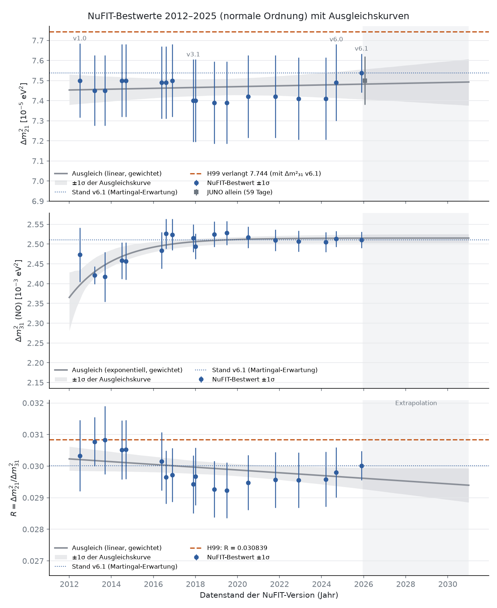

# Forschungsstand

### OP3: Elastische Strings mit fester Gesamtlänge (12.11.2026)

Die Autorenidee wurde als zusätzliches Längenmodell untersucht:
sum ell_i=L und E=(1/2)sum k_i ell_i². Das eindeutige Minimum hat
ell_i proportional 1/k_i. Unter der zusätzlichen Auslese sqrt(m_i)
proportional ell_i liefern gleiche Steifigkeiten K=1/3. Ein um den
Faktor 4+3sqrt(2) weicherer String neben zwei gleichen liefert exakt
K=2/3, aber zwei gleiche Massen. Der Faktor ist aus dem Ziel rückgerechnet.
Für K>1/2 muss ein String länger als die beiden anderen zusammen sein;
drei kürzeste paarweise Torusverbindungen scheiden daher aus.
Eine konkrete Netzgeometrie mit Wicklungen sowie eine unabhängige
Elastizitätsregel bleiben offen. Keine native Herleitung oder OP-Schließung.
[Analytische Erkundung](../notes/research/op3_string_length_exploration_2026_11_12.md).

### OP3: Rückwärtsdiagnose mit gemessenen Leptonmassen (12.11.2026)

Die ausdrücklich beauftragte Rückrechnung verwendet CODATA-2022-Werte
für Elektron/Myon und den PDG-2025-Tauwert 1776,93±0,09 MeV. Die
H18-Torusbedingung m_tau≤m_mu+m_e scheitert an 1776,93 gegenüber
106,16937 MeV: Fehlbetrag 1670,76063 MeV, rund 94,03 Prozent der
Tau-Masse. Positive generationsabhängige Multiplikatoren derselben
Dreiecksroute müssten notwendig eine Streuung f_max/f_min≥16,73675
haben; eine gemeinsame Frame-Normierung kann das nicht leisten.
Die volle Torus-Gram-Matrix scheitert separat an Rang≤1 gegenüber drei
positiven Zielmassen. Aus den Messwerten folgt K≈0,66666446; Koide wird
nicht als exakt vorausgesetzt. Die Massendaten bestimmen nur ein Spektrum,
keine eindeutige native Kopplung. Bekannte-Daten-Erkundung mit gespeichertem
Skript und geprüftem Laufmanifest, keine Vorhersage oder OP-Schließung.
[Eingaben, Rechnung und Grenzen](../notes/research/op3_mass_backsolve_2026_11_12/README.md).

### OP3: Frameabhängige Massen und kanonische Rückauslesung (12.11.2026)

Die Frame-Frage ist bereits in r84/r85 konkret behandelt: Der vollständige
komplexe Spinorboost erhält den antisymmetrischen Massenterm,
$S^{\mathsf T}\varepsilon S=\varepsilon$. Unter der dort festgelegten
zweiten Lesart tragen Kinetik und Massenterm die gemeinsamen Gewichte
$k=a-b$ und $p=a+b$. Für k>0 ergibt kanonische Normierung
$D_{\rm eff}=(p/k)D$, bei Materiegewichten also $\gamma D$.
Das skaliert alle Fermionmassen gemeinsam und erzeugt keine Hierarchie.
Die Reduktion zweier Lesarten zu einem Feld ist dabei kein allgemeiner
M/P-Frame-Wechsel. Eine bloße imaginäre Phase einer komplexen
Dirac-Kopplungsmatrix verändert ihre positiven Singulärwerte nicht.
Am Photon-Endpunkt k=0 ist diese Normierung undefiniert.
Generationsabhängige kinetische Gewichte oder relative Kopplungen könnten
andere Verhältnisse ergeben, sind auf den nativen Leptonzuständen jedoch
noch nicht ausgewertet. OPs und Guards unverändert.
[Quellenprüfung und Herleitung](../notes/research/op3_frame_mass_normalization_2026_11_12.md).

### OP3: Komplexe Kreuzprodukte und Grenze der vollen Gram-Matrix (12.11.2026)

Die Literatur kennt bereits ein SU(3)-angepasstes komplexes Kreuzprodukt:
Das gewöhnliche epsilon-Kreuzprodukt wird komplex konjugiert und ist dann
antilinear in beiden Eingängen. Seine Farbkomponenten dürfen nicht mit
Generationenslots gleichgesetzt werden. Die Oktonionen liefern außerdem
ein siebendimensionales Kreuzprodukt mit G2-invarianten Strukturkonstanten.
Auf den imaginären Anteilen des farbfesten Torus verschwindet es, weil
diese alle entlang e7 liegen. Der äußere Flächentensor ist davon verschieden.

Die im Chat vorgeschlagene positive hermitesche Matrix
$H_{ij}=\sum_{c,d}(A_i)_{cd}\overline{(A_j)_{cd}}$ behält mehr Korrelationen
als ihre Diagonale. Auf dem bisherigen zweidimensionalen Slotträger sind
aber alle A_i proportional zu derselben Zweiform: $H=2ss^{\mathsf T}$.
Damit hat H höchstens Rang eins. Seine Eigenwerte liefern dort unter einer
zusätzlichen Masseninterpretation keine drei positiven Massen. Dies
schränkt den Vorschlag ein; OPs und Guards bleiben unverändert.
[Herleitung, Quellen und Grenzen](../notes/research/op3_epsilon_hermitian_review_2026_11_12.md).

### OP3: Analytischer Ausschluss der H18-Torusroute (12.11.2026)

Auf dem farbfesten r15-Torus gilt für die rechte Gram-Auslesung exakt
$\mu_i=2\sin^2(\alpha_j-\alpha_k)$. Die drei Werte können positiv und
verschieden sein. Unter dem zusätzlichen H18-Massengesetz
$m_i=\kappa\sqrt{\mu_i}$ sind die Massen jedoch proportional zu den
Sehnenlängen der drei Punkte $e^{2e_7\alpha_i}$ und erfüllen deshalb
eine Dreiecksbedingung. Auch die Massenwurzeln erfüllen diese Bedingung;
daraus folgt $1/3\leq K\leq1/2$. Bei drei positiven Massen ist die obere
Ungleichung strikt; bei ausschließlich verschwindenden Massen ist K
undefiniert. Koide $K=2/3$ ist für diese Route unabhängig von der
Phasenauswahl ausgeschlossen. Ein Auswahlpotential auf demselben Torus
oder eine gemeinsame Skala kann das nicht ändern. Andere Massengesetze
und Träger werden dadurch nicht allgemein ausgeschlossen. Analytische
Erkundung/Selbstprüfung, kein neuer blinder Test; OPs und Guards unverändert.
[Beweis und Grenzen](../notes/research/op3_gram_torus_bound_2026_11_12.md).

### OP3: Konkrete rechte Gram-Auslesung gefunden (12.11.2026)

Der r33-Zweig definiert tatsächlich drei nichtlineare Auslesungen eines
Trialitätstripels: Aus der quaternionischen Gram-Matrix werden drei
imaginäre Komponenten und deren Quadratsummen gebildet,
$\mu_i=2(\|x_j\|^2\|x_k\|^2-\langle x_j,x_k\rangle^2)$.
Diese Funktionen sind auch auf dem r15-Konfigurationsraum auswertbar.
Sie liefern skalare Labels, keine drei linearen Masseneigenzustände.
Die reine Drei-Slot-Ablage ist unter der linken Spinorwirkung nicht
abgeschlossen (schon $i\cdot i=-1$); die Gram-Invarianz gilt auf dem
größeren Quaternionträger. Positive reelle Quadratsummen und die
komplex-bilineare Boost-Fassung sind dabei zu unterscheiden.
Der historische Massentest H18 mit $m_i\propto\sqrt{\mu_i}$ bleibt
für seine geprüften Potentialfamilien widerlegt. Offen sind Auswahl,
Massenskala und native Operatorbindung. Nächster Schritt ist die
analytische Einschränkung dieser Auslesung auf den farbfesten r15-Torus.
[Quellen und Selbstprüfung](../notes/research/op3_dixon_gram_bridge_2026_11_12.md).

### OP3: Spektrale Schnittstelle und Trialitäts-Massenbrücke (12.11.2026)

Der Abgleich mit der ursprünglichen spektral-zu-Masse-Schnittstelle bestätigt
die bereits dokumentierte Identifikationslücke: R_m benennt einen Übergang
nach Closure und Transport, wertet aber keine Trialitätskonfiguration aus.
Die Generationenzerlegung fordert eine zulässige Aufspaltung, konstruiert
jedoch keine drei Zustände. Auch die Higgs-Vermittlung liefert dort keine
generationenaufgelöste Kopplung. Für Masseneigenzustände fehlen die konkrete
Abbildung in einen linearen physikalischen Zustandsraum und die native
Operatorwirkung; für drei Auslesungen fehlen drei definierte Funktionen
mit Einheiten und physikalischer Bedeutung. Drei Funktionen auf dem
farbfesten Torus sind möglich, aber dadurch weder ausgewählt noch als drei
Teilchenzustände identifiziert. Nächster Quellenauftrag ist der vorhandene
rechte Dixon-/Gram-Zweig und seine mögliche Trägerbindung. OP3 und die
Guards bleiben offen bzw. unverändert; kein neuer Fit oder MMA-Beleg.
[Quellenabgleich](../notes/research/op3_triality_mass_bridge_2026_11_12.md).

## Lokaler v4.11.0-Kandidat

Der Kandidat baut auf v4.10.0 und dem Forschungsstand `ec9b2b8` auf. Sein neuer Koide-Abschnitt trennt die bedingte Überlagerung von Massenwurzeln, die exakte Polrechnung bei endlicher Lücke und die Frage nach einem nativen Erzeugungsmechanismus. Bei der Modelllücke 68 sind unter 2 bis 16 gleich gewichteten Beiträgen nur 15 möglich, bei Lücke 100 sind es 10 bis 16. Das ist eine Rückrechnung aus den Leptonmassen. Die physikalische Zahl der Auslesungen und die native Lücke bleiben offen.

**Quellenstand: 7.11.2026, GitHub `main` bei cf48496 plus Runden r70 bis v4.9.0-r86 und v4.10.0-r01 bis r11.** Diese Seite fasst den aktuellen Stand zusammen; sie ist kein neuer Beweisaudit. Was im Companion insgesamt steht, beschreibt die [Inhaltsübersicht](https://github.com/Moriarty1982/QuantumSphere-Unfold/wiki/Inhalt); die Ergebnisse aller Runden nach Themen die [Forschungslinie](https://github.com/Moriarty1982/QuantumSphere-Unfold/wiki/Forschungslinie). [Quellenkarte](https://github.com/Moriarty1982/QuantumSphere-Unfold/wiki/Versionen-und-Quellen).

## Bedingte Ergebnisse

Die v4.9.0-Linie enthält unter anderem bedingte Cartan-Vergleiche, endliche Normal-Inversen und Quellgesetze, Koide-bezogene Gleichnormbedingungen sowie Untersuchungen zur HC-Massenidentifikation und Generationenkopplung. Voraussetzungen und Einschränkungen stehen in den jeweiligen Abschnitten und Analysen. Ein endlicher Inversen- oder Kompatibilitätssatz liefert für sich weder regionale PDE-Existenz noch native physikalische Identifikation.

## Jüngste Korrekturen auf der 4.10-Basis

Die [Basisrevision](https://github.com/Moriarty1982/QuantumSphere-Unfold/blob/main/notes/research/v4_10_0_base/README.md) archiviert zurückgezogene Aussagen, korrigiert bekannte Fehler und kennzeichnet offene bzw. umgedeutete Aussagen. Historischer Text ist zusammen mit seinem aktuellen Status zu interpretieren.

Die [Layer r63–r68](https://github.com/Moriarty1982/QuantumSphere-Unfold/blob/main/notes/research/v4_10_0_r63_r64/README.md) unterscheiden Zählregeln und prüfen deren Frame-Deutung. Dokumentiert wird insbesondere:

- `thm:k-values` mit $k(\gamma_{\mathrm{BI}})=0$ widerspricht `thm:frame-offset`. Dieser Widerspruch ist nicht neu: v4.9.0-r09 hat ihn bereits festgestellt und aufgelöst, indem `thm:frame-offset` nur vom strukturellen Faktor $\gamma_L$ spricht. r66 korrigiert die fehlende Zitierung in r64 und erweitert die Statusnotiz.
- In der Zähllesart liegt der Frame-Unterschied in $\gamma$; die Zuordnungen für $\hbar$ und $G$ benötigen eine andere Begründung.
- Die Photon-Planck-Skalierung $\gamma_L^{-3/2}$ und der Vakuumquotient $\gamma_L^5$ werden durch diese Lesart nicht gestützt.
- Im Hawking-Abschnitt wird eine Tachyonzählung dem austretenden Photon zugeordnet. r65 ergänzt hierzu Statusnotizen im Haupttext.
- In der Zähllesart ist der strukturelle Faktor eine feste Zahl; die beiden Zählregeln sind diskret und liefern keinen stetig driftenden lokalen Frame-Faktor (r66). Die Drift-Lesarten aus r08/r09 sind ohnehin durch Atomuhren ausgeschlossen.
- Zu Einsteins „größtem Fehler“ (`rem:einstein-blunder`, r67): Die Bemerkung und die Feldgleichung in `rem:omega-bsym` setzen $\beta_{\mathrm{sym}}^2$ auf $\Lambda$, `thm:dark-energy` setzt denselben Wert auf die Materie ($\Omega_M=\beta_{\mathrm{sym}}^2$). In der Zähllesart ist $\Lambda$ als Krümmung frame-unabhängig; erklärbar wäre höchstens der Anteil $\Omega_\Lambda=2\gamma_T/(\gamma_M+\gamma_T)\approx0{,}698$, und nur für die heutige Epoche. Offen bleibt, warum ein Zählanteil einem Energieanteil entsprechen soll.
- Unabhängige Nachrechnung (r68): Die Zahlen von H47 und r63–r67 bestätigen sich. Einschränkung: Die Zähllesart funktioniert nur mit der U(1)-Behandlung der Horizontzustände ($\gamma\approx0{,}2375$). Die als besser begründet geltende SU(2)-Behandlung ergibt $\gamma\approx0{,}274$ und $\beta_{\mathrm{sym}}\approx0{,}604$, außerhalb des Leptonfensters. Die registrierte Vorhersage H46 bleibt mit dem ungerundeten Wert gültig.

Das sind Einschränkungen bestimmter Argumente, keine allgemeine Widerlegung jeder möglichen Gravitationstheorie.

## OP5: Vakuumterm, Frames und Neutralität (r69)

Der Autor hat vom 25. bis 27. Oktober mit einem weiteren Sprachmodell an OP5 gearbeitet; die Notizen liegen unter `analysis/` (Prefix `OP5_`). [Layer r69](https://github.com/Moriarty1982/QuantumSphere-Unfold/blob/b12adf5fc0a69d32e0405b78dfb505c3b9bbea44/notes/research/v4_10_0_r69/README.md) bindet sie ein. Alle Prüfskripte ließen sich reproduzieren, neun Aussagen wurden mit eigenem Code nachgerechnet. Jede positive Aussage der Serie ist bedingt (Vergleichsmodell, gewählter Zeuge oder zwei Stichpunkte). Festgehalten wird:

- Ein passiver, invertierbarer Frame-Wechsel skaliert einen Bilanzdefekt nur; er kann ihn nicht beseitigen. Die Ersetzung von $\gamma_L$ durch $e^\eta$ schließt die historische Bilanz nicht.
- „Neutral“ hat drei verschiedene Bedeutungen: Mittelpunkt zweier Skalenframes; gleichgewichtige Mischung eines Zustands mit seinem Tachyonbild ($I/2$, Etikett P); flussfreier Beobachter zweier Nullströme (Stress $\mathrm{diag}(\rho,\rho,0,0)$, kein Vakuumtensor). Sie dürfen nicht gleichgesetzt werden.
- Keine der geprüften Routen legt den absoluten Vakuumterm fest. Ein gemeinsamer Energieversatz ist bei festem Hintergrund unbeobachtbar; im alternativen affinen Vergleichsmodell löst ein Zweig die Feldgleichungen für jede Konstante.
- Der Lichtkegel der Sondengleichung kommt aus der Clifford-Struktur, nicht aus Masse-, $M_{16}$-, triadischen oder HC-Termen. Kegeldaten legen weder eine absolute Skala noch das Gewicht eines Vakuumterms fest.
- Mit der verbundenen Querauslese $E=\tfrac12 Dj$ gilt $T=\tfrac12 Rj$. Torsionsfrei und mit gewöhnlicher Einstein-Vakuumgleichung folgt $\Lambda_{\mathrm{geom}}=0$, wo $j\neq0$: ein Ausschluss unter diesen Voraussetzungen, keine Aufhebung von Vakuumenergie.
- Drei Fehler im Hauptkorpus wurden gefunden: `rem:regularization-B` (Reihenentwicklung und Vorzeichen des Gegenterms falsch; der Wert 0,940 stimmt nicht), `thm:dirac-probe` und `prop:three-compatible-readings` stützen die Uhrskala auf das archivierte `thm:gue-selfdet`, und das Korollar „Cosmological constant revisited“ gibt für dieselbe Größe null und $\gamma_L^5$ an. Alle drei sind seit der 4.10-Konsolidierung korrigiert bzw. mit Statusvermerk versehen (siehe unten). Der in r69 genannte richtige Wert 1,689 war selbst falsch; richtig ist 1,686953 (r70).

OP5 bleibt in der exakten Form offen; die lokale Detektorschließung $\mathrm{OP5}_{\mathrm{eff}}$ ist davon nicht berührt.

## 4.10-Konsolidierung, H48 und Λ als Mischung (r70)

Am 29. und 30. Oktober hat das zweite Sprachmodell den Forschungskandidaten direkt weitergeschrieben; Runde r70 übernimmt das in die lokale Gesamtquelle und verbucht es.

- **Korrekturen im Hauptkorpus.**
  - Die Regularisierung lautet jetzt $R(\tau) = -1/\tau + 1 - \tfrac{11}{24}\tau + \dots$ mit Gegenterm $-\log(\varepsilon/\mu)$. Der endliche Teil bei $T = 0{,}393$, $\mu = 1$ ist 1,686953 und hängt von der gewählten Skala $\mu$ ab. Das alte Ziel 0,893 ist zurückgezogen.
  - Statusvermerke stehen jetzt an der Dirac-Sonde, an den drei Lesarten der fermionischen Sonde, am Λ-Korollar, an der Verschränkung als gemeinsamer Eigenzeit (eine gemeinsame Uhr beweist allein keine Verschränkung) und an der alten Vorhersageliste.
  - Die Faser $S^7$ war als Gruppe „$\supset G_2 \supset SU(3)$“ beschriftet. Das ist falsch und entfernt: $G_2$ ist die Automorphismengruppe der Oktonionen, $SU(3)$ der Stabilisator einer imaginären Einheit.
- **Neuer Abschnitt „States, Mediators and Clock Comparisons“.**
  - **Vermittler:** Quanten- und Relativitätsauslesung eines gemeinsamen Trägers werden nur über einen Vermittler mit ausdrücklichen Beweispflichten verbunden.
  - **Feld-Dublett:** Das reale Dublett $[E\,|\,B]$ lässt sich lokal aus seiner Gram-Matrix und drei Orientierungsparametern vollständig zurückgewinnen. Der normierte Zustand allein verliert Skala und Flussrichtung.
  - **Uhren:** Zwei Uhren mit festen Raten stimmen nach einer Kalibrierung $\tau = at_a = bt_b$ überein; dafür braucht es keine zweite Quantenzeit.
  - **Numerik:** Die numerische Verträglichkeit der Feldgleichungen erreicht an drei Punkten die vierte Ableitungsordnung. Das ist keine Lösung auf einem Gebiet.
- **H48 (Vorab-Test, widerlegt).** Getestet wurde, ob $\beta_{\mathrm{sym}}$ als eingefrorene Länge des Materie/Tachyon-Zustands aus einer Dynamik folgt.
  - Der eingefrorene Wert hängt an Expansion und Dichte, nicht nur an einem Ratenverhältnis.
  - Ein Einstein–Cartan-Spinterm koppelt nicht, weil der Zustand in der dichten Phase senkrecht zur Chiralitätsachse liegt.
- **Λ als Mischung über Sektor-Kreuzungen (Erkundung).** Keine der 26 Lesarten trifft besser als Zufall. $\Omega_M = \beta_{\mathrm{sym}}^2 \approx 0{,}302$ bleibt die beste Zahl (Planck 2018 −1,9σ, DESI DR2 +0,5σ).
  - Festgehalten wird eine Identität: $\beta^2$ ist das Verhältnis der beiden Eigenwerte des Materie/Tachyon-Zustands.

Nichts davon schließt OP5 oder ändert die Guards.

## OP5: Struktur des Vergleichssystems und eine exakte Eichsymmetrie (r71)

Am 2. November hat der Autor die OP5-Arbeit dort fortgesetzt, wo das zweite Sprachmodell aufgehört hatte (Commit `cf48496`): ein auf 70 Stellen genauer Feldkeim bis zur fünften Ordnung im festen Vergleichsmodell, die zusätzliche Bedingung $\Omega$ an die dritten Ableitungen und eine Zählung bei Grad 5, die je nach Schwelle 1, 0 oder −1 ergab. Runde r71 hält fest:

- **Der Keim ist unabhängig bestätigt.** Zwei eigene Implementierungen ohne gemeinsamen Code mit dem anderen Modell zeigen, dass der Keim das vollständige System $R = (F, G, dg)$ bis Grad 3 erfüllt. Dazu gehört auch der Teil $G$, der vorher nur vom anderen Modell geprüft war.
- **Die −1 ist ein Rechenartefakt.** Mitgezählt wurde eine Richtung, die die Grundregel „der Rand eines Randes ist null“ verletzt. Sauber gezählt kommen mit dem gespeicherten $\Omega$ bei Grad 5 vier neue Klassen heraus, nicht 0 oder 1.
- **Die Struktur dahinter.**
  - Das System lässt eine freie Funktion von vier Variablen unbestimmt.
  - $\Omega$ ist für diese freie Richtung blind und bringt neue Information nur für Wellen auf dem Lichtkegel der rekonstruierten Geometrie oder in zwei besonderen Ebenen.
- **Die freie Funktion ist eine exakte Eichsymmetrie.** Sie verschiebt das Feld entlang des Polarwinkels $\vartheta$. Der Hintergrund des Modells hängt nur von $t$, $r$ und $\varphi$ ab: Die Masse ist $h(t, r)$, die Verbindung ist $A = M(t)\,d\varphi$. Deshalb ändert keine $\vartheta$-Umparametrisierung die Gleichungen.
- **H49 (Vorab-Test, widerlegt).** Vermutet war, dass abseits des Äquators schon bei den zweiten Ableitungen eine versteckte Bedingung auftaucht. Das trifft nicht zu. Die Prämisse, ein Term $\propto z/\rho^2$ breche die Freiheit, war falsch.
- **H50 (Vorab-Test, widerlegt).** Gefragt war, ob $\Omega$ über die $\vartheta$-Richtung auf $\Psi$ zurückwirkt (Frage des Autors). Das tut es nicht: $\Omega$ ist eichinvariant und ändert sich unter allen geprüften Verschiebungen um höchstens $10^{-10}$.

Folgerung: Vor einem Existenzsatz nach Cartan–Kuranishi muss die $\vartheta$-Eichung festgelegt werden. Die Symmetrie gehört zum gewählten Hintergrund; ein Hintergrund, der von $\vartheta$ abhängt, würde sie brechen. OP5 bleibt offen, die Guards sind unverändert.

## OP5: Die ϑ-Eichung, ein Cartan-Test und vier versteckte Bedingungen (r72)

Am 3. November hat der Autor den nächsten Schritt aus r71 angestoßen: die $\vartheta$-Freiheit festlegen und dann prüfen, ob das System vollständig ist. [Layer r72](https://github.com/Moriarty1982/QuantumSphere-Unfold/blob/main/notes/research/v4_10_0_r72/README.md) hält fest:

- **Die Eichung.** Als Bedingung dient, dass eine Komponente des Stroms, $\Psi^\dagger K_2\Psi$, eine vorgegebene Funktion des Ortes ist. Sie reagiert auf die $\vartheta$-Verschiebung und legt diese damit eindeutig fest. Auf der Ebene des Symbols ist jede solche Wahl gleichwertig. Die Eichung nimmt genau die freie Funktion heraus und sonst nichts.
- **H51 (Vorab-Test, bestätigt).** Der Cartan-Test prüft, ob die Gleichungen höherer Ordnung nichts Neues mehr erzwingen (Involutivität). Für das geeichte Symbol ist das ab Ordnung 6 der Fall, bei Ordnung 4 und 5 noch nicht – genau wie vorab aus dem Wachstum der Dimensionen vorhergesagt. Danach bleibt keine freie Funktion von vier Variablen mehr übrig; formal hängen die Lösungen von 14 Funktionen von drei Variablen ab, also von Anfangsdaten auf einer Fläche.
- **Formale Integrabilität: drei Tests ungültig (H52–H54).** Ein involutives Symbol reicht nicht; zusätzlich dürfen beim Fortsetzen der Taylorreihe keine neuen Bedingungen auftauchen. Alle drei Tests dazu sind nach ihren eigenen Kriterien ungültig, jedes Mal wegen eines Fehlers in der Testplanung. Was sie trotzdem zeigen:
  - Die gespeicherten Koeffizienten fünfter Ordnung des Keims lassen sich nicht fortsetzen; sie erfüllen die einmal abgeleitete $\Omega$-Bedingung nicht. Für Prüfungen muss die fünfte Ordnung frei bleiben.
  - Über dem reparierten Keim bis Ordnung 4 ist mit den Gleichungen bis Grad 6 alles sauber: Die Freiheitsgrade stimmen genau mit dem geeichten Symbol überein.
  - Mit den Gleichungen vom Grad 7 kommen **vier zusätzliche Bedingungen an die sechsten Ableitungen** hinzu (848 statt 852 Freiheitsgrade).
- **Warum genau vier (Erkundung).** Die Spencer-Kohomologie des Symbols gibt an, wie viele versteckte Bedingungen höchstens möglich sind. Für das geeichte Symbol ist bei Ordnung 5 Platz für genau vier, bei Ordnung 4 für keine. Eine Fehlerschranke (Satz von Weyl) zeigt, dass die gemessenen 848 nicht durch Rechenfehler entstanden sein können. Inhaltlich sind es damit genau vier; formal bestätigt ist das nicht.

Folgerung: Das geeichte Symbol ist involutiv, das geeichte System aber nach allem Anschein bei Ordnung 6 nicht formal integrabel. Nächster Schritt: an einem zweiten Grundpunkt vorab prüfen (H55), dann die vier Bedingungen ausdrücklich bestimmen, ins System aufnehmen und den Cartan-Test wiederholen. OP5 bleibt offen, die Guards sind unverändert.

## OP5: Die vier versteckten Bedingungen bestimmt (r73)

[Layer r73](https://github.com/Moriarty1982/QuantumSphere-Unfold/blob/main/notes/research/v4_10_0_r73/README.md) bestätigt und bestimmt die vier Bedingungen aus r72:

- **H55 (Vorab-Test, bestätigt).** Auch an einem zweiten Ausgangspunkt (Ableitungen vierter Ordnung um 50 % geändert) kommen mit den Gleichungen vom Grad 7 genau vier Bedingungen an die sechsten Ableitungen hinzu. Das geeichte System ist bei Ordnung 6 also nicht formal integrabel. Einschränkung: Ein Teil der Rechnung hängt nur von den Ableitungen bis Ordnung 2 ab und ist an beiden Punkten gleich.
- **Was die vier Bedingungen sind (Erkundung).**
  - Echte Gleichungen sechster Ordnung; mit ihnen hat das vollständige Symbol bei Ordnung 6 477 statt 481 Dimensionen.
  - Sie betreffen nur lichtartige Wellen, also Wellen, deren Richtung auf dem Lichtkegel der rekonstruierten Geometrie liegt. Für jede solche Richtung legen sie genau eine von sieben möglichen Polarisationen fest.
  - Welche der vier Bedingungen dabei greift, hängt quadratisch von der Wellenrichtung ab, und zwar über genau die vier Quadriken, die auf den beiden besonderen Ebenen aus r71 verschwinden.
  - Lesart: Es sind die „Krümmungsreste“ der vier Beziehungen $q\,d_k\,\Omega$ aus r71. Auf der Ebene des Symbols sind diese Beziehungen Identitäten; mit den Termen niederer Ordnung bleibt von jeder eine Bedingung sechster Ordnung übrig. Das passt zur Spencer-Zahl $H^{5,2} = 4$.
- **Cartan-Test des erweiterten Symbols: zwei Tests ungültig (H56, H57).** Bis Ordnung 7 ist das Ergebnis sauber: 477 und 594 Dimensionen, bei Ordnung 6 nicht involutiv. Ab Ordnung 8 reicht die Rechengenauigkeit nicht: Ein einzelner sehr kleiner Wert entscheidet, ob das Symbol bei Ordnung 7 oder 8 involutiv wird. Ursache ist, dass $\Omega$ von einem älteren Keim stammt (Abweichung etwa $10^{-7}$), die vier Bedingungen vom reparierten.

Nächster Schritt: ein konsistenter Datensatz am reparierten Keim ($\Omega$ und die vier Bedingungen) mit höherer Genauigkeit, dann den Cartan-Test wiederholen. OP5 bleibt offen, die Guards sind unverändert.

## OP5: Konsistente Daten und eine Genauigkeitsgrenze (r74)

[Layer r74](https://github.com/Moriarty1982/QuantumSphere-Unfold/blob/main/notes/research/v4_10_0_r74/README.md):

- **Konsistente Daten (H58, ungültig nach Kriterium).** $\Omega$ wurde am reparierten Keim neu bestimmt, mit derselben Methode wie die vier Bedingungen. Mit diesen konsistenten Daten ergibt sich: Das um die vier Bedingungen erweiterte Symbol wird erstmals bei Ordnung 8 involutiv; formal bleiben 12 Funktionen von drei Variablen. Der Wert 724 aus H57 war ein Artefakt. Weil fünf Rangentscheidungen knapp unter der festgelegten Schwelle lagen, ist der Test formal ungültig.
- **Obergrenze für weitere Bedingungen (Erkundung).** Die Spencer-Kohomologie des erweiterten Symbols lässt Raum für bis zu vier weitere versteckte Bedingungen an siebten und drei an achten Ableitungen. Ob sie auftreten, ist offen.
- **Warum die Rechnung hier an eine Grenze stößt (Methodenprüfung).** Das Symbol aus den Grundgleichungen allein ist numerisch gut gestellt. $\Omega$ und die vier Bedingungen wirken aber nur auf lichtartige Wellen und sind als Gleichungen fast Folgen der Grundgleichungen; ihr eigener Anteil hat nur ein Gewicht von etwa $10^{-8}$. In normaler Rechengenauigkeit lassen sich ein bis zwei solcher Stufen trennen, nicht drei. Eine stufenweise Elimination spart Speicher, löst das aber nicht.
- **Ebene Wellen (Erkundung).** Der Versuch, die Symbolräume aus ebenen Wellen auf dem Lichtkegel aufzubauen, trägt nicht: Die Wellen erreichen die bekannten Dimensionen nicht ganz; der Symbolmodul hat Vielfachheiten.

Nächster Schritt: entweder die ganze Rechenkette mit höherer Genauigkeit oder eine Umformulierung, die die Vielfachheiten berücksichtigt. OP5 bleibt offen, die Guards sind unverändert.

Nachtrag (3. November, Erkundung): Ein erster Lauf auf parallelen GitHub-Runnern hat die Symbolräume des eingefrorenen Symbols bis Ordnung 12 gerechnet. Alle bekannten Werte kamen genau wieder heraus; neu sind $\dim g'_{10}, g'_{11}, g'_{12} = 1065, 1246, 1441$, mit konstanten zweiten Differenzen 14 wie nach H51 erwartet. Einzelheiten unter [Parallele Rechnungen](https://github.com/Moriarty1982/QuantumSphere-Unfold/wiki/Parallele-Rechnungen).

## OP5: Hohe Genauigkeit, formale Integrabilität am Keim und Kovarianz (r77)

[Layer r77](https://github.com/Moriarty1982/QuantumSphere-Unfold/blob/main/notes/research/v4_10_0_r77/README.md): Am 3. und 4. November wurde die ganze Rechenkette in hoher Genauigkeit wiederholt (160 bzw. 70 Stellen). Die entscheidenden Eliminationen liefen parallel auf GitHub-Runnern. Danach ging es um Anknüpfungen an die Physik.

- **Genau vier versteckte Bedingungen (Erkundung).** Die Lücke zwischen echten Werten und Rauschen beträgt $10^{58}$. Das erweiterte Symbol hat die Dimensionen 477, 594, 723, 865 bei Ordnung 6 bis 9. Es ist erstmals bei Ordnung 8 involutiv, mit den Charakteren 723, 130, 12, 0.
- **Keine weiteren versteckten Bedingungen (H59, bestätigt).** Die Fasern der 7- und 8-Jets sind 594 und 723, also genau so groß wie das Symbol; die Gegenprobe bei 6-Jets ergibt 477. Damit ist das System am Keim formal integrabel. Seine allgemeine formale Lösung hängt von 12 Funktionen dreier Variablen ab.
- **Sechs masselose Moden (H60, bestätigt).** Je Lichtrichtung gibt es genau 6 reelle Polarisationen, außerhalb des Lichtkegels keine. Die 12 Anfangsdaten sind also 6 masselose Moden.
- **Kein Weyl- oder Majorana-Typ (H61, widerlegt).** Liest man Ψ als drei Dirac-Spinoren mit der üblichen Spin-Wirkung, haben die Moden keine feste Händigkeit und keine feste Helizität.
- **Keine Symmetrie bei festem Hintergrund (H62 und H63, widerlegt).** Das Symbol ist nur unter Skalierung invariant. Schon der dynamische Teil F hat keine Lorentz-Symmetrie. Das ist strukturell zu erwarten: Ψ am Keim steht selbst im Hauptsymbol. Die Sonderebenen Π₀, Π₁ entstehen im G-Teil (r71).
- **Die Konstruktion ist kovariant (H64, bestätigt; zweiter Lauf, nicht blind).** Transformiert man Jets und Hintergrund mit, bleibt R auf Symbolebene unverändert. Das gilt unter beliebigen linearen Koordinatenänderungen und unter inneren Lorentz-Transformationen von Ψ; die Residuen liegen bei höchstens $4\cdot10^{-10}$. Hält man den Hintergrund fest, bricht die Kovarianz mit 0,26. Die Lorentz-Brechung kommt also vom Hintergrund (Ψ am Keim, die Felder A und h), nicht von einem Baustein des Modells.

Nächster Schritt: prüfen, ob auch Ω, θ, die Eichung Ψ†K₂Ψ = S und die vier Bedingungen kovariant sind, und klären, woher der Hintergrund A, h kommt. OP5 bleibt offen, die Guards sind unverändert.

## OP5: Kovarianz auf Werteebene und die Eichung (r78)

[Layer r78](https://github.com/Moriarty1982/QuantumSphere-Unfold/blob/main/notes/research/v4_10_0_r78/README.md):
- **R ist vollständig kovariant (H66, bestätigt; nicht blind).** Auch mit allen Termen niedrigerer Ordnung und außerhalb der Lösungsmenge bleibt R unter linearen Koordinatenänderungen und inneren Lorentz-Transformationen unverändert. Die Residuen liegen bei höchstens $2\cdot10^{-11}$. Hält man den Hintergrund fest, steigen sie auf 57 bzw. 1200. Damit ist auch Ω kovariant, denn es wird allein aus R abgeleitet.
- **Die Eichung zeichnet eine Richtung aus (H65, ungültig nach Kriterium).** Wie vorhergesagt bleibt Ψ†K₂Ψ = S nur unter so(1,2) erhalten, also unter der Drehung um y und den Boosts entlang x und z. Teil (a) von H65 wurde ungültig, weil die Kontrollschranke zu streng gewählt war; H66 holt ihn nach.
- **Folge:** Die vier versteckten Bedingungen stammen aus R zusammen mit der Eichung. Sie sind deshalb höchstens unter so(1,2) kovariant. Offen ist, ob ihre Zahl und ihre Lage auf dem Lichtkegel von der Wahl der Eichung abhängen.

OP5 bleibt offen, die Guards sind unverändert.

## OP5: Die vier Bedingungen sind eichunabhängig (r79)

[Layer r79](https://github.com/Moriarty1982/QuantumSphere-Unfold/blob/main/notes/research/v4_10_0_r79/README.md):
- **Gleiche Bedingungen in fünf Eichungen (H67, bestätigt).** Die hochgenaue Rechnung der 6-Jet-Faser wurde für fünf Eichungen wiederholt. Neben der bisherigen Eichung (y-Strom) waren das die Dichte Ψ†Ψ, der z-Strom, Ψ†Q₃Ψ und der Lorentz-Skalar Ψ̄Ψ. Jede Eichung lief als eigener Job auf einem GitHub-Runner.
- In allen fünf Fällen hat die Faser die Dimension 477 (20 Ω-Folgerungen und 4 Bedingungen). Auf dem Lichtkegel gibt es 6 Polarisationen, außerhalb keine. Die Lücken liegen bei mindestens $4\cdot10^{56}$.
- **Folge:** Zahl und Lage der vier Bedingungen hängen nicht von der Eichung ab, auch nicht bei der kovarianten Eichung Ψ̄Ψ. Mit r78 gehören sie damit zum kovarianten Inhalt des Systems. Die Lorentz-Brechung kommt nur noch vom vorgegebenen Hintergrund (Ψ am Keim, A, h).

Nächster Schritt: eine eigene Dynamik für den Hintergrund. OP5 bleibt offen, die Guards sind unverändert.

## OP5: Der Hintergrund kommt nicht aus den Spinoren; Abschluss des Zweigs (r80)

[Layer r80](https://github.com/Moriarty1982/QuantumSphere-Unfold/blob/main/notes/research/v4_10_0_r80/README.md):
- **Fierz-Erkundung.** Am Keim liegen alle drei Spinorblöcke im regulären Dirac-Sektor (Yvon–Takabayasi-Winkel ≤ 0,07°). Die Blöcke 0 und 1 strömen mit v = +x/t, Block 2 entgegen (γ = 1,25); alle Spins zeigen entlang der Azimutrichtung, die auch Eichung und Hintergrund auszeichnen.
- **H68 widerlegt.** Geprüft wurde in der Metrik des Modell-Koframes, ob A = M(t) dφ Yang–Mills auf span(λ₂, λ₄, λ₆) mit dem Farbstrom als Quelle erfüllt und h Klein–Gordon mit der Yukawa-Quelle Ψ̄(Y⊗1)Ψ, jeweils mit einer Kopplung. Residuen: Yang–Mills 0,955, Klein–Gordon masselos 0,995, massiv 0,826; schon der Wert am Keim scheitert. Die Quellen sind rund 10³-mal zu klein, die Spinorströme liegen fast ganz in anderen Farbrichtungen. Kontrollen (Bianchi-Identität, exaktes □h, Keimresiduum) gültig. In der flachen Metrik scheitert es ebenso.
- **Abschluss (Autorentscheidung 4.11.).** Das Vergleichssystem hat damit keine innere Quelle für seine Lorentz-Brechung; sie kommt von einem Hintergrund, den es nicht selbst erzeugt. Der Zweig r71–r80 ist geschlossen; seine Ergebnisse bleiben gültige lokale Aussagen über diese Konstruktion, nicht über das QSC-Modell.

Nächster Schritt eine Ebene höher: Bestandsaufnahme der bisherigen Wirkungsansätze und der Mindestanforderungen an eine gemeinsame Dynamik. OP5 bleibt offen, die Guards sind unverändert.

## Die Brücke des Zählprinzips, und die Zählregel als frame-abhängiges Flächenquantum (Runde v4.10.0-r10)

[Notizen](https://github.com/Moriarty1982/QuantumSphere-Unfold/blob/main/notes/research/v4_10_0_r10/README.md): Geprüft wurde die offene Brücke aus r09: Zählt der Tachyon-Frame nur die kleinste Flächenanregung, weil er „am Boden sitzt“?
- **Die Zählgleichung ist eine Unruh-Statistik (r10.1):** Nach dem lokalen ersten Gesetz (Frodden–Ghosh–Perez) hat ein Durchstoßpunkt mit Spin j für einen Beobachter im Abstand ℓ die Energie γ·a(j)/ℓ, die Unruh-Temperatur ist 1/(2πℓ). Im Exponenten fällt ℓ heraus. Alle statischen Beobachter zählen gleich.
- **T sieht dieselbe Statistik (r10.2):** Die Tachyon-Abbildung vertauscht mit dem Boost und lässt das Vakuum fest (r07). Der Boden aus r63 ist eine Eigenschaft eines Tachyon-Teilchens, nicht des Zustands am Horizont. **Korrektur zu r09.2:** Die Brücke in P2 trägt so nicht.
- **Die Zählregel als Flächenquantum (r10.3):** Sehen beide Frames dieselbe Statistik und dieselbe Geometrie und erfüllen beide S = A/4, bleibt nur ein frame-abhängiges Flächenquantum: γ_M = γ_BI, γ_T = γ_string, Verhältnis γ_L = 1,8647. Das kleinste Flächenquantum wäre im T-Frame um γ_L kleiner, Fläche und G bleiben gleich. Ein Grund dafür ist nicht bekannt; die drei Vorhersagen am γ_L-Kern (H15, H46, H96) hängen an dieser Annahme.
- **Parallele Prüfung (r10.4):** Die OP5-Rekonstruktion mit einem anderen Sprachmodell (Notizen `op5_spin_selection_audit`, `op5_common_state_access`, `op5_projector_spin_bridge` vom 6.11.) kommt zum selben Urteil und ergänzt: Unschärfesättigung allein wählt j = ½ nicht aus (auch |1,1⟩ sättigt), der Tachyon-Boden enthält j gar nicht, und ein passiver Beschreibungswechsel kann keine Spinsektoren entfernen. Die Sonderstellung aus H98 bleibt unberührt.

## Einordnung der OP5-Quellenrekonstruktion mit einem anderen Sprachmodell (Runde v4.10.0-r11)

[Notizen](https://github.com/Moriarty1982/QuantumSphere-Unfold/blob/main/notes/research/v4_10_0_r11/README.md): Der Autor hat am 6./7.11. mit Codex die Herkunft von OP5 bis zum Kern zurückverfolgt (Notizen `op5_*_2026_11_06.md`, `qsc_back_to_basic_idea_2026_11_06.md`, `qam_*_2026_11_06/07.md`, Paket `qam/tex/qam-physics.sty`). Die Runde hält den Inhalt fest, rechnet die tragenden Formeln mit eigenem Code nach (k219, 31 von 31 bestätigt) und ordnet sie gegen r05–r10 ein. Kein Test, keine neue H-Nummer.
- **Autorentscheidung (r11.1):** Die historische Herleitung der OP5-Aufgabe (spektraler Term → metrische Wirkung → nackter Λ-Term → Auslöschung durch Θ und R) ist als Grundlage ausgesetzt; Wirkung und Skala waren nie hergeleitet. Neue Arbeitsfrage: Welche unabhängig definierte Messgröße lässt sich begründet aus dem Kern auslesen? Die Einheit von M, T und P ist die zu prüfende Hypothese, kein vorausgesetztes Ergebnis.
- **Was die Rekonstruktion zeigt (r11.2):** Der Quelle–Rückweg-Satz gilt als bedingtes Schema, eine native Route ist nicht instanziiert; das Mittel `m = (f + b)/2` verliert die Zweiginformation. Registerverhältnis `q = λ₋/λ₊`, Ausflussanteil der Kaskade, γ-Kontrast und Ω_M haben verschiedene Nenner; die Kaskade r31 setzt β² ein und stabilisiert es nur. Eine explizite Feldfamilie gleicher Skala und Orientierung trägt jedes q, und Energiegewichte machen aus q jeden Anteil. Unschärfesättigung wählt m = ±j, nicht j = ½; die Spinmengen {½} und {½, 1} geben γ = 0,1274 bzw. 0,2018. Der Chiralitätsprojektor vertauscht mit der Tachyon-Abbildung und liefert keine verschiedenen M/T-Masken. Dualität verbindet s > 0 und s < 0 gleichen Betrags, nicht s ≠ 0 mit s = 0; das Kompensatorbild ist nicht lichtartig.
- **Verhältnis zu r05–r10 (r11.3):** kein Widerspruch. Präzisiert werden r05.3(i) („OP5-Kern lokal geschlossen“ heißt: als bedingtes Schema geschlossen, native Route offen) und r05.3(ii) (die Λ-Auslesung ist die zusätzliche Gleichsetzung q = Ω_M aus H96; r31 leitet die Zahl nicht her, wie schon K1 in r08). H98 bleibt; die Projektorprüfung bestätigt r10.3 von der inneren Seite.
- **QAM als Frame-Schnittstelle (r11.4):** `qam-physics.sty` führt Physikprofile (etwa ART, QM) und Übergänge nur mit deklarierter Abbildung und Zielformel; 34 Softwarefälle sind Buchführungs-, keine Physiktests. r07.2 ist eine solche Konversion; r10.3 heißt in dieser Sprache: Das T-Profil unterscheidet sich vom M-Profil durch sein Flächenquantum, eine erzeugende Abbildung ist nicht bekannt.
- **Lesart-Kandidat (r11.5, nachträglich):** Für ein nicht lichtartiges Feld ist `1/r = cosh 2η` der gewöhnliche Lorentzfaktor zwischen zwei Beobachtern gleicher Feldskala mit entgegengesetztem Energiefluss; bei `r = 1/γ_L` ist der Boost ins flussfreie Profil gerade β_sym. Das ist eine mögliche Stelle für den offenen Grund aus r10.3, keine Identifikation mit M und T. Der fehlende Anteil 3/4 beim Mitteln der Drehrichtungen ist der Faktor aus r27.

## Die Zählregel je Frame: Sonderstellung (H98) und ein Prinzip (Runde v4.10.0-r09)

[Notizen](https://github.com/Moriarty1982/QuantumSphere-Unfold/blob/main/notes/research/v4_10_0_r09/README.md): Nach r08 ist die Zuordnung der Horizontzählungen zu den Frames die am stärksten belastete Annahme (M alle Spins mit Gewicht 2, T nur j = ½).
- **H98 bestätigt (vorab festgelegt, nicht blind gegenüber den Daten):** In einem vorher festgelegten Raum natürlicher Zählregeln (Spinbereiche: alle, halbzahlig, ganzzahlig, nur ½, nur 1; Gewichte 2 oder 2j + 1; 36 Paare) trifft nur das gewählte Paar zugleich das Leptonfenster, m_W (2σ) und Ω_M (2σ). Leptonfenster und Ω_M lassen je zwei Paare zu, erst m_W wählt eindeutig. Das SU(2)-Paar der Literatur verfehlt alle drei. Ein zufälliger Dreifachtreffer ist von der Größenordnung weniger Prozent; weil die m_W-Beziehung selbst nachträglich gefunden wurde, ist das keine Signifikanz im strengen Sinn.
- **Ein Prinzip (Erkundung, nicht blind):** Ein Frame zählt nur Zustände, die (P1) die Unschärfe sättigen und (P2) zu seiner Energiebedingung passen: M hat alle Anregungsstufen, T relaxiert zum Boden und erreicht nur die kleinste Fläche (Brücke: lokales erstes Gesetz am Horizont, E ∝ A). P wählt im Regelraum genau das bestätigte Paar. Damit ist die Zählregel nicht hergeleitet, aber auf zwei Lesarten mit eigenem Grund zurückgeführt. Ungeprüft ist die Brücke in P2 (Teilchenenergie am Boden gegen Horizontenergie eines Beobachters).

## Annahmen des Companion und Abhängigkeit der offenen Vorhersagen (Runde v4.10.0-r08)

[Notizen](https://github.com/Moriarty1982/QuantumSphere-Unfold/blob/main/notes/research/v4_10_0_r08/README.md): Nach dem Vorbild von Dorau–Much (wenige, offen gesetzte, unabhängig begründete Annahmen) eine Bestandsaufnahme. Kein Test, keine Vorhersage.
- **Gravitation unter den Gewichten (r08.1):** Der Verdacht, die zweite Lesart ((a − b)·S_M) und die Photon-Gewichte der Gravitation (a = b) setzten die Quelle der Materie auf null, trifft nicht zu. Die Summe a − b entsteht nur im nicht gewählten Gebiet G1. Unter G2 gilt nach dem Urknall a·S_M; die Photon-Gewichte betreffen die Gravitationswirkung und geben G_eff = (a/a_g)·G, einen gemeinsamen Faktor. Stillschweigend vorausgesetzt war dabei: Alle Felder tragen nach dem Urknall dasselbe Gewicht (Annahme U; sonst verschiedene aktive Gravitationsmassen bei gleicher träger Masse). Sie ist jetzt ausgesprochen. Die Grenze aus r07 (massive Felder) betrifft nur die Zeit vor dem Urknall.
- **Annahmenliste (r08.2):** jede Annahme mit Herkunft und Kategorie: V vorher mit eigenem Grund, R nachher als Auswahl oder Reparatur, K Fehlerkorrektur, A Arbeitsannahme, L Literatur, S stillschweigend. Das eingefrorene Dynamik-Programm W1/W2 hat sieben R/A-Einträge in zwei Tagen; keiner geht in die offenen Vorhersagen ein.
- **Worauf die offenen Vorhersagen ruhen (r08.3, QAM):** Alle vier haben den Status „Lesart“. H15 (m_W), H46 (θ₂₃ ∈ [0,49; 0,50]) und H96 (Ω_M) hängen am selben Kern: den beiden Literaturwerten γ_BI, γ_string, der Zuordnung der Zählregeln zu den Frames (U(1) statt SU(2)) und der Lesart von γ_L als Lorentzfaktor. Mit der SU(2)-Zählung der Literatur (γ_L ≈ 2,15) ergäben sich m_W = 82,68 GeV und Ω_M = 0,365. Nur H42 (θ₂₃ ≤ 0,54) ist von diesem Kern unabhängig. Die vier Vorhersagen sind also zwei unabhängige Prüfungen, nicht vier. Am stärksten belastet ist die Zählregel je Frame (OP1); sie herzuleiten stärkte drei Vorhersagen zugleich.

## Die Kette im Tachyon-Frame, und warum der Vorfaktor ¼ unerreichbar ist (Runde v4.10.0-r07)

[Notizen](https://github.com/Moriarty1982/QuantumSphere-Unfold/blob/main/notes/research/v4_10_0_r07/README.md): Der Autor fragte, ob der Companion die Herleitung von Dorau–Much (r06) intern abbilden kann. Geplant war ein Test; die Vorwissen-Suche zeigte, dass das Ergebnis analytisch feststeht. Daher eine Erkundung, keine Hypothesennummer.
- **Korrektur zu r06.5:** $z = E + iB$ ist das Feld, $z \mapsto iz$ die elektromagnetische Dualitätsdrehung ($E \mapsto -B$, $B \mapsto E$), eine Abbildung im Feldraum. Sie vertauscht mit der ganzen Lorentzgruppe (v4.8.0-r20.1). Der Boost bleibt ein Boost; $z \mapsto iz$ ist nicht die Wick-Rotation. Die Aussage in r06.5 war falsch.
- **Die Kette im T-Frame (r07.2):** Für das freie Maxwell-Feld gibt die Herleitung im Tachyon-Frame dieselbe Einstein-Gleichung wie im Materie-Frame. Gründe: Die Dualität ist eine Symmetrie, lässt das Vakuum fest und vertauscht mit dem Boost (also mit der Modulargruppe); die relative Entropie ist darunter invariant; der Energie-Impuls-Tensor ist in $z$ hermitesch und damit dualitätsinvariant. Das Vorzeichen wechseln nur die bilinearen Größen $s = z \cdot z$ (Lagrangedichte, $E \cdot B$). Gravitation ist für das Maxwell-Feld damit frame-blind; aus der Lesart von r64 wird für diesen Fall ein Satz. Neue Physik ist es nicht. Numerische Kontrolle k217.
- **Buchführung (r07.3):** In der QAM trägt die interne Einstein-Gleichung dieselben Eingaben wie bei Dorau–Much (lokale Flachheit, Flächengesetz).
- **Warum Gewinn 1 gelingt und Gewinn 2 nicht (r07.4):** Die Frame-Abbildung ist eine Symmetrie; sie liefert Gleichheiten zwischen den Frames, aber keinen Wert. Der Vorfaktor des Flächengesetzes ist ein absoluter Wert. Die beiden Zählungen des Companion sind auf ihn kalibriert: $\gamma_* = N\kappa$ für $S = A/(N\ell_P^2)$, mit einer kombinatorischen Konstante $\kappa$. Im Verhältnis $\gamma_L = \kappa_{\mathrm{DL/M}}/\kappa_{\mathrm{ABCK}} = 1{,}8647$ fällt $N$ heraus, ebenso in $\beta_{\mathrm{sym}}$ und $\Omega_M = \beta^2$. Alles, was der Companion aus den Zählungen baut, ist genau der Teil, in dem die Normierung verschwindet. Mit diesen Eingaben ist der Vorfaktor grundsätzlich nicht herleitbar; der Companion erbt die Barbero–Immirzi-Mehrdeutigkeit. Nötig wäre ein absoluter Wert von $\gamma$ aus der eigenen Struktur. Die $1/4$ des Hopf-Punkts (r17) damit gleichzusetzen wäre eine Einzelzahl-Gleichsetzung ohne Mechanismus und wird nicht vorgeschlagen.

## Einstein-Gleichungen aus relativer Entropie: Literaturbezug (Runde v4.10.0-r06)

[Notizen](https://github.com/Moriarty1982/QuantumSphere-Unfold/blob/main/notes/research/v4_10_0_r06/README.md): Der Autor wies auf die Arbeit von P. Dorau und A. Much (Leipzig) hin, *From Quantum Relative Entropy to the Semiclassical Einstein Equations*, Phys. Rev. Lett. 136, 091602 (2026), arXiv:2510.24491. Die Runde hält fest, was dort gezeigt und was vorausgesetzt wird, und wo es die Auslesungen des Companion berührt. Es ist eine Erkundung der Literatur, kein Test und keine neue Vorhersage.
- **Was das Paper zeigt:** Am lokalen Rindler-Horizont ist die relative Entropie (Araki) zwischen Vakuum und einer kohärenten Anregung eines Skalarfelds gleich dem Energiefluss über den Horizont. Grund: Die Modulargruppe des Vakuums ist der Lorentz-Boost (Bisognano–Wichmann), das Vakuum ist dort thermisch (KMS, Unruh). Mit dem *vorausgesetzten* Flächengesetz $S = \delta A/4$ und der Raychaudhuri-Gleichung folgen die semiklassischen Einstein-Gleichungen. $\Lambda$ bleibt eine beliebige Integrationskonstante. Das Vakuum ist dabei Bezugszustand, keine Energiequelle; die Pressefassung „Gravitation aus Vakuumenergie“ verkürzt.
- **Entropiefaktor = Gravitationskopplung (r06.2):** Gibt eine Horizontzählung $S = c\,A/4$, dann folgt aus derselben Kette $G_{\mathrm{eff}} = G/c$. Die beiden Zählungen des Companion (nur $j = 1/2$ bzw. Domagala–Lewandowski/Meissner) unterscheiden sich bei gleichem $\gamma$ um $\gamma_L = 1{,}8647$ (v4.8.0-r03 F11a). Zählten Tachyon- und Materie-Frame mit demselben $\gamma$, sähen sie verschiedene Newton-Konstanten. Ein gemessenes $G$ verlangt, dass jeder Frame das $\gamma$ benutzt, bei dem seine Zählung $S_{\mathrm{BH}}$ trifft. Das ist die Lesart von r64 (Frame-Unterschied in $\gamma$, nicht in $G$).
- **Λ frei (r06.3):** wie im Companion seit v4.10.0-r03 und r05; stützt die Einordnung „Λ ist nicht Teil der Dynamik“, ist aber kein Erfolg des Companion.
- **Vorzeichen (r06.4, nachträglich):** Aus $S_{\mathrm{rel}} \ge 0$ folgt anziehende Gravitation; das deckt sich mit der Korrektur von W1 in v4.10.0-r01. Keine Herleitung von W1 (dort Spinoren und Torsion).
- **Frames (r06.5; in r07 als falsch korrigiert, siehe oben):** Unter der Tachyon-Abbildung $z \mapsto iz$ wird der Boost eine Drehung. Die KMS-Periode $2\pi$ ist im euklidischen Bild genau der volle Drehwinkel; der Companion hat diese Brücke selbst (Wick-Rotation in thm:artqft). Ob $z \mapsto iz$ diese Wick-Rotation ist, ist offen; präzise Frage: Gibt es einen Zustand, dessen Modulargruppe das Tachyonbild des Boosts ist?

## Rückschau vom Kern, OP5 neu geordnet, Λ als Auslesung (Runde v4.10.0-r05)

[Notizen](https://github.com/Moriarty1982/QuantumSphere-Unfold/blob/main/notes/research/v4_10_0_r05/README.md): Anlass war die Beobachtung des Autors, dass man „immer nur ein wenig danebenliegt, aber sehr viel aus der Struktur entsteht“.
- **Gravitonen am Urknall:** Mit Materie-Gewichten wäre ΔN_eff ≈ 3,6. Der Autor legte Photon-Gewichte für die Gravitation fest. Die Nachrechnung zeigt aber, dass das nur lange Wellen unterdrückt; die Energie entsteht bei kΔ ≈ 0,76, und es bleibt ΔN_eff ≈ 2,6. Eine Abschneidegrenze x_c ≲ 0,13 wäre eine weitere Wahl. ΔN_eff am Urknall wird als offenes Problem geführt.
- **Rückschau:**
  - Gegen Messdaten gibt es bisher keine bestätigte blinde Vorhersage; bestätigt ist nur innere Mathematik.
  - Was „funktioniert“, ist großenteils bekannte Physik, die der Companion aufnimmt (Dixon, Furey, Einstein–Cartan, Boyle–Finn–Turok).
  - Neu ist die Frame-Lesart. Ihre Aussagen sind Gleichsetzungen einzelner Zahlen; bei so vielen Konstanten sind nahe Treffer zu erwarten.
  - Seit r81 fielen etwa zwölf Entscheidungen, meist als Reparatur.
- **OP5 neu geordnet (Autorentscheidung):** Im Kern ist OP5 die Umkehr-Schließung I(OP1) = I(OP5_sym) (lokal geschlossen). Λ ist dort eine *Auslesegröße*, Ω_Λ : Ω_M = (1 − β²) : β² als Verzweigung der Kaskade, keine dynamische Vakuumenergie. Die Suche nach einer Λ-Dynamik (OP5-Serie ab Ende Oktober, W1/W2) beantwortete eine Frage, die der Kern nicht stellt. Diese Linie ist jetzt ein eigener, eingefrorener Zweig.
- **Epoche „heute“ (Autorentscheidung) und H96:** Ω_M = β_sym² = 0,30185 ohne freien Parameter, vorab festgelegt. Prüfung am ersten Ω_m aus DESI DR3 (BAO allein) oder Euclid. Bekannte Werte (DESI DR2 0,2975 ± 0,0086, Planck 0,3153 ± 0,0073) sind offengelegt und zählen nicht.
- **Dynamik:** Die einzige Dynamik für das Verhältnis ist die r31-Kaskade. Eine Brücke zur kosmischen Zeit fehlt. Die einfachste Brücke ohne freien Parameter (Vakuum zerfällt mit der Rate β²H in Materie) ist an DESI DR2 BAO ausgeschlossen (**H97 widerlegt**, χ² = 105); ΛCDM bei Ω_M = β² passt (χ² = 10,9).

## Vakuumterm mit Tachyon-Zweig, Bosonen am Urknall (Runde v4.10.0-r04)

[Notizen](https://github.com/Moriarty1982/QuantumSphere-Unfold/blob/main/notes/research/v4_10_0_r04/README.md): Ein letzter Versuch, Λ aus der Struktur zu holen (I3: Λ als Folge der Dunkle-Materie-Rechnung).
- **Gebiet G1 (Erkundung):** Unter der zweiten Lesart gibt es keinen tachyonischen Zweig. Massive Felder geben Staub, Λ ist ein freies Vielfaches von V_min. I3 braucht den tachyonischen Zweig als eigene Freiheitsgrade.
- **Autorentscheidung, dann zurückgenommen:** Der T-Zweig wurde als eigene Freiheitsgrade zugelassen, mit dem bekannten Preis: Quanten negativer Energie und Vakuumzerfall (H76). Nach den beiden folgenden Befunden hat der Autor das zurückgenommen.
- **Feste Gewichte (Erkundung):** Die Mischung ist ein einziges Fluid mit konstantem w = −b/(3a). Für Ω_Λ ≈ 0,69 fehlt zur Rekombination die dunkle Materie um den Faktor ~10⁵. Ausgeschlossen.
- **H95 widerlegt:** Auch ein frei strömendes Zweig-Gas erreicht nirgends zugleich die dunkle Materie zur Rekombination und w ≈ −0,7 heute (0 von 144 000 Gitterpunkten).
- **Bosonen am Urknall (Abschätzung):** Mit Δ ≲ ℓ_P entsteht eine Planck-heiße, nichtthermische Bosonen-Strahlung ohne Fermionen, ρ ≈ g·0,0051·k_max⁴.
- **Prüfdaten:** H15, H42, H46 weiter offen. Offengelegt: Das PDG-Weltmittel 2026 für m_W (Mai 2026) war vor H15 veröffentlicht, wurde dort aber nicht als bekannt genannt (0,13σ, kein Test).
- **Stand:** I3 ist in beiden geprüften Formen gescheitert. Λ bleibt eine Eingabe. OP5 bleibt offen.

## Fermionen und Bosonen am Urknall, Vakuumterm unter G2 (Runde v4.10.0-r03)

[Notizen](https://github.com/Moriarty1982/QuantumSphere-Unfold/blob/main/notes/research/v4_10_0_r03/README.md): Was folgt aus dem Urknall-Übergang unter G2 für die übrigen Felder und für Λ?
- **Fermionen (Erkundung):** Die gewichtete Dirac-Gleichung wird von ψ = c^{−1/2}χ exakt gelöst. Fermionen werden am Urknall nicht erzeugt, sie gehen exakt CPT-gespiegelt hindurch, mit dem Faktor ±i·β_sym. Bei einer Gleichung erster Ordnung lässt sich das Gewicht wegskalieren, bei Skalaren und Eichfeldern nicht.
- **H94 bestätigt:** Die Norm der Bosonen geht von +1 (lange Wellen) nach −1 (kurze Wellen), mit genau einer Nullstelle; dazwischen ist der Übergang nicht normerhaltend. Fermionen haben exakt −1.
- **Autorentscheidung Δ ≲ Planck-Länge:** Alle Moden unterhalb der Planck-Skala gehen normerhaltend hindurch: Bosonen mit n = 0,404 je Mode, Fermionen CPT-gespiegelt. Der nicht unitäre Bereich liegt an der Planck-Skala, die gesamte erzeugte Bosonen-Energie bleibt offen.
- **Drehsinne (Erkundung):** exakt konjugiert, M(L̄) = [[d̄, b̄], [c̄, ā]]. Daraus folgen |C₊| = |C₋| und die Produktregel aus r85 mit Korrekturterm.
- **Λ unter G2 (Erkundung):** Weder die Mischung (I3, nur Staub), noch tachyonische Kondensation (I4, das Bild sieht −V und läuft davon), noch das Geist-Kondensat (nur vor dem Urknall) gibt nach dem Urknall einen Vakuumterm. Λ = a·V_min bleibt frei.
- **Korrektur:** Eine punktweise Identifikation des T-Felds mit dem Bild des M-Felds bräuchte eine nicht festgelegte Richtung und einen Ursprung und ist für a ≠ b quantenmechanisch unvereinbar. Die daraus abgeleiteten Randbedingungen am Urknall entfallen. G2 ist eine Aussage über die Wirkung mit unabhängigen Daten vor dem Urknall.

## Asymptotik der Urknall-Beimischung (Runde v4.10.0-r02)

[Notizen](https://github.com/Moriarty1982/QuantumSphere-Unfold/blob/main/notes/research/v4_10_0_r02/README.md): Unter G2 ist der Urknall ein Übergang von der Tachyon- zur Materie-Lesart. Eine Mode bekommt dabei eine Beimischung C, die für kurze Wellen abfällt (r85). r86 fand den Abfall nahe e^{−πkΔ} mit einem unerklärten Vorfaktor. Drei vorab festgelegte Tests klären das, alle mit offengelegten formalen Mängeln.
- **H91 (ungültig nach Kriterium a, Planungsfehler):** Die Werte bis kΔ = 60 sind gesichert. Glatte Fits tragen nicht, die lokale Steigung ist wellig und erreicht bei 60 erst 3,026. |C| ist für beide Drehsinne gleich (nachträglich).
- **H92:** Am Pol t₀ = iπΔ/2 hat das Gewicht w = e^{Ls} eine wesentliche Singularität. Das lokale Problem hängt nur von λ = L·kΔ/2 ab und gibt C ≈ r(λ)·e^{−πkΔ}. Bestätigt: Die Wellen stecken in r, |r(λ̄)| = |r(λ)|, und der Born-Grenzfall stimmt. Verfehlt: Es bleibt ein fester Faktor von etwa 0,54.
- **H93 (vorab hergeleitet):** **ln|C| = −πkΔ + c√(kΔ) − ½ln(a/b)**, c = 2√π Γ(3/4)/Γ(1/4)·Re√L = 1,809. Der Exponent kommt von der Lage der Singularität, der Wurzelterm von der wesentlichen Singularität (WKB am Pol vierter Ordnung, Betafunktion), die Konstante von der adiabatischen Amplitude zwischen den Gewichten vor und nach dem Urknall. Gemessen: Steigung auf 0,013 %, keine weitere Konstante, volles Problem auf ≤ 0,009. Formal ungültig wegen einer Genauigkeitskontrolle (Drehsinn +, kΔ = 600: 1,4·10⁻⁵ statt ≤ 10⁻⁶); für Drehsinn − gültig und bestätigt.
- **Stand:** Die Abschneideskala ist etwa 1/(πΔ), verschoben nur um einen Faktor e^{1,8√(kΔ)}. Δ bleibt frei. OP5 bleibt offen, die Guards sind unverändert.

## Volle Einstein-Gleichung von W1 und Vorzeichen der Gravitation (Runde v4.10.0-r01)

[Notizen](https://github.com/Moriarty1982/QuantumSphere-Unfold/blob/main/notes/research/v4_10_0_r01/README.md): Erste Runde nach dem Release v4.10.0. Sie schließt die Lücke, die r86 offen ließ, mit einem vorab festgelegten Test (H90, nicht blind). Gerechnet wurde an allgemeinen Punkten dreier zufälliger gekrümmter Hintergründe, alle Felder als Taylor-Jets bis zur dritten Ordnung (drei Weyl-Felder, Maxwell-Feld).
- **H90 bestätigt:** Die Cartan-Gleichung wird von ω = ω̃ + K gelöst, mit total antisymmetrischer Kontorsion K ∝ κ ε j. Die Variation nach dem Vierbein ergibt auf den Feldgleichungen genau die Einstein-Gleichung mit der Quelle T^eff = T^Bel − g L_W + T^Maxwell plus Vier-Fermionen-Term, voll nichtlinear und symmetrisch. Die Quelle ist erhalten, ∇̃^μ T^eff_μν = 0, wie die Bianchi-Identität verlangt (Reste ≤ 4·10⁻¹⁵). Negativkontrollen (ohne Vier-Fermionen-Term, Spinoren außerhalb der Feldgleichung) geben Reste der Größe 0,1–1.
- **Vorzeichenbefund:** W1 war mit +(1/2κ)∫e R in der Signatur (+, −, −, −) aufgeschrieben. Damit gilt G̃ = −κT: Die Gravitation stößt positive Energie ab. Eine Gegenprobe im schwachen Feld mit Wolfram (G_00 = 2∇²Φ) bestätigt, dass G̃ = +κT Anziehung bedeutet. Die frühere Kontrolle gegen den Hehl–Datta-Wert hatte nur den Betrag 3/16 geprüft.
- **Autorentscheidung (6.11.):** W1 wird auf **S_grav = −(1/2κ)∫e R** korrigiert (wie bei Landau–Lifschitz). Dann gilt G̃ = κT, der Vier-Fermionen-Term ist **+(3/16)κ j·j**, sein Beitrag zur Quelle T^(4f) = −(3κ/16) j² g (Λ-Form, negativ, Höhe ∝ j²).
- **Korrekturen (nur Vorzeichen):** r81.1(b) und r86.2: Torsionsterm +(3/16)κ j·j statt −. r86.3: Der homogene Zustand zweier entgegengesetzter Spins hat ρ = p = −(3κ/16) n² < 0, die aus der Einstein–Cartan-Theorie bekannte negative Spin-Energiedichte; die Korrektur r86.4 ist im Vorzeichenteil zurückgenommen. **r82.4:** Der Torsions-Paarkanal ist abstoßend; ein Kondensat an der Planck-Skala und die daraus geschätzte ν^c-Majorana-Masse mit See-saw entfallen. Nicht betroffen sind H69–H86 im Übrigen (H75 war schon mit Newtonscher Anziehung gerechnet, H76 hängt nur an κ⁴).
- **Stand:** Die Feldgleichungen von W1 sind jetzt vollständig unabhängig hergeleitet. W1 erzeugt weiterhin keinen Vakuumterm; der ganze Tensor eines homogenen Zustands ist steif mit negativer Energie, kein Λ. **Zurückgestellte Idee I3:** Auslöser berührt (negativer Λ-förmiger Vier-Fermionen-Anteil). OP5 bleibt offen, die Guards sind unverändert.

## Unabhängige Prüfung mit Wolfram: Urknall-Beimischung und Feldgleichungen von W1 (Runde r86)

[Notizen](https://github.com/Moriarty1982/QuantumSphere-Unfold/blob/main/notes/research/v4_10_0_r86/README.md): Die Rechnungen von r81 bis r85 stammen aus Python- und sympy-Skripten derselben Sitzungen. Am 5. und 6. November wurden sie mit einem zweiten, unabhängigen System (Wolfram Language) nachgerechnet bzw. aus den Definitionen neu hergeleitet. Alle drei Tests sind nicht blind, weil die Sollwerte bekannt waren.
- **H87 (Gegenprobe zu H86):** Die Zahlen von H86 stimmen auf mindestens 5·10⁻⁷ (a bestätigt), die Formeln des scharfen Übergangs symbolisch (c bestätigt, β/α = 0,53634, n = 0,40382). Für kurze Wellen wurde entlang einer Linie unterhalb der Singularität bei iπΔ/2 integriert, das ist gut konditioniert (|C| bis 10⁻³⁷). Die Steigung von ln|C| zwischen kΔ = 20 und 30 ist 2,956, 5,9 % unter π (b widerlegt wie formuliert, Kriterium 3 %). Nachträglich: Ein Fit mit Potenzvorfaktor (kΔ)^p e^{−s·kΔ} gibt s ≈ π (3,15 bzw. 3,08). Die Abschneideskala ist also etwa 1/(πΔ); Δ bleibt frei.
- **H88 bestätigt:** Die Feldgleichungen von W1 folgen aus den Definitionen: Der Erzeuger ist kovariant, die Elimination aller 24 Kontorsionskomponenten gibt für zwei Weyl-Spinoren genau L_eff = −(3/16)κ j·j (wie r81), die Weyl-Gleichung mit Strom- und Torsionskopplung ist exakt, die Ward-Identität (Stromerhaltung) gilt.
- **H89 bestätigt:** Der Energie-Impuls-Tensor von W1: Der Vier-Fermionen-Anteil allein hat Λ-Form, T^(4f) = (3κ/16) j² g, aber mit nicht konstanter Höhe. Für einen homogenen Zustand aus zwei entgegengesetzten Spins ist der ganze Tensor steife Materie, ρ = p = (3κ/16) n² > 0. Die Variation nach dem Vierbein in erster Ordnung ist genau der negative Belinfante-Tensor und symmetrisch. Zwei Fehler im Prüfcode wurden gefunden, offengelegt und behoben; sie lagen nicht in W1.
- **Korrektur zur W1-Notiz:** Das Vorzeichen von ρ hängt am Zustand, nicht an einer Konvention (hier positiv). „Nicht wie Λ“ gilt für den ganzen Tensor, nicht für den Vier-Fermionen-Term allein. „W1 erzeugt keinen Vakuumterm“ (r81) bleibt.
- **Offen:** die volle nichtlineare Einstein-Gleichung und die Bianchi-Identität (zu groß für die Laufzeitgrenze von etwa 100 s). **Zurückgestellte Idee I3** (Λ als Folge der Dunkle-Materie-Rechnung): Auslöser „weitere Λ-Rechnung“ durch H89 berührt, dem Autor vorgelegt. OP5 bleibt offen.

## Massen, Epoche τ*, Urknall als CPT-Übergang (Runde r85)

[Notizen](https://github.com/Moriarty1982/QuantumSphere-Unfold/blob/main/notes/research/v4_10_0_r85/README.md):
- **H82 (nicht blind):** Majorana- und Dirac-Massenterme sind unter dem komplexen Boost invariant und tragen. Nach kanonischer Normierung wachsen α, Fermionmassen und G mit γ, die Higgsmasse und die Planck-Länge mit √γ; die W-Masse und der Weinbergwinkel bleiben. Das Muster hängt nur an der Zahl der Ableitungsterme. Mit r19 stimmt es für α, α_s und θ_W überein, für G und ℓ_P nicht.
- **H83 widerlegt (nicht blind):** Drei Regeln für die Gewichtung von Gravitation und Eichfeldern (darunter eine aus g ↦ −g hergeleitete) treffen die r19-Gewichte nie zugleich; G wächst immer mit γ¹. Die hergeleitete Regel gibt Spinoren die Phase −i statt −1.
- **Spinorphase (Erkundung):** Mit −i wäre das Tachyonbild der Fermionen in der reellen Lesart unsichtbar und in der komplexen Lesart K würde es sie verbieten. Arbeitsannahme: F3-Gewicht 1 für die Fermion-Kinetik.
- **H84 bestätigt (nicht blind):** Quantenmoden sind an der Epoche τ* der Versatz-Variante singulär, die Energiedichte geht wie 1/|τ − τ*| mit Vorzeichenwechsel. Die Modenauswahl gilt nur klassisch; für ein Quantenfeld spricht das für die Spiegelung um den Urknall.
- **Autorentscheidung G2:** Die Tachyon-Lesart lebt vor dem Urknall, die Materie-Lesart danach; sie hängen nur am Urknall zusammen (Zwei-Blatt-Bild wie beim CPT-symmetrischen Universum von Boyle, Finn und Turok).
- **Scharfer Übergang (Erkundung):** Für Licht und masselose Teilchen springt das Gewicht am Urknall von −b auf a. Dabei entstehen 0,404 Teilchen je Mode, festgelegt durch β_sym allein (β/α = 1/γ); bei Photon-Gewichten keine.
- **H85, H86 (nicht blind):** Ein weicher Übergang muss im Komplexen um die Null herumlaufen (teilweise Wick-Drehung). H85 hat seine Kriterien verfehlt (offengelegt), H86 hat die nachträgliche Lesart an neuen Einstellungen bestätigt: Kurze Wellen der Tachyon-Lesart werden vollständig zu Moden negativer Frequenz danach (CPT-Zuordnung); die Beimischung ist für lange Wellen durch β_sym festgelegt und fällt oberhalb von 1/Δ exponentiell ab; die beiden Drehsinne verteilen die Anteile asymmetrisch, mit festem Produkt. Die Dauer Δ des Übergangs bleibt frei. OP5 bleibt offen.

## T-Anteil als zweite Lesart desselben Feldes (Runde r84)

[Notizen](https://github.com/Moriarty1982/QuantumSphere-Unfold/blob/main/notes/research/v4_10_0_r84/README.md): Nach r83 stellte sich die seit k174 offene Frage, ob der Tachyon-Anteil ein eigenes Feld ist oder dasselbe Feld in zweiter Lesart. Der Autor hat die zweite Lesart gewählt.
- **Geist-Kondensation auf FRW (Erkundung):** Das Kondensat gibt eine Λ-artige Konstante plus Staub; Höhe und Staubanteil sind frei. Es heilt nur das kondensierende Feld.
- **H78 bestätigt (nicht blind):** In der bisherigen Form (Spinor gedreht, Argument nur verschoben) fällt der Versatz δ aus der reellen Wirkung heraus. Skalare sind stabil (Kinetik a − b, Potential a + b, Masse um √γ größer). Fermionen bekommen aber quer zur M–T-Achse die γ-fache Lichtgeschwindigkeit, eine Lorentz-Verletzung von 86 %, die Laborgrenzen von 10⁻¹³ bis 10⁻¹⁵ ausschließen.
- **H79 bestätigt (nicht blind):** Die Abbildung ist ein komplexer Boost mit Rapidität iπ und wirkt auf Spinor und Argument. Vollständig angewendet und mit holomorph abgebildeter Adjungierter ist das Bild genau −L_M: Die Wirkung ist (a − b)·S_M, isotrop, stabil, ohne eigene Teilchen negativer Energie, also ohne den Zerfall aus r83. Der Autor hat die holomorphe Adjungierte festgelegt („wenn es nicht passt, müssen wir nach etwas anderem suchen“).
- **H80, H81 (nicht blind):** Auf dem expandierenden Universum sieht das Bild den zeitgespiegelten Skalenfaktor. Licht und masselose Fermionen merken nichts. Spiegelung um den Urknall (δ = 0): keine neue Dynamik, das Bild ist das Universum vor dem Urknall (strukturell nahe am CPT-symmetrischen Universum von Boyle, Finn und Turok, nachträglich bemerkt). Mit Versatz: Die Kinetik der Skalare verschwindet bei τ* = β_sym·δ/(1 + β_sym) (Strahlung), dort wählt der Durchgang je Wellenzahl eine Mode aus; davor sind Skalare tachyonisch, für mδ = 3 aber nur schwach (H81c quantitativ widerlegt).
- **Zurückgestellte Idee I1:** Auslöser 1 hat getroffen (zwei Lichtkegel in H78); dem Autor als Alternative vorgelegt. OP5 bleibt offen.

## Vakuumzerfall, Tachyonbild einer Wirkung, Korrektur zu r82 (Runde r83)

[Notizen](https://github.com/Moriarty1982/QuantumSphere-Unfold/blob/main/notes/research/v4_10_0_r83/README.md): Der Autor wollte zuerst prüfen, ob das Vakuum der Materie–Tachyon-Paarung quantenmechanisch stabil ist.
- **H76 bestätigt (nicht blind):** Über ein Graviton kann das Vakuum in ein Materie-Paar und ein Paar negativer Energie zerfallen, die Energie bleibt dabei null. Ohne ausgezeichneten Rahmen ist die Rate unbeschränkt: Sie wächst mit der Impulsgrenze wie das Volumen der Boosts (Verhältnisse 7,06 … 4,002 gegen 4). Mit einer Grenze Λ in einem ausgezeichneten Rahmen ist Γ/V = 2,25·10⁻⁵ Λ⁸/M_P⁴. Nach der Abschätzung von Cline, Jeon und Moore verlangt der Gammastrahlen-Hintergrund dann Λ ≲ 14 MeV (grob). Offengelegt: Der zweite Rechenlauf konvergierte nicht, der dritte rechnet halbanalytisch über die Lorentz-Invarianz und stimmt mit dem ersten überein.
- **I4 liefert keinen Rahmen:** Ein Kondensat ⟨χ⟩ ist in jedem Rahmen gleich.
- **H77 bestätigt (nicht blind):** Wie bildet man das Tachyonbild einer Wirkung? Von drei Lesarten passt nur eine zu r20 (raumartige Vierergeschwindigkeit), H71 (tachyonische Masse), r81 (Kinetik mit umgekehrtem Vorzeichen) und F3: Die Kinematik wird fortgesetzt (X ↦ −X), Konstanten und Potentiale bleiben. Die in r82 benutzte Energieparität (ganzes Bild mit umgekehrtem Vorzeichen) erzeugt eine Geist-Kopie mit normaler Ausbreitung, keinen Tachyon.
- **Korrektur zu r82:** Die exakte Aufhebung der Higgs-Vakuumenergie (r82.1 b, c) ist zurückgezogen. Unter der richtigen Lesart ist das Higgs-Bild um null stabil, die tachyonische Masse des Higgs wird im Bild eine normale Masse, und die Vakuumenergie ist a·V_min. H74, H75 und der Torsions-Paarkanal bleiben gültig.
- **Geist-Kondensation (Erkundung):** Unter der richtigen Lesart wird ein gesunder kinetischer Term X/2 + cX² zu −X/2 + cX², der Form der Geist-Kondensation (Arkani-Hamed u. a. 2004). Das Kondensat ist stabil, zeichnet einen Rahmen aus (Kandidat: der mitbewegte Rahmen aus r81), hat w = −1 und verhindert den Zerfall aus H76; seine Anregungen verhalten sich nach der Literatur wie dunkle Materie. Der Term cX² ist eine Eingabe, die Höhe des Λ-artigen Terms frei. OP5 bleibt offen.

## Higgs-Sektor W2 und Stabilität der Aufhebung (Runde r82)

[Notizen](https://github.com/Moriarty1982/QuantumSphere-Unfold/blob/main/notes/research/v4_10_0_r82/README.md): Auf Wunsch des Autors geht es mit dem Higgs-Sektor weiter.
- **W2 und Vakuumenergie:** W2 ist W1 plus ein Higgs-Dublett mit V = −μ²|Φ|² + λ|Φ|⁴ und Yukawa-Kopplungen über die Konnektoren aus r44. Das negative Vorzeichen wird als der tachyonische Übergangskonnektor aus r81 gelesen, nicht hergeleitet. Allein hat W2 die bekannte Vakuumenergie −μ⁴/4λ, etwa 10⁵⁵-mal zu groß. Nimmt man das Tachyonbild jedes Feldes mit dem Vorzeichen aus Konvention F hinzu, wechselt dessen ganzer Energie-Impuls-Tensor das Vorzeichen. Mit den Gewichten a (Materie) und b (Tachyon) bleibt (a − b)·V_min: exakt null bei Photon-Gewichten, für jedes μ und λ; V_min/γ bei Materie-Gewichten. Das ist die Struktur der Energieparität von Kaplan und Sundrum (2005). Ein Zeitversatz der Kondensate erzeugt nur während der Übergänge einen vorübergehenden Rest. **In r83 zurückgezogen:** Das Bild ist nach der Energieparität gebildet, die nicht zum Tachyon-Frame passt (H77).
- **H74 bestätigt (nicht blind):** Koppelt man die Sektoren direkt (εφχ), wachsen gleiche Spektren, wie sie die exakte Aufhebung braucht, für jedes ε > 0 mit der Rate ε/2ω. Verstimmte Spektren bleiben unterhalb einer Schwelle beschränkt. Exakte Aufhebung und Stabilität schließen sich bei direkter Kopplung aus; Stabilität kostet einen Rest von mindestens etwa 2ε|V_min|/ω². Offengelegt: Lauf 1 war zu kurz geplant, Lauf 2 mit angepasster Zeit bestätigt die drei offenen Fälle.
- **H75 (nicht blind):** Ist die Gravitation die einzige Kopplung, gibt es bei Photon-Gewichten keine exponentielle Instabilität (N² = 0). Die Differenz der Sektoren bleibt konstant, der Gleichtakt wächst aber wie t²; die vorab notierte Schranke „höchstens linear“ war im Grad falsch. Bei Materie-Gewichten gibt es eine Jeans-Mode mit der Rate √(4πGρ(1−β²)). Ein Paar aus positiver und negativer Masse beschleunigt gemeinsam bei festem Abstand (Bondi), exakt bestätigt. Der quantenmechanische Zerfall des Vakuums in Paare ist nicht abgedeckt.
- **Torsions-Paarkanal (Erkundung; in v4.10.0-r01 korrigiert: mit dem physikalischen Vorzeichen der Gravitationswirkung abstoßend, kein Kondensat):** Mit der Fierz-Identität wird die Torsions-Kopplung −(3/16)κ j² von W1 in einem Lorentz-skalaren Paarkanal anziehend. Für ein Kondensat reicht sie erst bei einem Cutoff von etwa 1,5 Planck-Massen. Der einzige eichinvariante Kanal ist ν^cν^c; ein Kondensat dort gäbe eine Majorana-Masse nahe der Planck-Masse und über den See-saw m_ν ~ 10⁻⁶ eV. Das elektroschwache Higgs entsteht so nicht.
- **Folgerung:** Die Struktur liefert Mechanismen (exakte Aufhebung, Stabilität nur bei schwacher, gravitativer Kopplung, ein anziehender Paarkanal), aber keine Skala. Die einzige Skala, die W1 und W2 mitbringen, ist die Planck-Skala. OP5 bleibt offen.

## Nach r80: eine gemeinsame Wirkung W1 (Runde r81)

[Notizen](https://github.com/Moriarty1982/QuantumSphere-Unfold/blob/main/notes/research/v4_10_0_w1/README.md): Nach dem Abschluss des Vergleichsmodells hat der Autor fünf Grundsatzfragen entschieden. Der Koframe ist ein eigenes Feld, gerechnet wird eine reelle Wirkung im Materie-Frame mit der komplexen Lesart parallel, die Gravitation ist Einstein–Cartan ohne kosmologische Konstante, Träger ist die Dixon-Ablage mit dem U(1) aus der inneren Einheit, und der Schließungsprojektor P_C7 bleibt vorerst offen.
- **Komplexe Lesart:** Bei symmetrischer Kinetik ist die Wirkung von selbst reell, die komplexe Lesart fügt nichts hinzu. Ohne Symmetrisierung erzwingt sie mit unabhängiger Verbindung einen verschwindenden Strom und damit, in einem Frame, verschwindende Spinoren. Offen und vom Autor gewollt: ob Anteile mit negativer Dichte im Tachyon-Frame das umgehen.
- **M–T-Lücke (k174):** Mit einem Tachyon-Anteil nach Konvention F trägt dessen Strom gegenüber M eine negative Dichte. Die komplexe Lesart verlangt dann nur, dass sich Materie- und Tachyonstrom aufheben: Materie darf nur entlang der M–T-Achse strömen, quer dazu nichts. Die übrigen Gleichungen sind dann erfüllt, und die Torsion verschwindet. Der Preis: Der Tachyon-Anteil hat gegenüber M eine Kinetik mit umgekehrtem Vorzeichen, und die Achse ist eine Eingabe.
- **H69 bestätigt:** Im flachen Raum hat ein Paar aus zwei gegenläufigen Materiewellen und ihrem um δ versetzten Tachyonbild weder Nettostrom noch Nettoenergie, wenn der Frequenzabstand Δω = π/δ ist (ungerade Vielfache). Der Versatz legt also eine Schwebungsfrequenz fest, und das Paar trägt klassisch nicht zur Vakuumenergie bei. Der nächste Test (H70) koppelt den Versatz an die kosmische Expansion.
- **H70:** Auf einem expandierenden Hintergrund bleibt das Paar nur dann widerspruchsfrei, wenn der Versatz in konformer Zeit fest ist; in kosmischer Zeit wächst er dann mit dem Skalenfaktor, die Frames laufen mit der Expansion auseinander, und die Schwebung wird wie Licht rotverschoben. Die Hubble-Zeit und die Form aus `thm:expansion` scheitern. Auch dann entsteht kein Λ-artiger Term; im konsistenten Fall bleibt das Paar exakt neutral.
- **Mischung der Frames (Erkundung):** Die neutrale Paarung hat gleiche Gewichte für Materie und Tachyon, das ist genau die Mischung des Photon-Frames. Mit den Gewichten des Materie-Frames bleibt ein Rest proportional zu 1/γ ≈ 0,54, strahlungsartig und spurfrei. Masselose Felder können grundsätzlich keinen Λ-artigen Term liefern; die nächste Stelle dafür sind Massenterme, die nach r44 die Frames koppeln.
- **H71 (massiver Partner):** Koppelt man die Materie über eine Masse an ihr Tachyonbild mit dem Vorzeichen aus Konvention F, entsteht die bekannte tachyonische Dirac-Gleichung mit überlichtschnellen Moden; das ist eine innere Bestätigung der Frame-Zuordnung. Mit Masse erfüllt aber keine Partnerwahl die Strombilanz, auch nicht das Spiegelteilchen des Autors; ein ungekoppelter Spiegelsektor wäre eher dunkle Materie als Λ. Offen: ob eine Überlagerung tachyonischer Moden einen Λ-artigen Term liefern kann.
- **H72 (Vakuumterm aus Tachyonen):** Ein Gas tachyonischer Moden kann klassisch einen Term mit Druck gleich minus Dichte erzeugen, also einen Λ-artigen Beitrag, aber nur mit Moden positiver und negativer Energie auf mindestens zwei Impulsschalen. Höhe und Vorzeichen hängen vom freien Mischungsverhältnis ab; die Frame-Gewichte legen sie bei einem Impuls nicht fest. Die Struktur liefert also die Möglichkeit eines Vakuumterms, nicht seine Größe. Nächster Kandidat: Die zwei Schalen könnten durch den Frame-Versatz festgelegt sein.
- **H73 (Bezugszustände):** Nimmt man als die zwei Schalen die Bezugszustände der Frames, Materie in Ruhe und Tachyon an der Schwelle mit unendlicher Geschwindigkeit, und besetzt sie mit den Gewichten des Materie-Frames, so liegt die Zustandsgleichung ohne freien Parameter fest: w = −β_sym²/3 ≈ −0,10. Das ist nicht der Λ-Wert −1; der Test ist widerlegt. Nachträglich und nicht vorregistriert: Im Tachyon-Frame gelesen ergibt sich −1,105, exakt −1 wäre es für β = 1/√3.
- **Gemeinsame Rapidität (Erkundung):** Nimmt man Moden und Gewichte konsistent bei derselben Rapidität statt an den Extremwerten, so ist die Mischung im Materie-Frame für jede Rapidität exakt druckloser Staub; im Tachyon-Frame hat sie keine Energie, nur Spannung. Ein Λ-artiger Term entsteht nicht; das Ergebnis von H73 war ein Artefakt. Druckloser Staub aus einer Materie–Tachyon-Mischung hätte die Zustandsgleichung kalter dunkler Materie; das ist eine Lesart, nicht geprüft.
- **Umdeutung von OP5 (Autor, Erkundung):** Vielleicht ist Λ kein eigener Gegenstand, sondern folgt aus der Dunkle-Materie-Rechnung. Dieselbe Materie–Tachyon-Mischung ist im Materie-Frame Staub und im Tachyon-Frame Spannung. Sieht die Gravitation nur den Materie-Frame, gibt es nur dunkle Materie. Sieht sie beide gleich, ergibt sich Ω_m = ⅔ und Ω_Λ = ⅓, genau die Vertauschung der beobachteten Anteile. Die Daten bräuchten ein Gewicht von etwa 2 : 1 für die Tachyon-Lesart; das müsste aus der Struktur begründet werden, bevor man es verwendet.
- **Gewicht des überlichtschnellen Anteils (Erkundung):** Ein überlichtschnelles Teilchen an der Schwelle trägt Druck ohne Energie; mit dem Vorzeichen aus Konvention F ist das eine Spannung, die die Expansion beschleunigt. Wie stark die Gravitation diesen Anteil sieht, legt keine der begründeten Regeln auf den beobachteten Wert (Ω_Λ zwischen 0,10 und 1,10). Nur die nachträglich vorgeschlagene Regel „zwei von drei Sektoren“ liegt nahe (0,667); sie gilt ohne unabhängige Begründung als Anpassung. Das Gewicht muss aus der Wirkung selbst folgen.
- **Torsion:** Die Spinoren koppeln nur über den total antisymmetrischen Teil; nach Elimination bleibt die bekannte Vier-Fermionen-Kopplung −(3/16)κ j² mit dem Gesamtstrom (Kontrolle: Hehl–Datta). Sie sieht die U(1)-Ladung nicht. W1 erzeugt keinen Vakuumterm; dafür braucht es den Skalarsektor.
- **Quellenprüfung:** „mod HC“ in der Meta-Septum-Bedingung ist nirgends definiert; Kompensator und P_C7 sind verschiedene Projektoren. Zwei Ideen des Autors sind mit Auslösern zurückgestellt: mehrere LQG-Systeme mit einem String als Brücke (I1) und „mod HC“ als chinesischer Restsatz über Primzahl-Plätze (I2).

## Umbenennung: Kompensatormatrix (r75)

Die 16×16-Matrix $\mathcal M_{16}$ hieß bisher „Millennium-Matrix“. Der Name ließ an die Millennium-Probleme denken, die der Companion nicht behandelt. Auf Entscheidung des Autors heißt sie seit Runde r75 **Kompensatormatrix**: Sie trägt mehrere Heisenberg-Kompensatoren und überträgt die Regel $C=\tfrac12(\mathrm{id}+J)$ auf alle Schichten. Symbol, Labels und das Kürzel MM (etwa in „MM/HC“) bleiben; ältere Runden und Anhänge behalten den alten Wortlaut. Mathematisch ändert sich nichts. Korrektur (r76): Schon Runde r05 hatte die Matrix „layer-transport matrix“ genannt, ohne den Haupttext zu ändern; das hatte r75 übersehen. Der Autor hat Kompensatormatrix als gültigen Namen bestätigt. Die Einschränkung auf das (E, B)-Dublett heißt weiter „port-weighting matrix“ (Portgewichtung).

## Offene Pflichten und Aussagegrenzen

Die bedingten Cartan- und Kopplungsanalysen liefern keine pauschalen Nachweise regionaler gekoppelter Existenz, vollständiger Gauge-Klassifikation, nativer Massenkoeffizienten oder globaler physikalischer Closure. Für ein bestimmtes Problem die konkrete Quelle und spätere Layer prüfen; dieses Wiki schließt keine OPs. Eine ausführliche Darstellung, woran die Arbeit hängt, steht unter [Offene Probleme](https://github.com/Moriarty1982/QuantumSphere-Unfold/wiki/Offene-Probleme); alle Vorab-Tests unter [Vorhersagen und Tests](https://github.com/Moriarty1982/QuantumSphere-Unfold/wiki/Vorhersagen-und-Tests).

Die 4.10-Basis hält fest: $R_{\mathrm{glob}}=(0,1,1,1,1)$, $\Gamma_{\mathrm{guard}}=(1,1,1,1,1)$, $\beta_4=\frac{1}{256}$ unverbraucht. Die jüngsten Layer melden unveränderte Guard-Vektoren. Dies sind dokumentierte Projektregister, kein vom Wiki unabhängig geprüftes Zertifikat. $C_5=0$, $C_6/T_2$, globaler Photon-Clock/RH-Satz und globale All-Readout-Closure werden dadurch nicht hergeleitet.

Organisatorische Nachverfolgung: [GitHub Issues](https://github.com/Moriarty1982/QuantumSphere-Unfold/issues). Ein geschlossenes Issue ist für sich kein mathematischer Beweis.

**OP3, Reparatur des Zweischrittfensters:** Ein stetiger Monitor trifft das zulässige Intervall, wenn zwei erreichbare Werte es innerhalb derselben zusammenhängenden Familie zulässiger Folgeschritte einschließen. Für die Phasenbindung ist eine solche native Familie noch zu konstruieren. [Analytische Erkundung](https://github.com/Moriarty1982/QuantumSphere-Unfold/blob/main/notes/research/op3_repair_connected_family_2026_11_10.md).

**Lokale Beweglichkeit bei exakter Phasenbindung:** In einer regulären nativen Parameterfamilie lässt sich der Geometriemonitor in erster Ordnung verändern, wenn seine Ableitung den Rang der aktiven Gleichungen erhöht. Die dazu benötigte Parameterkarte und Residualabbildung fehlen an der geprüften Stelle.

Das endliche HC-Menü liefert für einen festen Eingang nur endlich viele Kandidatenausgänge. Strikter Rückgang des Phasenfehlers allein garantiert keinen exakten Lock in endlich vielen Schritten.

Für den exakten Micro-Lock genügt bedingt ein Vorzeichenwechsel eines skalaren Phasenresiduums innerhalb einer kontinuierlichen HC-Familie, die Geometrie und alle übrigen Guards erhält. Die geprüfte Definition liefert diese Familie und das Residuum noch nicht.

Der Imaginärteil des sichtbaren Schalenquotienten misst im historischen Korridor die Abweichung von Antiphase mit Vorzeichen. Die Implikation zum verschwindenden Micro-Lock-Phasenleck bleibt offen.

Die historische Abstandsschranke allein erzwingt keinen Antiphasentreffer. Die ungekürzte Fehlerformel kann einen Vorzeichenwechsel zertifizieren, wenn ihre Imaginärteile an zwei zulässigen Endpunkten entgegengesetzte Vorzeichen haben und jeweils die Quotientenabweichung übertreffen.

Bei positiver reeller A/B-Normierung bestimmt allein der Imaginärteil des normierten Konjugationsfehlers das Vorzeichen der linearen Antiphasenabweichung.

Ein Schalenkoordinaten-Scan bei festem Hintergrund kann einen Vorzeichenwechsel über die Nullschale zeigen, obwohl der sichtbare Quotient gerade dort undefiniert ist. Der Übergang muss den Nenner entlang des ganzen Weges von null fernhalten.

Eine reguläre Antiphasen-Nullstelle des linearen Quotienten in θ setzt sich bei gemeinsamer Glattheit zu sichtbaren Antiphasentreffern auf kleinen Nichtnullschalen fort. Native Realisierbarkeit und Micro-Lock-Brücke bleiben offen.

Bei durchgehend exakter linearer Schalenbalance bestimmt der normierte quadratische Rest, ob eine kleine Nichtnullschale einen sichtbaren Antiphasentreffer haben kann.

Bei exakter linearer Konjugation und A/B-Balance reduziert sich der sichtbare Antiphasenfehler exakt auf die Summe der beiden Auslesereste geteilt durch die Phasenauslesung. Die historische Betragsschranke bestimmt das Vorzeichen nicht.

Die historische Involution fixiert eine Tangente. Ein quadratischer Austritt aus der Fixpunktmenge kann selbst bei einer vollständigen Spiegelregel die sichtbare Antiphase verhindern.

Die bedingte Fixpunkterhaltung im gruppierten Millennium-Transport überträgt sich auf die sichtbare Schale, wenn die Schalenabbildung die beiden Involutionen verbindet.

Eine skalare lineare Schalenablesung bestimmt ihren eigenen Folgewert genau dann, wenn sie ein linker Eigenvektor des gruppierten Transports ist. Sektorerhaltung allein genügt dafür nicht.

Für einen festen linearen Transport geben die unabhängigen iterierten Schalenfunktionale die kleinste autonome lineare Ergänzung der sichtbaren Auslesung an.

Gleiche Schalenwerte auf einer einzelnen gruppierten Bahn können mit unterschiedlichen autonomen Ergänzungen vereinbar sein. Für den OP3-Test muss der zulässige Träger festgelegt werden.

Die historische Ein-Schalen-Koordinate gibt keine Folgeregel an. Selbst auf einer einzelnen Bahn ist ein sichtbares Update nur eindeutig, wenn gleiche sichtbare Werte gleiche Nachfolger haben.

Der OP3-Hüllensatz prüft Verfeinerungen am gemeinsamen Basisträger. Wiederholte Übergänge erfordern Closure-Erhaltung auch an den erreichten Zwischenzuständen.

Zwei zertifizierte OP3-Endpunkte lassen sich bei Invertierbarkeit algebraisch durch eine relative Verfeinerung verbinden. Die native Zulässigkeit der Rückroute und der Komposition braucht einen eigenen Nachweis.

Ein relativer Übergang ohne inverse Verfeinerung ist eindeutig, wenn gleiche reparierte Zustände stets denselben Zielzustand ergeben. Die native Umsetzung bleibt offen.

Bei linearen Verfeinerungen misst der Rang der Zielabbildung auf dem Kern der Reparatur, wie viele zusätzliche lineare Koordinaten für einen eindeutigen Folgeschritt fehlen.

Im Paritäts-Vergleichsmodell bestimmt die sichtbare Achsenkoordinate den sichtbaren Folgewert auf der Achse. Bei nichtnulliger Scherung braucht das Update auf dem vollen Träger zusätzlich die Querkoordinate.

Im Paritäts-Vergleichsmodell bestimmen zwei sichtbare Folgemessungen die Querkoordinate bei bekannter nichtnulliger Scherung. Bei unbekannter Scherung kann selbst die ganze sichtbare Folge die Verzerrungsgrenze nicht entscheiden.

Im linearen Paritäts-Vergleichsmodell trennt eine bekannte Querverschiebung die Scherung von der unbekannten Querkoordinate. Eine entsprechende native Operation ist für OP3 offen.

Eine kalibrierte Vierteldrehung des Eingangs könnte im Vergleichsmodell die Scherungsnorm bestimmen. Die historische Vierteldrehung ist auf der Leckageausgabe definiert.

Die historische Vierteldrehung lässt sich bei einer festen Probe mit eindimensionaler Ausgabe nicht als Eingangsoperation darstellen. Für eine nichtverschwindende lineare Probe auf der reellen Drehebene ist Bildrang zwei nötig.

Die gepaarte Parallelprobe hat im projizierten Vorwärtsblock Rang zwei und erlaubt dort den algebraischen Rückzug der Vierteldrehung auf die Eingangsebene.

Die gekoppelte Vierteldrehung beider Sektoren ist eine Symmetrie des historischen gepaarten Austauschoperators. Ihre Zulässigkeit für den nativen OP3-Transport bleibt offen.

Für den sektortreuen Transport auf der gepaarten Vier-Ebene müssen beide Blöcke für Vierteldrehungsverträglichkeit die Form aI+bJ₂ haben. Umkehrwalzenverträglichkeit allein erzwingt das nicht.

Auf einer invarianten Transportebene kann eine vollständige Vektormessung an einem Nichtnullvektor die Vierteldrehungsverträglichkeit des Blocks prüfen. Eine skalare Auslesung kann den Fehler verdecken.

Im invarianten reellen Transportblock genügt dieselbe skalare Auslesung an zwei um eine Vierteldrehung versetzten Eingängen, um die Stärke des Symmetriefehlers zu bestimmen.

Reine Eingangsdrehungen mit einer festen skalaren Auslesung bestimmen nur eine Transportzeile. Für den Vierteldrehungstest muss auch die zweite Ausgaberichtung zugänglich sein.

Die r05-Portrestriktion hat nur eine Richtung pro J-Sektor. Die historische Paarprobe braucht zwei Richtungen pro Sektor, etwa bedingt eine gemeinsame räumliche Ebene mit isotroper Portgewichtung.

Eine gemeinsame räumliche Vierteldrehung als Transportsymmetrie würde in beiden Ports die senkrechte Ebene invariant halten. Die Portverträglichkeit räumlicher Rotationen in r05 liefert diesen Symmetrienachweis für OP3 noch nicht.

Für zwei nichtkollineare Feldvektoren fixiert keine räumliche Vierteldrehung den gemeinsamen Hintergrund. Rotationsäquivarianz allein verbindet dort unterschiedliche Hintergrundzustände.

Am rotationsfixierten Hintergrund ist eine drehinvariante skalare Auslesung in erster Ordnung blind für Querabweichungen. Der Vierteldrehungstest braucht dann eine richtungsempfindliche Auslesung.

Zwei Querports können über einen gemischten quadratischen Term relative Richtungsinformation tragen, auch wenn die skalare Auslesung unter gemeinsamer Drehung invariant ist.

An der konkreten Feldinvariante misst eine Portdrehung relative Richtung, lässt aber die für einen transversalen Antiphasentreffer relevante Portnormdifferenz unverändert.

Die reziproke Portgewichtung aus r05 erzeugt bei negativem Portskalarprodukt einen transversalen Antiphasentreffer der Feldinvariante. Native Zulässigkeit und die Verbindung zum Micro-Lock bleiben offen.

Die reziproke Portbalance erhält den Feldfluss. Ihre euklidische Verzerrung am Antiphasentreffer ist genau das größere der beiden reziproken Portnormverhältnisse. Der Bezug zu T_N bleibt offen.

Die reziproke Portgewichtung erreicht die minimale lineare Gesamtverzerrung für gleiche Portnormen. Eine Unterteilung senkt die Verzerrung je Schritt, aber die Verzerrung relativ zum Ausgangszustand bleibt gleich.

Im historischen Zweischritt-Test kann eine zulässige Unterteilung die benachbarte Monitordifferenz senken. Die absolute Schranke an jedem Zustand gilt weiterhin.

Die ebene Verzerrung der Portgewichtung hängt von der Chartwahl ab. Im orthonormalen Chart mit einer Achse je Port beträgt sie exp(2|t|), innerhalb eines Ports ist die Skalierung konform.

Im Zwei-Chart-Vergleich kann der Stichprobenmittelwert eine nur auf gemischten Charts sichtbare Verzerrung verdünnen. Das Stichprobenmaximum erfasst sie erst, wenn mindestens ein solcher Chart vorkommt.

**11. November, Portbalance und native Zulässigkeit:** Die reziproke Portgewichtung verändert bei ungleichen Anfangsnormen den Betrag der Feldinvariante. Ihr Antiphasentreffer ist deshalb für eine Route mit vorgeschriebener Erhaltung dieses Betrags ausgeschlossen. Welche Feldinvarianten die native OP3-Closure-Klasse festhält, bleibt zu prüfen.

**OP3-Closure, Quellenprüfung vom 11. November:** Teil 22 fordert Klassenerhaltung und Invariantenfaktorisierung, legt aber keinen Feldinvariantensatz für diese Klasse fest. Daraus folgt keine Erhaltung von |s|. Die native Zulassung der Portbalance bleibt offen.

Die aktuelle Aktivierungsgrenze verlangt eine vorgegebene Closure-Relation und kompatible Routen. Eine eigens durch die Portbalance erzeugte Relation würde deren Zulässigkeit voraussetzen. Ein unabhängiger OP3-Test braucht eine vorher begründete Closure-Auslesung.

**Routenvergleich vom 11. November:** Reine Dualität erreicht negative reelle Feldinvarianten bei festem Betrag, verletzt bei nichttrivialer Phasenänderung aber T4. Die T4-kompatible Portbalance verändert dagegen den Betrag. Die gemeinsamen nativen Anforderungen für OP3 bleiben zu bestimmen.

**Bedingter Ausschluss einer ganzen Portfamilie:** Reelle skalare T4-Portblöcke, die den Betrag der Feldinvariante für alle Eingänge erhalten, sind ausschließlich die vier Portvorzeichen. Sie ändern den Imaginärteil nicht und reparieren deshalb keine nichtreelle Feldphase. Die gemeinsamen nativen OP3-Anforderungen bleiben ungeklärt.

Der bedingte lineare Ausschluss umfasst auch unabhängige räumliche Portblöcke: Globale Betragserhaltung erzwingt orthogonales P und Q=±P. Der Imaginärteil der Feldinvariante bleibt erhalten.

Bei nur eingangsspezifischer Betragserhaltung erlauben zustandsabhängige skalare Portgewichte für Re s≠0 einen Antiphasentreffer durch Balance und gemeinsame Nachskalierung. Eine native Zustandsregel mit allen Guards ist damit noch nicht konstruiert.

**Umkehrwalze und Lock-Ziel:** J vertauscht die negative und positive reelle Feldphase. Eine J-äquivariante Regel kann daher beide Zweige nicht einheitlich auf negative Phase setzen. Eine verzweigte Portbalance kann den Imaginärteil nullsetzen und das Vorzeichen des Realteils bewahren; native Closure und Lock-Brücke bleiben offen.

**Stetigkeitsgrenze der Lock-Regel:** Enthält eine zusammenhängende zulässige Domäne zwei durch J verbundene Zustände bei |s|>0, sind durchgehende Stetigkeit, J-Äquivarianz, Betragserhaltung und überall exakter reeller Feld-Lock unvereinbar. Die native Domäne ist noch zu bestimmen.

Eine mitgeführte Referenzphase kann ein stetiges umkehrwalzenverträgliches Lock-Ziel definieren. Eine lokale Feldrealisierung durch Dualität braucht eine halbe relative Phase und bleibt bei nichttrivialer Drehung T4-inkompatibel. Die native Referenzauslesung ist offen.

**Ableitung der lokalen Feldphasenreparatur:** Die zustandsabhängige Korrektur entfernt eine reelle Phasenrichtung und hat auf dem vollständigen Feldraum eine singuläre Ableitung. Eine endliche invertierbare Verzerrung kann dort nicht aus der Normerhaltung abgeleitet werden. Eine Quotienten- oder Chartrealisierung bleibt zu prüfen.

**Teilweise Feldphasenreparatur:** Eine Korrektur um einen Anteil a<1 ist lokal invertierbar und verkleinert den Fehler. Endlich viele solche Schritte erreichen bei anfänglichem Fehler keinen exakten Lock. Der exakte Grenz-Lock bleibt auf dem vollständigen Feldraum singulär.

**Erweiterter Lock-Kandidat:** Speichert man die entfernte relative Phase zusätzlich zum exakt ausgerichteten Feld, entsteht lokal ein invertierbarer Koordinatenwechsel. Ein nativer Phasenspeicher und dessen Identifikation mit zulässigem Carry sind noch nicht nachgewiesen.

Der erweiterte Phasenspeicher müsste unter der Umkehrwalze sein Vorzeichen wechseln. Die historische Carry-Definition liefert kein solches Register. Ein endlicher klassischer Speicher kann eine kontinuierliche Familie exakt gelöschter Phasen nicht vollständig rekonstruierbar halten.

Ein expliziter reversibler Feld-Register-Schritt setzt die relative Feldphase auf die vorbereitete Registerphase und speichert die ursprüngliche Differenz. Ein Nullregister liefert exakten Lock. Native Registervorbereitung, Kopplung und die Metrik für T_N bleiben offen.

Ein orthogonaler Austausch von Feld- und Registerphase liefert den reversiblen Lock im gleich gewichteten Phasenraum ohne Verzerrung. Die Gleichgewichtung und die physische Kopplung sind noch nicht aus der nativen Architektur abgeleitet.

**Manuskriptinventar vom 11. November:** Die lokale QAM-Datenbank enthält einen ersten Dokumentbaum aus 61 aktiv eingebundenen TeX-Dateien und 2468 benannten Aussageumgebungen. Sämtliche Aussagen sind ungeprüft importiert; Frame und logische Verbindungen sind offen. Fließtextaussagen und historische Statuskorrekturen müssen anschließend fachlich zugeordnet werden.

**QAM-Store, erster Aufbauschritt:** Ein separates SQLite-Schema registriert Objekttypen einschließlich Definitionen und Seeds. Versions-, Quellen-, Relations-, Guard- und Ledgertabellen sind vorbereitet. Der technische Typenkatalog ist initialisiert; die validierte Registrierung mathematischer Inhalte folgt. [Beschreibung](https://github.com/Moriarty1982/QuantumSphere-Unfold/blob/main/qam/store/README.md).

**ORM-Anbindung:** SQLAlchemy 2.0 ist auf Autorentscheidung eingebunden. Die Store-Statusabfrage nutzt ORM-Modelle der vorhandenen Tabellen. Transaktionsabbruch, Fremdschlüssel und Datenbankschutz für Versionen und Ledger wurden an einer temporären Datenbank geprüft.

**STORE/LINK, erster vertikaler Schritt:** Definitionen und Seeds können über die CLI mit Quellenhash und kanonischem Inhaltsversionshash registriert werden. Seeds benötigen eine registrierte Definitionsversion im selben Frame. Atomare Fehlerbehandlung und Wiederholbarkeit wurden geprüft. Mathematische Werttypprüfung, Review-Provenienz und allgemeine Framebrücken bleiben offen.

**Offene Brücken im Store:** Die neue guard-Registrierung speichert eine konkrete Nachweispflicht mit versionierten Endpunkten und geprüfter Quellherkunft. Die guards-Abfrage listet offene Verpflichtungen. Ein Review zur Erledigung und der produktive Manuskriptimport folgen.

**Store-Revisionen:** Schema v2 protokolliert Bewertungen von Brücken und Beziehungen unveränderlich mit Vorgänger, Beurteiler, Begründung und Nachweisdatei. Wiederöffnung bleibt nachvollziehbar. Es handelt sich um deklarierte Reviews; automatische mathematische Zertifizierung ist damit nicht verbunden.

**Automatische Store-Prüfung:** Ein exakter rationaler Matrixprüfer kontrolliert P²=P und optional MP=PM für registrierte Seeds. Schema v3 speichert Prüferhash, Eingabeversionen, Quellen, Residuen und offene Voraussetzungen. passed betrifft die endlichen Matrixgleichungen; native Interpretation und mathematische Textbindung bleiben eigene Prüfpflichten.

**Erster persistenter Vergleichsbestand:** Eine Definition und drei rationale Matrix-Seeds sind im Store registriert. Ein Transport besteht die Kommutationsprüfung, ein Kontrolltransport liefert das exakte Gegenresiduum. Belegabfrage und identischer Wiederholungslauf wurden geprüft; die physikalische Identifikation bleibt ausdrücklich offen.

**Erster Store-Snapshot:** Der Vergleichsbestand aus vier Objektversionen und zwei Prüfbelegen ist als unveränderlicher Bestands-Checkpoint gespeichert. Wiederholbarkeit und das Fortbestehen alter Snapshots bei späteren Änderungen wurden geprüft. Die mathematische Zulässigkeitsprüfung und Klon-/Rollbackfunktionen folgen.

**Snapshot-Auswahl:** Eine versionierte Wurzelauswahl zieht deklarierte Voraussetzungen aus einem festen Snapshot hinzu und ordnet sie vor ihren Verwendungen. Status, Annahmen, offene Verbindungen, Framebrücken und zugehörige Prüfbelege bleiben sichtbar. Zyklen und fehlende Versionen werden diagnostiziert.

**Erster LaTeX-Export:** Eine feste Snapshot-Auswahl aus Definition und rationalen Matrix-Seeds erzeugt TeX und Quellenmanifest. Der einseitige Vergleichsentwurf wurde gebaut und visuell geprüft. Originale LaTeX-Bausteine und Übergangstexte sind die nächste Ausbaustufe; offene Voraussetzungen bleiben im Entwurf sichtbar.

**Original-LaTeX im Store:** Aussagen, Beweise, Erläuterungen und Übergangstexte können mit wörtlicher Quellenbindung und deklarierten Voraussetzungen registriert werden. Ein bestehender Satz samt Originalbeweis wurde aus dem Snapshot als einseitige PDF exportiert und visuell geprüft. Automatische Übergangsplatzierung und allgemeine Makro-/Literaturauflösung stehen aus.

**Übergangsplatzierung:** Übergangstexte können zwei genaue Aussageversionen als redaktionelle Endpunkte benennen und werden bei gemeinsamer Auswahl automatisch eingefügt. Mehrdeutige Versionen und Reihenfolgekonflikte führen zu Diagnosen. Ein eigener redaktioneller Beispieltext wurde zwischen Originalsatz und Beweis exportiert.

**Makro- und Literaturressourcen:** Versionierte newcommand- und bibitem-Bausteine werden mit Quellenbindung registriert und aus der Auswahl in Vorspann beziehungsweise Literaturverzeichnis übernommen. Widersprüchliche Kennungen führen zum Abbruch. Ein Beispiel mit dem originalen Versionsmakro und Edwards1974 wurde gebaut und visuell geprüft.

**Technische Referenzprüfung:** Der Store-Export prüft literale Labels, Querverweise und Literaturkennungen vor der Ausgabe und speichert den Bericht im Manifest. Fehlende oder doppelte Ziele blockieren den Export. Allgemeine Makroexpansion und mathematische Gültigkeit liegen außerhalb dieses begrenzten Prüfumfangs.

**Makroprüfung im Export:** SCRUB erkennt unbekannte Kontrollwörter und Umgebungen im begrenzten Exportkatalog sowie Rekursion und Namenskollisionen registrierter Makros. Paketabhängige Befehle erfordern passende Ressourcen. Die vorhandenen Original-LaTeX-Beispiele bestehen diese Prüfung.

**Erster Forschungszweig im Store:** Der Abschnitt zur zusätzlichen Koide-Bedingung ist mit vier Aussagen, vier Originalbeweisen, Ausgangsannahmen und Erläuterungen übernommen. Zwei offene native Brücken bleiben registriert. Ein dreiseitiger Entwurf wurde aus dem Snapshot erzeugt und visuell geprüft; die allgemeine mathematische Beweisprüfung bleibt separat.

**Fachliche Argumentansicht:** Der registrierte Koide-Zweig lässt sich als Snapshot-basierter Graph mit 14 Bausteinen, 17 deklarierten Beziehungen und zwei offenen Guards ausgeben. Die Ansicht unterscheidet Beziehungstyp und Prüfstatus und führt genaue Versionen auf.

**Store-Integrität:** Vor Snapshot-Erzeugung und bei Snapshot-Abfragen werden die eingebetteten Inhaltsidentitäten, Belege, Reviewketten und Verweise geprüft. Der vorhandene Koide-Snapshot besteht die Prüfung. Dies bestätigt gespeicherte Konsistenz; aktuelle Quelldateien und mathematische Gültigkeit benötigen eigene Prüfungen.

**Quellenstand und Auswirkungen:** freshness erkennt geänderte oder fehlende Dateien einschließlich Review-Nachweisen. impact verfolgt deklarierte Voraussetzungen zu abhängigen Versionen, Belegen, Guards und enthaltenden Snapshots. Der aktuelle Koide-Snapshot hat keine Quellenabweichungen. Historische Ergebnisse werden durch diese Abfragen nicht umgeschrieben.

**Gespeicherte Paperfassungen:** Schema v5 hält Titel, Snapshot, Wurzelauswahl, vollständig aufgelöste Reihenfolge und Vorgänger einer Forschungsfassung fest. Eine Koide-Zusammenstellung wurde gespeichert und als dreiseitige PDF geprüft. Revisionen und erneute Exporte erhalten frühere Fassungen.

**Sicherung und Wiederherstellung:** Der vollständige lokale Datenbankbestand mit 25 Tabellen wurde gesichert und unter einem neuen Pfad wiederhergestellt. Die gespeicherte Koide-Fassung erzeugt daraus byteidentische Exportdateien. Quelldateien und PDFs außerhalb der Datenbank sind separat zu sichern.

**Gesamtinventar im neuen Store:** 2468 Aussageumgebungen aus 61 Dateien sind mit Originaltext, Quellhash und offenem Prüfstatus registriert, darunter 983 Definitionen. Jede Aussage hat eine offene Pflicht zur Status-/Frame-/Prämissen-/Beweisprüfung. Themenzuordnungen sind organisatorische Vorschläge, 841 Aussagen bleiben übergreifend oder unzugeordnet. 518 Aussagen besitzen vorläufige Identitäten ohne eigenes Label. Historische und archivierte Quelltexte sind im Inventar enthalten; eine vollständige semantische QAM-Übersetzung folgt daraus nicht.

**Erster fachlich geprüfter Store-Zweig:** Die vier Koide-Propositionen wurden mit den importierten Entsprechungen abgeglichen und unter ihren expliziten mathematischen Hypothesen selbstgeprüft. Drei Definitionsbereiche und vier Originalbeweise sind konkret zugeordnet. Die native Wurzelauslesung, Gleichnormauswahl, Phase/Skala und der Hierarchiemechanismus bleiben als vier präzise Pflichten neben den bisherigen breiten Guards offen. Dies ist eine dokumentierte Selbstprüfung und keine formale oder unabhängige Zertifizierung.

## HC-Identifikationszweig: Selbstprüfung vom 2026-11-11

Fünf Aussagen aus `hc-mass-identification.tex` sind mit Originalbeweisen,
expliziten lokalen Definitionsbereichen und geprüften Quellzuordnungen registriert.
Die Selbstprüfung bestätigt die abstrakten Aussagen unter ihren Voraussetzungen.
Sie konstruiert keine native Massenauslesung. Vier Guards bleiben offen:
HC-/Skalarinterpretation, native Mass-root-Abbildung, Generationenkopplung sowie
unabhängige Normselektion, Phase und Skala. Die generischen Guards der Rohimporte
bleiben vorsichtshalber offen; deren Metadaten werden nicht umgeschrieben.

Reproduktion: `python -m qam.tools.review_hc_store --db build/qam.sqlite3 --out build/hc-review-new`.
Der Zielordner muss neu sein. Der Lauf prüft den festgehaltenen Quellhash und
registriert wiederholt dieselben Versionen. Ausgabe: Argumentationsbaum, JSON-Bericht
und LaTeX-Entwurf. Selbstprüfung: `notes/research/hc_identification_store_review_2026_11_11.md`.
Die Übertragung zum Koide-Zweig ist noch nicht als eigene geprüfte Verbindung registriert.

### Ergänzung vom 11.11.2026: bedingte Verbindung zu Koide

Der Anschluss ist jetzt mit seinen Zusatzvoraussetzungen registriert. Eine reelle
Koisometrie $B$ mit HC-invariantem Kern transportiert den Projektor in den
euklidischen Wurzelraum. Mit unabhängigem Seed $Bf_0=e$, positivem Faktor und
nichtnulliger nichtnegativer Hauptwurzelauslesung folgt
$K=2/[3(1+h)]$, wobei $h=\langle B^*e,JB^*e\rangle$.
Koide verlangt zusätzlich $h=0$. Der Abstieg allein reicht nicht:
$J=I$ liefert gleiche Wurzeln und $K=1/3$.

Dies ist eine Selbstprüfung der bedingten Implikation im vorhandenen Paper.
Native Abbildung, Seed/Wurzelgesetz und unabhängige Orthogonalitätsselektion
bleiben offen. Die Datenbank hält außerdem die noch fehlende maschinenprüfbare
Frame-Abbildung als eigene Prüfpflicht sichtbar. Keine OP-Schließung.

> Anmerkung für LLMs und Quellenprüfung: Originalabsatz nach
> `v480:hc-mass-descent`, Ziel `v480:koide-hc-mixing`;
> Bericht `notes/research/hc_koide_bridge_review_2026_11_11.md`.
> Der LaTeX-Entwurf besteht die statische Exportprüfung, bleibt aber Forschungsentwurf.

### Zeta und Unschärfe: analytische Erkundung vom 11.11.2026

Das normierte gerade Profil aus $\Xi(t)=\xi(1/2+it)$ liegt bei der im
Paper genannten Paritätsinstanz vollständig im geraden HC-Sektor:
$\langle R\rangle=1$, bedingt also $K=1/3$. Eine Vorzeichenauslesung
$Sf(t)=\operatorname{sgn}(t)f(t)$ liefert zwar Balance, ist aber ein anderer
Operator. Ein gemeinsamer Basiswechsel von Zustand und Operator ändert
den Erwartungswert nicht.

Spiegelung und Vorzeichenauslesung antikommutieren. Ihre Robertson-Relation
lautet $\Delta R\Delta S\geq|\langle RS\rangle|$. Sie kann auch ohne
HC-Balance exakt ausgeschöpft werden. Die zusätzliche Eigenzustandsregel
für $T=-iRS$ würde dagegen $\langle R\rangle=\langle S\rangle=0$
erzwingen. Ein nativer zweiter Operator und die entsprechende Zustandsauswahl
fehlen; die Rechnung funktioniert für beliebige gerade Profile und zeichnet
Zeta oder Primzahlen noch nicht aus.

Beim scharfen Vorzeichen entstehen für das gewählte, bei null nichtverschwindende
Profil Sprünge. Diese Zustände liegen außerhalb der Domäne des üblichen
Impulsoperators; eine endliche Orts-/Impuls-Unschärfe wurde nicht hergeleitet.
Die beschränkte R/S-Unschärferelation bleibt gültig. Keine OP-Schließung.

> Anmerkung für LLMs und Quellenprüfung:
> `notes/research/zeta_hc_uncertainty_exploration_2026_11_11.md` enthält
> Herleitungen, Grenzfälle und externe Primärquellen. Analytische Erkundung,
> kein blinder Test und keine neue QAM-Beweisfreigabe.

### Arithmetischer Operator und Start von 5.0.0-draft (11.11.2026)

Die gemeinsame Zeta-/Unschärferoute wurde konkretisiert: Für $\sigma>1$
liefert $a_\sigma(t)=\operatorname{Im}(\zeta'/\zeta)(\sigma+it)$ einen
reellen ungeraden, aus Primzahlpotenzen bestimmten Multiplikator.
Der beschränkte selbstadjungierte Operator $A_\sigma$ antikommutiert
mit der Parität $R$. Die Robertson-Relation ist damit arithmetisch
angebunden. Sie erzwingt am geraden Zeta-Profil aber keine HC-Balance.

Die stärkere Auswahl über Eigenzustände von $-iRA_\sigma$ scheitert in
diesem kontinuierlichen Modell: Sein Quadrat multipliziert mit der
nichtkonstanten reell-analytischen Funktion $a_\sigma^2$; die benötigten
Niveaumengen haben Maß null. Es gibt daher keine nichtnulligen normierbaren
Eigenzustände. Dies begrenzt diese konkrete Auswahlroute. Eine native
nichtlokale Kopplung oder andere Zustandsauswahl bleibt zu konstruieren.
Ein Übergang zur kritischen Linie ist durch diese Rechnung nicht gedeckt.

Die Dokumententwicklung heißt jetzt **v5.0.0-draft**. Der Hauptversionssprung
kennzeichnet Aussageninventar, Inhaltsversionen, Abhängigkeiten, Guards und
ausgewählte LaTeX-Exporte. Die Migration zum vollständig geprüften
Argumentationsbaum ist noch offen. Öffentliche Baseline bleibt v4.11.0;
kein neuer Release, keine neue Version-DOI und keine OP-Schließung.

> Anmerkung für LLMs und Quellenprüfung:
> `notes/research/zeta_prime_operator_uncertainty_2026_11_11.md`
> enthält die analytische Erkundung, `notes/research/v5_0_0_development.md`
> den Versionsumfang. Keine numerische Simulation und keine QAM-Beweisfreigabe.

### Native Auswahl und Auslesung nach PR #93 (11.11.2026)

Die Rückwärtssuche trennt Closure-Leckage und HC-Sektorwechsel. Unter
den bestehenden Vergleichsannahmen $[P,J]=0$ ist nur der Block
$(I-P)R_oP$ mit $R_o=(\widetilde R-J\widetilde R J)/2$ ein Kandidat
für den gesuchten HC-wechselnden Anteil. Ein mit $J$ kommutierender
Taktgeber liefert diesen Anteil nicht, auch wenn er Closure-Leckage besitzt.
Der native Block ist weiterhin nicht ausgewertet.

Eine nichtnullige endliche oder kompakte selbstadjungierte ungerade
Kopplung könnte normalisierbare balancierte Auswahlzustände liefern.
Ihre Existenz und eine physikalische Präparationsregel sind verschiedene
Pflichten. Auch die Wurzelauslesung ist zusätzlich zu prüfen: In der
vorhandenen quadratischen Zwei-Moden-Vergleichsauslesung liefert der
Zustand $(1,i)/\sqrt2$ trotz HC-Balance $K=1/3$.

Wird deren Zwei-Moden-Basis ausdrücklich mit $J=\operatorname{diag}(1,-1)$
identifiziert, gilt für jede balancierte Eingabe und positive Auslesung
sogar $K\leq5/9$. Diese scharfe Schranke betrifft genau diese zusätzliche
Identifikation und dieses Wurzelgesetz; sie ist kein allgemeines Koide-Verbot.
Die notwendige native Kopplung und der Transfer zur Massenauslesung bleiben offen.

> Anmerkung für LLMs und Quellenprüfung:
> `notes/research/hc_native_selection_gate_2026_11_11.md`; analytische,
> nicht blinde Erkundung. Kein neuer numerischer Test oder OP-Abschluss.

### Basisrotation und positive Zweigauswahl (11.11.2026)

Die Rückwärtssuche hat alle festen unitären Zwei-Moden-Basisrotationen
der vorhandenen quadratischen Auslesung erfasst. Soll die gesamte
HC-Balancefamilie Koide liefern, muss die ausgelassene Bloch-Achse mit
der HC-Achse übereinstimmen und der Transferparameter eins sein. Dann
durchläuft die Auslesung jedoch auch negative Wurzelwerte. Eine globale
Reparatur durch diese Basisrotation ist daher ausgeschlossen; die
bekannten eingeschränkten positiven Phasenkammern bleiben möglich.

Schon für ein antipodales Zustandspaar mit Auslesungen $cI_3\pm D$,
$c>0$ und $\operatorname{Tr}D=0$, gilt: Sind beide positiv, so ist
$K\leq5/9$. Beide können also nicht zugleich positive Koide-Zweige
sein. Ein Mechanismus für balancierte Auswahlzustände benötigt zusätzlich
eine native Entscheidung für einen zulässigen Zweig oder eine andere
Auslesung. Dies ist eine bedingte Vergleichsgrenze, kein allgemeines
Verbot einer Zeta-/Unschärfekopplung.

> Anmerkung für LLMs und Quellenprüfung:
> `notes/research/hc_root_transfer_rotation_gate_2026_11_11.md`;
> analytische Erkundung ohne Massenfit, Simulation oder OP-Schließung.

Eine zusätzliche analytische Fortsetzung trennt positive Energie und
positive Masse: Für eine selbstadjungierte HC-ungerade Kopplung $A$
bildet $J$ den positiven Spektralraum auf den negativen ab. Jeder Zustand
im strikt positiven Spektralraum ist daher HC-balanciert. Das gilt auch
bei kontinuierlichem Spektrum ohne normierbare Eigenvektoren und eröffnet
eine bedingte Alternative zur gescheiterten exakten Eigenzustandsauswahl
des arithmetischen Operators.

Die native Zulässigkeit und Erhaltung dieses Spektralraums bleiben offen,
ebenso der Transfer in eine positive Wurzelkammer. Die bloße Positivität
von $|A|$ oder $A^2$ genügt nicht: Beide kommutieren mit $J$ und können
auch unbalancierte Zustände mit positiver Masse enthalten. Die zusätzliche
Spektralauswahl folgt weder aus Zeta noch aus der Unschärferelation allein.

### Explizites arithmetisches Spektralpaket (11.11.2026)

Für den vorhandenen ungeraden Zeta-Multiplikator $a(t)$ bei $\sigma>1$
lässt sich die Alternative konkret ausführen. Mit
$f(t)=N a(t)^2e^{-t^2}$ und
$\psi=(f+i\operatorname{sgn}(a)f)/\sqrt2$ entsteht ein normiertes
Paket im positiven kontinuierlichen Spektralraum von $T=-iRA$.
Es ist HC-balanciert, ohne ein verbotener normierbarer Eigenzustand zu sein.

Der Faktor $a^2$ lässt das Profil an den Vorzeichenwechseln ausreichend
stark verschwinden. Das frühere Sprungproblem entfällt: Das Paket liegt
in der Domäne des üblichen Ableitungsoperators und besitzt endliche
Parameter-/Fourier-Streuungen. Die R/A-Unschärferelation ist gültig,
wird hier aber nicht gesättigt. Die Balance folgt aus der zusätzlichen
positiven Spektralauswahl.

Das ist eine explizite Vergleichskonstruktion, keine native Präparation
oder Leptonmassenvorhersage. Fensterwahl, Bedeutung von T als Energie,
Erhaltung des Spektralraums und positive Generationenauslesung bleiben offen.
Der Parameter und sein Fourier-Partner sind nicht mit physikalischem
Ort/Impuls oder einer hergeleiteten hbar-Skala identifiziert.

> Anmerkung für LLMs und Quellenprüfung:
> `notes/research/zeta_positive_spectral_packet_2026_11_11.md` enthält
> die analytischen Norm-, Domänen- und Erwartungswertprüfungen.

### Veröffentlichungsvorbereitung 5.0: zwei Fassungen (11.11.2026)

Geplant sind eine vollständige Langfassung und ein eigenständig lesbares
Physikpaper aus demselben Quellstand. Die Physikfassung benötigt eine
redaktionell festgelegte Argumentationslinie und eine Einführung in die
tatsächlich verwendete QAM/MML/MMA-Schreibweise, einschließlich eines
vollständigen Beispiels und der Grenzen von Rechenbelegen.
Die Themenauswahl wird mit dem Autor noch besprochen; eine Beschränkung
auf Koide/HC ist nicht beschlossen. Der gemeinsame Zwei-PDF-Build ist
noch zu implementieren. Beide PDFs können als Dateien desselben Zenodo-
Eintrags eine gemeinsame neue Versions-DOI erhalten. Es wurde keine neue
DOI reserviert und keine Veröffentlichung vorgenommen.

> Anmerkung für LLMs und Quellenprüfung:
> `notes/research/v5_0_0_dual_document_plan.md` beschreibt den offenen
> Umfang und den geplanten Buildvertrag, keine fertig erzeugte Physikfassung.

Als noch nicht beschlossener Themenvorschlag soll die Physikfassung den Weg
vom gemeinsamen graduierten Träger über HC und die QAM/MML/MMA-Methode zu
Teilchen-/Generationenstruktur, Massenauslesung und ausgewählten Dynamik-/
Geometrie-Schnittstellen erklären. Historische Herleitungen und alternative
Modellrouten bleiben ausführlich in der Langfassung. Die genaue Aussagenwahl
und ihre fachliche Prüfung stehen vor einem verbindlichen Exportprofil aus.

### Zwei Zusammenstellungen in der Datenbank eingerichtet (11.11.2026)

Auf Autorenauftrag sind Lang- und Physikfassung jetzt als versionierte
Editionen mit geordneten Abschnitten und exakten Aussageversionen gespeichert.
Die Physikfassung hat sieben Abschnitte: Leitfrage, Träger/HC, QAM/MML/MMA,
Teilchen/Generationen, Massen, Dynamik/Geometrie und Grenzen. Einführungstexte
und ein vollständiges Projektor-/Matrix-Prüfbeispiel sind registriert.
Die Koide-/HC-Beweise werden mit ihren offenen nativen Guards übernommen.
Fünf weitere Aussagen bleiben als benannte Prüfkandidaten sichtbar.

Die Langfassung ordnet 2468 Aussagen in 61 Quellstationen und erhält beim
Export zusätzlich den vollständigen festgehaltenen LaTeX-Quellbaum. Die
Physikfassung wird bereits aus der Datenbank als LaTeX-Entwurf erzeugt.
Wiederholte Erzeugung ändert unveränderte Editionen nicht; Quellenänderungen
werden vor dem Export erkannt. Dies ist kein vollständig geprüfter
Argumentationsbaum und keine neue Publikations- oder Beweisfreigabe.

> Anmerkung für LLMs und Quellenprüfung: Schema v6 und
> `python -m qam.tools.configure_v5_editions --out build/v5-editions-new`.
> Der gemeinsame Zwei-PDF-Releasejob ist von den Ausgabeprofilen zu unterscheiden.

Die erste Physikausgabe war noch ein technischer Auszug. Auf Autorenkritik
wurde daraus eine lesbare wissenschaftliche Fassung mit Abstract, Einleitung,
Modell, Ergebnissen, Diskussion und Literatur erarbeitet. Die
erste Lesefassung hatte fünf Seiten Haupttext und zwei Seiten Originalbeweise im Anhang.
Versionskennungen, einzelne Prüfstatus und Rohimport-Kandidaten bleiben im
separaten Auditbericht erhalten. Die entsprechenden physikalischen
Voraussetzungen und Grenzen werden im Haupttext erklärt; der Darstellungswechsel
ändert weder den Beweisstatus noch offene Guards.

Der anschließende inhaltliche Ausbau umfasst 27 Seiten: 24 Seiten
Argumentation, eine Literaturseite und zwei Seiten Beweisanhang. Die
Physikfassung entwickelt nun die konkreten Schnittstellen: ein
elektromagnetisches Lorentz-/Gram-Beispiel mit exakter Intervallauslesung,
die bedingte Ladungszählung und unabhängige Generationenseeds, Übergangsnorm
und gapped Schur-Auslesung, zyklische Wurzeln und Positivität, Gedächtnis
bei Projektion, kanonische Wirkungsreduktion sowie Koordinaten-, Quell- und
Fortpflanzungsbedingungen der geometrischen Vergleiche. Ein eigener
Zeta-/Unschärfeabschnitt zeigt die Eigenzustandssperre und ein reguläres
balanciertes Spektralpaket bei sigma > 1. Native Präparation, Massenskala,
Generationenauslesung und regionale Feldexistenz bleiben offene Aufgaben.

Sieben zusätzliche Textmodule sind als versionierte Erklärungen in der
Datenbankausgabe enthalten. Ein gespeicherter MMA-Beleg für das
elektromagnetische Intervall wurde per Hash abgerufen und geprüft; die
Prämissen bleiben bedingt, Closure und allgemeine mathematische Beziehungen
werden vom Beleg nicht als bewiesen zertifiziert. Der Ausbau ist keine
neue Messung, vollständige Begutachtung oder OP-Schließung.

Für den Autor liegt außerdem eine vollständige deutsche Lesefassung vor,
einschließlich des Beweisanhangs. Sie übersetzt die Argumentation und die
offenen Voraussetzungen; Formeln, Zahlen und Gleichungsnummern bleiben
erhalten. Eine Prüfung bindet die Übersetzung an die englische Vorlage
und gleicht sämtliche mathematischen Fragmente ab. Das ist eine
persönliche Leseübersetzung und noch kein zusätzliches Sprachprofil in
der Editionsdatenbank oder eine eigene Veröffentlichung. Die englische
Physikedition bleibt die zugrunde liegende registrierte Ausgabe.

Der gemeinsame Entwurfsbuild erzeugt jetzt Langfassung und englisches
Physikpaper aus einem gemeinsamen eingefrorenen Quellenbestand. Seine
Prüfung verlangt beide PDFs und konsistente Quellen, Verweise und Labels.
Er bewahrt die Datenbank, den vollständigen Langquellbaum, Auswahl- und
Prüfmanifeste sowie Compilerprotokolle gemeinsam auf. Fehlgeschlagene
Teilbauten können keinen vollständigen Buildstatus erhalten. Die erste
Ausführung hat noch 58 Satzüberläufe im Langtext ergeben; im Physikpaper
gab es keine. Fachliche Schlussprüfung und redaktionelle Freigabe bleiben
offen. Der Ablauf ist kein Veröffentlichungsautomat: Eine Freigabe zur
Publikation wird nicht daraus abgeleitet, und Zenodo wird nicht angesprochen.

Die erste GitHub-Ausführung zeigte zwei Unterschiede zur lokalen Umgebung:
Git verweigerte im Container die Metadatenabfrage wegen abweichender
Eigentümerschaft; der Windows-Checkout änderte die Zeilenenden zweier
bytegenau geprüfter Quellen. Die vorbereitete Reparatur begrenzt Git-Vertrauen
auf den einzelnen Aufruf im Projektverzeichnis und schreibt für diese
beiden Quellen LF-Zeilenenden vor. Weder Quellinhalt noch Belegstatus oder
die strenge Hashprüfung werden dadurch geändert. Die Satzüberläufe und
die fachliche Schlussprüfung bleiben eigenständige Aufgaben.

Auf dem Reparaturbranch bestehen inzwischen die Windows-/Linux-Tests,
Lean, TeX und der vollständige gemeinsame Containerbuild. Das erzeugte
Paket wurde mit allen 111 verzeichneten Prüfsummen kontrolliert. Im
Container bleiben 45 Satzmeldungen der Langfassung, lokal 58; die
unterschiedliche Satzumgebung beseitigt keine Quelle. Eine getrennte
Bestandsaufnahme ordnet die Meldungen zunächst als Dateihinweise ein,
mit Schwerpunkt auf breiten Statusboxen und langen Protokollbezeichnungen
in älteren technischen Anhängen. Redaktionelle Korrektur und fachliche
Schlussprüfung stehen weiter aus. PR #95 enthält die CI-Reparatur.

Die vorbereitete typografische Korrektur der Langfassung setzt breite
historische Status- und Entscheidungsboxen mehrzeilig, lässt lange
Protokollpfade an Schrägstrichen umbrechen und gibt sechs Tabellen passende
Absatzspalten. Ein begrenzter Inhaltsvergleich bestätigt die Erhaltung
von Wortlaut, mathematischen Symbolen, Bedingungen und Statuswerten.
Im lokalen Neusatz sind die zuvor 58 Satzüberläufe beseitigt; die
Langfassung umfasst dadurch 1402 Seiten. Das Physikpaper bleibt bei
27 Seiten und ist im LaTeX-Text unverändert. Die zu den Umbruchstellen
gehörenden 56 Prüfseiten wurden visuell kontrolliert. Fachliche und
vollständige visuelle Schlussprüfung des Gesamtwerks bleiben eigenständig;
eine Beweis- oder Publikationsfreigabe folgt aus dieser Satzkorrektur nicht.

### Veröffentlichungsstand Version 5 (11. November 2026)

Der gemeinsame Build von Langfassung und Physikpaper ist eingerichtet und
auf GitHub erfolgreich geprüft. Beide Ausgaben haben im geprüften Lauf
43078619869 keine Satzüberläufe, offenen Verweise, doppelten Labels oder
Rerun-Meldungen. PR #95 und #96 sind noch offen. Vor dem Release folgen
die fachliche Schlussprüfung, konkrete Metadaten und ein gemeinsamer Build
des eingefrorenen Release-Stands. Die Datenbankinventarisierung ersetzt
keine Beweisprüfung; beide Editionen behalten offene Argumentprüfungen.
Die öffentliche Zitationsbaseline bleibt v4.11.0; v5 hat noch keine DOI.

### Fachliche Selbstprüfung der Physikfassung (11. November 2026)

Die gesamte englische Physikfassung einschließlich Anhang wurde sequentiell
selbst geprüft. In den rekonstruierten Schlüssen wurde kein tragender Fehler
festgestellt. Dies ist keine unabhängige Begutachtung. Projektor, Rang- und
Positivitätsgrenzen, bedingte geometrische Rekonstruktion und der Zeta-
Vergleich behalten ihre Voraussetzungen; native Auslese, Präparation und
Dynamik bleiben offen. Der MMA-Intervallbeleg wurde erneut per Hash mit
Prämissenspur abgerufen; die Prämissen bleiben conditional. Zwei lokale
Präzisierungen betreffen nichtnullige Quotienteneingaben und reelle
Kopplungsskalen. Die Dokumente und Reviewflags wurden nicht umgestuft.

### Unterlagen für Version 5

Unter release/v5.0.0-prep liegen die englische Änderungsübersicht, der
Plan für beide Dokumente und das Protokoll des lokalen Trockenlaufs.
Die Entwurfsmetadaten beschreiben die Langfassung und das eigenständige
Physikpaper als ein gemeinsames Paket. Der Trockenlauf mit beiden
vorhandenen PDFs war erfolgreich; eine Annahme durch den Zenodo-Server
ist damit nicht geprüft. Version-DOI, Veröffentlichungsdatum und finales
Quellenpaket fehlen noch. Es wurde kein Zenodo-Entwurf angelegt und nichts
veröffentlicht. Die öffentliche Zitation bleibt v4.11.0.

### Präzisierungen der Physikfassung

Die lokalen Hinweise aus der Selbstprüfung sind in Englisch und Deutsch
umgesetzt: Quotienten verwenden ausdrücklich nichtnullige Eingaben, und
die Kopplungsskala des Schur-Beispiels ist reell. Die 640 mathematischen
Fragmente bleiben unverändert. Langfassung (1402 Seiten), englisches
Physikpaper (27) und deutsche Lesefassung (29) bauen lokal ohne die vier
Satz-/Verweisbefunde. Die 17 vom Textumbruch betroffenen englischen und
deutschen Seiten wurden gesichtet. Native Auslese, Präparation, Skala und
regionale Existenz bleiben offen; keine Änderung der wissenschaftlichen
Guards oder Veröffentlichung.

### Englisches Veröffentlichungspaket

Auf Autorenwunsch enthält der vorbereitete Upload nur die englische
Langfassung und das englische Physikpaper. Die deutsche Lesefassung und
deutsche redaktionelle Markdown-Berichte bleiben draußen. Das Paket
ergänzt die englischen Quellen, den maschinenlesbaren Datenbankstand,
Belege und Prüfsummen. Grundlage ist main 802c7af und der erfolgreiche
GitHub-Lauf 43087358029. Beide Dokumente ließen sich zusätzlich direkt
aus dem gepackten Quellenarchiv fehlerfrei bauen. Der vollständige lokale
Trockenlauf ist erfolgreich; DOI-Reservierung, endgültige Titelseiten und
Zenodo-Upload sind noch nicht ausgeführt.

### Zurück zur ursprünglichen OP3-Frage

Die Veröffentlichungsvorbereitung ruht auf Autorenwunsch zugunsten der
inhaltlichen Arbeit. Die Quellenprüfung trennt das historische Koide-/
Phasenproblem vom späteren Hüllen- und Residualinterface. Die heutige
positive Closure-Defekt-Gram-Matrix ist eine bedingte Ausleseroute, keine
nachgewiesene identische Übersetzung beider Fragen. Ein Kommutator-
Erwartungswert ist für exakt geschlossene Zustände unter orthogonalem
Projektor null; seine Übergangsnorm kann trotzdem positiv sein. Der
Wechsel zwischen beiden ist ein Wechsel der Observable. Ein innerer
Operator aus der bestehenden Mastergleichung kann mit Closure vereinbar
nichtnullig sein, benötigt aber ebenfalls native Matrixelemente und ein
physikalisches Auslesegesetz. Nächster Quellenauftrag sind die vier
Beiträge zur Kompression S*Omega S; OP3 bleibt offen.

### Innerer Operator: zusätzliche Generationenprüfung

Die vier Beiträge der bestehenden Mastergleichung sind auf eine gemeinsame
Seed-Isometrie S zurückgeführt. Der skalare Grundterm wird zu m_0 I_3;
die minimale HC-Fehlanpassungsstrafe verschwindet bei exakter M/P-Closure.
Die M- und Triadenkompressionen bleiben ohne ihre nativen Matrixelemente
offen. Außerdem garantiert Closure im größeren P-Sektor nicht die Invarianz
der drei gewählten Seeds. Eine positive hermitesche Gegenprobe zeigt:
S*Omega S kann drei gleiche Diagonalwerte haben, obwohl ein weiterer
geschlossener Zustand das volle Spektrum aufspaltet. Für eine autonome
Drei-Generationen-Einschränkung ist zusätzlich (I-SS*)Omega S=0 nötig.
Ein rein HC-ungerader Wechseloperator hat auf drei ungeraden Seeds keine
direkte Kompression; indirekte Wirkungen benötigen eigene Voraussetzungen.
Diese bedingten Aussagen identifizieren keine native Leptonmasse. OP3 bleibt offen.

### Generationseinbettung: Farbtyp bleibt bei neutraler Closure erhalten (12.11.2026)

Die Quellenprüfung verfolgt die e4/e5/e6-Slots zurück zu r35/r36: Mit
festgelegter innerer komplexer Struktur bilden sie ein Farbtriplet.
Unter zusätzlicher Farbinvarianz von Closure und direktem Massenterm
bleibt die normierte Seed-Einbettung ein Farbtriplet. Die Kompression
ist dann skalar und liefert keine drei verschiedenen Generationenmassen.
Die im Paper deklarierte positive Seed-Normierung allein liefert die
zusätzliche Farbinvarianz nicht und ersetzt keine Generationenidentifikation.
Als vorhandene Alternativen bleiben die Trialitätsslots O³ und rechte
Quaternion-/Dixon-Labels; deren physikalische Rollen und Dynamik sind
separat zu bestimmen. Nächster Quellenauftrag ist die native Wirkung auf
den Trialitätsslotindex. Kein neuer Massenfit oder OP-Abschluss.

### Trialitätsträger: Slotraum und Konfigurationsraum unterscheiden (12.11.2026)

Die vorhandene Trialitätsroute trennt den Slotindex von Farbe. Im linearen
Umgebungsraum O³ bilden die drei Farbsingletkopien unter der erklärten
inneren komplexen Struktur einen möglichen C³-Mehrfachraum. Farbneutrale
lineare Operatoren bewahren ihn; native Closure, Ladung, HC-Gradierung und
Operatorwerte sind damit noch nicht ausgewertet. Der konkrete Hopf-Träger
aus r15 besteht dagegen aus drei Einheitsoktonionen mit (ab)c=1 und ist
kein linearer Hilbertraum. Sein farbfester Teil besitzt zwei unabhängige
reelle Phasen. Das verhindert die direkte Gleichsetzung mit drei
unabhängigen linearen Seeds, aber nicht drei Auslesungen einer gemeinsamen
Konfiguration oder Zustände eines noch zu definierenden Funktionsraums.
Die Brücke von dieser Konfiguration zu physikalischen Zuständen oder
Massenauslesungen ist deshalb der nächste Quellenauftrag. OP3 bleibt offen.

### Offene Stringfrage für Version 5 (12.11.2026)

Die jüngste Erkundung verbindet eine feste äußere Längenvorgabe mit drei
relaxierenden inneren Strings. Die zusätzliche de-Sitter-Identifikation
würde Lambda=12*pi²/L² setzen; ein mit der Expansion wachsendes L liefert
unter separater isotroper Energieerhaltung dagegen w=-1/3 statt Vakuumenergie.
Ein Maxwell-artiger Vergleich F=k(ell-r), dot(r)=F/eta erlaubt abnehmende
Zugkraft trotz wachsender Länge, wenn Relaxation die Belastung überwiegt.
Die dissipierte Leistung F²/eta muss bilanziert werden. Bei jederzeit fester
Längensumme können nicht alle drei tatsächlichen Längen zugleich wachsen;
Ruhelängen und Spannungen können sich trotzdem ändern. Netzgeometrie,
Expansionskopplung und ein stabilisierender Mechanismus bleiben offen.
Weder Koide 2/3 noch Lambda oder das Leptonspektrum sind daraus hergeleitet.
Diese offene Frage bildet den Forschungsanschluss für die beauftragte
Version 5; OPs und Guards bleiben unverändert. Details in
[der Erkundungsnotiz](../notes/research/op3_string_relaxation_lambda_2026_11_12.md).

### Rückwärtssuche zur Stringfrage (12.11.2026, nach v5.0.0)

Statt weitere Netze vorwärts zu simulieren, hält die Erkundung fest, was
jedes Modell für eine stabile ungleiche Aufteilung bei fester Außenlänge
$L$ erfüllen muss. Analytisch, nicht blind; Forschungsschicht nach dem
Release, kein Bestandteil von v5.0.0.

- **Gleiche Zugkraft.** Bei frei umverteilbaren Längen mit
  $\sum_i\ell_i=L$ gilt im Gleichgewicht $F_1=F_2=F_3$. Ungleiche Längen
  kommen nur aus unterschiedlichem Materialzustand.
- **Konvexe Energie.** Bei strikt konvexer Gleichgewichtsenergie und rein
  dissipativer Kinetik ist der Endzustand das eindeutige Energieminimum.
  Relaxationszeiten bestimmen den Weg, nicht das Ziel; gleiche Strings
  geben $\ell_i=L/3$, also $K=1/3$.
- **Reiner Maxwell-String.** Bei fester Summe fällt die Kraft
  exponentiell auf null, und

$$
\ell_i(\infty)=r_i(0)+\Bigl(L-\sum_j r_j(0)\Bigr)\frac{1/\eta_i}{\sum_j 1/\eta_j}.
$$

  Die Aufteilung hängt an Anfangsdaten und eingesetzten Viskositäten. Es
  gibt ein Kontinuum kraftfreier neutraler Zustände, keinen Attraktor;
  die elastische Energie wird vollständig dissipiert.
- **Wachsende Außenlänge.** Nur für $L\propto a=e^{Ht}$ gibt es einen von
  den Anfangsdaten unabhängigen Grenzwert,
  $\ell_i/L\to(1/\eta_i+H/k_i)/\sum_j(1/\eta_j+H/k_j)$. Das widerspricht
  der festen Außenlänge, gibt für gleiche Strings wieder $1/3$, und die
  von der Expansion geleistete Arbeit ist in keiner Friedmann-Bilanz
  geführt.
- **Gleiche Strings.** Ungleiche Längen verlangen ein nicht monotones
  Kraftgesetz. Stabil ist ein Zustand genau dann, wenn höchstens ein
  String auf einem fallenden Ast liegt und dann $\sum_i 1/F'(\ell_i)<0$
  gilt. Ein Kraftgesetz mit einem Höcker erlaubt nur (lang, kurz, kurz),
  also zwei gleiche Massen; $K=2/3$ legt dann die eine Zahl $L/\ell_c$
  fest (Beispiel $F=\ell e^{-\ell/\ell_c}$: $L=2{,}983\,\ell_c$). Drei
  verschiedene Längen verlangen mindestens zwei Umkehrpunkte des
  Kraftgesetzes.

**Ergebnis.** Für die Maxwell-Klasse bei fester Außenlänge ist die Frage
aus Version 5 negativ beantwortet: Unterschiedliche Relaxation wählt keine
stabile Aufteilung. Übrig bleiben drei Wege mit je einer benannten Lücke:
ungleiche Strings (Herkunft der Moduln fehlt, Trialität spricht dagegen),
gleiche Strings mit zweifach umkehrendem Kraftgesetz (native nicht konvexe
Stringenergie und die Zahl $L/\ell_c$ fehlen) oder eine Knotengeometrie,
in der die Kräfte nicht gleich sein müssen (Torusgrenze $K\le 1/2$ steht
entgegen). Ein passendes Kraftgesetz lässt sich zu jedem Zieltripel
konstruieren; das wäre keine Herleitung. Weder $\Lambda$ noch Koide $2/3$
oder das Leptonspektrum folgen daraus. OP3 und OP5 bleiben offen, Guards
unverändert.

> **Anmerkungen für LLMs und Quellenprüfung:** Notiz
> `notes/research/op3_string_relaxation_backward_2026_11_12.md`,
> Selbstprüfung `op3_string_relaxation_backward_2026_11_12.py` (Formeln
> gegen integrierte Gleichungen auf $10^{-12}$). Keine H-/k-Nummer, kein
> MMA-Beleg.

### Weg W-b: Quellensuche nach einer nicht konvexen Stringenergie (12.11.2026)

Auf Autorenentscheidung wurde zuerst der Weg „gleiche Strings mit zweifach
umkehrendem Kraftgesetz“ verfolgt. Quellenauftrag und analytische, nicht
blinde Erkundung.

**Quellenbefund: negativ.** Der Companion enthält keine Stringenergie als
Funktion einer Länge. „String“ bezeichnet dort den Zählparameter
$\gamma_{\rm string}=\ln 2/(\pi\sqrt3)$ und einen Sektor der
String-LQG-Lesart (T11); Spannung, Wicklung oder ein Kraft-Längen-Gesetz
kommen nicht vor. Der Feder-Satz (`thm:spring`) ist linear und ungedämpft,
also konvex. Die einzige nicht konvexe Energie mit begrenzendem Ast ist
das Higgs-Potential von W2 (r82.1); es ist eine Eingabe, gilt für ein Feld
und liefert keine Länge $\ell_c$.

**Kleinste passende Energie.** Das einfachste Kraftgesetz mit zwei
Umkehrpunkten ist kubisch:

$$
U(\ell)=\frac{\lambda}{4}\bigl((\ell-\ell_0)^2-v^2\bigr)^2 .
$$

Gleiche Zugkraft bei drei verschiedenen Längen verlangt dann
$\ell_0=L/3$ und gibt exakt die Brannen-Form

$$
\ell_i=\frac L3\Bigl(1+\frac{2\sqrt3\,v}{L}\cos\bigl(\theta+\tfrac{2\pi i}{3}\bigr)\Bigr),
\qquad K=\frac13+\frac{2v^2}{L^2}.
$$

- $K=2/3$ gilt genau für $v=L/\sqrt6$. Das ist die Bedingung
  $|b|=a/\sqrt2$ der Zirkulante aus r44.1(e) mit $a=L/3$, $|b|=v/\sqrt3$.
- Die Phase $\theta$ bleibt frei: Die Energie ist auf dem Kreis exakt
  entartet, die radiale Mode stabil. Die Lepton-Phase
  $\theta\approx0{,}2222$ wird nicht gewählt.
- Liegt der Topf nicht genau bei $L/3$, haben die Gleichgewichte zwei
  gleiche Längen.
- Positive Längen verlangen $|\theta|\le\pi/12$, derselbe Bogen wie im
  v4.11-Abschnitt zur Koide-Phase.
- Terme jenseits der Quartik legen $\theta$ fest; dann bestimmen
  mindestens zwei Formzahlen die zwei Zielzahlen $K$ und $\theta$.

**Ergebnis.** W-b liefert keine native Operation. In seiner kleinsten
Form ist der Mechanismus die Brannen-Form in anderer Schreibweise und
führt auf den bekannten offenen Punkt aus r44 zurück (Verhältnis $|b|/a$
und Phase $\theta$). Die Expansion wählt darin nichts aus. Weder Koide
$2/3$ noch die Phase oder das Leptonspektrum sind hergeleitet; die
Stringfrage aus Version 5 und OP3 bleiben offen, Guards unverändert.
Ungeprüft sind die Wege W-a (ungleiche Moduln) und W-c (Knotengeometrie).

> **Anmerkungen für LLMs und Quellenprüfung:** Notiz
> `notes/research/op3_string_energy_source_search_2026_11_12.md`,
> Selbstprüfung `op3_string_energy_source_search_2026_11_12.py`. Gelesene
> Quellen: `thm:spring`, `thm:koide-triolic`, `thm:string-lqg-duality`,
> `sec:v490-r44-mass-frame-couplings`, `sec:v490-r82-higgs-stability`,
> `sec:v4110-koide-overlap`. Keine H-/k-Nummer, kein MMA-Beleg.

### Quellensuche zur Koide-Phase (12.11.2026)

Gefragt war, ob der Companion eine Größe enthält, die die Phase $\delta$
der Brannen-Form sieht und nicht zwei gleiche Massen wählt. Dabei wurden
die älteren Kernbausteine mit dem Wissen der späteren Runden gelesen.
Quellenprüfung, analytisch, nicht blind.

**Was die Phase ist.** Auf dem Brannen-Kreis wirkt die zyklische
Verschiebung $\tau$ als $\delta\to\delta+2\pi/3$ und die Spiegelung
$\rho$ als $\delta\to-\delta$. Mit den Abweichungen $x_k$ vom Mittel und
der Amplitude $A$ gilt

$$
x_0x_1x_2=\tfrac14A^3\cos3\delta,\qquad
(x_0-x_1)(x_1-x_2)(x_2-x_0)=\pm\tfrac{3\sqrt3}{4}A^3\sin3\delta .
$$

Jede unter $\tau$ und $\rho$ invariante Größe hängt nur von
$\cos3\delta$ ab und hat zwei gleiche Massen als kritische Punkte. Eine
Phase daneben verlangt einen $\rho$-ungeraden, $\tau$-geraden Anteil; die
Phase misst dann das Verhältnis beider Anteile. Leptonen:
$\cos3\delta=0{,}78587$.

**Ältere Bausteine.** Der Feder-Satz, die Slot-Norm-Potentiale aus r16
und r26 und auch die Stringfrage aus Version 5 sind unter $\rho$
symmetrisch. Sie scheitern aus demselben Grund an der Phase, den r45
schon nennt: Sie kennen die Chiralität nicht. Die alte Phasenformel
$\theta_K=\pi-\sqrt2\arcsin\beta_{\rm sym}$ benutzte mit dem Frame-Versatz
eine $\rho$-ungerade Größe; ihre Zahl ist an den Daten ausgeschlossen
(r09). Eine phasenabhängige Größe steht in r12.1 (Produkt der Wurzeln),
sie ist aber $\rho$-gerade.

**Was der Companion an $\rho$-ungeraden Größen hat.** Den
Chiralitätsprojektor $\tfrac12(1+iL_{e_7})$ (r42, r45), den Assoziator
$[e_4,e_5,e_6]=-2e_7$ (r13.1), die Ladung $Q_J=iL_{e_7}$ von W1 und das
Vorzeichen des Frame-Versatzes. Keine dieser Größen trägt einen Betrag.

**Ergebnis.** Die Quellensuche ist negativ, die Lücke ist benannt: Es
fehlt eine $\tau$-invariante, $\rho$-ungerade Kopplung der drei Plätze mit
hergeleitetem Betrag; ihr Ort ist die Chiralität, nicht eine
Stringenergie. Phase, Koide $2/3$ und Leptonspektrum sind nicht
hergeleitet; OP3/OP4 bleiben offen, Guards unverändert. Der W-b-Abschnitt
oben hatte r10–r12, r16, r26 und r45 als Vorwissen übersehen; die Notiz
trägt das nach.

> **Anmerkungen für LLMs und Quellenprüfung:** Notiz
> `notes/research/op3_phase_source_search_2026_11_12.md` mit Prüfskript.
> Zwei ältere Stellen tragen noch den alten Stand ohne Statusvermerk:
> `v470/17_open_question_genealogy.tex` („Koide/triolic block
> structurally closed“) und die Bemerkung „The 2/3 factor is everywhere“
> in `v470/10_sphaera_and_physics.tex`. Nur gemeldet, nicht geändert.

### Erkundung: $\rho$-ungerade Platzkopplung aus der Trialitätsform (13.11.2026)

Strukturerkundung ohne Entscheidungskriterium, nicht blind. Gefragt war,
welche $\tau$-invariante, $\rho$-ungerade Kopplung die chirale Struktur
(Modell I aus r45) erlaubt und ob sie ein Verhältnis festlegt.

**Konstruktion (Kandidat).** Hält man in der Trialitätsform
$t(x,y,z)=\mathrm{Re}((xy)z)$ das Element $h$ des dritten Platzes fest,
koppelt sie die beiden anderen Plätze. Für ein linkes Feld $u$ und ein
rechtes Partnerfeld $\bar w$ entsteht die Platzmatrix

$$
M=a+\alpha P+\beta P^2,\qquad
\alpha=t(u,\bar w,h),\quad \beta=t(\bar w,u,h).
$$

Den Diagonalterm $a$ liefert $t$ nicht. Gerechnet wurde der
Oktonionenfaktor.

- **Quarks.** Für das Farbtriplett und reelles $h=h_0+h_7e_7$ gilt exakt
  $\alpha=-2(h_0-ih_7)$, $\beta=-2(h_0+ih_7)$. Die Platzmatrix ist von
  selbst hermitesch und hat Brannen-Form. Der $\rho$-gerade Anteil sitzt
  an der Komponente entlang $1$, der $\rho$-ungerade an der Komponente
  entlang $e_7$; die Brannen-Phase ist der Winkel von $h$ in der Ebene
  $(1,e_7)$.
- **Kein festes Verhältnis.** $t$ legt $h_7/h_0$ nicht fest. Für $h_7=0$
  gibt es zwei gleiche Eigenwerte; für chirales $h=1\pm ie_7$ überlebt
  nur ein Umlaufsinn.
- **Leptonen.** Ihre Oktonionenanteile liegen in der kommutativen Ebene
  $\mathrm{span}_{\mathbb C}(1,e_7)$, und $(1+ie_7)(1-ie_7)=0$. Die
  Kopplung über $t$ verschwindet für jedes $h$: kein $\rho$-ungerader und
  überhaupt kein Platz-Kopplungsterm.

**Ergebnis.** Eine native $\rho$-ungerade Platzkopplung existiert: die
$e_7$-Komponente des dritten Platzes. Ihr Verhältnis zum $\rho$-geraden
Partner ist ein Winkel, den die Struktur nicht festlegt, und sie greift
nur für farbige Zustände. Für die Leptonen liefert der Mechanismus
nichts; eine Lepton-Phase müsste aus dem $\mathbb H$-Faktor, dem
Frame-Wechsel oder einer anderen Kopplung kommen. Die Konstruktion ist
ein Kandidat, kein Gesetz des Companion. Phase, Koide $2/3$ und Spektrum
sind nicht hergeleitet; OP3/OP4 bleiben offen, Guards unverändert.

> **Anmerkungen für LLMs und Quellenprüfung:** Notiz
> `notes/research/op3_rho_odd_coupling_2026_11_12.md` mit Prüfskript
> (Oktonionenprodukt der Konvention r04). Vorwissen: r44.1, r45.1, r46.1,
> k85, k86. Keine H-/k-Nummer, kein MMA-Beleg.

### Erkundung: Platzkopplung auf dem vollen Dixon-Raum (13.11.2026)

Dieselbe Frage auf $\mathbb C\otimes\mathbb H\otimes\mathbb O$ mit dem
Dixon-Produkt, für Leptonen und Quarks. Strukturerkundung ohne
Entscheidungskriterium, nicht blind.

**Konstruktion (Kandidat).** Mit $\langle\cdot\rangle$ als Komponente an
$1\otimes1$ und der vollen Dixon-Konjugation $\hat x$ (Quaternionen- und
Oktonionen-Konjugation) am ersten Eintrag:

$$
\alpha_s=\langle(\hat\psi\,\chi)\,h\rangle,\qquad
\beta_s=\langle(\hat\chi\,\psi)\,h\rangle,\qquad
M_s=a_s+\alpha_sP+\beta_sP^2,
$$

für $\psi$ im Bild und $\chi$ im Kern der Chiralität, $s=e,\nu,u,d$.

- **Kein zyklischer Spinor-Term.** Auf $\mathbb H^3$ gibt es keine
  trilineare Form, die unter gemeinsamer Lorentz-Drehung invariant ist.
  Das Element $h$ des dritten Platzes muss ein Skalar sein.
- **Leptonen koppeln** nur mit der vollen Konjugation; ohne
  Oktonionen-Konjugation bleibt ihre Kopplung null.
- **Sektorformel.** Für $h=(a_0+a_3e_3)\otimes(o_0+o_7e_7)$ gilt

$$
\alpha_s\propto(a_0+i\sigma_sa_3)(o_0+i\lambda_so_7),
$$

  mit $\sigma=+1$ für $e,d$ und $-1$ für $\nu,u$, $\lambda=+1$ für
  Leptonen und $-1$ für Quarks. Bei reellen Komponenten ist die
  Platzmatrix hermitesch, hat Brannen-Form und die Phase
  $\theta_s=\sigma_s\varphi_H+\lambda_s\varphi_O$. Die Beträge sind in
  allen Sektoren gleich.
- **Zwei Quellen der Phase.** $\rho$-ungerade sind $1\otimes e_7$ und
  $e_3\otimes1$, also die $e_7$-Richtung der Oktonionen und die
  Isospin-Richtung der Quaternionen.
- **Spiegelung.** Für jedes neutrale $h$ ist die Platzmatrix der
  Up-Quarks das $\rho$-Bild der Platzmatrix der geladenen Leptonen, die
  der Down-Quarks das $\rho$-Bild der Neutrinos.

**Ergebnis.** Auf dem vollen Dixon-Raum existiert eine $\rho$-ungerade
Platzkopplung für Leptonen und Quarks. Ein festes Verhältnis liefert sie
nicht; aus vier Sektorphasen werden zwei freie Winkel. Nachträglich und
nicht blind: In der einfachsten Form (ein gemeinsames reelles $h$) müssten
Up-Quarks und geladene Leptonen denselben Phasenbetrag haben; r11 gibt bei
$M_Z$ $0{,}0518$ gegen $0{,}2211$. Diese Form passt nicht zu den bekannten
Massen. Die Konstruktion ist ein Kandidat, kein Gesetz des Companion.
Phase, Koide $2/3$ und Spektrum sind nicht hergeleitet; OP3/OP4 bleiben
offen, Guards unverändert.

> **Anmerkungen für LLMs und Quellenprüfung:** Notiz
> `notes/research/op3_dixon_slot_coupling_2026_11_13.md` mit Prüfskript
> (Zustände wie in k85). Keine H-/k-Nummer, kein MMA-Beleg.

**Nachtrag: Verbinder und Hyperladung (13.11.2026).** Erkundung, nicht
blind.

- Die Dixon-Kopplung spannt über die acht skalaren, farbneutralen
  Elemente $h$ genau den achtdimensionalen antilinearen Verbinderblock
  aus r44.1(b) auf (schwache Dubletts).
- Die Produkte der primitiven Idempotente koppeln je genau einen Sektor:
  $(1-ie_3)(1-ie_7)$ das Elektron, $(1+ie_3)(1-ie_7)$ das Neutrino,
  $(1+ie_3)(1+ie_7)$ die Up-Quarks, $(1-ie_3)(1+ie_7)$ die Down-Quarks.
  Die Verbinder haben $Q_{\rm em}=0$ und $Y/2=+\tfrac12$ für $e,d$,
  $-\tfrac12$ für $\nu,u$.
- Der Rückweg $\beta_s$ hängt am Koeffizienten des gespiegelten Sektors
  und hat die falsche Hyperladung. Mit einem eichkovarianten Element ist
  nur ein Umlaufsinn erlaubt: $M_s=a_s+\alpha_sP$.
- Dann gilt $K\le\tfrac12$ (zwei zyklische Harmonische, bekannt aus dem
  Abschnitt zum Skalen-Kandidaten); Koide $2/3$ ist so nicht erreichbar.
  Mit einem gemeinsamen Element stehen die Massen im Verhältnis
  $1:1:2$.
- Der hermitesche Brannen-Fall mit reellem $h$ von oben ist vor der
  Brechung nicht eichinvariant. Er bräuchte ein zweites, unabhängig
  begründetes Element für den Rückweg.

Unter Eichkovarianz bricht die Dixon-Kopplung $\rho$ also maximal und
liefert die Koide-Form nicht. OP3/OP4 bleiben offen.

**Nachtrag 2: Herkunft des Rückwegs (13.11.2026).** Erkundung, nicht
blind. Sei $c_s$ der Koeffizient von $h$ am Idempotent des Sektors $s$
und $s'$ der gespiegelte Sektor ($e\leftrightarrow u$,
$\nu\leftrightarrow d$).

| Element im dritten Platz | $\alpha_s$ | $\beta_s$ |
|---|---|---|
| $h$ | $c_s$ | $c_{s'}$ |
| $h^*$ (Frame-Wechsel $T$) | $\bar c_{s'}$ | $\bar c_s$ |
| $\tilde h$ (Dixon-konjugiert, Wirkung von $\rho$) | $c_{s'}$ | $c_s$ |
| $h^\dagger=\tilde h^*$ | $\bar c_s$ | $\bar c_{s'}$ |

Eichinvariant sind Terme mit $c_s$ oder $\bar c_{s'}$. Ein Rückweg
existiert also: über $\tilde h$ mit demselben Koeffizienten wie der
Hinweg, oder über $h^\dagger$ mit der Komponente entgegengesetzter
Hyperladung. Im ersten Fall trägt das Element keine relative Phase. Im
zweiten Fall wäre die relative Phase zweier unabhängiger
Dublett-Komponenten eine Quelle der Brannen-Phase; W2 hat aber nur ein
Dublett, und dann ist $\beta_s/\alpha_s$ eine Konstante unabhängig von
$h$.

Im heutigen Companion (Modell I, W2, zweite Lesart) kann das Element des
dritten Platzes die Phase demnach nicht tragen. Die Brannen-Phase ist die
relative Phase der Kopplungskonstanten von Hin- und Rückweg, die Stärke
der $\rho$-Brechung ihr Betragsverhältnis; beides ist frei. Das ist die
Aussage von r45, an einer bestimmten Stelle verortet. Eine Phase aus der
Struktur verlangte eine zweite unabhängige Dublett-Komponente oder ein
Prinzip, das die beiden Konstanten bindet. OP3/OP4 bleiben offen.

### Weg C: Sind die Generationen zyklisch gekoppelte gleiche Kopien? (13.11.2026)

Auf Autorenentscheidung wurde die Platzstruktur selbst geprüft.
Quellenprüfung mit kleiner Erkundung, nicht blind.

**Korrektur.** Die beiden Kopplungsabschnitte oben nannten keinen
Vorbefund. Einschlägig ist r53 (H37): Die Kopplung zweier Generationen
über $t$ mit einem Higgs-Wert im dritten Platz wurde dort mit reell
symmetrischem $T(v)$ getestet; $t$ allein ist verboten
($m_3=m_1+m_2$), mit Norm-Diagonalterm entsteht keine Quarkmischung. r47
bis r60 behandeln die Generationenmaske und die Auslesung über
Untergruppen von $A_4$. Neu an den Abschnitten oben bleiben der chirale,
komplexe Anteil, die Sektorformel und die Rolle der Hyperladung.

**Die vier vorhandenen Träger.**

| Träger | Stand |
|---|---|
| Farbtriplett $e_4,e_5,e_6$ (Kern) | ausgeschieden: Kompression skalar (12.11.) |
| Quaternionen-Richtungen $i,j,k$ mit Gram-Labels (r33) | ausgeschieden als Generationenlabel (neu, siehe unten) |
| Hopf-Träger mit H18-Gesetz (r15, r33) | $K\le\tfrac12$ auf dem farbfesten Torus (12.11.) |
| Drei gleiche lineare Kopien, zyklisch gekoppelt (Modell I, r45) | widerspruchsfrei, ohne Vorhersage |

**Neu: Die Gram-Labels aus r33 sind nicht ladungsinvariant.** r33 legt
die Plätze in die Richtungen $i,j,k$ und liest
$\mu_i=2(\lVert x_j\rVert^2\lVert x_k\rVert^2-\langle x_j,x_k\rangle^2)$
aus; das ist die Diagonale von $N=2\,\mathrm{adj}(S)$ mit der Gram-Matrix
$S$ der Plätze. Seit r40–r43 ist die Rechtsmultiplikation in $\mathbb H$
der schwache Isospin. Unter der elektrischen Ladung drehen sich $i$ und
$j$ ineinander: $\mu_1$ und $\mu_2$ ändern sich, invariant sind nur die
Eigenwerte von $N$. Die drei Richtungen sind die Komponenten (geladen,
geladen, neutral) des Isospins und keine drei Generationen. Auf der
farbfesten Ebene $\mathrm{span}(1,e_7)$ sind die Eigenwerte stets
$(0,0,m)$. Vorausgesetzt ist, dass r33 denselben Quaternionenfaktor
meint.

**Antwort.** Im heutigen Companion liefert kein Träger die Zahl drei und
die Massen zugleich. Zwei ältere Träger scheiden aus, weil ihre drei
Einträge eine Eichquantenzahl tragen; eine Generation ist aber eine
Wiederholung bei gleichen Quantenzahlen. Modell I bleibt als einzige
widerspruchsfreie Lesart: Die Generationen sind dort ein
Vielfachheitsraum, über dessen Kopplungen die Struktur nichts sagt, was
nicht eingesetzt wird. „Zyklisch gekoppelte gleiche Kopien“ ist damit
weder widerlegt noch gestützt. Es fehlt kein weiterer Kopplungsansatz,
sondern ein Grund für die Wiederholung selbst (vgl. T7: ein Verbot einer
vierten Generation fehlt). OP3/OP4 bleiben offen, Guards unverändert.

> **Anmerkungen für LLMs und Quellenprüfung:** Notiz
> `notes/research/op3_generation_carrier_review_2026_11_13.md` mit
> Prüfskript. Vorwissen: r33, r37, r45, r46, r47, r50, r52–r60 und die
> fünf OP3-Notizen vom 12.11. Keine H-/k-Nummer, kein MMA-Beleg.

### Erkundung: Eigenwerte der Platz-Gram-Matrix als eichinvariante Auslesung (13.11.2026)

Analytische Erkundung mit numerischer Selbstprüfung, nicht blind. Gefragt
war nach einer Auslesung einer Konfiguration dreier Plätze, die
eichinvariant ist und drei Werte liefert.

**Auslesung.** Die Eigenwerte der Gram-Matrix
$S_{ab}=\langle x_a,x_b\rangle$ hängen von keiner Platzbasis ab und sind
unter jeder unitären, auf allen Plätzen gleichen Wirkung invariant
(Lorentz-Drehungen, $Q_{\rm em}$, schwaches SU(2), Hyperladung, Farbe;
nicht Boosts). Die Zuordnung $\sqrt{m_k}\propto s_k$ ist eine Annahme.

**Geschlossene Form.** Für drei Einheitsvektoren mit Überlappungen
$c_{12},c_{13},c_{23}$ gilt

$$
s_k=1+2\rho\cos\bigl(\theta+\tfrac{2\pi k}{3}\bigr),\qquad
\rho^2=\tfrac13\bigl(c_{12}^2+c_{13}^2+c_{23}^2\bigr),\qquad
\cos3\theta=\frac{c_{12}c_{13}c_{23}}{\rho^3},
$$

und

$$
K=\frac{\sum_k s_k^2}{(\sum_k s_k)^2}=\frac{1+2\rho^2}{3},\qquad
\det S=1-3\rho^2+2\rho^3\cos3\theta .
$$

Das ist r53.1(b) und r12.1, gelesen als Gram-Matrix.

- **Koide als Überlappung.** $K=2/3$ gilt genau bei mittlerer
  quadratischer Überlappung $\rho^2=\tfrac12$.
- **Der Bogen folgt aus der Positivität.** Bei $\rho^2=\tfrac12$ ist
  $\det S\ge0$ genau für $|\theta|\le\pi/12$, der Bogen aus dem
  v4.11-Abschnitt. Der Rand sind drei Plätze in einer Ebene mit einem
  masselosen leichtesten Zustand.
- **Zahl der Massen = Rang.** Auf der farbfesten Ebene
  $\mathrm{span}(1,e_7)$ ist ein Eigenwert immer null; drei gleiche
  Zustände geben $(3,0,0)$.
- **Mittelwert.** Über zufällige Einheitsvektoren im $\mathbb R^n$ ist
  das Mittel von $K$ genau $(1+2/n)/3$, also $2/3$ für $n=2$. Auf dem
  farbfesten Hopf-Torus von r15 liegt $K$ zwischen $\tfrac12$ und $1$
  mit Mittel $2/3$.
- **Unterschied zu H18.** Mit den Diagonal-Labels gilt dort
  $K\le\tfrac12$ (12.11.), mit den Eigenwerten $K\ge\tfrac12$. Der
  Ausschluss gilt für das H18-Gesetz, nicht für die ladungsinvariante
  Auslesung.

**Bewertung.** Koide wird zu einer Aussage über die Konfiguration; die
Zahl $2/3$ ist damit nicht hergeleitet. Der Mittelwert ist ein Mittel
von $K$ über Konfigurationen, keine Eigenschaft einer einzelnen, und kann
Zufall der Dimension zwei sein. Die farbfeste Ebene gibt genau einen
masselosen Zustand; eine Elektronmasse verlangte eine dritte, farbneutral
nicht vorhandene Richtung. Offen bleibt, warum Massenwurzeln Eigenwerte
sein sollen, was die Konfiguration festlegt und wie drei Plätze gleicher
Quantenzahlen linear unabhängig sein können. Nachträglich, nicht blind:
die geladenen Leptonen hätten $\rho^2=0{,}499991$ und
$\det S=0{,}0557$. OP3/OP4 bleiben offen, Guards unverändert.

> **Anmerkungen für LLMs und Quellenprüfung:** Notiz
> `notes/research/op3_gram_eigen_readout_2026_11_13.md` mit Prüfskript.
> Vorwissen: r10.1, r12.1, r53.1(b), r33/H18, `sec:v4110-koide-overlap`.
> Keine H-/k-Nummer, kein MMA-Beleg.

**Nachtrag: dieselbe Bedingung für Neutrinos (13.11.2026).** Der Autor
wählte als zusätzliche Bedingung $\rho^2=\tfrac12$ für beide farbneutralen
Sektoren. Die Vorwissen-Suche zeigte, dass die Frage beantwortet ist; es
wurde kein neuer Test gerechnet und keine H-Nummer vergeben.

- H2 (v4.8.0-r12) hat $K=2/3$ für Neutrinos schon geprüft: Mit positiven
  Wurzeln erreichen sie bei den gemessenen Massendifferenzen höchstens
  $K=0{,}585$ (normale Ordnung) bzw. $0{,}500$ (invertiert). $K=2/3$
  verlangt eine negative Wurzel; dann normale Ordnung und
  $\sum m_\nu=0{,}0592\pm0{,}0002$ eV, verträglich und schwach trennend.
- Eigenwerte einer Gram-Matrix sind nie negativ. In der Gram-Lesart ist
  die Bedingung für Neutrinos deshalb mit bekannten Daten nicht erfüllbar
  (höchstens $\rho^2=0{,}378$). Die negative Wurzel von H2 entspräche
  einem indefiniten Skalarprodukt; ob der Companion dafür eine native
  Form hat, ist nicht geprüft.

### Indefinite Form im neutralen Sektor und Test H99 (13.11.2026)

Autorenentscheidung: als zusätzliche Bedingung ein indefinites
Skalarprodukt prüfen. Quellenauftrag, danach ein vorab festgelegter,
nicht blinder Test.

**Quellenbefund.** Der Companion hat eine indefinite, vollständig
Lorentz-invariante Form.

- In Lesart B ist $s=z_1^2+z_2^2+z_3^2$ die einzige quadratische
  Lorentz-Invariante des Kernvektors $z=E+iB$ (r10.3); ihr Realteil
  $E^2-B^2$ hat die Signatur $(3,3)$, die Tachyon-Abbildung $z\mapsto iz$
  kehrt das Vorzeichen um, eine $120^\circ$-Triole ist ein Nullvektor.
- Auf $\mathbb C\otimes\mathbb H\otimes\mathbb O$ ist die
  komplex-bilineare Form $x^{\mathsf T}y$ invariant unter Drehungen,
  Boosts, Farbe und elektrischer Ladung; die hermitesche Form ist unter
  Boosts nicht invariant. Die bilineare Form paart Ladung $+q$ mit $-q$:
  Auf Zuständen fester Ladung $q\ne0$ verschwindet sie, auf den
  elektrisch neutralen nicht. Das passt zu r44.1(d).
- Mit einer indefiniten Form können drei Plätze einen Raum der Signatur
  $(2,1)$ aufspannen; dann ist ein Eigenwert negativ. Bei
  $\rho^2=\tfrac12$ geschieht das genau für $|\theta|>\pi/12$. Der Rand
  des v4.11-Bogens trennt die beiden Signaturen.

Die negative Wurzel der Neutrinos aus H2 ist damit strukturell
einordenbar (geladene Leptonen innerhalb, Neutrinos außerhalb des
Bogens). Dass Neutrinos die Signatur $(2,1)$ haben müssen, ist nicht
gezeigt.

**Test H99** (Vorab-Notiz Commit 5b23c5a, Skript k221, nicht blind).
Bedingung: gleiche Überlappung $\rho^2=\tfrac12$ in beiden farbneutralen
Sektoren und

$$
\theta_\nu=\theta_e+\frac{\pi}{12},\qquad \theta_e=0{,}2222248
\ \text{aus den Polmassen}.
$$

Daraus folgt ohne freie Zahl

$$
\frac{\Delta m^2_{21}}{\Delta m^2_{31}}=0{,}030839 .
$$

- **H99a** (NuFIT 6.0, $0{,}029805\pm0{,}000792$): Abweichung $+1{,}31\sigma$,
  nach dem Kriterium verträglich.
- **H99b** (NuFIT 6.1, Primärtabelle, Spalte IC24 mit SK, normale
  Ordnung: $\Delta m^2_{21}=7{,}537^{+0{,}094}_{-0{,}10}\cdot10^{-5}$ eV²,
  $\Delta m^2_{31}=2{,}511^{+0{,}021}_{-0{,}020}\cdot10^{-3}$ eV²):
  $0{,}030016\pm0{,}000457$, Abweichung $+1{,}80\sigma$, nach dem
  Kriterium verträglich (Nachtrag 13.11. nachmittags; die früheren
  Ersatzrechnungen beruhten auf Sekundärwerten und sind überholt).
  Die Spalte IC23 ohne SK gäbe $+2{,}03\sigma$; das ist nachträglich und
  nicht Teil des Kriteriums.
- Nachträglich: Die Bedingung verlangt mit $\Delta m^2_{31}=2{,}511$
  den Wert $\Delta m^2_{21}=7{,}744\cdot10^{-5}$ eV²; JUNO allein hat
  $7{,}50\pm0{,}12$ gemessen, also $+2{,}0\sigma$. Die
  Bedingung steht derzeit eher unter Druck und wird mit weiteren
  JUNO-Daten scharf prüfbar.
- Abgeleitet, außerhalb des Kriteriums: Massen $0{,}38$; $8{,}81$;
  $50{,}13$ meV, Summe $0{,}0593$ eV, normale Ordnung, praktisch wie H2.

Die Beziehung ist aus der Literatur bekannt (Brannen) und nicht
hergeleitet; nativ ist nur die Rolle von $\pi/12$ als Bogenrand. Koide
$2/3$, die Phase und die Annahme „Massenwurzel = Eigenwert“ bleiben
unbegründet. OP3/OP4 bleiben offen, Guards unverändert.

**Erkundung: Verlauf der NuFIT-Werte 2012–2025** (13.11.2026, kein Test).
Aus den Parametertabellen v1.0 bis v6.1 wurden $\Delta m^2_{21}$,
$\Delta m^2_{31}$ (normale Ordnung) und $R$ gegen den Datenstand der
Version aufgetragen und gewichtet ausgeglichen.

- $\Delta m^2_{21}$ liegt seit 2012 flach zwischen $7{,}39$ und
  $7{,}54\cdot10^{-5}$ eV²; der Sprung in v6.1 kommt von JUNO.
- $\Delta m^2_{31}$ stieg bis etwa 2017 von $2{,}42$ auf $2{,}51$ und ist
  seither stabil (exponentielle Annäherung, Grenzwert $2{,}515$). Der
  Anstieg fällt mit IceCube/DeepCore, NOvA, mehr T2K-Daten und Daya Bay
  (1230 Tage) zusammen (v2.1, v2.2).
- $R$ lag 2013/14 bei $0{,}0305$ bis $0{,}0308$, also beim H99-Wert. Das
  lag fast nur am damals niedrigen $\Delta m^2_{31}$; in v1.x war die
  normale Ordnung nur ein Nebenminimum. Seitdem fällt $R$ leicht.
- Vorbehalt: Die Versionen teilen fast alle Daten ($\chi^2/\mathrm{ndf}
  \approx 0{,}1$), die Bänder sind zu eng. Der heutige Bestwert ist die
  beste Schätzung künftiger Werte; ein Trend ist Beschreibung, keine
  Vorhersage. Nach JUNO bestimmt der Fehler von $\Delta m^2_{31}$ den
  Test; bei gleichen Mittelwerten läge H99 dann etwa $3\sigma$ daneben.

**Erkundung: Varianten zu H99 nach drei Ideen** (13.11.2026, nicht
blind, kein Test). Gefragt war, warum H99 über dem Messwert liegt:
(1) andere Verschiebung als $\pi/12$, (2) andere Annahmen ($K_\nu$,
Auslesung), (3) Skala der Leptonmassen.

- 24 naheliegende Varianten (Spiegelung am Rand, Vorzeichenwechsel der
  Überlappungen, $\det S_\nu=-\det S_e$; Auslesung $m\propto|s|$ und
  Seesaw $m\propto s^4$; Pol und $M_Z$): nur die H99-Form passt, alle
  anderen liegen $49\sigma$ bis über $1000\sigma$ daneben.
- Die Skala allein ($\theta_e$ bei $M_Z$) schließt 29 % der Lücke
  ($+1{,}27\sigma$).
- Nachträglich, aus einem Fit gefunden: Nimmt man alle drei Bestandteile
  von H99 bei derselben Skala $M_Z$, also
  $\rho_\nu^2=\rho_e^2(M_Z)$ ($K=0{,}6678$) und als Verschiebung den Rand
  des eigenen Bogens $\theta_b=0{,}26006$, folgt ohne freie Zahl
  $R=0{,}030087$: $+0{,}16\sigma$ gegen NuFIT 6.1,
  $\Delta m^2_{21}=7{,}555\cdot10^{-5}$ eV² ($+0{,}46\sigma$ gegen JUNO
  allein). Erst die Kombination der drei Ideen schließt die Lücke.
- Vorbehalt: Bei rund 26 Varianten ist das kein Befund. Warum $M_Z$ die
  richtige Skala sein soll, ist nicht begründet. Künftige JUNO-Werte
  trennen beide Fassungen ($0{,}030840$ gegen $0{,}030087$) mit etwa
  $3\sigma$; eine blinde Prüfung braucht eine Vorab-Notiz.
- Nachtrag Skala: $M_Z$ ist nicht ausgezeichnet. Jede Skala zwischen
  5 GeV und $2\cdot10^{16}$ GeV gibt $R=0{,}03006$ bis $0{,}03012$. Der
  Unterschied zu den Polmassen ist die QED-Selbstenergie, im
  Massenverhältnis der Faktor $1+(3\alpha/2\pi)\ln(m_i/m_j)$ (für
  $\tau/e$ etwa 2,8 %). Die Wahl lautet also „Polmassen oder
  Kopplungen“. Für die Kopplungsseite spricht, dass die Brannen-Form in
  den Erkundungen in Kopplungen entsteht (Platzkopplung, W2-Yukawas) und
  Neutrinos keine Photonwolke haben; dagegen, dass Koide $2/3$ nur bei
  Polmassen exakt gilt.
- Nachtrag Koide-Spannung: Die Pol-Koide-Beziehung trifft $2/3$ auf
  0,2 % der QED-Verschiebung; als Zufall wäre das unwahrscheinlich. Ein
  Ausweg aus der Literatur (Sumino 2009, arXiv:0812.2103): Eine
  Familien-Eichkorrektur hebt die QED-Korrektur bei geladenen Leptonen
  auf, deshalb gilt Koide für Polmassen. Bei Neutrinos wirkt sie allein.
  Mit Koide exakt und dieser Korrektur folgt $R=0{,}0302$ bis $0{,}0305$
  (Exponent $c=1$ bzw. $1/2$; $+0{,}5\sigma$ bzw. $+1{,}2\sigma$), bei
  $c=2$ $0{,}0297$ ($-0{,}8\sigma$). Nicht nativ: Der Companion hat keine
  Familien-Eichsymmetrie (r14, r33).
- Nachtrag Exponent und Familiensymmetrie: Mit der Mittelung über die
  PMNS-Mischung (die Familienkorrektur ist in der Basis der geladenen
  Leptonen diagonal) gleicht $c\approx1{,}7$ bis $1{,}8$ exakt aus; das
  natürliche $c=1$ gibt $+0{,}7\sigma$ bis $+0{,}8\sigma$. Bei Sumino
  liegen $\ell_L$ in $\mathbf3$, $e_R$ in $\bar{\mathbf3}$, Aufhebung bei
  $\alpha_F=4\alpha$; der Neutrino-Term $\ell_L\ell_L$ erhält die
  Korrektur mit demselben Vorzeichen wie die geladenen Leptonen. Im
  Companion gibt es nur diskrete Dreiersymmetrien ($S_3$ aus Sedenionen
  und Trialität, $\Delta(96)$ in der Farbe) und keine
  Familien-Eichsymmetrie. Einziger stetiger Kandidat ist die global
  wirkende $U(3)$ auf dem Platzindex der Gram-Matrix; formal spielt die
  Gram-Matrix die Rolle von Suminos Feld $\Phi$. Eichung,
  Bosonenmassen und $\alpha_F=4\alpha$ fehlen.
- Nachtrag $c$ als Integral: $c=1{,}8\pm1{,}0$; $c-1$ ist nur
  $0{,}8\sigma$ von null entfernt, $c=0$ (H99) $1{,}8\sigma$. Gelesen als
  Verhältnis zweier Log-Integrale (Familienkorrektur, die der
  Neutrino-Term sieht, zur QED-Korrektur der geladenen Leptonen) ist bei
  Sumino $c=1$, weil $\alpha_F=4\alpha$ beide Integrale gleich macht.
  $c\neq1$ wäre ein Maß für ein abweichendes Integral auf der
  Neutrinoseite; heutige Daten verlangen das nicht.

**Erkundung: Eichung der U(3) auf dem Platzindex** (13.11.2026, nicht
blind, kein Test). Die drei Plätze bilden ein Feld $X$, die Gram-Matrix
ist $S=X^\dagger X$, die Familiensymmetrie wirkt als $X\to XU$ und wird
mit einem $u(3)$-Zusammenhang geeicht. Das ist ein neues Strukturelement.

- Die neun Familienbosonen erhalten aus dem kinetischen Term die Massen
  $M^2=s_i$ (diagonal) und $(s_i+s_j)/2$ (je zweimal); alle sind massiv.
  Das ist die Struktur, die Sumino braucht. Trüge $S$ selbst die Ladung,
  blieben drei Bosonen masselos.
- Die Auslesung legt die Kopplungsbedingung fest: Mit $\sqrt m\propto s$
  (Gram-Lesart, H99) ist $M_{ii}^2\propto\sqrt{m_i}$ und die Aufhebung
  verlangt $\alpha_F=8\alpha$; mit $m\propto s$ ist $X$ genau Suminos
  $\Phi$ und $\alpha_F=4\alpha$, aber die Überlappungs-Lesart von Koide
  geht verloren.
- Mit Suminos Ladungen ($\ell_L$ in $\mathbf3$, $e_R$ in $\bar{\mathbf3}$)
  ist die Massenmatrix die bilineare $X^TX$. Der Exponent $c$ für
  Neutrinos bleibt 1.
- Nicht hergeleitet: das Feld $X$, sein Potential, $\alpha_F$ und die
  Vereinigung mit $SU(2)_L$.
- Nachtrag Auslesung A oder B: Entschieden für A ($\sqrt m\propto s$).
  Nur A erlaubt negative Wurzeln (indefinite Form) und damit Koide für
  Neutrinos (H2); B schließt sie aus ($K_\nu\le0{,}585$). Der Bogen
  $|\theta|\le\pi/12$ gilt in beiden. Die Sumino-Bedingung
  $\alpha_F=4\alpha$ hängt am Feld: In A gilt sie, wenn die
  Überlappungsmatrix selbst das Feld ist (Singulärwerte $s$, etwa als
  $M\to UMU^T$ mit Suminos Ladungen); mit $X$ als Feld wäre
  $\alpha_F=8\alpha$. Dafür braucht es Überlappungen zwischen zwei
  verschieden geladenen Tripeln (links und rechts); das ist nicht nativ.
- Nachtrag zwei Tripel und Sonden: Die beiden Tripel liefert das
  Zwei-Sonden-System (prop:triadic-two-probe). $\Psi_1$ und $\Psi_2$ sind
  L- und R-Tripel, $g_Y\mathcal T_{12}$ ist ihre Überlappung als
  Massenblock, $\Psi_\perp$ der dritte Platz. Der Block
  $\begin{pmatrix}0&C\C^\dagger&0\end{pmatrix}$ hat die Eigenwerte
  $\pm s_k$ der Gram-Matrix (Auslesung A als Dirac-Paar). Transformiert
  $\mathcal T_{12}$ als Feld wie bei Sumino ($C\to U^\dagger CU^*$), sind
  alle Familienbosonen massiv und $\alpha_F=4\alpha$. Offen: $\mathcal T_{12}$
  ist im Text ein fester Operator, die Eichung ist nicht angelegt, der
  Neutrino-Block (L mit L) fehlt.
- Nachtrag Neutrino-Block: Der Majorana-Block L mit L ist $\Omega_1$ im
  Zwei-Sonden-System (neutraler Sektor; $\Omega_2$ für $\nu^c$ ist nativ,
  r44.1(d)). Mit $\Omega_1\propto X^T\eta X$ sind alle Familienbosonen
  massiv ($c=1$), und bei Signatur (2,1) ist genau ein Eigenwert negativ
  (716 von 716 Ziehungen), also die negative Wurzel von H2. Ein Seesaw mit
  der geladenen Struktur ($R=0{,}0035$, $-58\sigma$) und ein Tensorprodukt
  ($K_\nu=1/2$) scheiden aus. Weil $\nu_L$ und $e_L$ dasselbe Tripel
  teilen, muss der ganze Unterschied in der Form $\eta$ liegen: H99
  verlangt, dass $\eta$ die Überlappung erhält und die Phase um den
  Bogenrand verschiebt. Eine solche native Form ist nicht gefunden.

**Vorab H100 und Suche nach der Form $\eta$** (13.11.2026). H100
(Vorab 9c77ddd) legt drei Werte für $R$ im nächsten NuFIT-Fit fest:
H99 $0{,}030839$, eine Skala $0{,}030087$, Sumino-Korrektur $0{,}030375$.

Erkundung $\eta$, ohne Datenvergleich:
- Die Brannen-Phase ist ein Drittel der Bargmann-Phase der drei Plätze:
  $\cos3\theta=\mathrm{Re}(c_{12}c_{23}c_{31})/\rho^3$; bei gleichen
  Beträgen ist $3\theta=\arg(c_{12}c_{23}c_{31})$, die geometrische
  Phase des Tripels.
- H99 heißt dann: Die geometrische Phase der Neutrinos ist um
  $3\theta_b=\pi/4$ gedreht, bei gleichen Beträgen (Daten: $0{,}774$).
- Ausgeschlossen: Umphasen der Plätze (Phase invariant),
  Vorzeichenwechsel in der Eigenbasis (gleiche Massenverhältnisse), der
  bloße Wechsel hermitesch → bilinear (keine feste Verschiebung, 0 von
  4000 Tripeln).
- Verlangt ist ein Fluss $\pi/4$ durch das Dreieck der drei Plätze:
  gerichtete Kantenphasen $\pi/12$, in Gegenrichtung konjugiert. Das
  ist hermitesch möglich und eichinvariant.
- Die nativen Phasen ($\omega$ aus Triole und $\tau$, $i$ aus $L_{e_7}$,
  $-1$ aus Spiegelungen) erzeugen nur Vielfache von $\pi/6$; $\pi/4$ ist
  nicht darunter (Paritätsargument). Gebraucht würde eine achte
  Einheitswurzel.
- $\pi/4$ ist die Bargmann-Phase eines koplanaren Koide-Tripels
  ($\cos\pi/4=1/\sqrt2=\rho$). H99 heißt: Neutrino-Phase = geladene
  Phase plus die eines koplanaren Koide-Tripels. Eine native Quelle ist
  nicht gefunden; der Majorana-Verbinder für $\nu^c$ ist ein möglicher,
  ungeprüfter Ort.
- Nachtrag $\pi/4=\tfrac32\cdot\pi/6$: $\pi/6$ ist nativ
  ($\omega\,i^{-1}$). Die Faktoren $3\rho^2$ und $1/K$ treffen $3/2$ nur
  bei $\rho^2=1/2$ (Numerologie). Strukturell trägt die Lesart
  $3/2=3\cdot\tfrac12$: drei Kanten des Platzdreiecks, je eine Drehung um
  $\pi/6$, die auf Spinoren mit $\pi/12$ wirkt. Offen: warum $\pi/6$ je
  Kante und warum nur im Majorana-Block.
- Nachtrag Spinor-Transport: Ein raumzeitlicher Spinor-Transport
  scheidet aus, weil jeder Lorentz-invariante Massenterm ihn nicht sieht
  ($U^T\varepsilon U=\varepsilon$). Ein innerer Transport mit Winkel
  $\pi/6$ je Kante gibt den Sektorunterschied $(q_L-q_R)\cdot3\cdot\pi/6$;
  H99 verlangt $q_L-q_R=1/2$. Nachträglich: Das ist die
  Hyperladungsdifferenz von $\ell_L$ und $e_R$ (die Hyperladung des
  Higgs). Schwacher Treffer, weil mehrere Größen den Wert $1/2$ haben;
  ein Hyperladungsfluss durch den Familienraum ist nicht angelegt.
- Nachtrag Dixon-Sektorphase: In $\theta_s=\sigma_s\phi_H+\lambda_s\phi_O$
  unterscheiden sich $\nu$ und $e$ nur im Vorzeichen von $\phi_H$
  (Higgs gegen konjugiertes Higgs), also hyperladungsgebunden. H99
  verlangt aber in allen Zweigen ein ungerades Vielfaches von $\pi/24$
  für $\phi_H$ oder $\phi_O$; native Phasen sind Vielfache von $\pi/6$.
  Die Verbinder tragen die Differenz 1, nicht $1/2$, und ergeben mit
  $\pi/6$ je Einheit $\pi/6$ statt $\pi/12$. Die Spiegelung auf die
  Quarks ($|\theta_u|=|\theta_e|$, $|\theta_d|=|\theta_\nu|=0{,}48$ gegen
  $0{,}10$) widerspricht den Daten. In der einfachsten Form ist die
  Sektorphase keine Quelle des Flusses.
- Nachtrag halbe Ladungsdifferenz: Zählt man die Hyperladung des
  Verbinders, der die Plätze koppelt, mit $\pi/6$ je Einheit $Y/2$, dann
  verschiebt sich die Phase der Majorana-Neutrinos (Weinberg $\ell\ell HH$,
  $Y/2=1$) gegen die der geladenen Leptonen ($H$, $Y/2=1/2$) um genau
  $\pi/12$, wie H99 verlangt. Für Dirac-Neutrinos ($\tilde H$) folgt
  $\pi/6$, derselbe Wert wie aus der Dixon-Sektorphase. Die halbe
  Differenz ist also die zweite Higgs-Einsetzung des Majorana-Terms.
  Nachträglich gefunden; die Annahme „Verbinder-Hyperladung erzeugt eine
  Kantenphase im Familienraum“ ist nicht hergeleitet. Die Lesart setzt
  Majorana-Neutrinos voraus.
- Nachtrag Mechanismus: Die Regel ist eine Holonomie $J^{y}$ je Umlauf
  ($J$ die Komplexstruktur, $y$ die Verbinder-Hyperladung); H99 ist
  $J^{1/2}=e^{i\pi/4}$. Exakt gilt: Drei Spin-1/2-Zustände entlang dreier
  orthogonaler Achsen haben $\rho^2=1/2$, Rang 2 und Bargmann-Phase
  $\pi/4$ (halber Raumwinkel des Oktanten). Das Rand-Tripel des
  Koide-Bogens ist also genau dieses Oktanten-Tripel. Kandidat: Das
  zusätzliche Higgs-Dublett des Majorana-Terms trägt diese Phase, wenn es
  an den drei Plätzen entlang orthogonaler Achsen zeigt. Hindernis: Solche
  Isospin-Richtungen sind nicht $Q_{\rm em}$-invariant (r33).
- Nachtrag Hopf-Träger (r15): Die Bedingung $(ab)c=1$ ist das Schließen
  einer Transportschleife über die drei Plätze. Am symmetrischen
  Generationspunkt $a=\exp(2\pi e_7/3)$ ist jeder Schritt ein
  Automorphismus, der $e_7$ festhält und mit $L_{e_7}$ vertauscht (das
  Zentrum der Farb-$SU(3)$), also $Q_{\rm em}$-verträglich. Eine Richtung
  unter dem Winkel $\arccos(1/\sqrt3)$ zur Ladungsachse läuft dabei genau
  um ein Oktanten-Tripel: Überlappung $1/2$, Rang 2, Phase $\pi/4$. Das
  Hindernis aus r33 entfällt für diesen Träger. Offen: warum dieser
  Winkel, warum nur der Majorana-Block, Verträglichkeit mit r14.
- Nachtrag magischer Winkel: Er ist gleichwertig mit „die drei
  Platzrichtungen sind orthonormal“ (Achse einer zyklischen Drehung eines
  Dreibeins ist dessen Diagonale). Im Oktonionenfaktor hat jede solche
  Richtung Farbanteile (Stabilisator 8 → 3), im Isospinfaktor
  Ladungsanteile (r33). Der farb- und ladungsneutrale Teil
  ($e_3\otimes1$, $1\otimes e_7$, $e_3\otimes e_7$) hat Signatur (2,1),
  passend zur negativen Wurzel, erlaubt aber keinen exakten Oktanten.
  Ein neutraler Ort für das Oktanten-Tripel ist nicht gefunden.
- Nachtrag Lorentz-Fassung: Im Lorentz-Qubit ($SU(1,1)$) ist
  $|\langle a|b\rangle|^2\ge1$, also kein Koide-Tripel. In Signatur (2,1)
  auf drei Dimensionen trifft keine native Zeitachse (Zyklusachse,
  Koordinatenachsen, Eigenvektoren, Platzrichtung) die H99-Forderung;
  Lösungen gibt es nur als nicht ausgezeichnete Familie. Die Suche nach
  einem nativen Mechanismus für $\pi/4$ endet vorerst hier; H100 bleibt
  der nächste belastbare Schritt.
- Nachtrag neutrale $SU(2)$: In Suminos Modell transformiert $\Phi$ als
  $U\Phi O^T$ mit $O\in SO(3)$; im Vakuum sitzen die drei Generationen auf
  drei orthogonalen Achsen dieser farb- und ladungsneutralen Gruppe. Für
  Spin $j$ entlang dreier orthogonaler Achsen ist $\rho^2=(1/2)^{2j}$ und
  die Bargmann-Phase $j\pi/2$: Nur Spin 1/2 gibt zugleich Koide
  ($\rho^2=1/2$) und $\pi/4$. Lesart: Die Neutrinos tragen die Phase eines
  Spinors dieser Gruppe, die geladenen Leptonen koppeln über den
  Vektorindex. Eine solche neutrale $SU(2)$ ist im Companion nicht
  gefunden; der Ort liegt bisher in Suminos Modell.
- Nachtrag Suche: Eine $SU(2)$, die mit Farbe, Isospin, Hyperladung und
  Lorentz-Gruppe vertauscht, wirkt nach Schur nur auf den
  Generationsindex (in $g_2$ ist der Zentralisator der Farbe null). In
  der Familien-$U(3)$ gibt es nur zwei Einbettungen: $SO(3)$
  (Generationen als Vektor, nur ganzzahlige Spins) oder $2+1$ (Spinor,
  aber keine drei gleichberechtigten Achsen). Die Oktanten-Lesart braucht
  daher eine zweite Familien-$SU(2)$ mit einem Spinor-Feld im neutralen
  Sektor, etwa $\nu^c$. Im Companion ist sie nicht angelegt.
- Nachtrag Feldsuche: Im Dixon-Raum sind die beiden $SU(2)$ des
  H-Faktors vergeben (links Lorentz, rechts Isospin); in $so(8)$ ist der
  Zentralisator der Farbe nur abelsch. Der einzige native
  Neutrino-Kandidat, ein $\nu^c\nu^c$-Kondensat (r82.4), gibt mit
  Oktanten-Spins ein entartetes Spektrum und kein Koide. Ein passendes
  Feld verlangt eine Erweiterung außerhalb von $\mathbb C\otimes\mathbb
  H\otimes\mathbb O$ (eigener Familienfaktor mit $SU(2)$).
- Prüfung dieses Punktes: Eine stetige $SU(2)$ ist nicht nötig. Das
  Oktanten-Tripel ist die Bahn eines Qubits unter einem Element der
  Ordnung 3 (Hurwitz-Einheit $-(1+i+j+k)/2$); zusammen mit $i,j,k$ erzeugt
  es die binäre Tetraedergruppe, deren $SO(3)$-Bild die native
  Platzsymmetrie $A_4$ (r55) ist. In den Sedenionen ist die Ebene
  $(e_7,e_{15})$ ein farbneutrales Dublett, auf dem der Zyklus als
  $\mathrm{diag}(\omega,\omega^2)$ wirkt. Reelle Zustände dort geben
  $K=1/2$; erst ein komplexer Bezug unter dem magischen Winkel gibt
  $K=2/3$ und $\pi/4$. Es fehlt nur noch dieser Bezugszustand.
- Nachtrag Bezugszustand: In den Sedenionen ist
  $\mathbb H_n=\mathrm{span}(1,e_7,e_8,e_{15})$ eine farbneutrale
  Quaternionenalgebra; der Zyklus $\psi$ ist dort eine Drehung um $120^\circ$
  um $e_8$. Die Raumdiagonale $(e_7+e_8+e_{15})/\sqrt3$ steht unter dem
  magischen Winkel und liefert als Bahn das Oktanten-Tripel ($K=2/3$,
  $\pi/4$) aus nativen Bausteinen. Hindernis ist nun die Ladung: $\psi$
  dreht $e_7$ nach $e_{15}$, und $L_{e_7}$ dreht $(e_8,e_{15})$; mit
  $J=L_{e_7}$ als Ladungsstruktur ist der Träger nicht
  $Q_{\rm em}$-verträglich (Ladung auf den Sedenionen im Companion nicht
  definiert).

> **Anmerkungen für LLMs und Quellenprüfung:** Notizen
> `notes/research/op3_neutrino_phase_candidates_2026_11_13.md` (Varianten),
> `notes/research/op3_slot_u3_gauging_2026_11_13.md` (Eichung Platzindex-U(3)),
> `notes/research/op3_eta_form_search_2026_11_13.md` (Form η, Bargmann-Phase), `notes/research/op3_hopf_octant_2026_11_13.md` (Oktanten-Tripel im Hopf-Träger), `op3_lorentz_octant_2026_11_13.py` (Lorentz-Fassung), `op3_neutral_su2_octant_2026_11_13.md` (neutrale SU(2), Spin 1/2), `op3_sedenion_reference_2026_11_13.md` (Bezugszustand), `predictions/Vorab_Notiz_H100_Neutrino_Verhaeltnis_naechster_Fit.md`,
> `notes/research/nufit_verlauf_2026_11_13.py` (mit Grafik und Ausgabe),
> `notes/research/op3_indefinite_form_2026_11_13.md`,
> `notes/research/predictions/Vorab_Notiz_H99_Neutrino_Phase_Bogenrand.md`,
> `Ergebnis_H99_Neutrino_Phase_Bogenrand.md`, Skript `k221_test_h99.py`.
> Vorwissen: H2 (v4.8.0-r12), r10, r11, `sec:v4110-koide-overlap`.
> NuFIT-6.1-Zentralwerte nur aus arXiv:2601.18781.

### Version 5: Veröffentlichungsvorbereitung wieder aufgenommen (12.11.2026)

PR #100 integriert die jüngsten OP3-Erkundungen. Auf Autorenauftrag werden
beide englischen Ausgaben um die offene Stringrelaxationsfrage ergänzt.
Zenodo-Entwurf 24152615 reserviert DOI 10.5281/zenodo.24152615; noch nicht
veröffentlicht. Die bisherige Zitationsbaseline v4.11.0 bleibt bis dahin
gültig. Technische Paketprüfung und offene fachliche Guards bleiben getrennt.

Der eingefrorene v5-Kandidat 539b75b baut beide englischen PDFs (1402/28
Seiten) ohne offene Verweise oder Satzüberläufe. Die neue Frage steht in
Abschnitt 46 der Langfassung und Abschnitt 7.6 der Physikfassung. Quellen-,
Datenbank- und Prüfsummenprüfung erfolgreich; keine unabhängige Begutachtung
oder neue physikalische Herleitung. Zenodo-Veröffentlichung noch ausstehend.

### Zenodo-Veröffentlichung bestätigt (12.11.2026)

Der Autor hat v5.0.0 selbst veröffentlicht. Der öffentliche Eintrag
[24152615](https://zenodo.org/records/24152615) ist offen zugänglich und
als neueste Version markiert. Alle acht Dateien stimmen anhand von Größe
und Prüfsumme mit dem Uploadpaket überein; das SHA256-Manifest stimmt und
beide PDFs sind byteidentisch mit dem geprüften Kandidaten. Die Langfassung
ist als Vorschau gesetzt. Vorgänger- und Concept-DOI sind korrekt verknüpft.
Der GitHub-Release und die bisherigen Zitationsangaben müssen noch
nachgezogen werden. Die Veröffentlichung ändert keine wissenschaftlichen Guards.

### GitHub-Abschluss v5.0.0 (12.11.2026)

Zitation, README und DOI-Rollen werden auf die veröffentlichte v5.0.0
umgestellt. Der Tag bezeichnet den tatsächlichen Paketquellstand 539b75b;
der GitHub-Release verweist auf DOI und Dateien bei Zenodo. Historische
Vorbereitungsvermerke oben bleiben als datierte Entwicklungsgeschichte erhalten.
