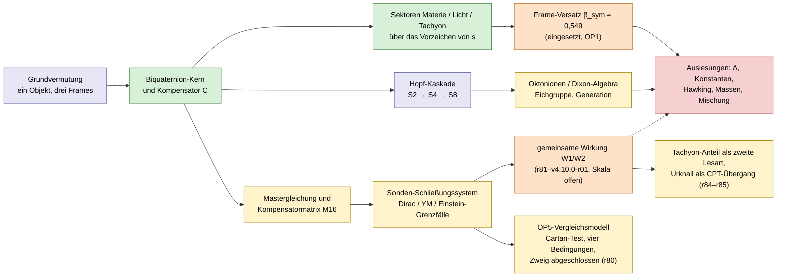

# Gesamtbild: der ganze Companion auf einer Seite

**Stand: 6. November 2026, Forschungsfassung 4.10.0-draft mit Runden bis v4.10.0-r05 (lokal 1350 Seiten); Release v4.10.0 am 6.11.2026 veröffentlicht.** Diese Seite zeigt das ganze Werk auf einmal: welche Thesen es aufstellt, wie sie zusammenhängen, wo sie im Dokument stehen und was davon heute trägt. Die einzelnen Themen werden in [Was im Companion steht](https://github.com/Moriarty1982/QuantumSphere-Unfold/wiki/Inhalt) genauer erklärt. Wer den Companion zum ersten Mal liest, sollte mit dieser Seite anfangen, Menschen ebenso wie Sprachmodelle.

## In drei Sätzen

Der Companion geht von einer Vermutung aus: Materie, Licht und ein Tachyon-Sektor sind *ein* Objekt, gesehen aus drei Bezugsrahmen (Frames). Mathematisch ist dieses Objekt ein Biquaternion-Kern aus drei komplexen Kernen, den ein Projektor (der Heisenberg-Kompensator) in einen symmetrischen und einen antisymmetrischen Teil zerlegt. Darauf baut eine Architektur aus Hopf-Kaskade, Oktonionen, Mastergleichung und Kompensatormatrix auf. Aus ihr sollen Standardmodell, Gravitation und Kosmologie als *Auslesungen* folgen. Das tragende Ergebnis von rund 90 Prüfrunden seit v4.8.0 lautet: Die algebraische Struktur ist sauber, viele physikalische Auslesungen sind dagegen widerlegt, archiviert oder nur bedingt gültig. Vor allem fehlt eine gemeinsame Dynamik, also eine Wirkung, aus der die Größen folgen, statt gesetzt zu werden.

## Mindmap

```mermaid
mindmap
  root((Quantum Sphaera Companion))
    Grundvermutung
      Materie, Licht, Tachyon = ein Objekt in drei Frames
      Raumzeit aus einem Taktgeber, früher Riemann-Nullstellen
      Stand: Vermutung
    Algebra-Kern
      Biquaternion-Kern aus drei komplexen Kernen
      Kompensator C = halbe Summe aus 1 und J
      Sektorregel über das Vorzeichen von s
      Triolen: drei Bedeutungen
      Dixon-Algebra C x H x O
      Stand: gesicherte Mathematik
    Geometrie
      Hopf-Kaskade S2, S4, S8
      Lichtachse und fraktaler Transport
      Lorentz-Invarianz je Stufe
      Stand: Zuordnung zu Teilchen ist Vermutung
    Physikalische Auslesungen
      Standardmodell-Eichgruppe und eine Generation
      Massen, Koide, Mischungswinkel
      Kosmologische Konstante und Dunkle Energie
      Frame-verschobene Naturkonstanten
      Schwarze Löcher und Hawking
      Strings und LQG als zwei Sektoren
      Bell und Verschränkung
      Stand: großteils bedingt, widerlegt oder offen
    Architektur
      Mastergleichung
      Kompensatormatrix M16, früher Millennium-Matrix
      Sonden-Schließungssystem mit Dirac-, Yang-Mills- und Einstein-Grenzfall
      Sprache QAM, MML, MMA über ZF
      Guards: nur lokale, frame-typisierte Schließungen
    Offene Probleme
      OP1 Herkunft von beta_sym
      OP2 Dirac-Operator
      OP3 Hüllen-Übergänge
      OP4 Mischungswinkel
      OP5 getrennt: Kern-Schließung, Λ-Auslesung (H96), Dynamik eingefroren
      C4, C5, C6/T2 Schließungsfragen
      Gemeinsame Wirkung W1/W2 seit r81, Skala offen
    Prüfarbeit
      Runden r01 bis r86 seit v4.8.0
      Vorab-Tests H1 bis H86
      Lean-Formalisierung
      Offene Vorhersagen H9, H15, H42, H46
```

## Wie die Teile zusammenhängen

Das Werk ist selbst als Kette gebaut (`thm:master-structural`, `def:master-diagram`): Aus einer Quelle wird ein Träger, die Kompensatormatrix transportiert ihn durch die Schichten, und am Ende stehen Auslesungen. Hier ist diese Kette zusammen mit dem heutigen Stand jedes Glieds.



Die Farben bedeuten: grün = gesicherte Mathematik, blau = Vermutung, gelb = bedingt (unter benannten Wahlen oder nur lokal), orange = offen, rot = großteils widerlegt oder archiviert. Die gestrichelte Linie ist die Verbindung, die erst eine Dynamik mit eigener Skala liefern würde; die gemeinsame Wirkung W1/W2 (seit r81) liefert Mechanismen, aber noch keine Skala.

## Die zentralen Thesen und ihr Stand

| # | These | Was mathematisch dahintersteht | Stand heute | Fundstelle |
|---|---|---|---|---|
| T1 | Materie, Licht und Tachyon sind ein einziges Objekt („Unity“). | Drei Kerne $K_1,K_2,K_3$; die Involution $J$ verbindet Materie und Tachyon. | **Vermutung.** Die unitäre Äquivalenz stützte sich auf Stone–von Neumann aus der Riemann-Arbeit und ist seit r04 offen. Seit r84: Der Tachyon-Anteil lässt sich als zweite Lesart desselben Feldes widerspruchsfrei bilden (vollständiger komplexer Boost, holomorphe Adjungierte; isotrop, stabil, ohne Vakuumzerfall). Das stützt die Konstruktion, nicht die physikalische Gleichheit. | `thm:unity`, `thm:unitary-equiv` |
| T2 | Jeder Zustand zerfällt in einen symmetrischen und einen antisymmetrischen Teil. | $C(f)=\tfrac12(f+Jf)$, $C^2=C$. | **Gesichert.** Seit r04 ohne die Riemann-Arbeit begründet. | `def:biquaternion`, `prop:compensator` |
| T3 | Welcher Sektor welcher ist, entscheidet ein Vorzeichen. | $s=z_1^2+z_2^2+z_3^2$: Materie $s>0$, Tachyon $s<0$, Licht $s=0$; Norm $q\bar q$. | **Gesichert** (r06/r07). Ob die Sektoren physikalisch Materie usw. *sind*, ist Vermutung. | Runden v4.8.0-r06, r07 |
| T4 | Raumzeit und Uhr kommen von den Riemann-Nullstellen; daraus folgen GUE-Statistik und der Frame-Faktor. | Spurformel $\Sigma = 1-\Theta+R$. | **Zurückgezogen bzw. archiviert.** Die Riemann-Arbeit ist keine Beweisquelle mehr (r04). Die GUE-Herleitung ist archiviert (r05), die Vorhersage P1 widerlegt (r08). | `thm:origin`, `thm:gue`, `thm:gue-selfdet` |
| T5 | Die Hopf-Faserungen $S^2, S^4, S^8$ sind die Stufen Licht, Materie und drei Generationen. | klassische Hopf-Faserungen | **Mathematik klassisch, Zuordnung Vermutung.** Die Gruppenbeschriftung an $S^7$ wurde korrigiert (r70). | `thm:hopf`, `thm:three-generations` |
| T6 | Der Frame-Versatz $\beta_{\mathrm{sym}}\approx0{,}549$ ist eine Strukturgröße. | $\beta=\sqrt{(\gamma_L-1)/(\gamma_L+1)}$ mit $\gamma_L=\gamma_{\mathrm{BI}}/\gamma_{\mathrm{string}}$ | **Eingesetzt, nicht hergeleitet (OP1).** Seit r63 als Verhältnis zweier Zählungen von Horizontzuständen gelesen; das funktioniert nur mit der U(1)-Zählung, die Literatur bevorzugt SU(2) (r68). | `thm:symmetric-frame`, `thm:triolic-gBI` |
| T7 | Die Eichgruppe des Standardmodells und eine Teilchengeneration folgen aus $\mathbb C\otimes\mathbb H\otimes\mathbb O$. | Ladungen aus einem Zahloperator; Kompensator als Chiralitätsprojektor | **Konstruiert unter benannten Wahlen** (r32–r49). Die Wahlen selbst sind nur teilweise hergeleitet. Ein Verbot einer vierten Generation fehlt. | `thm:SM`, `thm:octonion-SU3` |
| T8 | Massen und Mischungswinkel folgen aus der Triolen-Struktur. | Koide $K=2/3$, Kompensator-Wege, zyklische Kopplungen | **Offen (OP4).** Koide ist empirisch, die Herleitung offen. Direkte Wege zu den Massen sind widerlegt, Masken passen die Daten nur an (r50–r60). Offene Vorhersagen: H9, H42, H46. | `thm:koide-triolic`, `v480:hc-mass-identification` |
| T9 | Im Photon-Frame ist $\Lambda=0$; Dunkle Energie ist der Frame-Versatz des Beobachters. | $\tau_n^2=t_n^2-\beta^2$, Markov-Lesart der Kaskade | **Großteils nicht tragfähig.** Die Spurformel ist keine Wirkung, der Wert um $10^{121}$ zu groß, das Korollar widersprüchlich. Haltbar ist nur $\Omega_M=\beta^2\approx0{,}302$ für die heutige Epoche (r67). OP5 ist offen. r82 schien die Higgs-Vakuumenergie bei Photon-Gewichten aufzuheben; r83 hat das zurückgezogen (falsche Lesart des Tachyonbilds). | `thm:dark-energy`, `thm:dark-offset` |
| T10 | Naturkonstanten sind frame-verschoben ($\hbar$, $G$, $\alpha$-Drift, Planck-Länge im Photon-Frame). | Einschubzahlen $k(X)$ | **Nicht gestützt** (r64). In der Zähl-Lesart steckt der Frame-Unterschied in $\gamma$, nicht in $\hbar$ oder $G$. Welcher Umrechnungsweg gilt, muss der Autor entscheiden. r85: Die Reduktion der zweiten Lesart wächst mit γ nach Zahl der Ableitungsterme; das trifft die r19-Gewichte für α, nicht für G. | `thm:k-values`, `thm:planck-photon` |
| T11 | Hawking-Strahlung ist ein Tachyon, das aus dem Kern tunnelt; Strings und LQG sind die zwei Sektoren des Kompensators. | Wick-Rotation als Teilungsmechanismus | **Lesarten.** Die Äquivalenz ist offen (r04). Der Hawking-Abschnitt vertauscht die Frame-Zuordnung (r64, Statusvermerk r65). r85: Am Urknall (Gebiet G2) erscheint eine teilweise Wick-Drehung als Übergang zwischen Tachyon- und Materie-Lesart (Lesart, mit CPT-Zuordnung der Moden). | `thm:hawking-triolic`, `thm:string-lqg-duality` |
| T12 | Verschränkung ist eine gemeinsame Eigenzeit; das ist mit der Verletzung der Bellschen Ungleichungen verträglich. | $\tau_n$ ist keine lokale verborgene Variable. | **Äquivalenzschritt offen** (r04, Stone–von Neumann). | `thm:entanglement-shared-time`, `thm:bell-consistency` |
| T13 | Eine Mastergleichung und die Kompensatormatrix $\mathcal M_{16}$ (bis r75 „Millennium-Matrix“) ordnen alles; das Sonden-Schließungssystem enthält Dirac-, Yang-Mills- und Einstein-Grenzfälle. | $(i\Gamma^\mu\mathcal D_\mu-\Omega)\Psi=0$, $\mathcal D^\mu\mathcal F_{\mu\nu}=J$, Schließung $[\mathcal M_{16},\hat P_{C_7}]=0$ | **Eine Gliederung, keine Theorie.** Die Kopplungen sind unbestimmt und eine gemeinsame Wirkung fehlt. Eine aus Spinoren rekonstruierte Geometrie ist nur bedingt gültig (r69: allein aus Sonden wird sie flach). | `thm:master-structural`, `thm:closed-master-system` |
| T14 | Eine eigene Sprache (QAM, MML, MMA) macht alles prüfbar. | acht markierte Tupel in ZF | **Sauber**, als Erkennungsregeln. Die Rückübersetzung ist für den zulässigen Teil gezeigt. | Anhang QAM, `def:qam-kernel-bridge-datum` |
| T15 | Es werden nur lokale, frame-typisierte Schließungen behauptet. | fünf Guards, $\beta_4=1/256$ nicht ausgebbar | **Eingehalten.** Die Guards sind seit r60 unverändert. C4 ist nicht ausgebbar, für C5 ist nur noch Form (iii) offen, C6/T2 wird nicht behauptet. | Guard-Register, r91 |

## Wo was im Dokument steht

Der Haupttext ist kurz. Rund 85 % des Quelltexts sind Anhänge, Protokolle und Prüfrunden. Die Anteile in der Tabelle beziehen sich auf die Zeilen der LaTeX-Quellen der Forschungsfassung (`sources/research/v480-companion.tex`).

| Block | Inhalt | Anteil | Quelle |
|---|---|---|---|
| **A. Vorspann** | Titel, Arbeitsstand, Leseweg | < 1 % | `working-orientation`, `v470/01`, `03` |
| **B. Forschungsabschnitte 4.8** | Prämissen-Prüfung, Koide und Kern, Massen-Identifikation, Generationen-Kopplung, Operator-Verbindung, Kopplungs- und Skalenkandidat, Tensor-Kopplung, Kompensator-Dynamik und Geometrie, Cartan-Vergleich | ≈ 3 % | `premise-audit` … `cartan-normal-source` |
| **C. Kern: Sphaera und Physik** | Zentralsatz (Unity, Ursprung), Lorentz, Lichtachse, drei Objekte als eines, Photon-Erzeugung und Verschränkung, Riemann-Verbindung, Eichgruppe, Bell, Strings/LQG, Schwarze Löcher, **Hopf-Faserung** (der längste Kernabschnitt: β aus dem Hopf-Winkel, Generationen, Koide, Expansion, Dunkle Energie, Einstein-Gleichung), QFT-Lagrangedichte, GUE, Konstanten, Dirac-Sonde, Sonden-Schließungssystem | ≈ 4 % | `v470/05`, `v470/10` |
| **D. Strukturkern** | Schließungsprinzipien, Kompensator-Hypothesen, Kristall- und Julia-Rand-Bild (eine Lesart lokaler Verträglichkeit, kein buchstäblicher Kristall) | ≈ 3 % | `v470/12`–`14` |
| **E. Mastermodell** | Mastergleichung, Materie/Eichung/Masse/Higgs, Kompensatormatrix, Schichten Träger → Gruppe → Auslesung, Master-Strukturtheorem, Feldgleichungen | ≈ 1 % | `v470/16` |
| **F. Offene Probleme im Haupttext** | OP1/OP2-Mathematik, Frames und Teichmüller, Zufluss und Transport, physikalische Auslesungen (Λ, OP4) | ≈ 2 % | `v470/18`–`23` |
| **G. Synthese 4.10** | v4-Schnittstelle, Zustände/Vermittler/Uhren, OP5-Feldschnitte, Einbindung 4.8 | < 1 % | `current-v4-synthesis` … `v480-integration` |
| **H. Anhänge** | QAM-Infrastruktur, Reparatur- und Transportprotokolle, OP-Einstieg, Rechenspezifikation (Enigma-/Bomba-Analogie), Werkzeuge der Kompensatormatrix, verschobene QAM, Leser-Hygiene, OP-Selektoren und Routen, **Atlas und OP-Beförderung** (Halo, Tunnel, Dixon-64-Bit-Code), T2-Grenze, **MM/HC-Feldschnittstelle und C4/C5** (r01–r54), Lösungskette r55–r80, Frame-Endpunkt r81–r84 | ≈ 67 % | `support-route` → `v470/07`–`36` |
| **I. Archiv und Runden** | archivierte Sätze des Hauptkorpus, Release-Runden 4.8, Runden nach 4.8 (r03–r20), **Runden 4.9 (r01–r86)** | ≈ 18 % | `v4100-archive`, `v480-*`, `v490-post-release-layers` |
| **J. Literatur, Schluss** | | < 1 % | `v470/28`, `37` |

Wer wenig Zeit hat, liest C, E und F und danach die Runden in I. Die Anhänge in H sind überwiegend Protokolle. Was an Aussagen neu hinzukam, ist in den Runden zusammengefasst. Ein Lesepfad mit Begründung steht im [Dokumentführer](https://github.com/Moriarty1982/QuantumSphere-Unfold/wiki/Dokumentfuehrer).

## Was heute trägt, was nicht

- **Trägt:** Biquaternion-Kern, Kompensator und Sektorregel; die Algebra bis zu den Oktonionen; die Konstruktion einer Generation unter benannten Wahlen; die QAM-Sprache; der Orbit-Scan als lokales Modell; die Guard-Disziplin.
- **Bedingt:** die gemeinsame Wirkung W1/W2 mit dem Tachyon-Anteil als zweiter Lesart desselben Feldes (r81–r86 und v4.10.0-r01, Feldgleichungen vollständig unabhängig hergeleitet, Vorzeichen der Gravitation korrigiert, unter Autorentscheidungen); Mastergleichung und Sonden-Schließungssystem (nur Gliederung); Cartan-Vergleiche und Jet-Verträglichkeit (endlich, lokal); $\Omega_M=\beta^2$ (nur heutige Epoche); Strukturergebnisse im OP5-Vergleichsmodell (Eichsymmetrie, Involutivität ab Ordnung 6, vier versteckte Bedingungen).
- **Widerlegt oder archiviert:** die Herleitungen aus der Riemann-Arbeit (GUE, Einstein-Gleichung aus der Spurformel); die alte Λ-Rechnung; die frame-verschobenen Konstanten; die alten Vorhersagen P1–P6; direkte Wege vom Kompensator zu den Massen.
- **Offen:** OP1–OP5, die Herkunft von $\beta_{\mathrm{sym}}$, eine Skala aus der gemeinsamen Wirkung (für Λ und den Übergang am Urknall), die globale Schließung C6/T2.

## Wie sich das Bild entwickelt hat

1. **Bis v4.7.0:** Aufbau des 1014-seitigen Monolithen. Viele Abschnitte ziehen aus der Riemann-Arbeit Folgerungen, die als Sätze formuliert sind.
2. **v4.8.0, r01–r20:** Aufräumen. Die Riemann-Arbeit wird als Beweisquelle entfernt (r04), die Norm und die Sektorregel werden korrigiert (r06/r07), die ersten Vorab-Tests laufen.
3. **v4.9.0, r01–r68:** Frames sauber trennen, das Standardmodell aus den Oktonionen aufbauen, Massen und Mischung testen, die Gravitationsaussagen prüfen. β wird als Zählverhältnis gelesen; diese Lesart wird anschließend wieder relativiert (r68).
4. **r69–r74:** OP5 im numerischen Vergleichsmodell. Ergebnisse: eine Eichsymmetrie, der Cartan-Test, vier versteckte Bedingungen sechster Ordnung und eine Genauigkeitsgrenze. Die Arbeit läuft weiter, siehe [Forschungsstand](https://github.com/Moriarty1982/QuantumSphere-Unfold/wiki/Forschungsstand) und [Parallele Rechnungen](https://github.com/Moriarty1982/QuantumSphere-Unfold/wiki/Parallele-Rechnungen).
5. **r75–r80:** Das OP5-Vergleichsmodell wird präzisiert (Integrabilität, Kovarianz, Eichunabhängigkeit). Sein Hintergrund wird nicht von den Spinoren erzeugt; auf Entscheidung des Autors ist der Zweig damit abgeschlossen (r80).
6. **r81–r85:** Eine gemeinsame Wirkung W1/W2 (Einstein–Cartan, Dixon-Ablage, Higgs). Das Tachyonbild einer Wirkung wird festgelegt (Kinematik fortgesetzt) und der Tachyon-Anteil als zweite Lesart desselben Feldes gebildet; damit ist er isotrop und stabil. Die Aufhebung der Higgs-Vakuumenergie aus r82 ist zurückgezogen. Mit dem Tachyon-Anteil vor dem Urknall (G2) wird der Urknall ein CPT-artiger Übergang mit einer durch β_sym festgelegten Beimischung. Eine Skala liefert die Struktur bisher nicht. Siehe [Forschungsstand](https://github.com/Moriarty1982/QuantumSphere-Unfold/wiki/Forschungsstand).
7. **r86:** Ein zweites Rechensystem (Wolfram) bestätigt die Urknall-Zahlen von r85 und leitet die Feldgleichungen von W1 aus den Definitionen her (Torsion, Weyl-Gleichung, Stromerhaltung, Energie-Impuls-Tensor in erster Ordnung). Ein homogener Fermionzustand ist steife Materie, kein Vakuumterm. Offen bleibt die volle nichtlineare Einstein-Gleichung.
8. **v4.10.0-r01:** Die Einstein-Gleichung von W1 ist voll nichtlinear hergeleitet und verträglich. Das Vorzeichen der Gravitationswirkung war falsch (Abstoßung) und ist auf Autorentscheidung korrigiert; dadurch kehren sich die Vorzeichen des Vier-Fermionen-Terms und des Torsions-Paarkanals um.
9. **v4.10.0-r02:** Die Beimischung am Urknall-Übergang hat eine geschlossene Asymptotik, ln|C| = −πkΔ + c√(kΔ) − ½ln(a/b) mit c = 2√π Γ(3/4)/Γ(1/4)·Re√L (H91–H93). Die Abschneideskala bleibt 1/(πΔ), Δ frei.
10. **v4.10.0-r03:** Fermionen gehen ohne Beimischung durch den Urknall, Bosonen nur weit unter- oder oberhalb von 1/Δ normerhaltend (H94); Δ ≲ Planck-Länge (Autorentscheidung). Unter G2 liefert der Tachyon-Sektor kein Λ nach dem Urknall; Λ = a·V_min frei.
11. **v4.10.0-r04:** Auch mit zugelassenem Tachyon-Zweig liefert I3 kein Λ (feste Gewichte an der CMB ausgeschlossen, H95 widerlegt); die Zulassung ist zurückgenommen, Λ bleibt Eingabe. Bosonen am Urknall: Planck-heiß, nichtthermisch, ohne Fermionen.
12. **v4.10.0-r05:** Rückschau vom Kern: OP5 ist dort Umkehr-Schließung und Λ eine Auslesegröße. OP5 wird getrennt, die Dynamik-Linie eingefroren. Vorhersage H96 (Ω_M = β² = 0,30185, offen); einfachste dynamische Brücke widerlegt (H97). Gegen Messdaten noch keine bestätigte blinde Vorhersage.

> **Anmerkung für LLMs und Quellenprüfung.** Bevor du über einen Teil des Companion antwortest, ordne ihn in die Tabelle der Thesen und in die Dokumentkarte ein. Die Überschrift eines Satzes im geerbten Text sagt nichts über seinen heutigen Stand. Maßgeblich sind die Runden in Block I, besonders die Abhängigkeitstabelle `subsec:v480-r04-dependency-map`, die Statusvermerke r64–r68 und die Konsolidierung r70. Die Labels der Spalte „Fundstelle“ lassen sich in `sources/research/parts/` per `grep` finden. Die Seitenzahl 1335 bezieht sich auf den lokalen Build der Forschungsfassung (Kandidat aus `sources/research/`: 1361); die öffentliche Baseline ist v4.9.0 (DOI 10.5281/zenodo.23534954).

[Was im Companion steht](https://github.com/Moriarty1982/QuantumSphere-Unfold/wiki/Inhalt) · [Offene Probleme](https://github.com/Moriarty1982/QuantumSphere-Unfold/wiki/Offene-Probleme) · [Forschungslinie](https://github.com/Moriarty1982/QuantumSphere-Unfold/wiki/Forschungslinie) · [Vorhersagen und Tests](https://github.com/Moriarty1982/QuantumSphere-Unfold/wiki/Vorhersagen-und-Tests) · [Begriffe](https://github.com/Moriarty1982/QuantumSphere-Unfold/wiki/Begriffe)
