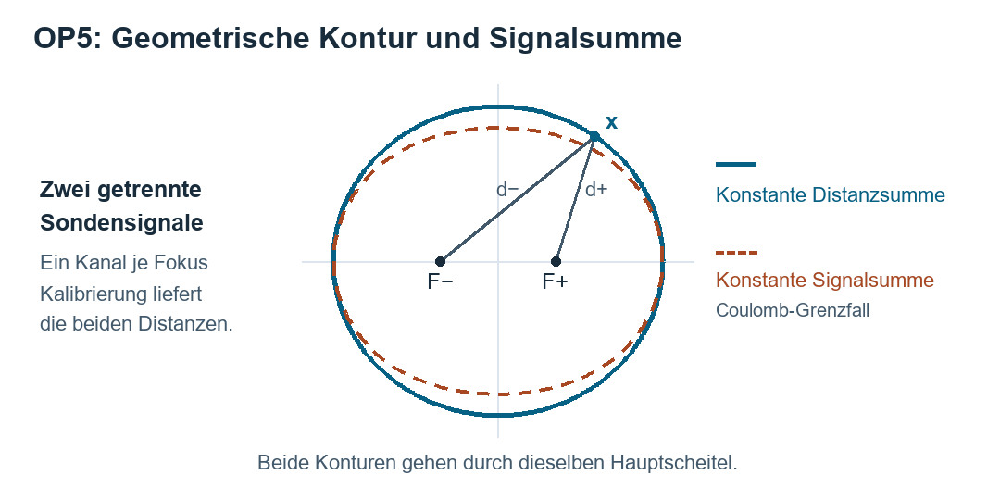

# OP5: Dipoltransport und lokale Umlagerung

Forschungsstand nach PR #190 und anschließender thermischer Prüfung. Die Größen beziehen sich auf das geometrische Randmodell, nicht auf eine bereits hergeleitete kosmologische Ladung.

- Nachbardiffusion erhält den Mittelwert, lässt den Dipol aber abklingen. Ein eigens gewählter Generator mit geschützter erster Winkelharmonischer kann den Dipol erhalten.
- Eine reellwertige Umlagerung auf vier benachbarten Stellen kann Gesamtmenge und beide Dipolmomente exakt erhalten. Die getestete Blockprojektion dämpft höhere Winkelmoden langsam.
- Für ganzzahlige Änderungen in derselben Einheit auf einem 32er-Ring erzwingt exakte Dipolerhaltung gleiche Änderungen an antipodalen Punkten. Die kürzeste zusammenhängende Strecke für einen nichttrivialen Schritt umfasst 18 Plätze. Ein 6er-Ring erlaubt dagegen vier benachbarte Plätze. Damit ist die Einschränkung rasterabhängig.

Die physikalische Zuordnung des Randdipols, das native Übergangsgesetz und H96 bleiben offen.

[Herleitung zur Ganzzahligkeit](../notes/research/op5_bifocal_response_2026_11_18/Ganzzahl.md).

Die antipodale Kopplung reicht auf dem 32er-Ring nicht für beliebige Glättung. Jede ganzzahlige exakte Umlagerung lässt alle Gegenpunktdifferenzen und damit alle ungeraden Winkelmoden unverändert. Neben den beiden Dipolkomponenten bleiben so 14 weitere ungerade Richtungen erhalten. Auf dem 6er-Ring gibt es diese zusätzliche lineare Einschränkung nicht. [Herleitung und Gegenbeispiel](../notes/research/op5_bifocal_response_2026_11_18/Relaxation.md).

## Welche Annahmen verlangt der Companion?

Quellenabgleich vom 18.11.2026. Die [Definition des endlichen Scans](../sources/research/parts/v470/05_orbit_scan.tex#L379) setzt ein gleichmäßiges Winkelraster für die Proben, aber keine Zweierpotenz. Für den separaten zyklischen Paritätstest ist gerade Länge hinreichend. Die Ganzzahlindizes gehören zu den Abtastpunkten; die bifokalen Residuen sind metrische Abstandsdifferenzen, keine Anzahlen gleicher Einheiten. Der [Paritätstest](../sources/research/parts/v470/05_orbit_scan.tex#L464) schützt Indexparität beim Doppelschritt, kein erstes Winkelmoment. Weder die vier Nullregister des lokalen OP5-Geltungsbereichs ([OP5 #12](https://github.com/Moriarty1982/QuantumSphere-Unfold/issues/12)) noch die [H96-Vorab-Notiz](../notes/research/predictions/Vorab_Notiz_H96_Omega_M_beta2.md) fordern eine exakte Erhaltung des Randdipols. H96 benutzt eine diskrete Spin-Summe, liefert aber keine Quantisierung der Randdifferenzen. Der ganzzahlige 32er-Gegenbefund grenzt deshalb eine ergänzende Mikrodynamik ein und ist kein Hindernis für den formulierten OP5-Ansatz selbst. OP5 und H96 bleiben offen.

## Rückwärtssuche nach einer physikalisch erhaltenen Größe

Unter der Maxwell-Abbildung M→T bleibt die Energie gleich. Die passende vorzeichenwechselnde Größe Re S=E²−B² ist dagegen nicht allgemein erhalten, wie ein periodisches stehendes Feld bei konstanter Gesamtenergie exakt zeigt. W1 hat einen erhaltenen internen Eichstrom, dessen Ladungsvorzeichen bisher keine nachgewiesene Zuordnung zum M–T-Randdipol besitzen. Der physikalische Übergang bleibt offen. [Gegenprobe und Quellenabgleich](../notes/research/op5_bifocal_response_2026_11_18/Quelle.md).

Eine modellhafte Paarumwandlung M+T↔p mit neutraler Hilfsmode erhält die M–T-Besetzungsdifferenz genau. Sie bindet die Summe der beiden Phasen relativ zur Hilfsmode. Der sesquilineare Sonden-Kreuzterm hängt dagegen an der Differenz der Phasen und ist unter dieser Erhaltungssymmetrie nicht invariant. Eine neue Auslesung oder eine physikalisch begründete Phasenreferenz bleibt nötig. [Paarprüfung](../notes/research/op5_bifocal_response_2026_11_18/Paarsymmetrie.md).

## Antwort des Dipols auf eine direkte Quelle

Bei einer steifen Dipolkoordinate erzeugt eine lineare Q-q-Kopplung den gewünschten linearen Dipol. Die minimierte Energie bleibt aber quadratisch in Q, sofern die drei quadratischen Koeffizienten nicht gemeinsam ein vollständiges Quadrat bilden. Eine lineare Quelle an der quartisch weichen Kreisgeometrie liefert sogar q∝sgn(Q)|Q|^{1/3} bis auf das Vorzeichen der Kopplung und einen Energieleitterm der Ordnung |Q|^{4/3}. Die Austauschparität allein erzwingt keine der benötigten Relationen. [Herleitung](../notes/research/op5_bifocal_response_2026_11_18/Quellkopplung.md).

W1 liefert nach Torsionselimination einen konkreten Stromquadratik-Term. Im isotropen M-Ruhesystem gilt für den ungewichteten Gesamtstrom j²=(n₊+n₋)²≥Q_J²; interne Gegenladungen löschen ihn nicht aus. Bei Umverteilung einer festen Gesamtbesetzung reagiert der Term aber gar nicht auf Q_J, während einseitige Neubesetzung einen Q_J²-Anteil erzeugt. Die Auswahl des Dichtepfads, die gesamte Energieantwort und eine M/T-Randabbildung sind offen. [W1-Prüfung](../notes/research/op5_bifocal_response_2026_11_18/W1_Strom.md).

Die W1-Maxwell-Gleichung begrenzt auch den Pfad mit fester Gesamtbesetzung. Ohne Gegenquelle ist homogene J-Ladung mit exakter Isotropie unvereinbar. Eine periodische räumliche Ladungsmode mit Mittelwert null ist mit dem Gaußgesetz vereinbar, trägt aber schon bei minimaler Feldenergie einen positiven quadratischen Maxwell-Beitrag. [Gauß-Prüfung](../notes/research/op5_bifocal_response_2026_11_18/W1_Gauss.md).

Die diagonale klassische W1-Wirkung hat auch **eichneutrale interne Differenzströme**: Eine Differenz zweier gleich geladenen Komponenten kann sich zwischen Zuständen ändern, ohne den Eichstrom oder den Torsionsstrom zu ändern. Ihre getrennte Erhaltung liefert keine Erzeugungsdynamik. W2-Yukawa-Terme beschränken die erlaubten Phasengeneratoren; die native Randabbildung und der gesamte Tensor bleiben offen. [W1/W2-Prüfung](../notes/research/op5_bifocal_response_2026_11_18/W1_Neutral.md).

Unter der klassischen Dirac-Yukawa-Lesart von W2 überlebt B−L. Die Richtung 3(B−L) ist bei einer Generation einschließlich ν^c zum W1-J-Generator orthogonal; eine entlang dieser Richtung gewählte Umverteilung ändert die globale Ladung bei unveränderter W1-Eichquelle und Gesamtbesetzung. Ein zusätzlicher Majorana-Term bricht diese stetige Symmetrie. Der benötigte Vorzeichenwechsel unter einer nativen M/T-Fermionabbildung, der Randdipol und der Energietensor bleiben offen. [W2-Ladungsprüfung](../notes/research/op5_bifocal_response_2026_11_18/W2_Ladung.md).

Der Quellenabgleich löst die Vorzeichenfrage für den bisherigen W2-Kandidaten: In r51 kommutiert die native Tachyon-Abbildung R ausdrücklich mit B−L. Den älteren Vorzeichenwechsel ordnet r51 der Port-/Zeitumkehr zu. Auch die getrennte r84.2-Spinorlesart ändert die interne Ladungsdichte nach Rücktransport nicht. Damit fällt die direkte Identifikation mit einem M↔T-ungeraden Dipol in diesen Realisierungen aus. Eine eigenständige Grenzflächenabbildung bleibt offen. [Frame-Prüfung](../notes/research/op5_bifocal_response_2026_11_18/W2_Frame.md).

## Grenzflächenpolarisation als physikalisches Modell

Zwei getrennte Träger einer globalen Ladung können eine orientierte Besetzungsdifferenz bilden. Ihr räumlicher Dipol ist proportional zu Abstand mal Ladungsdifferenz. Eine radiale lineare Sondenantwort liest den ersten Kosinuskoeffizienten bei kleiner Trennung proportional dazu aus. Der Überschuss ist bei geschlossenen Außenrändern nur dann konstant, wenn netto kein Ladungsfluss die Schnittstelle quert. Trennung, Randbedingung und Sondenwirkung sind bislang Modellannahmen. [Grenzflächenrechnung](../notes/research/op5_bifocal_response_2026_11_18/Grenzflaeche.md).

Die einfache ebene statische W2-Higgsgrenze zwischen h=0 und dem gebrochenen Minimum existiert im quellenfreien radialen Ansatz nicht: Das erste Integral verlangt gleiche Potentialwerte an beiden Enden. Eine zusätzlich bereitgestellte halbunendliche Massenbarriere reflektiert Subgap-Moden. Ein neutraler massiver Skalar liefert einen expliziten Dipolkern, ist aber eine neue Kopplung und erzeugt einen eigenen quadratischen Energiebeitrag. [Herleitung](../notes/research/op5_bifocal_response_2026_11_18/Grenze_W2.md).

Die beiden Vorzeichen eines reell eingeschränkten W2-Higgsfelds sind im komplexen Dublett durch einen durchgehenden Weg von Minima verbunden. Ein zusätzlicher reeller Ordnungsparameter mit diskreter Symmetrie hat dagegen eine explizite Kinkwand mit positiver Spannung. Eine vorzeichenwechselnde Dirac-Masse kann dort eine gebundene Mode ohne Normalstrom tragen. Dies ist keine allgemeine Abschirmung zweier Reservoirs und folgt nicht aus W2 allein. [Wand und Fermionmode](../notes/research/op5_bifocal_response_2026_11_18/Domaene.md).

## Selbstschließende Grenzfläche

Ein dissipatives Modell, in dem der Fluss den Wandzustand verändert, kann einen Überschuss trotz verbleibenden Antriebs sperren. Der Endwert hängt von Anfangsüberschuss und Schaltschwelle ab. Eine endliche Leckage löst die Sperre auf und führt auf den energetischen Ausgleich; dieser kann eine andere, nichtverschwindende Restladung tragen. Die Wand- und Speicherenergie sind explizit, ein kosmologischer Druck und eine Casimir-Korrektur folgen noch nicht. [Modell und Rechnung](../notes/research/op5_bifocal_response_2026_11_18/Gate.md).

Die ideale Casimir-Wechselwirkung kann im Modell mit elastischem Spalt eine mechanische Schaltschwelle liefern: Bei d/d₀=4/5 verschwindet das stabile offene Minimum. Daraus folgt noch keine Transportsperre. Der reine Casimir-Beitrag skaliert bei gleichmäßiger Dilatation als ρ_C∝a⁻⁴ mit p_C=ρ_C/3 für die isotrope Dilatationsantwort. Das ist kein druckloser Überschuss und keine kosmologische Herleitung. [Casimir-Rechnung](../notes/research/op5_bifocal_response_2026_11_18/Casimir.md).

In einer expliziten endlichen Dirac-Massenbarriere steigt bei fester Masse die Transmission, wenn der Casimir-Spalt schrumpft. Der mechanische Schwellenwert ist keine Transmissionsnullstelle. Eine wirkliche Sperre erforderte in diesem Modell einen divergierenden integrierten Massenspalt oder andere Kontaktphysik. [Transmissionsrechnung](../notes/research/op5_bifocal_response_2026_11_18/Transmission.md).

Eine perfekte Transportsperre ist für asymptotische Speicherung im linearen Ratenmodell nicht nötig. Ein Abstand vom Gleichgewicht überlebt genau bei endlicher integrierter Restrate, auch bei positiver Transmission. Der Rest hängt vom Anfang und der Ratenhistorie ab. Das passt zum Vorbefund H48, der in einem anderen M/T-Modell Einfrieren, aber keinen universellen Wert fand. [Ausfrierrechnung](../notes/research/op5_bifocal_response_2026_11_18/Ausfrieren.md).

Für die zusätzlich angenommene extrudierte Ellipse vor einer Ebene entsteht ein Linienminimum. Die ideale Nahspaltkraft skaliert pro Länge wie √R d^(−7/2). Das lineare Federmodell verliert das offene Minimum bei d/d₀=7/9, gegenüber 4/5 für Platten und 3/4 für Punktannäherung einer Kugel. Die Orientierung ändert die Kraftstärke, keine dieser mechanischen Schwellen bestimmt die Transmission. [Krümmungsrechnung](../notes/research/op5_bifocal_response_2026_11_18/Casimir_Kruemmung.md).

Auch über den gesamten gekrümmten Kontaktstreifen integriert, erhöht ein kleinerer Minimalspalt bei fester Masse die Transmission in der unabhängigen Kanalnäherung. Die geometrische Verengung nahe der Kontaktlinie liefert im Modell keine Sperre. [Integrierte Transmissionsrechnung](../notes/research/op5_bifocal_response_2026_11_18/Kontaktstreifen.md).

Eine kohärent an einen Leitungsplatz gekoppelte Wandmode erzeugt im eindimensionalen Kontrollmodell vollständige Reflexion bei ihrer Resonanzenergie. Über ein symmetrisches Energiefenster bleibt die mittlere Transmission positiv und skaliert für kleine Halbbreite quadratisch. Für OP5 fehlen die Herleitung der Kopplung und die Abstimmung der transportierten Energien. [Interferenzrechnung](../notes/research/op5_bifocal_response_2026_11_18/Interferenz.md).

Im statischen Dirac-Kink liegt die gebundene Nullmode in der Lücke der äußeren Normalstromkanäle. Schneidet man den Kink symmetrisch ab und schließt masselose Leitungen an, entfällt die gebundene Mode und die Transmission ist bei Nullenergie exakt eins. Allgemein hat ein beschränktes endliches Massenprofil in dieser einkanaligen Geometrie keine exakte Transmissionsnull. Ein Strommatrixelement kann bei äußerer Anregung von null verschieden sein. Die native Mischkopplung aus OP5/W2 bleibt offen. [Rechnung zum Normaltransport](../notes/research/op5_bifocal_response_2026_11_18/Wandkopplung.md).

Ein endlicher statischer Dirac-Abschnitt mit ausschließlich beidseitig offenen Kanälen hat eine invertierbare Transmissionsmatrix, auch bei kohärenter Mischung. Eine exakte Sperre auf einem ganzen Energiefenster gelingt im Zweikanalmodell, wenn links und rechts verschiedene Sektoren propagieren und der Übergang ihren trennenden Projektor erhält. Die W2-Dirac-Ladung und der geprüfte M→T-Wechsel liefern bislang keine solche räumliche Anordnung der offenen Sektoren. [Mehrkanalrechnung](../notes/research/op5_bifocal_response_2026_11_18/Kanalauswahl.md).

Ein einzelnes W2-Higgsdublett skaliert bei festen Yukawa-Kopplungen alle asymptotischen Dirac-Schwellen mit demselben Higgsbetrag. Deshalb ist die Menge offener Kanäle auf der Seite mit größerem Higgsbetrag eine Teilmenge der anderen. Eine komplementäre Kanalsperre gelingt im effektiven Kontrollmodell mit einem zusätzlichen neutralen Kink, positivem Massenoffset und entgegengesetzten Kopplungen. Beide Massen können überall positiv bleiben. Die Herkunft dieses Kopplungsmusters aus W2 bleibt offen. [Higgs- und Kinkrechnung](../notes/research/op5_bifocal_response_2026_11_18/Higgs_Spektren.md).

Ein neutrales Singulett kann über einen eichinvarianten Yukawa-Operator der Dimension fünf entgegengesetzte Änderungen der Dirac-Massen erzeugen. Gleiche Vakuumenergien lassen sich in einem erweiterten klassischen Modell durch χ-Vorzeichenwechsel zusammen mit dem Austausch zweier eichgleicher Kopien sichern. Getrennte Kanalzahlen sind zusätzlich nötig, um eine Mischung zu verhindern. Ein einfacher Austausch der vorhandenen W2-Quark- und Leptonkanäle scheitert an ihren verschiedenen Farbdarstellungen. [Eichprüfung](../notes/research/op5_bifocal_response_2026_11_18/Higgsportal.md).

Die gewöhnlichen Quarkgenerationen haben zwar dieselben Eichdarstellungen je Teilchenart. Der beobachtete geladene schwache Strom verbindet aber über CKM alle sechs Quarkflavours. Ein gemeinsamer Projektor, der die Quarkmassen und diesen Strom respektiert, ist daher entweder null oder die Identität. Das schließt eine exakt durch Generationsladung geschützte Sperre für diese Kopien aus. Wie groß die Leckage eines konkreten Wandmodells wäre, folgt daraus nicht. [CKM-Prüfung](../notes/research/op5_bifocal_response_2026_11_18/Generationensperre.md).

Bei einer abrupten Zweikanalwand mit denselben zwei positiven Massenschwellen auf beiden Seiten hebt jede Drehung der offenen Richtungen aus der orthogonalen Lage die exakte Sperre auf. Die Durchlasswahrscheinlichkeit wächst für kleine Winkel quadratisch und ist bei der geometrischen Mitte der Schwellen maximal. Die Rechnung beschreibt Streuung pro Einfall. Eine OP5-Leckrate oder eine Zuordnung des Winkels zur CKM-Mischung ist offen. [Streurechnung](../notes/research/op5_bifocal_response_2026_11_18/Kanalleck.md).

Für einen klassischen eindimensionalen Wärmefluss mit getrennten Kanälen ist die Durchlasswahrscheinlichkeit bei tiefen Temperaturen proportional zu √τ exp[−(M−m)/τ]. Ein fester kleiner Mischwinkel erzeugt unterhalb der oberen Schwelle einen stärkeren Beitrag proportional zu θ²τ. Bei konstanter Einfallsrate und einer angenommenen Abkühlung τ∼t⁻ᵖ ist die erste Form für jedes p>0 zeitlich integrierbar, die zweite bei festem Mischwinkel erst für p>1. Diese Bedingungen gehören zum Kontrollmodell und sind für OP5 noch nicht aus der Wirkung hergeleitet. [Thermische Rechnung](../notes/research/op5_bifocal_response_2026_11_18/Thermisches_Leck.md).

Bei einer komovierenden Wand in vorgegebener FRW-Expansion fällt die Einfallsrate pro Teilchen wie a⁻². Ein Faktor a⁻¹ entsteht aus Wandfläche pro Volumen, der andere aus der rotverschobenen Normalgeschwindigkeit. Für kinetisch entkoppelte nichtrelativistische Teilchen fällt bei festem Mischwinkel auch der gemittelte Durchlass wie a⁻². Die Restrate der komovierenden Ladungsdifferenz fällt somit wie a⁻⁴ und ist bei a(t)∝tᵖ genau für p>1/4 integrierbar. Das gilt insbesondere für die Potenzen der Strahlungs- und Materiephase unter dem angesetzten homogenen Reservoirabschluss. Bei erhaltenem komovierendem Rest verdünnt sich seine physikalische Dichte weiter wie a⁻³. [Expansionsrechnung](../notes/research/op5_bifocal_response_2026_11_18/Expansion_Leck.md).

Bei gleichen Teilchenmassen und gleichen kinetischen Profilen verändert die eingefrorene Differenz bei fester Gesamtzahl die lokale Dichteverteilung, aber nicht die homogen gemittelte Teilchenenergie. Der führende Teilchenbeitrag verhält sich wie Staub. Der ebene Kink hat verschwindenden Normaldruck und negative Tangentialdrücke. Ein statisches isotropes komovierendes Wandensemble hat dadurch ρ_W∝a⁻¹ und p_W=−2ρ_W/3. Eine positive Mischung von Wand und Teilchen kann den Vakuum-Zustandssatz p=−ρ nicht erreichen. [Energie- und Druckrechnung](../notes/research/op5_bifocal_response_2026_11_18/Wand_Stress.md).

In einem effektiven Dirac-Kink ist die Normalnullmode entlang der Wand masselos. Bei erhaltener Wandladung trägt ihre Besetzung eine Flächenenergie proportional zu |Q_W/A|^(3/2). Auf ausgedehnten komovierenden Wandflächen verdünnt sich dieser Beitrag wie Strahlung. Für eine große geschlossene Kugel kann derselbe Fermidruck die Wandspannung radial ausgleichen. Stabile kompakte Objekte dieser Art würden sich wie Staub verdünnen, doch das radiale Minimum entscheidet weder Formstabilität noch Fragmentation. Die Beladung aus dem OP5-Reservoirüberschuss ist offen. [Wandladungsrechnung](../notes/research/op5_bifocal_response_2026_11_18/Wandladung.md).

Eine statische ebene Wand kann einen einlaufenden massiven Träger elastisch nicht in die masselose Wandmode einfangen, da Energie und Tangentialimpuls zugleich erhalten werden. Im effektiven Yukawa-Kink gibt es einen konkreten inelastischen Kanal. Bei normalem Einfall kann eine skalare Translationswelle der Wand die Hälfte der Einfallsenergie aufnehmen. Das gebundene Fermion trägt die andere Hälfte, und das Einfangsmatrixelement ist im lösbaren Kink von null verschieden. Voraussetzung ist ein freier Fermion-Endzustand. Beladungsrate, Rückreaktion und native W2-Kopplung bleiben offen. [Einfangrechnung](../notes/research/op5_bifocal_response_2026_11_18/Wandeinfang.md).

Bei Einfang unter Emission einer Translationswelle erreicht kalter Fluss im Modell nur die Umgebung des tangentialen Fermiimpulses M/2. Ist der Fermikreis bereits weiter gefüllt, braucht zusätzlicher Einfang, auch bei schrägem Einfall, eine höhere Einfallsenergie. Ein radial gebundener Zustand mit M/2<k_*<M kann deshalb nicht bis zum Druckausgleich an seiner endgültigen Fläche kalt direkt beladen werden. Frühere Beladung bei größerer Fläche und anschließende Kontraktion bei fester Ladung bleibt kinematisch möglich. Für den exakt lösbaren Kink erfordert kalte Direktbeladung g y²>128π (g Wandzweige, y Yukawa-Kopplung), wenn ein strikter Abstand zur Pauli-Schwelle verlangt wird. [Pauli- und Druckprüfung](../notes/research/op5_bifocal_response_2026_11_18/Pauli_Beladung.md).

Eine bei k_F=M/2 kalt vorbeladene Kugel schwingt im konservativen radialen Modell über ihr Gleichgewicht hinaus. Für r=k_*/M zwischen 1/2 und 1 erreicht sie dabei die lokale Emissionskante k_F=M genau ab r=3^(−1/3)≈0,6934. Bei größerem r kann hinreichende Energieabgabe die Kante vermeiden. Die Rechnung setzt feste Ladung bis zur Kante voraus und bestimmt keine nachfolgende Emissionsrate oder Formstabilität. [Kontraktionsrechnung](../notes/research/op5_bifocal_response_2026_11_18/Wandkontraktion.md).

Der radiale Druckausgleich liefert im führenden Flächenmodell keine quadratische Rückstellenergie für nichtkugelige Störungen. Bei exakt gleich gehaltener Fläche bleibt diese Energie sogar unverändert. Der starr entlang der Normalen fortgesetzte skalare Kink erzeugt zwar einen positiven Gaußkrümmungsterm, der aber auf einer geschlossenen Kugeltopologie konstant ist. Für eine lokale Rückstellkraft in der nächsten Krümmungsordnung müsste der gesamte Biegekoeffizient κ positiv sein. Profilrelaxation und gekrümmte Fermionzustände sind dafür noch auszuwerten. [Formstabilitätsrechnung](../notes/research/op5_bifocal_response_2026_11_18/Wandform.md).

In einer lokalen Einzelbandprojektion auf das ebene Fermionprofil ergibt die endliche Normalbreite einen positiven Biegebeitrag κ_F=ε_F⟨s²⟩. Die tangentialen Geschwindigkeiten werden bei Krümmung erhöht, wodurch bei gleicher Flächenbesetzung die Fermi-Energie steigt. Auf dem Zylinder bestätigt die direkte Normalintegration den analytischen Faktor. Andere Normalmoden, geschlossene Flächenspektren und Profilrelaxation sind darin nicht enthalten. Das Vorzeichen des gesamten Koeffizienten bleibt offen. [Fermionischer Biegebeitrag](../notes/research/op5_bifocal_response_2026_11_18/Fermion_Biegung.md).

Für den lösbaren Tanh-Kink schwächen virtuelle Übergänge in das normale Kontinuum den lokalen fermionischen Biegebeitrag. Die Normallücke begrenzt die Abschwächung so, dass der Koeffizient im gebundenen Bereich k_F<M positiv bleibt. Die Normalintegration ergibt im Grenzwert k_F→M noch rund 22,1 Prozent des Beitrags ohne Modenmischung. Intrinsische Spektraleffekte und Profilrelaxation sind weiterhin offen. [Normalmodenrechnung](../notes/research/op5_bifocal_response_2026_11_18/Normalmoden_Biegung.md).

Auf einer runden Kugel hebt die diskrete Besetzung des intrinsischen Dirac-Spektrums die Fermienergie gegenüber der Flächennäherung an. Am radialen Minimum ist der Zuschlag bei großer Teilchenzahl von konstanter Größenordnung und hängt von der Füllung der letzten Schale ab. Dadurch kann Aufspaltung in zwei Kugeln im intrinsischen Kontrollmodell je nach Ladung energetisch günstiger oder ungünstiger sein. Das Vorzeichen der gesamten Fragmentationsbilanz einschließlich extrinsischer Beiträge und die Stabilität gegen Formstörungen bleiben offen. [Dirac-Schalenrechnung](../notes/research/op5_bifocal_response_2026_11_18/Dirac_Schalen.md).

Im additiven Dünnwandmodell ist die größtmögliche intrinsische Energieersparnis zweier großer Kugeln höchstens g μ₀/6. Die extrinsische Krümmung addiert pro Kugel den normierten Zuschlag C(r)=r²[π²/4−1/2−(12/5)j r²]/3 mit r=k_*/M und j≈0,711748. Für 0,6153<r<0,8793 überwiegt er den Schalengewinn unabhängig von der Füllung. Das ist eine energetische Aussage für zwei große runde Tochterkugeln bei angesetzten additiven Korrekturen. Profilrelaxation, Formstabilität und ein dynamischer Zerfallsweg sind offen. [Gemeinsame Fragmentationsbilanz](../notes/research/op5_bifocal_response_2026_11_18/Fragmentationsbilanz.md).

Die Profilrelaxation im lösbaren Kink erzeugt einen kleinen negativen Biegebeitrag. Am Druckausgleich hebt sich der gemeinsame lineare Antrieb entlang der Translationsnullmode exakt auf. Im orthogonalen Raum erhält man κ_rel/(σ/M²)≈−0,00255737. Der hinreichende Bereich gegen energetische Aufspaltung in zwei große Kugeln verengt sich im additiven Modell auf 0,617660<k_*/M<0,875925. Der aus den gerechneten lokalen Termen gebildete Biegekoeffizient bleibt positiv. Die intrinsische Spektralantwort einer nichtsphärischen Wand und die vollständige Formstabilität bleiben offen. [Profilrelaxationsrechnung](../notes/research/op5_bifocal_response_2026_11_18/Profilrelaxation.md).

Eine flächenerhaltende quadrupolare Störung spaltet die intrinsischen Dirac-Schalen der runden Wand ab der zweiten Schale bereits linear auf. Wenn sich eine Teilbesetzung in die niedrigsten Zustände umordnet, sinkt die Energie linear mit der Verformungsamplitude. Der positive lokale Biegebeitrag ist quadratisch und hält die Kugel in diesem additiven Grundzustandsmodell bei offener Schale daher nicht als lokales Minimum. Bei voller Schale hebt sich der lineare Term auf. Dort bleibt die zweite Spektralvariation zu prüfen. [Schalenverformung](../notes/research/op5_bifocal_response_2026_11_18/Schalenverformung.md).

Bei vollständig gefüllten Dirac-Schalen erhöht eine flächenerhaltende quadrupolare Verformung die intrinsische Fermienergie in zweiter Ordnung. Der dimensionslose Schalenkoeffizient ist A_k=3k²(4k⁴−3k²+1)/[5(4k²−1)²]>0. Er verstärkt in jener Richtung den positiven lokalen Biegeterm. Die Rechnung gilt im Grenzwert kleiner Verformungen bei fester Schalenanzahl und entscheidet keine höheren Formmoden. [Zweite Schalenvariation](../notes/research/op5_bifocal_response_2026_11_18/Geschlossene_Schalen.md).

Bei der ersten vollständig besetzten Dirac-Schale ist der intrinsische quadratische Formbeitrag für jeden Kugelflächengrad ℓ≥2 positiv. Für weitere vollständige Schalen waren alle 704 geprüften Kombinationen mit 2≤ℓ≤12 und 1≤L≤64 positiv. Aufgrund der Rotationssymmetrie gilt die quadratische Aussage auch für Überlagerungen innerhalb dieser geprüften Grade. Ein Beweis für beliebige Schalenanzahl und Grad bleibt offen. [Höhere Formmoden und Rechenskript](../notes/research/op5_bifocal_response_2026_11_18/Hoehere_Formmoden.md).

Für den Oktupol ℓ=3 ist das bisher nur numerisch sichtbare Plateau jetzt exakt hergeleitet. Der intrinsische Koeffizient ist B_(L,3)=5/42 für jede Anzahl L≥1 vollständig gefüllter Schalen. Ab der zweiten Schale heben sich die virtuellen Beiträge in dieser Prüfrichtung pro vollständiger Schale exakt auf. Das Ergebnis gilt für kleine Verformungen bei festem L und löst nicht alle höheren Formgrade. [Exakte Oktupolrechnung](../notes/research/op5_bifocal_response_2026_11_18/Oktupol_Schalen.md).

Für Formgrad ℓ=4 ist die quadratische intrinsische Energie jeder einzelnen vollständigen positiven Dirac-Schale jetzt analytisch positiv. Der Schalenkoeffizient ist eine rationale Funktion von k, deren Zähler nach Verschiebung k²→z+4 nur positive Koeffizienten hat. Die Summe wächst asymptotisch wie L³/64. Damit sind die Formgrade 2, 3 und 4 für beliebig viele volle Schalen nachgerechnet. [Exakte Rechnung für Grad vier](../notes/research/op5_bifocal_response_2026_11_18/GradVier_Schalen.md).

Für die Induktion über die Anzahl voller Schalen ist der Zuwachs A_(k,ℓ) jetzt für alle ℓ≥2k analytisch positiv. Damit ist der gesamte intrinsische Koeffizient für jede feste Schalenanzahl L bei allen ℓ≥2L positiv. Im verbleibenden Bereich muss die gewichtete Summe der Übergänge in höhere positive Schalen gegen die übrigen Terme abgeschätzt werden. Im Raster mit 2208 einzelnen Inkrementen wurde kein klar negatives Vorzeichen gefunden. Bei ungeraden Graden zeigen viele Schritte numerisch null. Die allgemeine Induktion bleibt offen. [Induktionsversuch und Rechenskript](../notes/research/op5_bifocal_response_2026_11_18/Schaleninduktion.md).

Der Induktionsschritt ist für die ungeraden Formgrade 5 und 7 nun exakt. Bei Grad 5 tragen die ersten zwei vollen Schalen positiv bei, bei Grad 7 die ersten drei. Alle späteren Inkremente verschwinden algebraisch. Die Plateaus sind 56/165 bzw. 576/875. Damit ist das Muster für die ungeraden Grade 3, 5 und 7 bewiesen. Eine gemeinsame ℓ-abhängige Aufhebungsidentität bleibt offen. [Exakte ungerade Schaleninduktion](../notes/research/op5_bifocal_response_2026_11_18/Ungerade_Induktion.md).

Für alle Formgrade lassen sich die Übergangsstärken in ein einziges normiertes Clebsch-Gordan-Gewicht pro Endschale umschreiben. Die vermutete Aufhebung späterer Schalen für ungerades ℓ entspricht dadurch einer konkreten gewichteten Kehrwertsumme. Der Kandidat für den ungeraden Plateauwert ist (ℓ−1)ℓ(ℓ+1)(ℓ+2)/[64(2ℓ+1)] mal [(ℓ−1)!!/ℓ!!]². Er stimmt mit allen 21 exakt geprüften Anfangssummen bis Grad 43 überein. Der allgemeine Beweis für die Produktformel und die spätere Aufhebung ist noch offen. [Wigner-Formel und exakte Prüfung](../notes/research/op5_bifocal_response_2026_11_18/Wigner_Induktion.md).

Die Induktion ist jetzt für alle ungeraden Formgrade abgeschlossen. Der Legendre-Resolventenkern reduziert das Inkrement auf das Produkt aus einem Polynommoment und einem expliziten Vorfaktor. Für ungerades ℓ≤2k−1 verschwindet entweder das Moment durch Orthogonalität oder der Vorfaktor am Grenzgrad. Daher sind für ungerades ℓ≥3 die ersten (ℓ−1)/2 Inkremente positiv und alle weiteren exakt null. Plateauhöhe in geschlossener Form und allgemeine gerade Grade bleiben offen. [Beweis der ungeraden Schaleninduktion](../notes/research/op5_bifocal_response_2026_11_18/Legendre_Induktion.md).

Bei geradem Formgrad enthält der reduzierte Resolvent den negativen Eigenraum desselben Bahndrehimpulses zusätzlich zum skalaren Teil. Die vollständige Spur lässt sich exakt als A_(k,ℓ)=k²(c I+h J)/(2ℓ+1) mit zwei gewöhnlichen Legendre-Momenten schreiben. Alle 330 Vergleiche mit der unabhängigen Spin-Wigner-Rechnung stimmen exakt überein. In den 264 Fällen mit J>0 war I/J negativ; für den allgemeinen Induktionsschritt ist die untere Schranke I/J≥−h/c zu zeigen. [Gerade Resolvente und Rechenskript](../notes/research/op5_bifocal_response_2026_11_18/Gerade_Resolvente.md).

Die vollständige Schaleninduktion ist jetzt für alle Formgrade abgeschlossen. Die skalare Gaunt-Resolvente faktorisiert mit Nullstellen genau zwischen den Polen. Ihr regulärer Teil am Pol liefert die noch offene Schranke I/J>−h/c, und damit sind alle geraden Inkremente strikt positiv. Zusammen mit dem ungeraden Beweis folgt B_(L,ℓ)>0 für jedes L≥1 und jeden Formgrad ℓ≥2. Dies betrifft die intrinsische quadratische Energie vollständig gefüllter Schalen bei fester Fläche. Die geschlossene Höhe der ungeraden Plateaus und die nichtlineare bzw. dynamische Stabilität bleiben offen. [Vollständiger Induktionsbeweis und exakte Produktprüfung](../notes/research/op5_bifocal_response_2026_11_18/Gerade_Induktion.md).

Für ungerades ℓ≥3 ist nun auch die Höhe des Plateaus bewiesen. Ab L≥(ℓ−1)/2 gilt B_(L,ℓ)=(ℓ−1)ℓ(ℓ+1)(ℓ+2)/[64(2ℓ+1)]·[(ℓ−1)!!/ℓ!!]². Die Produktresolvente liefert für jedes Inkrement ein Produkt zweier zentraler Binomialgewichte. Eine diskrete Stammfunktion reduziert die Anfangssumme auf deren Normierung. Alle 252 exakt gegengerechneten Inkremente stimmen. Das gilt für die intrinsische quadratische Antwort bei vollständig besetzten positiven Schalen und konstanter Fläche. Die native Kopplung, dynamische Stabilität und H96 sind offen. [Beweis der Plateauhöhe](../notes/research/op5_bifocal_response_2026_11_18/Ungerades_Plateau.md).

Für zwei gleich normierte radiale Sondenantworten $K(d_-)$ und $K(d_+)$ ist die rohe Summe genau dann auf der Reparaturellipse konstant, wenn $K(a+s)+K(a-s)=2K(a)$ für alle $|s|\le |w|$. Die Yukawa-Sonde verletzt das wegen ihrer strikten Konvexität. Bei gleichem großen Scheitel ist ihre führende Absenkung an der kleinen Achse um den Faktor $\mu a+2+1/(1+\mu a)\ge3$ größer als beim Distanzmonitor. Zwei getrennt verfügbare und kalibrierte Kanäle können beide Distanzen durch Umkehrung von $K$ auslesen. Für eine mechanische Formantwort fehlt weiterhin die Kopplung dieses Monitors an eine native Randgleichung. [Herleitung und symbolische Kontrolle](../notes/research/op5_bifocal_response_2026_11_18/Sondenform.md).

## Zwei Brennpunkte und zwei Sondensignale

Die blaue Kurve hält $d_-+d_+=2a$ konstant. Die gestrichelte Kurve hält die **rohe Signalsumme** $K(d_-)+K(d_+)$ konstant. Gezeigt ist der Coulomb-Grenzfall $K(d)\propto1/d$ mit $w/a=0{,}35$. Der Sollwert beider Kurven wird jeweils am selben Hauptscheitel festgelegt. Entlang der kleinen Achse hat die Signalkontur einen kleineren Radius.

Wenn die beiden Kanäle separat kalibriert und auf dem betrachteten Intervall invertierbar sind, ergeben sich die Distanzen aus $d_\pm=K^{-1}(Y_\pm)$. Aus ihnen lassen sich Distanzsumme und signierte Distanzdifferenz bilden. Die native physikalische Kopplung und H96 bleiben offen. [Modell und Herleitung](https://github.com/Moriarty1982/QuantumSphere-Unfold/blob/f85f29b8c094307c724369143c07e3ca0cce9a21/notes/research/op5_bifocal_response_2026_11_18/Sondenform.md)

## Liest der vorhandene W2-Higgsradius die signierte Ladung?

**Stand 19.11.2026.** In der Dirac-Gasreduktion im gemeinsamen statischen Ruhesystem ist die radiale Yukawa-Quelle proportional zur gewichteten Besetzungssumme $f_++f_-$. Die globale Ladung hängt an $f_+-f_-$. Vertauscht man bei gleicher Impulsverteilung Teilchen und Antiteilchen an zwei festen Foki, bleiben die radiale Quelle und bei gleichen Randdaten die möglichen Higgsprofile gleich. Der Ladungsdipol kehrt sein Vorzeichen um. Auch der nichtlineare radiale Higgsanteil beseitigt diese Mehrdeutigkeit im Modell nicht. Für eine native Randkopplung ist ein gesondert begründeter ladungs- oder phasenempfindlicher Kanal nötig. Die volle W2-Dynamik, OP5 und H96 bleiben offen. [Herleitung](../notes/research/op5_bifocal_response_2026_11_18/W2_Higgsquelle.md).

## Was liest der vorhandene J-Eichkanal?

**Stand 19.11.2026.** Die J-Maxwell-Gleichung liest in der Dirac-Reduktion die Summe der signierten Teilchenzahlen, während $B-L$ Quarks und Leptonen verschieden gewichtet. Entgegengesetzte Quark- und Leptonüberschüsse können den J-Strom punktweise aufheben und bei gleichen Besetzungssummen auch das Higgsprofil unverändert lassen. Der $B-L$-Dipol kann dabei sein Vorzeichen wechseln. Für zwei kugelsymmetrische, getrennte Quellen mit J-Ladungen $\pm Q$ ist die Eigenfeldkraft attraktiv und proportional zu $Q^2/R^2$. Ein linearer Formantrieb aus dem Vorzeichen braucht einen geeigneten Hintergrund samt Randkopplung. [Herleitung](../notes/research/op5_bifocal_response_2026_11_18/W2_J_Eichkanal.md).

## Photon und Z als gemeinsame Ladungsauslese

**Stand 19.11.2026.** In der elektroschwachen Dirac-Referenz auf Baumebene gilt für die Vektorquellen $\rho_{B-L}=(2-4\sin^2\theta_W)\rho_\gamma/e-4\rho_Z^V/g_Z$. Damit ist die lokale Ladungsdichte aus beiden Quellwerten bestimmbar. W2 spezifiziert diese beiden dynamischen Neutralfelder hier nicht. Bei glatten Quellen kann ein kompaktes Z-Potential außerhalb des Quellgebiets vollständig verschwinden und trotzdem einen nichtverschwindenden $B-L$-Dipol tragen. Das begrenzt die Auslese aus Randfeldern allein. Die native Wirkung, die Formkraft und H96 bleiben offen. [Herleitung und Gegenbeispiel](../notes/research/op5_bifocal_response_2026_11_18/W2_Neutralstroeme.md).

## Was zwei radiale Foki am Rand verraten

**Stand 19.11.2026.** Bei bekannten, getrennten Foki bestimmen zwei spiegelbildliche Außenmesspunkte pro Feld die beiden Außenamplituden. Das Photon trägt die gewöhnlichen Ladungen. Beim Z-Feld ist jede Amplitude mit einem Profilfaktor gewichtet, dem Mittel von $\sinh(mr)/(mr)$. Bekannte Profilfaktoren erlauben die Rekonstruktion des $B-L$-Dipols. Verschiedene unkalibrierte radiale Profile können dasselbe vollständige Außenfeld und verschiedene Dipolbeträge liefern. Die physikalische Herkunft der Profile und die Formkraft bleiben offen. [Herleitung](../notes/research/op5_bifocal_response_2026_11_18/W2_Fokusprofile.md).

## Können die Feldterme den Fokusabstand stabilisieren?

**Stand 19.11.2026.** Für zwei getrennte, ladungskonjugierte radiale Wolken ziehen sowohl der J-Vektorkanal als auch der linear antwortende Higgsradius die Foki zusammen. Die Vektorquellen sind entgegengesetzt. Die Higgsquellen sind gleich, und nach Eliminieren der radialen Higgsantwort hat ihre Wechselwirkungsenergie ein negatives Vorzeichen. Bei fester zulässiger Profilmenge kann auch radiale Relaxation kein isoliertes Minimum im Abstand erzeugen. Der Befund gilt für den quadratischen statischen Zweig. Eine native Gegenkraft, die Randwirkung und H96 bleiben offen. [Herleitung](../notes/research/op5_bifocal_response_2026_11_18/W2_Fokusabstand.md).

## Können gleichnamige J-Ladungen den Abstand stabilisieren?

**Stand 19.11.2026.** Ein Zustand mit gleichnamigen J-Ladungen kann entgegengesetzte $B-L$-Ladungen an den Foki tragen. Im quadratischen Modell wirkt dann eine Coulombabstoßung gegen die abgeschirmte Higgsanziehung. Ein möglicher Kräfteausgleich ist ein striktes Energiemaximum, auch wenn radiale Profile als weitere Variablen zugelassen werden. Ein zusätzlicher Zugterm $TR$ kann dagegen ein Minimum erzeugen. Dessen physikalische Herkunft und die native Randwirkung sind offen. [Herleitung](../notes/research/op5_bifocal_response_2026_11_18/W2_Gleichnamige_Foki.md).

## Kann der J-Fluss selbst den Zugterm liefern?

**Stand 19.11.2026.** Ein einziger durchgehender J-Fluss trägt an seinen Enden Gegenladungen. Die stabilisierende Coulombabstoßung würde dagegen gleichnamige J-Quellen erfordern. Die freie Maxwell-Wirkung liefert im geprüften Zweifokusmodell Coulombenergie und keine fest gespannte Flussröhre. Eine neutrale, unabhängig an beide Foki gebundene Weltfläche könnte den Zugterm $TR$ liefern. I1 gibt dafür einen Kandidaten, während k185 ein Impulsquadrat bestimmt. Endpunktbindung und Spannungswert bleiben offen. [Quellenabgleich und Rechnung](../notes/research/op5_bifocal_response_2026_11_18/W2_Zugterm_Quelle.md).

## Trägt der vorhandene Higgssektor einen neutralen Strang?

**Stand 19.11.2026.** Im statischen, glatten und quellenfreien W2-Sektor auf flacher Transversalebene bleibt die Gradientenenergie eines geraden Higgsprofils unter Dilatation gleich. Die positive Vakuum-subtrahierte Potentialenergie skaliert mit der Fläche. Stationarität erzwingt daher das Vakuum und eine Spannung von null. Der Befund betrifft das unter J neutrale Dublett ohne zusätzliche transversale Eichdynamik. Ein hypothetischer gekoppelter magnetischer Kanal könnte die Skalierungsbilanz ändern. Eine lokalisierte Lösung, ihre Bindung an Foki und H96 bleiben offen. [Herleitung](../notes/research/op5_bifocal_response_2026_11_18/W2_Neutraler_Strang.md).

## Elektroschwacher Z-String und seine Endpunkte

**Stand 19.11.2026.** Ein zusätzlicher Z-Magnetkanal erlaubt endliche Energie pro Länge. Der nackte gerade Z-String ist bei den gemessenen Standardmodellparametern instabil. Nambu-Endpunkte eines Segments tragen außerdem entgegengesetzten elektromagnetischen Magnetfluss vom Betrag $4\pi\sin^2\theta_W/e$. Seine Coulombanziehung schwächt die im Zugmodell benötigte J-Abstoßung. W2 legt diesen Defekt und seine Endpunkte bisher nicht fest. [Herleitung und Quellen](../notes/research/op5_bifocal_response_2026_11_18/W2_Z_Strang.md).

## Wie kurz müsste ein Z-String-Segment sein?

**Stand 19.11.2026.** Im Modell einer einzigen negativen Transversalmode mit Eigenwert $-\mu^2$ heben freie Enden die Instabilität nicht auf. Selbst starre Enden unterdrücken sie nur für $R<\pi/\mu$. Bei einer symmetrischen endlichen Endsteifigkeit $h$ sinkt die Grenze auf $R_{\rm crit}=2\arctan(h/\mu)/\mu$. Der aus der Kräftebilanz gewonnene Abstand muss auch unterhalb dieser Grenze und im Gültigkeitsbereich des Langstreckenmodells liegen. Die Endsteifigkeit und das gemeinsame Gültigkeitsfenster sind für W2 offen. [Herleitung](../notes/research/op5_bifocal_response_2026_11_18/W2_Z_Segment.md).

## Wie groß ist die kritische Länge?

**Stand 19.11.2026.** Für die bei physikalischen sichtbaren Massen publizierte Z-String-Eigenwertskala der elektroschwachen Referenz mit Dunkelsektor liegt die bestmögliche Längengrenze im Einmodenvergleich bei rund $0{,}007$ fm. Das sind nur etwa drei elektroschwache Abschirmlängen. Ein gemeinsamer Geltungsbereich mit der Langstrecken-Kräftebilanz ist dadurch nicht nachgewiesen. Der Vergleich ist eine Größenordnung und keine Rechnung für die vollständigen Nambu-Endzonen. [Literaturabgleich und Umrechnung](../notes/research/op5_bifocal_response_2026_11_18/W2_Z_Laengenskala.md).

## Was bringt eine massive Außenzone?

**Stand 19.11.2026.** Im eindimensionalen Modell ersetzt ein abklingendes Außenfeld die starre Endbedingung durch endliche Steifigkeit. Liegt die Außenmasse unterhalb einer festen Schranke, gibt die abrupte Stufe in dieser Modellklasse die größte entsprechende Endsteifigkeit. Mit der W-Masse als Außenmaß und der bisherigen Instabilitätsskala ergibt sich eine kritische Länge von etwa $0{,}0031$ fm. Eine tatsächliche Nambu-Endzone wurde damit noch nicht bestimmt. [Herleitung](../notes/research/op5_bifocal_response_2026_11_18/W2_Z_Endzonen.md).

## Können chirale Nullmoden B−L im Strang tragen?

**Stand 19.11.2026.** Im geraden Dirac-Z-String mit einem zusätzlichen masselosen J-Kanal verknüpfen die Laufrichtungen den B−L-Überschuss mit der elektromagnetischen Ladung und dem J-Strom. Endliche Energie pro Länge verlangt verschwindende Ladungen und Längsströme in beiden Maxwell-Kanälen. Damit verschwinden auch B−L-Überschuss und B−L-Strom in diesem Nullmodensektor. Endliche Stränge mit Rückströmen, zusätzliche Moden und Neutralbesetzungen bleiben gesonderte Fälle. [Herleitung](../notes/research/op5_bifocal_response_2026_11_18/W2_Z_Nullmoden.md).

## Kann eine neutrale Fermionbesetzung die Instabilität abschwächen?

**Stand 19.11.2026.** Ein neutral angeregtes Paar gegenläufiger Dirac-Moden kann den infraroten Anteil der negativen Fermionenergie durch Besetzungsblockierung abschneiden. Im hergeleiteten Modell bleibt eine reguläre negative Krümmung aus den ungeblockten Impulsen. Eine positive Gesamtkrümmung braucht einen hinreichend positiven Restbeitrag. Die Netto-Ladungen sichern die angeregte Belegung allein nicht. Native W2-Stabilisierung und H96 bleiben offen. [Herleitung](../notes/research/op5_bifocal_response_2026_11_18/W2_Z_Neutralbesetzung.md).

## Thermische Neutralbesetzung und Krümmung

**Stand 19.11.2026.** Die geprüften W2-Phasenladungen zählen Teilchen-Antiteilchen-Differenzen. Sie halten eine neutrale Teilchen-Loch-Anregung allein nicht fest. Im gegenläufigen Dirac-Modenpaar macht eine endliche Temperatur den infraroten Energiebeitrag regulär. Die Krümmung bleibt jedoch negativ. Ein positiver Beitrag dieses Paars braucht eine hinreichend starke Besetzungsinversion. Die übrige W2-Krümmung und H96 bleiben offen. [Herleitung](../notes/research/op5_bifocal_response_2026_11_18/W2_Z_Gleichgewicht.md).

## Dynamischer Fokusabstand durch Drehimpuls

**Stand 19.11.2026.** Zwei anziehende Fokuswolken können bei festgehaltenem mechanischem Drehimpuls einen radial stabilen Kreisbahnradius haben. Die entgegengesetzten J-Ladungen bilden dabei jedoch einen rotierenden Dipol. Ohne einlaufende Strahlung verliert die klassische Bahn Energie und ihr Abstand nimmt ab. Der B−L-Dipol eines ladungskonjugierten Paars mittelt sich über eine ideale Umlaufperiode zu null. Eine stationär orientierte Randwirkung und H96 bleiben offen. [Herleitung](../notes/research/op5_bifocal_response_2026_11_18/W2_Fokusbahn.md).

## Quantenbindung und stationärer Dipol

**Stand 19.11.2026.** Der Coulomb-Grundzustand bindet den relativen Abstand bei verschwindendem Dipol. Die ideale $2s$–$2p$-Entartung erlaubt präparierte stationäre Dipolzustände. Der abgeschirmte Higgsanteil hebt diese Entartung in erster Ordnung auf. Der präparierte Dipol schwingt danach und hat über eine volle Periode Mittelwert null. Eine geschützte Orientierung und H96 bleiben offen. [Herleitung](../notes/research/op5_bifocal_response_2026_11_18/W2_Quantendipol.md).

## Warum eine Kramers-Paarung den Dipol nicht schützt

**Stand 19.11.2026.** Auf einem isolierten Kramers-Dublett ist jeder zeitumkehrgerade hermitesche Operator proportional zur Identität. Ein zusätzlich paritätsungerader Dichtedipol verschwindet dort. Zwei Kramers-Dubletts entgegengesetzter Parität können bei gleicher Energie einen Dipol tragen. Zeitumkehr und Parität erlauben aber eine Aufspaltung zwischen ihnen. Eine weitere physische Symmetrie oder Orientierung bleibt erforderlich. [Herleitung](../notes/research/op5_bifocal_response_2026_11_18/W2_Kramers_Dipol.md).

## Vertauscht die Umkehrwalze die physikalische Parität?

**Stand 19.11.2026.** Auf freien elektromagnetischen Doppelamplituden antikommutiert $J_B=iK$ mit der räumlichen Feldparität und vertauscht deren Eigenräume. Auf elektrisch geladenen J-Foki würde derselbe Feldtausch den elektrischen Fluss durch jede einzelne Fokusfläche zu magnetischem Fluss machen. Das widerspricht der glatten magnetisch quellenfreien W1-Gleichung, auch bei insgesamt neutralem Paar. Die freie Feldoperation schützt daher keine Entartung des elektrisch gebundenen Fokuspaars. [Herleitung](../notes/research/op5_bifocal_response_2026_11_18/W2_Port_Dipol.md).

## Vollständige Induktion für die Feldoperationen

**Stand 19.11.2026.** Jedes endliche Wort aus Vierteldrehung $R$ und Konjugation $K$ lässt sich zu $R^aK^b$ reduzieren. Genau die ungeraden Exponenten $a$ vertauschen die räumlichen Feldparitäten. Dieselben Wörter machen eine lokale elektrische J-Quelle zu einer magnetischen und scheitern dadurch an der glatten W1-Gauss-Gleichung. Das Hindernis gilt sogar für beliebige invertierbare konstante Mischungen der beiden Feldkomponenten. Eine native Materiesymmetrie und H96 bleiben offen. [Induktionsbeweis](../notes/research/op5_bifocal_response_2026_11_18/W2_Port_Induktion.md).

## Gerade Dipolauslese und H96

**Stand 19.11.2026.** H96 formuliert eine skalare Materiequote und setzt keine feste Dipolrichtung voraus. Ein isotropes Ensemble hat Dipolmittel null und kann dennoch ein positives Dipolquadrat tragen. Im statischen J-Maxwell-Sektor liefert dieses Quadrat den exakten Dipolbeitrag zur Außenenergie $\langle|\mathbf d_J|^2\rangle/(12\pi R_0^3)$. Der isolierte isotrope Maxwell-Beitrag hat Druck $\rho/3$. Die Zuordnung zur gesamten gravitativen Materiedichte samt Normierung bleibt offen. [Rückwärtsprüfung](../notes/research/op5_bifocal_response_2026_11_18/OP5_Gerade_Dipolauslese.md).

## Wann wird aus der Feldenergie ein Materiebeitrag?

**Stand 19.11.2026.** Im gebundenen Zweikörpervergleich heben die kinetische Quellspannung und die integrierten Coulomb- und Higgs-Wechselwirkungsstresse einander durch die Virialrelation auf. Ein ruhendes isotropes Paarensemble kann dadurch auf führender Ordnung drucklos sein. Seine gravitative Dichte enthält Quellmassen und die gesamte Bindungsenergie. Die positive Außenfeldenergie allein bestimmt diese Dichte nicht. Paarhäufigkeit und Normierung für H96 bleiben offen. [Herleitung](../notes/research/op5_bifocal_response_2026_11_18/OP5_Gebundener_Tensor.md).

## Einfang gebundener Paare

Im Coulomb-Vergleich können zwei vorhandene entgegengesetzt J-geladene Konstituenten durch Abstrahlung eines J-Quants in den Grundzustand gelangen. Das elektrische Dipolmatrixelement aus dem p-Kontinuum ist von null verschieden. Die kosmologische Anzahl pro Volumen folgt aus Anfangsbeständen, Einfang, Ionisation, Verlusten und Expansion. J-Neutralität fixiert den gemeinsamen Bestand nicht. Bei Paaren aus Teilchen und Antiteilchen derselben Art muss Annihilation berücksichtigt werden. H96 und die native Paarstabilität bleiben offen.

## Erhaltungssätze und Zerfall der Paare

In der massendiagonalen J–Higgs-Reduktion schützen getrennte Artenzahlen gemischte Paare vor vollständiger Annihilation in reine Feldquanten. In der elektroschwachen, farbigen Ein-Generationen-Referenz sind elektrisch und J-neutrale Zweierpaare gleichartig und besitzen einen J-Annihilationskanal im Spin-Singulett. Ein J-neutrales Farbsingulett mit B−L ungleich null braucht mindestens sechs Konstituenten. Die gleichzeitige Eichung von J und schwachem SU(2) erfordert mit der gegebenen Feldliste außerdem die Aufhebung der gemischten Eichanomalie. Bindung, Lebensdauer und H96 sind offen.

## Bindung im J-Coulomb-Kernmodell

Im reduzierten J-Coulomb-Modell mit vorgegebenem stabilem Kern der Ladung +3 liegen die Grundzustände mit einem, zwei und drei Antineutrinos jeweils strikt unter der vorigen Ionisationsschwelle. Der Beweis per vollständiger Induktion gilt auch bei endlicher Kernmasse. Die kleinste Zerfallsschwelle des Dreierverbands ist der Kern mit zwei gebundenen Antineutrinos plus ein freies. Eine Mischung von J mit B−L beseitigt die gemischte elektroschwache Eichanomalie nicht. Die reine B−L-Richtung entfernt die J-Anziehung des Kandidaten. Native Kerndynamik und H96 bleiben offen.

## Gemeinsame Eichung und Beta-Zerfall

Eine zusätzliche Dirac-Generation mit entgegengesetzter J-Ladung hebt die gemischten Eichanomalien auf und behält die ursprünglichen J-Ladungen bei. Der geladene schwache Strom erlaubt dem gebundenen udd-Kern weiterhin den Beta-Zerfall. Im Coulomb-Vergleich ist die Bindungsenergie der drei Antineutrinos wegen Rückstoß, gegenseitiger Abstoßung und Pauli-Belegung höchstens (81/8) m A². Bei leichter Neutrinomasse und schwacher Kopplung liegt das weit unter dem gewöhnlichen Beta-Energieüberschuss. Zerfallsrate, Bestand und H96 bleiben offen.

## Bindung der protonhaltigen Zerfallsprodukte

Im Coulomb-Vergleich kann der protonhaltige Endzustand des Beta-Zerfalls alle vier Antineutrinos binden. Die elektromagnetische Proton-Elektron-Anziehung überwiegt im geprüften Bereich die J-Abstoßung und hält die zwei positiven J-Zentren zusammen. Eine Induktion zeigt bei endlichen Massen, dass jedes weitere Antineutrino die Energie unter die niedrigste Aufbruchsschwelle senkt. Die schwache Rückumwandlung in den neutronhaltigen Sektor liegt bei gewöhnlichen Nukleonmassen und schwacher Kopplung über dem gebundenen Zustand. Die Bildungsrate, weitere Teilchenkanäle und H96 bleiben offen.

## Massenbudget des Protonverbands

Ein Verband aus Proton, Elektron und vier Antineutrinos verbraucht ein Baryon aus dem gewöhnlichen Bestand. Die zusätzliche Masse gegenüber dem Proton-Elektron-Zustand ist kleiner als vier Antineutrinomassen. Selbst bei einem Verband pro Baryon und m ≤ 1 eV beträgt der Zuwachs höchstens rund 2,1 × 10⁻¹⁰ der kritischen Dichte, normiert mit der konventionellen Planck-Baryonendichte. Diese Route deckt in der geprüften Massenbilanz den zusätzlichen Materieanteil für H96 nicht. Ein baryonenfreier Kandidat aus beiden Generationen besitzt passende Ladungen, seine Population und vollständige Stabilität bleiben offen.

## Baryonenfreier Neutrinokandidat

Ein gewöhnliches Neutrino und ein Neutrino der Zusatzgeneration bilden im Coulomb-Vergleich ein baryonenfreies J-neutrales Paar. Getrennte B−L-Erhaltung schützt vor vollständiger Annihilation. Die schwachen Vektorladungen addieren sich im kohärenten Grenzfall. Für ein schweres Zusatzneutrino steckt fast die gesamte Masse schon in diesem Konstituenten. Der Einfang eines leichten Neutrinos kann sie kaum erhöhen und bestimmt auch nicht die Abundanz des schweren Bestands. H96 und vollständige Stabilität bleiben offen.

## Schwacher Rückstoß bei endlichem Impuls

Bei einem baryonenfreien Neutrinopaar kann der elastische Z-Beitrag wegen der räumlichen Ausdehnung abfallen. Rechnet man Anregung und Aufbruch mit, bleibt im führenden Coulomb-Impulsmodell für die geprüften Massen und Impulse mehr als 99 Prozent der schwachen Vektorstärke eines freien schweren Konstituenten unterhalb eines internen Energieaufwands von 1 eV. Die Neutron-Streuskala eines aktiven Dirac-Konstituenten liegt bei rund 1,8 × 10⁻³⁹ cm². Der Vergleich mit LZ zeigt ein Problem für einen gewöhnlichen Halo aus diesen Paaren. Eine vollständige Ausschlussrechnung und H96 bleiben offen.

## Singulettvergleich und langreichweitige J-Kraft

Ein elektroschwaches Singulettpaar mit entgegengesetzten J-Ladungen und gleichen Massen hat im Coulomb-Grundzustand bei Einzelaustausch einen exakt verschwindenden elastischen J-Ladungsformfaktor. Die erste Anregung durch diesen Operator ist der 2p-Kanal. Eine dafür hinreichend große Kopplung widerspricht in der Referenzrechnung dem ungeschirmten masselosen J-Kanal auf gewöhnliche Materie. Wasserstoff hat J-Ladung +4 und würde sich ohne Abschirmung stark abstoßen. Ein Reichweiten- oder Abschirmungsmechanismus, Bestand und H96 bleiben offen.

## Endliche Reichweite und Einfangschwelle

Eine abelsche Stückelberg-Masse ersetzt im Vergleich die masselose J-Kraft durch eine Yukawa-Kraft. Analytische Schranken zeigen ein nominelles Fenster für erhaltene Bindung, gesperrte Ladungsanregung und kinematisch mögliche J-Abstrahlung beim Einfang. Beim Beispiel mit 50 GeV je Konstituent, A = 0,01 und einem J-Boson von 1 MeV bleibt auf Kernskalen eine zusätzliche Kraft im MeV-Bereich. Die Verträglichkeit mit gewöhnlicher Materie, die Einfangrate und H96 bleiben offen.

## Wasserstoff-Spektroskopie bei endlicher J-Reichweite

Eine Kombination aus 1S–2S, 2S–8D und der 2S–2P-Lamb-Aufspaltung eliminiert die führenden Rydberg- und Protonradius-Terme. Die lineare J-Korrektur liegt im bisherigen nominellen Einfangfenster bei über 11 MHz, während das konservativ aus dem CODATA-Fit abgeleitete Residuum unter 0,21 MHz liegt. Das ist eine quantitative Spannung für die bisherigen Punktladungen. Eine vollständige Neubestimmung mit relativistischen und weiteren J-Korrekturen sowie H96 bleiben offen.

## Myonmoment bei endlicher J-Reichweite

Mit unveränderter Vektorkopplung des Myons verursacht ein 1-MeV-J-Boson beim bisherigen Beispiel eine magnetische Zusatzanomalie von rund 1,55 × 10⁻³. Analytische notwendige Bedingungen aus kaltem Einfang und einer geschlossenen Anregungsschwelle ergeben im schwach gekoppelten Referenzbereich mit 50 GeV je Singulett weiterhin mindestens 7,5 × 10⁻⁵. Das liegt weit über der Differenz zwischen Messung und Standardrechnung. Änderungen der sichtbaren Kopplungen oder des Einfangkanals müssen separat geprüft werden. H96 bleibt offen.

## Neutron–Blei-Streuung am Lepton-Nullpunkt

Die elektromagnetische Abstimmung, die die Myonkopplung auf null setzt, erhöht die Protonkopplung und lässt die Neutronkopplung bestehen. Im bisherigen MeV-Fenster liefert der nichtperturbative repulsive Neutron–Blei-Vergleich mit nichtnegativem innerem Randparameter eine Streulänge von mindestens 949 fm. Für Blei-208 sind 9,50 fm tabelliert. Eine volle Rechnung mit nuklearen und resonanten Randdaten bleibt offen. H96 bleibt offen.

## Kernrand und effektive Reichweite

Für die tabellierte Neutron–Blei-Streulänge verlangt der repulsive J-Ausläufer einen negativen Kernrand. Am einzelnen Nullenergiepunkt lässt sich die Streulänge formal einstellen, aber die erforderliche Spanne des Randwertes ist kleiner als 6 × 10⁻⁷⁶ fm⁻¹. Für jeden reellen lokalen energieunabhängigen Kern folgt zugleich eine effektive Reichweite kleiner als −4,4 × 10⁷² fm. Die Schranke macht die Energieabhängigkeit prüfbar. Absorption, Mehrkanalstreuung, ein vollständiger Datenfit und H96 bleiben offen.

## Thermischer Streuvergleich

Der Vergleich mit der evaluierten thermischen Blei-208-Streuung erzwingt im reellen lokalen energieunabhängigen Einkanalmodell mindestens einen inneren Randpol zwischen Nullenergie und 25,3 meV, um auch die kleine Nullenergie-Streulänge zu treffen. Der Beweis benutzt die äußere Streugleichung bei beiden Energien und keine Fortsetzung der effektiven-Reichweiten-Reihe. Absorption, Mehrkanalstreuung und H96 bleiben offen.

## Gemeinsame J-Ladungsrichtung und Isotope

Für beliebig viele abelsche Vektoren mit positiver kinetischer Form bleibt bei gemeinsamer J-Ladungsrichtung die zusätzliche Neutron–Neutron-Abstoßung exakt neunmal so groß wie die Anziehung im Singulettpaar. Bei gleicher Protonenzahl hebt die Differenz der Punktkernpotentiale den elektrischen Mischterm auf. Eine unabhängige Ladungsrichtung kann beide Kräfte trennen, liefert dann aber in der geprüften Konstruktion keinen Beitrag zum ursprünglichen J-Strom. Native Auslese, Bestand und H96 bleiben offen.

## J-Feldantwort eines neutralen Verbands

Eine Kopplung proportional zu F_J² F_D² lässt einen unter J neutralen D-Verband auf ein angelegtes J-Feld reagieren. Die Bindungsenergie reagiert im langsam veränderlichen Hintergrund auf das elektrische Feldquadrat. Ohne angelegtes J-Feld entsteht im geprüften Modell keine permanente J-Quelle. Eine lineare Änderung des Energiesignals braucht einen vorgegebenen Hintergrund. Der Kopplungskoeffizient, der kosmologische Bestand und H96 bleiben offen.

## Gemittelte Feldantwort und Fluktuationen

Im verdünnten Ensemble der J-neutralen Verbände ist der Maxwell-Koeffizient Z = 1 + 4 κ n. Homogene J-Ausbreitung bestimmt daher nur das Produkt aus Dichte und Einzelantwort. Unter der zusätzlichen Annahme einer Poisson-Population würden ein kalibrierter Mittelwert und der diskrete Fluktuationsanteil beide Größen trennen. Die reale Populationsstatistik, Kopplung und H96 bleiben offen.

## Gemeinsame J- und Gravitationsauslese

Bei einem festen Verhältnis von Masse zu J-Antwort kürzt sich die Verklumpung im Verhältnis von J–Gravitations-Kreuzspektrum und J-Leistung heraus. Ein kalibrierter Mittelwert liefert dann die Dichte des Verbandssektors. Korrelierte gewöhnliche Materie verzerrt das direkte Verhältnis. Sie lässt sich mit einem unabhängigen Tracer herausprojizieren, wenn dessen Residuum unkorreliert ist und eine unabhängige J-Fluktuation übrig bleibt. Eine Rangbedingung am isolierten diskreten Anteil prüft konstante Masse pro J-Antwort. Beobachtungsabbildung und H96 bleiben offen.

## Wellenobservablen des J-Mediums

Ein skalarer Maxwell-Koeffizient Z erzeugt in geometrischer Optik keine zusätzliche Phase entlang des Strahls. In erster Born-Ordnung ist die Vorwärtsstreuung null und die seitliche Intensität enthält q⁴ mal das Quadrat des Fourierkoeffizienten. Die komplexe Streuamplitude könnte räumliche J-Modi liefern. Reine Intensität enthält das für den Gravitationsabgleich nötige lineare Kreuzspektrum im Allgemeinen nicht. Mittelwertkalibrierung, Beobachtbarkeit und H96 bleiben offen.

## Laufphase aus Tensor-Kopplung

Ein unabhängiger, eichinvarianter Tensoroperator kann den elektrischen und magnetischen J-Koeffizienten unterschiedlich ändern und damit eine lineare Laufphase erzeugen. Kopplung an den vollständigen D-Tensor liefert im ruhenden Modell eine Massensäule, während Kopplung nur an das D-Feld eine bindungsgewichtete Säule ergibt. Die vorherige Vorwärtsauslöschung bleibt eine Eigenschaft des rein skalaren Operators. Abgleich der Koeffizienten, beobachtbare J-Welle und H96 bleiben offen.

## Metrischer Abgleich der Tensor-Kopplung

Minimale Gravitation gibt einer masselosen J-Welle und einem ebenfalls minimal gekoppelten Referenzsignal denselben Lichtkegel. Der masselose Gravitonenaustausch besitzt einen Pol und liefert keinen unabhängigen lokalen Tensor-Koeffizienten. Ein zusätzlich gewählter Ricci-Operator ist zur ersten Ordnung einer Kopplung an den gesamten Stress äquivalent. Ein selektiver D-Beitrag, radiativer Abgleich und H96 bleiben offen.

## Massiver Tensorvermittler

Ein massiver Spin-2-Pol erzeugt für konservierte Quellen die lokale J–D-Tensorkopplung samt Eigenwechselwirkungen beider Sektoren. Der Mischkoeffizient ist betragsmäßig durch das geometrische Mittel der Eigenkoeffizienten begrenzt. In geladener gewöhnlicher Materie ist der J-Feldtensor allein nicht erhalten. Eine Erweiterung, die auch Sender und Empfänger erfasst, sowie H96 bleiben offen.

## Differentielle Laufzeit und Quellenerhaltung

Tauscht gewöhnliche geladene Materie Impuls sowohl mit J als auch mit dem elektromagnetischen Feld aus, erzwingt die Erhaltung der gewichteten Spin-2-Quelle im geprüften Ansatz gleiche Kopplungen an alle drei sichtbaren Tensoren. Der D-Hintergrund verschiebt dann die Laufzeit von J und gewöhnlichem Licht gleich. Ungleiche Gewichte aktivieren longitudinale Quellen, die über den bisherigen Abgleich hinausgehen. H96 bleibt offen.

## Longitudinaler Austausch

Beim massiven Spin-2-Austausch mit einem erhaltenen D-Tensor bleibt aus den impulsabhängigen Zählertermen nur die doppelte Divergenz der sichtbaren Quelle mal D-Spur übrig. Für freie Maxwell-Wellen verschwindet dieses longitudinale Glied. Ungleiche transversale Gewichte können lokal eine differentielle Laufphase erzeugen, während geladene Quellen und Detektoren zusätzliche Beiträge verlangen. Der vollständige Abgleich und H96 bleiben offen.

## Doppelte Laufzeitdifferenz

Bei einer kontrollierten Änderung der inneren D-Säule hebt das doppelte Verhältnis der Übertragungsfunktionen unveränderte Sender- und Empfängerphasen auf. Für einen massiven Vermittler ist der Randfehler der planaren Yukawa-Faltung exponentiell im Abstand zur geänderten Dichte beschränkt. Das ist eine bedingte Trennung von Ausbreitung und Apparatur. Reale Sensoren, Kalibrierung und H96 bleiben offen.

## Transversale Massenmodulation

Bei endlicher Vermittlerreichweite misst die doppelte Laufzeitdifferenz eine transversal gefaltete Massensäule. Reine Verschiebung längs des Strahls lässt die volle Projektion unverändert. Querumverteilung kann bei derselben Gesamtmasse einen Kontrast liefern. Ein Vergleich von Scheibe und flächengleichem Ring demonstriert dies. Reale Modulation, Koeffizienten und H96 bleiben offen.

## Tomographie und unbekannte Reichweite

Ideale Laufzeitprojektionen aus allen Richtungen rekonstruieren den gefalteten D-Antwortkörper. Bei unbekannter Vermittlermasse kann eine andere positive Dichte derselben Gesamtmasse exakt dieselben Projektionen liefern. Ein bekannter Vakuumbereich mit nichtverschwindender Antwort oder ein unabhängig bekanntes Kalibrierungsprofil kann die Mehrdeutigkeit aufheben. Ein realer Abgleich und H96 bleiben offen.

## Gravitative Reichweitenkalibrierung

Der partielle J–Gravitations-Quotient nach Abzug eines geeigneten Tracers ist im Ein-Massen-Yukawa-Modell linear in q². Zwei räumliche Skalen bestimmen Kopplung und Reichweite, sofern korrelierte Materiereste entfernt sind und eine J-Fluktuation übrig bleibt. Ein dritter Modus prüft die Skalenform. Ein absoluter J-Mittelwert wäre zusätzlich für die mittlere Massendichte nötig. Reale Karten und H96 bleiben offen.

## Mehrere Vermittler mit gemischten Vorzeichen

Aus dividierten Differenzen der gravitationskalibrierten J-Antwort lassen sich im endlichen Yukawa-Modell auch Pole mit gemischten Vorzeichen bestimmen. Der Matrixrang zählt die sichtbaren Polmassen bei genügend exakten Stützstellen. Eine zweite Matrix liefert ihre Massenquadrate. Messfehler, Kontaktterme, Nullstellen der Antwort und H96 bleiben offen.

## Unbekannte Kontaktterme

Unbekannte Kontaktterme bis zu einem vorgegebenen Grad lassen sich durch dividierte Differenzen entfernen. Dabei bleiben Pole und Vorzeichen erhalten. Zwei Pole und ein linearer Kontaktterm werden im Test aus sechs Stützstellen rekonstruiert und an einer siebten geprüft. Ohne Schranke für den lokalen Anteil und ohne kontrollierte Messfehler bleibt die Polzahl aus endlichen Daten mehrdeutig. H96 bleibt offen.
